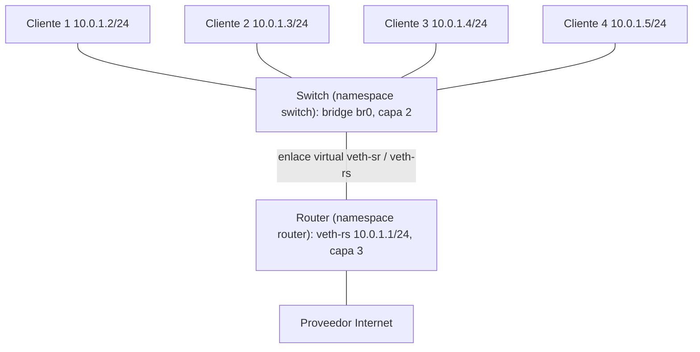

<p class="tema-eyebrow">LABORATORIO 03</p>

# COMPONENTES DE RED Y CONMUTACIÓN

<p class="tema-meta"><span>16 secciones</span><span>1 diagrama</span><span>3 tablas</span></p>

## El próximo reto

Los dos empleados de Networking SecOps ya navegan por Internet, pero la oficina ha crecido: ahora hay cuatro empleados y el bridge del router se ha quedado pequeño. Necesitas separar la conmutación del enrutamiento: un switch dedicado concentrará las conexiones de los cuatro equipos, mientras el router seguirá encargándose de la salida a Internet. Además, deberás observar cómo aprende direcciones MAC el switch y cómo la MTU condiciona el tamaño de los paquetes.

## Introducción técnica

Con dos clientes, el bridge del `router` basta. Con más equipos conviene separar la **conmutación** del **enrutamiento**: un switch concentra las conexiones de los clientes y reenvía cada trama solo al puerto del destinatario, mientras que el router conserva el enrutamiento y el NAT hacia el exterior.

En este laboratorio el switch se construye como un bridge Linux en un *namespace* propio, se conectan cuatro clientes y se observa cómo aprende direcciones MAC, cómo reenvía tramas y cómo la MTU condiciona el tamaño de los paquetes.

## Estado inicial

- Hay dos clientes unidos directamente al bridge del `router`, con salida a Internet por NAT.
- Hacen falta cuatro clientes (Cliente 1 a 4) conectados a un punto de concentración.
- El `router` debe seguir encargándose del enrutamiento y del NAT.

## Resultado que se construirá

Queda una red conmutada: cuatro clientes en un switch (bridge en el *namespace* `switch`) unido al `router` por un enlace propio. Se observan la tabla MAC del bridge, el reenvío de unicast conocido, el *flooding* de unicast desconocido y de broadcast, y el efecto de la MTU, incluida la fragmentación y el mecanismo de descubrimiento de la MTU del camino (PMTUD).

## Herramientas necesarias

-   Linux con privilegios de superusuario.
-   Comandos: `ip`, `ping`, `tcpdump`, `bridge`, `ethtool`.
-   Conocimientos básicos de direccionamiento MAC e IP.

## Topología



El **switch** (namespace `switch`) y el **router** (namespace `router`) son ahora dos equipos lógicos distintos. El bridge `br0` pertenece solo al switch; la dirección IP `10.0.1.1` pertenece a la interfaz `veth-rs` del router, que está conectada al bridge mediante un enlace virtual. Así se separa la función de capa 2 (conmutar tramas) de la de capa 3 (*gateway* hacia otras redes).

**Direccionamiento:**

| Dispositivo | Interfaz | Dirección IP       |
|-------------|----------|--------------------|
| Cliente 1   | veth-c1  | 10.0.1.2/24        |
| Cliente 2   | veth-c2  | 10.0.1.3/24        |
| Cliente 3   | veth-c3  | 10.0.1.4/24        |
| Cliente 4   | veth-c4  | 10.0.1.5/24        |
| Switch      | br0 (puertos `veth-s1`…`veth-s4` y `veth-sr`) | - (capa 2, sin IP) |
| Router (LAN)| veth-rs  | 10.0.1.1/24        |
| Router (WAN)| veth-wan | 192.168.1.2/24    |

## Construcción de la red

### Paso 1: Verificar el estado actual

Asegurémonos de que el laboratorio 02 está funcionando:

```bash
# Verificar namespaces
ip netns list

# Verificar conectividad a Internet
ip netns exec cliente1 ping -c 2 8.8.8.8
```

Si no existen los namespaces, ejecuta los comandos de los laboratorios 01 y 02 para crearlos.

### Paso 2: Eliminar la configuración anterior (bridge del router)

En el laboratorio 01 se crea un bridge `br0` dentro del router para conectar los clientes. Ahora el bridge pasará a un **namespace propio para el switch**, de modo que el router quede solo con funciones de capa 3. Eliminamos el bridge y los cables virtuales anteriores (al borrar un extremo de un par veth desaparece también el otro; los clientes perderán su IP y su ruta, que se reconfiguran en el Paso 7):

```bash
if [ "$(ip netns exec router cat /sys/class/net/lo/ifalias 2>/dev/null)" != networking-lab-owned ]; then
  echo "router no tiene la marca de propiedad Networking Lab; se aborta la migración."
  exit 1
fi
PIDS_ROUTER=$(sudo ip netns pids router 2>/dev/null || true)
if [ -n "$PIDS_ROUTER" ]; then echo "router tiene procesos activos ($PIDS_ROUTER); ciérralos antes de migrar."; exit 1; fi
if ip netns list | awk '{print $1}' | grep -Fxq remote; then
  if [ "$(ip netns exec remote cat /sys/class/net/lo/ifalias 2>/dev/null)" = networking-lab-owned ]; then
    PIDS_REMOTE=$(sudo ip netns pids remote 2>/dev/null || true)
    if [ -n "$PIDS_REMOTE" ]; then echo "remote tiene procesos activos ($PIDS_REMOTE); ciérralos antes de migrar."; exit 1; fi
    ip netns del remote
  else
    echo "Existe remote sin marca de propiedad; se aborta sin modificarlo."; exit 1
  fi
fi
if [ -f /tmp/lab03-pmtud-icmp-drop.added ]; then
  ip netns exec router iptables -D OUTPUT -p icmp --icmp-type fragmentation-needed -d 10.0.1.2 -j DROP 2>/dev/null || true
  rm -f /tmp/lab03-pmtud-icmp-drop.added
fi
if [ -f /tmp/lab03-router-ip_forward.orig ]; then
  ip netns exec router sysctl -w net.ipv4.ip_forward="$(cat /tmp/lab03-router-ip_forward.orig)"
  rm -f /tmp/lab03-router-ip_forward.orig
fi
for dev in br0 veth-r1 veth-r2; do
  if ip netns exec router ip link show "$dev" >/dev/null 2>&1; then
    if [ "$(ip netns exec router cat "/sys/class/net/$dev/ifalias" 2>/dev/null)" = networking-lab-lab-01 ]; then
      ip netns exec router ip link del "$dev"
    else
      echo "Se conserva router/$dev: no tiene marca del laboratorio 01."
      exit 1
    fi
  fi
done
# Retirar reglas antiguas solo si el laboratorio 02 dejó su marcador de propiedad.
if [ -f /tmp/lab02-router-forward-out.added ]; then
  ip netns exec router iptables -D FORWARD -i br0 -o veth-wan -j ACCEPT 2>/dev/null || true
  rm -f /tmp/lab02-router-forward-out.added
elif ip netns exec router iptables -C FORWARD -i br0 -o veth-wan -j ACCEPT 2>/dev/null; then
  echo "Regla heredada br0 detectada sin marcador; se conserva para revisión manual."
fi
if [ -f /tmp/lab02-router-forward-in.added ]; then
  ip netns exec router iptables -D FORWARD -i veth-wan -o br0 -m conntrack --ctstate RELATED,ESTABLISHED -j ACCEPT 2>/dev/null || true
  rm -f /tmp/lab02-router-forward-in.added
elif ip netns exec router iptables -C FORWARD -i veth-wan -o br0 -m conntrack --ctstate RELATED,ESTABLISHED -j ACCEPT 2>/dev/null || ip netns exec router iptables -C FORWARD -i veth-wan -o br0 -m state --state RELATED,ESTABLISHED -j ACCEPT 2>/dev/null; then
  echo "Regla heredada br0 detectada sin marcador; se conserva para revisión manual."
fi
```

!!! info "Transición de reglas de reenvío"
    El Paso 2 elimina las reglas `FORWARD` que el laboratorio 02 haya marcado como propias. Si detecta reglas `br0` sin marcador, las conserva y avisa: no puede demostrar que las creó este proyecto. El Paso 9 instala las reglas equivalentes sobre `veth-rs` y se registra su propiedad. La limpieza final elimina el namespace `router`; por eso sus reglas y contadores desaparecen junto con él.
### Paso 3: Crear el namespace del switch

```bash
ip netns add switch
ip netns exec switch ip link set lo alias networking-lab-owned
```

### Paso 4: Crear el bridge en el switch

```bash
# Crear bridge en el namespace switch
ip netns exec switch ip link add br0 type bridge
ip netns exec switch ip link set br0 up
```

### Paso 5: Crear el namespace del Cliente 3 y Cliente 4

```bash
ip netns add cliente3
ip netns exec cliente3 ip link set lo alias networking-lab-owned
ip netns add cliente4
ip netns exec cliente4 ip link set lo alias networking-lab-owned
```

### Paso 6: Crear interfaces para los 4 clientes

```bash
# Cliente 1
ip link add veth-c1 type veth peer name veth-s1
ip link set veth-c1 alias networking-lab-lab-03
ip link set veth-s1 alias networking-lab-lab-03
ip link set veth-c1 netns cliente1
ip link set veth-s1 netns switch

# Cliente 2
ip link add veth-c2 type veth peer name veth-s2
ip link set veth-c2 alias networking-lab-lab-03
ip link set veth-s2 alias networking-lab-lab-03
ip link set veth-c2 netns cliente2
ip link set veth-s2 netns switch

# Cliente 3
ip link add veth-c3 type veth peer name veth-s3
ip link set veth-c3 alias networking-lab-lab-03
ip link set veth-s3 alias networking-lab-lab-03
ip link set veth-c3 netns cliente3
ip link set veth-s3 netns switch

# Cliente 4
ip link add veth-c4 type veth peer name veth-s4
ip link set veth-c4 alias networking-lab-lab-03
ip link set veth-s4 alias networking-lab-lab-03
ip link set veth-c4 netns cliente4
ip link set veth-s4 netns switch
```

### Paso 7: Configurar los clientes

```bash
# Cliente 1
ip netns exec cliente1 ip addr add 10.0.1.2/24 dev veth-c1
ip netns exec cliente1 ip link set veth-c1 up
ip netns exec cliente1 ip link set lo up
ip netns exec cliente1 ip route add default via 10.0.1.1

# Cliente 2
ip netns exec cliente2 ip addr add 10.0.1.3/24 dev veth-c2
ip netns exec cliente2 ip link set veth-c2 up
ip netns exec cliente2 ip link set lo up
ip netns exec cliente2 ip route add default via 10.0.1.1

# Cliente 3
ip netns exec cliente3 ip addr add 10.0.1.4/24 dev veth-c3
ip netns exec cliente3 ip link set veth-c3 up
ip netns exec cliente3 ip link set lo up
ip netns exec cliente3 ip route add default via 10.0.1.1

# Cliente 4
ip netns exec cliente4 ip addr add 10.0.1.5/24 dev veth-c4
ip netns exec cliente4 ip link set veth-c4 up
ip netns exec cliente4 ip link set lo up
ip netns exec cliente4 ip route add default via 10.0.1.1
```

### Paso 8: Conectar las interfaces del switch al bridge

```bash
# En el namespace switch
ip netns exec switch ip link set veth-s1 master br0
ip netns exec switch ip link set veth-s2 master br0
ip netns exec switch ip link set veth-s3 master br0
ip netns exec switch ip link set veth-s4 master br0
ip netns exec switch ip link set veth-s1 up
ip netns exec switch ip link set veth-s2 up
ip netns exec switch ip link set veth-s3 up
ip netns exec switch ip link set veth-s4 up
```

### Paso 9: Conectar el switch al router

Se necesita un enlace entre el switch y el router:

```bash
# Crear par veth switch-router
ip link add veth-sr type veth peer name veth-rs
ip link set veth-sr alias networking-lab-lab-03
ip link set veth-rs alias networking-lab-lab-03
ip link set veth-sr netns switch
ip link set veth-rs netns router

# Conectar al bridge del switch
ip netns exec switch ip link set veth-sr master br0
ip netns exec switch ip link set veth-sr up

# Configurar IP en el router (interfaz hacia el switch)
ip netns exec router ip addr add 10.0.1.1/24 dev veth-rs
ip netns exec router ip link set veth-rs up
if ! ip netns exec router iptables -C FORWARD -i veth-rs -o veth-wan -j ACCEPT; then
  ip netns exec router iptables -A FORWARD -i veth-rs -o veth-wan -j ACCEPT && touch /tmp/lab03-router-forward-out.added
fi
if ! ip netns exec router iptables -C FORWARD -i veth-wan -o veth-rs -m conntrack --ctstate RELATED,ESTABLISHED -j ACCEPT; then
  ip netns exec router iptables -A FORWARD -i veth-wan -o veth-rs -m conntrack --ctstate RELATED,ESTABLISHED -j ACCEPT && touch /tmp/lab03-router-forward-in.added
fi
```

### Paso 10: Verificar conectividad entre clientes

```bash
# Cliente 1 a Cliente 3
ip netns exec cliente1 ping -c 4 10.0.1.4

# Cliente 2 a Cliente 4
ip netns exec cliente2 ping -c 4 10.0.1.5

# Cliente 3 al router
ip netns exec cliente3 ping -c 4 10.0.1.1
```

**Resultado esperado:** Todas las pruebas con 0% de pérdida.

### Paso 11: Verificar conectividad a Internet

```bash
ip netns exec cliente3 ping -c 4 8.8.8.8
ip netns exec cliente4 curl -I http://google.com
```

Si `curl` no resuelve el nombre, se consulta la nota «DNS dentro de un namespace» del laboratorio 02: cada namespace necesita su propio `/etc/netns/<ns>/resolv.conf`.

## Observación del funcionamiento del switch

### Paso 12: Ver la tabla de direcciones MAC del switch

El switch aprende las direcciones MAC de los dispositivos conectados:

```bash
# Ver tabla MAC del bridge
ip netns exec switch bridge fdb show br br0
```

**Ejemplo de salida** (representativo; las direcciones MAC serán distintas en el equipo, pues Linux las genera al azar; para poder seguirlas, conviene anotarlas con `ip netns exec cliente1 ip link show veth-c1`):

```
5e:1c:9a:03:77:b1 dev veth-s1 master br0
c2:4d:08:6f:12:e4 dev veth-s2 master br0
...
```

**Qué significa cada entrada:** `5e:1c:9a:03:77:b1 dev veth-s1 master br0` quiere decir «la MAC `5e:1c:…` se ha visto como **origen** de una trama recibida por el puerto `veth-s1`; por tanto, las tramas cuyo destino sea esa MAC deben salir por `veth-s1`». El switch **aprende** leyendo la MAC de origen de cada trama entrante y **consulta** la tabla usando la MAC de destino. Solo aparecen las MAC de los equipos que ya han enviado tráfico: si la tabla está vacía, ejecuta antes los pings del Paso 10. Si la MAC de destino no está en la tabla (o es *broadcast*), el switch inunda la trama por todos los puertos excepto el de entrada. Las entradas caducan tras un tiempo de envejecimiento (por defecto, 300 s en Linux).

También se ven entradas con `permanent` o `self`: corresponden a las MAC de las propias interfaces del bridge y no a equipos aprendidos.

### Paso 13: Capturar tráfico en el switch

Para observar cómo el switch reenvía tramas, se captura en el bridge. Debe tenerse en cuenta que `br0` ve el tráfico que **entra o sale por el propio bridge**, no distingue por sí solo por qué puerto físico salió cada trama; para comprobar que el reenvío es selectivo, captura además en un puerto concreto (por ejemplo `-i veth-s4`, que **no** debería ver el ping entre Cliente 1 y Cliente 3 una vez aprendidas las MAC):

```bash
# Capturar en el switch (interfaz br0)
ip netns exec switch tcpdump -i br0 -n -e icmp
```

En otra terminal, se envía un ping de Cliente 1 a Cliente 3:

```bash
ip netns exec cliente1 ping -c 1 10.0.1.4
```

**Interpretación de la captura:**

1.  Cliente 1 envía una trama con **MAC origen = la de `veth-c1`** y **MAC destino = la de `veth-c3`**.
2.  El switch recibe la trama por `veth-s1`.
3.  El switch consulta su tabla MAC y encuentra que la MAC destino está en `veth-s3`.
4.  El switch reenvía la trama **solo por `veth-s3`** (no por los demás puertos).
5.  Cliente 3 recibe la trama y responde.

**Esto demuestra la conmutación en capa 2:** el switch aprende y reenvía solo al puerto correcto, reduciendo el tráfico innecesario. (La primera trama de la conversación puede inundarse si la MAC de destino aún no se conoce, y ARP se envía por *broadcast*.)

!!! info "Bridge Linux frente a switch físico"
    La equivalencia funcional es una herramienta didáctica. Un bridge Linux no reproduce necesariamente funciones propias de un switch empresarial: [STP](https://1.ieee802.org/spanning-tree/) configurado y gestionado por defecto, administración avanzada ([SNMP](https://www.rfc-editor.org/rfc/rfc3411), CLI de proveedor), [QoS](https://www.rfc-editor.org/rfc/rfc2475) por hardware, [PoE](https://1.ieee802.org/maintenance/802-3/), apilado o rendimiento por [ASIC](https://www.ibm.com/think/topics/asic).

## Análisis de MTU

Conviene distinguir cinco magnitudes que suelen confundirse:

| Concepto | Qué es |
|----------|--------|
| **MTU de una interfaz** | Tamaño máximo del **paquete IP** (cabecera IP + datos) que la interfaz puede transmitir. Con 1500, un paquete IP de hasta 1500 bytes. |
| **Carga útil (payload)** | Los datos que van dentro del paquete (en IPv4 sin opciones, 1500 − 20 de cabecera IP = 1480 para TCP/UDP/ICMP). |
| **Tamaño total de la trama Ethernet** | Paquete IP **más** la cabecera Ethernet (14 bytes) y el FCS (4): hasta 1518 bytes con MTU 1500 (1522 con etiqueta 802.1Q). La cabecera Ethernet se añade *fuera* del MTU. |
| **Fragmentación IPv4** | División de un paquete mayor que la MTU en fragmentos, si el bit DF no lo prohíbe. |
| **Path MTU Discovery ([PMTUD](https://www.rfc-editor.org/rfc/rfc1191))** | Mecanismo con el que el origen descubre la MTU más pequeña del camino, enviando paquetes con DF y atendiendo los mensajes ICMP «fragmentation needed». |

### Paso 14: Verificar la MTU actual

```bash
# Ver MTU de las interfaces
ip netns exec cliente1 ip link show veth-c1
```

**Resultado esperado:** `mtu 1500`

### Paso 15: Probar MTU con ping

Se envía un ping con una carga mayor que la MTU. **Debe recordarse:** la opción `-s` de `ping` indica el tamaño de los **datos ICMP**; el paquete IP resultante mide `-s` + 8 (cabecera ICMP) + 20 (cabecera IP). Con `-s 2000` el paquete IP mide 2028 bytes:

```bash
# Ping con 2000 bytes de datos (paquete IP de 2028 bytes: se fragmentará)
ip netns exec cliente1 ping -c 2 -M do -s 2000 10.0.1.4
```

**Resultado esperado:** con `-M do` (prohibir fragmentación) y MTU 1500, el propio `ping` rechaza el envío antes de transmitirlo:

```
ping: local error: message too long, mtu=1500
```

Si en cambio permites la fragmentación (`-M dont` no activa el bit DF; el valor por defecto, `want`, lo activa pero fragmenta localmente cuando el paquete no cabe), el paquete se divide en fragmentos de hasta 1500 bytes, el destino los reensambla y el ping responde con normalidad:

```bash
ip netns exec cliente1 ping -c 2 -M dont -s 2000 10.0.1.4
```

Esto demuestra la importancia de la MTU: los paquetes que exceden el tamaño máximo deben fragmentarse o, si está prohibido, no pueden enviarse. En el tamaño máximo sin fragmentar, `-s 1472` (1472 + 8 + 20 = 1500) funciona con `-M do` y `-s 1473` no.

Este experimento es **local**: el error lo genera el propio origen. En un camino real con varios saltos, PMTUD depende de que los routers intermedios devuelvan ICMP «fragmentation needed» y de que ningún filtro lo bloquee.

### Paso 16: Cambiar MTU (opcional)

Es posible cambiar la MTU para soportar jumboframes entre Cliente 1 y Cliente 3. La MTU debe subirse en **todos los extremos del camino**: ambos clientes y los puertos del switch por los que pasa la trama (el bridge adopta por defecto la menor MTU de sus puertos, por eso también se sube a mano; la MTU de `br0` solo afecta a la interfaz del propio bridge, y es la de cada puerto la que limita lo que se transmite):

```bash
MTU_FILE=/tmp/lab03-mtu.before
if [ -e "$MTU_FILE" ]; then echo "Existe $MTU_FILE; restaura la MTU o ejecuta la limpieza de Lab03."; exit 1; fi
: > "$MTU_FILE"
for spec in "cliente1 veth-c1" "cliente3 veth-c3" "switch veth-s1" "switch veth-s3" "switch br0"; do
  read -r ns dev <<< "$spec"
  mtu=$(ip netns exec "$ns" cat "/sys/class/net/$dev/mtu") || { echo "No se pudo leer MTU de $ns/$dev"; rm -f "$MTU_FILE"; exit 1; }
  printf '%s %s %s\n' "$ns" "$dev" "$mtu" >> "$MTU_FILE"
done
ip netns exec cliente1 ip link set veth-c1 mtu 9000
ip netns exec cliente3 ip link set veth-c3 mtu 9000
ip netns exec switch ip link set veth-s1 mtu 9000
ip netns exec switch ip link set veth-s3 mtu 9000
ip netns exec switch ip link set br0 mtu 9000
```

Ahora un ping con `-s 8972` (8972 + 8 + 20 = 9000) y `-M do` entre Cliente 1 y Cliente 3 debería funcionar. Un ping con `-s 9000` no cabría: sumaría 28 bytes de cabeceras. Los otros puertos del bridge (`veth-s2`, `veth-s4`, `veth-sr`) conservan 1500, de modo que el tráfico hacia ellos sigue limitado por esa MTU. Se restaura al terminar:

```bash
while read -r ns dev mtu; do ip netns exec "$ns" ip link set "$dev" mtu "$mtu"; done < /tmp/lab03-mtu.before
rm -f /tmp/lab03-mtu.before
```

### Prueba: PMTUD a través de un router cuando se bloquea ICMP

El Paso 15 anterior muestra un error local del origen; esta prueba crea un segundo salto con MTU menor para observar PMTUD real. El router ya tiene `10.0.1.1/24` hacia los clientes. Se añade una red remota `10.0.2.0/24` con MTU 1200. Todo se ejecuta dentro de namespaces; no modifica el host.

```bash
sudo ip netns add remote
sudo ip netns exec remote ip link set lo alias networking-lab-owned
sudo ip link add veth-rmt type veth peer name veth-remote
sudo ip link set veth-rmt alias networking-lab-lab-03
sudo ip link set veth-remote alias networking-lab-lab-03
sudo ip link set veth-rmt netns router
sudo ip link set veth-remote netns remote
sudo ip netns exec router ip addr add 10.0.2.1/24 dev veth-rmt
sudo ip netns exec remote ip addr add 10.0.2.2/24 dev veth-remote
sudo ip netns exec router ip link set veth-rmt mtu 1200 up
sudo ip netns exec remote ip link set veth-remote mtu 1200 up
sudo ip netns exec remote ip link set lo up
if [ -e /tmp/lab03-router-ip_forward.orig ]; then echo "Existe /tmp/lab03-router-ip_forward.orig; ejecuta la limpieza de Lab03 antes de repetir."; exit 1; fi
sudo ip netns exec router sysctl -n net.ipv4.ip_forward | sudo tee /tmp/lab03-router-ip_forward.orig >/dev/null
sudo ip netns exec router sysctl -w net.ipv4.ip_forward=1

# El datagrama IP de 1200 bytes (1172 de datos ICMP + 28 de cabeceras) debe pasar.
sudo ip netns exec cliente1 ping -M do -c 2 -s 1172 10.0.2.2

# Un datagrama mayor requiere ICMP type 3/code 4 desde el router.
sudo ip netns exec cliente1 ping -M do -c 2 -s 1300 10.0.2.2 || true

# Bloquear solo el mensaje ICMP Fragmentation Needed dirigido a Cliente 1.
if ! sudo ip netns exec router iptables -C OUTPUT -p icmp --icmp-type fragmentation-needed -d 10.0.1.2 -j DROP; then
  sudo ip netns exec router iptables -I OUTPUT 1 -p icmp --icmp-type fragmentation-needed -d 10.0.1.2 -j DROP && touch /tmp/lab03-pmtud-icmp-drop.added
fi
sudo ip netns exec cliente1 ping -M do -c 2 -W 1 -s 1300 10.0.2.2 || echo "Esperado: sin ICMP de PMTUD, el origen no aprende la MTU del camino."
if [ -f /tmp/lab03-pmtud-icmp-drop.added ]; then
  sudo ip netns exec router iptables -D OUTPUT -p icmp --icmp-type fragmentation-needed -d 10.0.1.2 -j DROP 2>/dev/null || true
  rm -f /tmp/lab03-pmtud-icmp-drop.added
fi

sudo ip netns exec router sysctl -w net.ipv4.ip_forward="$(cat /tmp/lab03-router-ip_forward.orig)"
rm -f /tmp/lab03-router-ip_forward.orig
PIDS_REMOTE=$(sudo ip netns pids remote 2>/dev/null || true)
if [ "$(sudo ip netns exec remote cat /sys/class/net/lo/ifalias 2>/dev/null)" = networking-lab-owned ] && [ -z "$PIDS_REMOTE" ]; then
  sudo ip netns del remote
else
  echo "Se conserva remote: tiene procesos activos o no tiene la marca de propiedad."
fi
```

Para observar el mensaje ICMP, ejecuta en otra terminal antes de repetir el ping grande (si `tcpdump` está instalado):

```bash
sudo ip netns exec router tcpdump -ni veth-rs -c 1 'icmp[0] = 3 and icmp[1] = 4'
```

**Resultado esperado:** con ICMP permitido, el router informa la MTU 1200; al bloquear ese mensaje, el paquete grande deja de progresar y la aplicación puede experimentar un *black hole* de PMTUD. Los paquetes de 1172 bytes de datos siguen pasando. La regla se elimina y el valor original de `ip_forward` se restaura dentro del namespace.

## Pruebas de comportamiento

### Prueba 1: Aprendizaje de direcciones MAC

1.  Limpiar la tabla MAC del switch:

    ```bash
    ip netns exec switch bridge fdb flush dev br0 dynamic
    ```

    La forma extendida de `bridge fdb flush` depende de una versión de `iproute2` que implemente el filtro `dynamic` y del soporte netlink del kernel; no debe fijarse un umbral universal de kernel 6.0. Se comprueba `bridge fdb help`/`bridge -Version`. Si el filtro no está disponible, elimina solo la MAC de prueba con `bridge fdb del LLADDR dev PUERTO master` o espera al envejecimiento dinámico (300 s por defecto).

2.  Enviar un ping de Cliente 1 a Cliente 2.
3.  Ver la tabla MAC nuevamente.
4.  **Interpretación:** el switch aprende la MAC en el primer instante en que recibe una trama cuya MAC de origen pertenece a Cliente 2. El aprendizaje ocurre en el plano de datos al procesar esa trama; no espera al temporizador de envejecimiento. El temporizador solo elimina entradas dinámicas que dejan de renovarse.

### Prueba 2: Broadcast en la red

1.  Enviar un ping de Cliente 1 a la dirección de broadcast `10.0.1.255`:

    ```bash
    ip netns exec cliente1 ping -c 1 -b 10.0.1.255
    ```

    Linux ignora por defecto los ping a broadcast (`net.ipv4.icmp_echo_ignore_broadcasts=1`), así que no se ven respuestas. Para que los demás clientes contesten, ejecuta antes en cada uno: `ip netns exec clienteN sysctl -w net.ipv4.icmp_echo_ignore_broadcasts=0`.

2.  Capturar en el switch para ver cómo se reenvía la trama de broadcast.
3.  **Interpretación:** el broadcast se replica por todos los puertos que pertenecen a la misma VLAN, excepto el puerto de entrada. Este comportamiento permite que los equipos del dominio reciban mensajes de difusión como ARP; la VLAN limita el alcance de esa difusión.

### Prueba 3: Impacto de la MTU en el rendimiento

La prueba se realiza entre `cliente1` y `cliente3`, que comparten el mismo dominio de capa 2: el tráfico **no atraviesa el router**. Por tanto, cambia la MTU solo en los extremos y puertos del bridge que realmente están en ese camino.

1. Medir el throughput con MTU 1500. El servidor se ejecuta como daemon con PID file para poder detenerlo de forma selectiva:

    ```bash
    if [ -e /tmp/lab03-iperf3.pid ]; then echo "Existe /tmp/lab03-iperf3.pid; ejecuta la limpieza de Lab03."; exit 1; fi
    ip netns exec cliente3 iperf3 -s -D -I /tmp/lab03-iperf3.pid
    for n in 1 2 3 4 5; do ip netns exec cliente1 iperf3 -c 10.0.1.4 -P 1 -t 10 -O 2; done
    ```

2. Cambiar la MTU a 9000 en todos los enlaces del camino (`cliente1:veth-c1`, `switch:veth-s1`, `switch:br0`, `switch:veth-s3`, `cliente3:veth-c3`) y repetir exactamente las cinco mediciones con `-P 1`, `-t 10` y `-O 2`:

    ```bash
    MTU_FILE=/tmp/lab03-mtu.before
    if [ -e "$MTU_FILE" ]; then echo "Existe $MTU_FILE; restaura la MTU antes de medir."; exit 1; fi
    : > "$MTU_FILE"
    for spec in "cliente1 veth-c1" "cliente3 veth-c3" "switch veth-s1" "switch veth-s3" "switch br0"; do
      read -r ns dev <<< "$spec"
      mtu=$(ip netns exec "$ns" cat "/sys/class/net/$dev/mtu") || { echo "No se pudo leer MTU de $ns/$dev"; rm -f "$MTU_FILE"; exit 1; }
      printf '%s %s %s\n' "$ns" "$dev" "$mtu" >> "$MTU_FILE"
    done
    ip netns exec cliente1 ip link set veth-c1 mtu 9000
    ip netns exec switch ip link set veth-s1 mtu 9000
    ip netns exec switch ip link set br0 mtu 9000
    ip netns exec switch ip link set veth-s3 mtu 9000
    ip netns exec cliente3 ip link set veth-c3 mtu 9000
    for n in 1 2 3 4 5; do ip netns exec cliente1 iperf3 -c 10.0.1.4 -P 1 -t 10 -O 2; done
    while read -r ns dev mtu; do ip netns exec "$ns" ip link set "$dev" mtu "$mtu"; done < "$MTU_FILE"
    rm -f "$MTU_FILE"
    ```

3. Se registran los cinco valores de bitrate del receptor para cada condición y se compara la **mediana**. Se mantiene constante la dirección, extremos, número de flujos, duración y carga de CPU.
4. **Interpretación:** no existe una mejora garantizada. Los jumboframes reducen la proporción de cabeceras por byte útil, pero en `veth` el límite puede ser CPU, copias de memoria o el propio generador. La comparación válida utiliza la mediana de cinco pruebas por condición; una diferencia menor que la dispersión entre repeticiones no constituye evidencia de mejora.

La diferencia puede ser pequeña o nula en `veth`: el límite puede ser la CPU, el proceso de copia o el generador. Una mejora en esta topología virtual no demuestra por sí sola una mejora en una NIC física.
## Diagnóstico de problemas frecuentes
| Error | Causa | Solución |
|-------|-------|----------|
| Los clientes no pueden hacer ping entre sí | El switch no tiene los puertos en el bridge. | Verificar `bridge link show`. |
| `ping: local error: message too long` | El paquete excede la MTU y se pidió no fragmentar (`-M do`). | Reducir `-s`, aumentar la MTU en todos los enlaces o usar `-M dont`. |
| El switch no aprende MAC | La interfaz está down. | Verificar `ip link set ... up`. |
| No sale a Internet | El router no tiene ruta al switch. | Verificar IP en `veth-rs` y que el switch esté conectado al router. |

## Limpieza del laboratorio

Primero se detiene el servidor `iperf3` de esta práctica y después se eliminan los *namespaces* exclusivos de Lab03. **`router` y los cambios del host no se tocan desde esta sección**: la reversión corresponde a la sección homónima del Laboratorio 02, propietario de `router`, `cliente1`, `cliente2`, NAT, `FORWARD`, `ip_forward`, ruta y `veth-host`.

```bash
PROC_LEFT=0
if [ -s /tmp/lab03-iperf3.pid ]; then
  PID=$(cat /tmp/lab03-iperf3.pid 2>/dev/null || true)
  if [[ "$PID" =~ ^[0-9]+$ ]] && [ -r "/proc/$PID/cmdline" ]; then
    CMDLINE=$(tr '\0' ' ' < "/proc/$PID/cmdline")
    if [[ "$CMDLINE" == *iperf3* && "$CMDLINE" == *"/tmp/lab03-iperf3.pid"* ]]; then sudo kill -TERM "$PID" 2>/dev/null || true
    else echo "PID $PID no coincide con el servidor iperf3 de Lab03; no se detiene."; PROC_LEFT=1
    fi
  fi
fi
sleep 1
if [ -s /tmp/lab03-iperf3.pid ]; then
  PID=$(cat /tmp/lab03-iperf3.pid 2>/dev/null || true)
  if [[ "$PID" =~ ^[0-9]+$ ]] && [ -r "/proc/$PID/cmdline" ]; then
    CMDLINE=$(tr '\0' ' ' < "/proc/$PID/cmdline")
    if [[ "$CMDLINE" == *iperf3* && "$CMDLINE" == *"/tmp/lab03-iperf3.pid"* ]]; then sudo kill -KILL "$PID" 2>/dev/null || true; fi
  fi
fi

NS_LEFT=0
if sudo ip netns list | awk '{print $1}' | grep -Fxq cliente1; then
  if [ "$(sudo ip netns exec cliente1 cat /sys/class/net/lo/ifalias 2>/dev/null)" != networking-lab-owned ]; then echo "Se conserva cliente1: no tiene la marca exclusiva de Lab01."; NS_LEFT=1
  else PIDS_C1=$(sudo ip netns pids cliente1 2>/dev/null || true); if [ -n "$PIDS_C1" ]; then echo "Se conserva cliente1: hay procesos activos ($PIDS_C1)."; NS_LEFT=1; fi
  fi
fi
if [ -f /tmp/lab03-router-ip_forward.orig ] || [ -f /tmp/lab03-pmtud-icmp-drop.added ] || [ -f /tmp/lab03-router-forward-out.added ] || [ -f /tmp/lab03-router-forward-in.added ]; then
  if [ "$(sudo ip netns exec router cat /sys/class/net/lo/ifalias 2>/dev/null)" != networking-lab-owned ]; then echo "Se conserva router: no tiene la marca de propiedad de Lab01."; NS_LEFT=1
  else PIDS_ROUTER=$(sudo ip netns pids router 2>/dev/null || true); if [ -n "$PIDS_ROUTER" ]; then echo "Se conserva router: hay procesos activos ($PIDS_ROUTER)."; NS_LEFT=1; fi
  fi
fi
for ns in switch cliente3 cliente4 remote; do
  if sudo ip netns list | awk '{print $1}' | grep -Fxq "$ns"; then
    if [ "$(sudo ip netns exec "$ns" cat /sys/class/net/lo/ifalias 2>/dev/null)" != networking-lab-owned ]; then echo "Se conserva $ns: no tiene la marca de propiedad Networking Lab."; NS_LEFT=1
    else
      PIDS=$(sudo ip netns pids "$ns" 2>/dev/null || true)
      if [ -n "$PIDS" ]; then echo "Se conserva $ns: hay procesos activos ($PIDS); ciérralos desde su terminal."; NS_LEFT=1; fi
    fi
  fi
done
if [ "$NS_LEFT" = 0 ] && [ "$PROC_LEFT" = 0 ]; then
  if [ -f /tmp/lab03-mtu.before ]; then
    while read -r ns dev mtu; do
      if sudo ip netns list | awk '{print $1}' | grep -Fxq "$ns"; then sudo ip netns exec "$ns" ip link set "$dev" mtu "$mtu" 2>/dev/null || true; fi
    done < /tmp/lab03-mtu.before
    rm -f /tmp/lab03-mtu.before
  fi
  if sudo ip netns list | awk '{print $1}' | grep -Fxq router; then
    if [ -f /tmp/lab03-router-forward-out.added ]; then sudo ip netns exec router iptables -D FORWARD -i veth-rs -o veth-wan -j ACCEPT 2>/dev/null || true; fi
    if [ -f /tmp/lab03-router-forward-in.added ]; then sudo ip netns exec router iptables -D FORWARD -i veth-wan -o veth-rs -m conntrack --ctstate RELATED,ESTABLISHED -j ACCEPT 2>/dev/null || true; fi
    if [ -f /tmp/lab03-pmtud-icmp-drop.added ]; then sudo ip netns exec router iptables -D OUTPUT -p icmp --icmp-type fragmentation-needed -d 10.0.1.2 -j DROP 2>/dev/null || true; fi
    if [ -f /tmp/lab03-router-ip_forward.orig ]; then sudo ip netns exec router sysctl -w net.ipv4.ip_forward="$(cat /tmp/lab03-router-ip_forward.orig)"; fi
  fi
  rm -f /tmp/lab03-router-forward-out.added /tmp/lab03-router-forward-in.added /tmp/lab03-pmtud-icmp-drop.added /tmp/lab03-router-ip_forward.orig
  for ns in switch cliente3 cliente4 remote; do
    if sudo ip netns list | awk '{print $1}' | grep -Fxq "$ns"; then sudo ip netns del "$ns" 2>/dev/null || true; fi
  done
  rm -f /tmp/lab03-iperf3.pid /tmp/lab03-mtu.before
  for f in /sys/class/net/*/ifalias; do
    [ -r "$f" ] || continue
    [ "$(cat "$f")" = networking-lab-lab-03 ] || continue
    dev=${f%/ifalias}; dev=${dev##*/}
    sudo ip link del "$dev" 2>/dev/null || true
  done
else echo "Se conservan namespaces y marcadores de Lab03: hay procesos o recursos sin marca que requieren inspección."; fi
```

Cuando termine esta sección, ejecuta la reversión del Laboratorio 02 para retirar el router compartido y restaurar el estado original del host.

## Profundización: algoritmo de conmutación y FDB

Un switch aprende observando la **MAC de origen** de cada trama recibida; no aprende una MAC porque alguien haya hecho ping a esa dirección. Para cada VLAN/dominio de bridge, el comportamiento básico es:

1. Recibe una trama por un puerto y aprende `MAC_origen → puerto`.
2. Si la MAC destino es broadcast/multicast, replica según las reglas de la VLAN.
3. Si la MAC destino unicast está en la FDB, reenvía solo por el puerto aprendido (si no es el puerto de entrada).
4. Si la MAC destino unicast no está en la FDB, realiza flooding por los puertos elegibles, excepto el de entrada.
5. Las entradas dinámicas envejecen; las estáticas no siguen necesariamente el mismo temporizador.

### Experimento predictivo

Antes de ejecutar, conviene anotar qué puertos deberían recibir cada trama. Después se ejecuta:

```bash
for dev in veth-s1 veth-s2 veth-s3 veth-s4 veth-sr; do
  sudo ip netns exec switch bridge fdb flush dev "$dev" dynamic
 done
sudo ip netns exec switch bridge fdb show br br0
sudo ip netns exec cliente1 ping -c 1 10.0.1.3
sudo ip netns exec switch bridge fdb show br br0
```

Se repite desde un cliente hacia otro destino no contactado y se compara la captura en los puertos del switch. La FDB se llena con MAC **de origen** de las tramas observadas. El primer unicast puede inundarse si el destino todavía no está aprendido; la respuesta suele permitir aprender ambas MAC.

### MTU y PMTUD

`ping -M do -s N` controla el tamaño de la carga ICMP, no el tamaño total de la trama Ethernet: añade cabecera IP e ICMP. Con IPv4 sin opciones, el tamaño del paquete IP es aproximadamente `N + 28` bytes. Si un router no puede fragmentar un paquete con DF, debe devolver ICMP Destination Unreachable / Fragmentation Needed (tipo 3, código 4). Si ese ICMP se filtra, PMTUD clásico puede fallar de forma silenciosa; no concluyas que todo paquete perdido es un problema de MTU.

El cambio a MTU 9000 debe compararse con pruebas repetidas y la misma carga, duración, CPU y dirección de prueba. Una variación de `iperf3` en veth no demuestra por sí sola una mejora física de jumbo frames.

## Análisis técnico y decisiones

El bridge aprende la MAC de origen de cada trama y la asocia al puerto de entrada en su FDB. Cuando conoce la MAC destino, reenvía por el puerto asociado; si la desconoce, inunda la trama por los demás puertos de la misma VLAN, excepto el de entrada. El broadcast se replica dentro del dominio de broadcast; un unicast conocido se dirige a un puerto concreto. Borrar una entrada provoca aprendizaje posterior y, mientras tanto, flooding de unicast desconocido. Un bridge Linux reproduce la conmutación básica, pero no sustituye todas las funciones de un switch gestionable: ASIC, telemetría, políticas avanzadas, PoE y operación del fabricante. VLAN y STP amplían la segmentación y evitan bucles de capa 2.

## Estado final

Queda implementada una red conmutada con cuatro clientes y un switch Linux, con comunicación verificada entre clientes y hacia el router, y con la tabla MAC observada durante el aprendizaje.

Un bridge Linux reproduce la conmutación básica, pero no sustituye las funciones de un switch gestionable (ASIC, telemetría, PoE ni políticas avanzadas). La MTU debe coincidir en todos los extremos del camino para evitar fragmentación y pérdida de rendimiento.

# ¡Bien hecho!

La oficina ya cuenta con un switch dedicado que conecta a los cuatro empleados, y el router mantiene la salida a Internet. Has observado cómo el switch aprende direcciones MAC, cómo reenvía tramas de forma selectiva y cómo la MTU condiciona el tamaño de los paquetes. En el Laboratorio 04 dividiremos la red en subredes para organizar el tráfico por grupos.

## Continuidad técnica

La empresa queda con cuatro clientes conectados a un switch, y el switch unido al router con salida a Internet. Con dos departamentos nuevos, en el laboratorio 04 la red se divide en subredes con VLSM y el router pasa a encaminar entre ellas.
