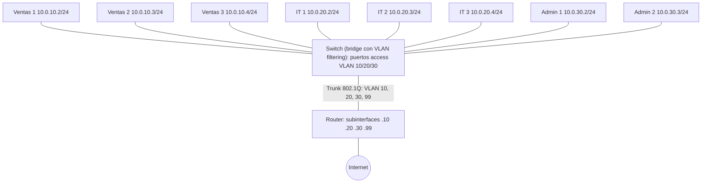
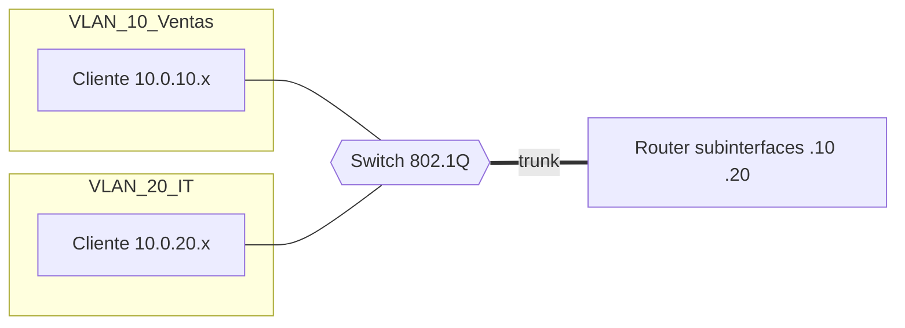

<p class="tema-eyebrow">LABORATORIO 05</p>

# CONMUTACIÓN Y SEGMENTACIÓN DE RED

<p class="tema-meta"><span>12 secciones</span><span>2 diagramas</span><span>2 tablas</span></p>

## Contexto empresarial

La empresa **Networking SecOps** ha crecido y ahora tiene **tres departamentos** con necesidades de red independientes:

-   **Ventas**: 10 empleados, necesitan acceso a Internet y a un servidor de archivos.
-   **IT/Sistemas**: 6 empleados, administran servidores y necesitan acceso restringido.
-   **Administración**: 4 empleados, incluyendo directivos que requieren acceso a datos sensibles.

La red actual tiene subredes separadas (Ventas e IT) pero **comparten el mismo switch físico**. Esto significa que:

-   El tráfico broadcast de un departamento afecta a los otros.
-   No hay separación a nivel de capa 2: todos comparten el mismo dominio de broadcast.
-   Un problema de capa 2 (por ejemplo, una tormenta de broadcast) en un departamento puede afectar a los demás.

Se necesita **segmentar la red lógicamente en capa 2** usando **VLANs** para:

-   Separar los dominios de broadcast entre departamentos.
-   Reducir la exposición a nivel de enlace (un puerto de un departamento deja de recibir las tramas de otro).
-   Facilitar la administración y expansión.

!!! warning "Las VLAN no son por sí solas una barrera de seguridad suficiente"
    Las VLAN **separan dominios de broadcast**. La comunicación **entre** ellas pasa por el router y debe controlarse mediante **enrutamiento y políticas de filtrado** (véase el apartado «Seguridad entre VLAN»). Una VLAN mal configurada (por ejemplo, un [trunk](https://www.cisco.com/c/en/us/support/docs/lan-switching/virtual-lans-vlan/10023-3.html) que admite VLAN que no debería) también puede romper la separación.

!!! note "Continuidad con el laboratorio 04"
    Aquí el direccionamiento cambia: pasamos de las subredes VLSM de `10.0.0.0/24` a redes `/24` independientes por VLAN (`10.0.10.0/24`, `10.0.20.0/24`, `10.0.30.0/24`). No es una corrección del laboratorio 04: es **otro escenario**. En el 04 el objetivo era practicar el reparto de direcciones; en este, estudiar la segmentación de capa 2, para lo cual cada VLAN con su propia subred `/24` resulta más clara. Ambas tablas **no describen la misma infraestructura**.

## Problema inicial

-   Todos los clientes están en el mismo switch físico (bridge).
-   Las subredes están separadas lógicamente, pero comparten el mismo dominio de broadcast.
-   Se necesitan **3 VLANs**: VLAN 10 (Ventas), VLAN 20 (IT), VLAN 30 (Administración).
-   El router debe enrutar entre VLANs mediante **subinterfaces (Router-on-a-Stick)**.
-   El switch debe soportar **trunking (802.1Q)** para transportar múltiples VLANs.

## Objetivos del laboratorio

1.  Comprender el concepto de **direcciones MAC** y su papel en la conmutación.
2.  Implementar **VLANs** para segmentar una red física en dominios lógicos.
3.  Configurar **trunking ([IEEE](https://www.ieee.org/) 802.1Q)** para transportar múltiples VLANs.
4.  Implementar **Router-on-a-Stick** con subinterfaces para enrutar entre VLANs.
5.  Analizar los **dominios de broadcast** y cómo las VLANs los segmentan.
6.  Diferenciar la **separación en capa 2** (VLAN) del **control del tráfico entre segmentos** (enrutamiento y filtrado).

## Herramientas necesarias

-   Linux con privilegios de superusuario.
-   Comandos: `ip` (incluido `ip link … type vlan` para las subinterfaces), `ping`, `tcpdump`, `bridge`.

## Diseño de VLANs y direccionamiento

| VLAN | Nombre | Subred | Gateway |
|------|--------|--------|---------|
| 10 | Ventas | 10.0.10.0/24 | 10.0.10.1 |
| 20 | IT | 10.0.20.0/24 | 10.0.20.1 |
| 30 | Administración | 10.0.30.0/24 | 10.0.30.1 |
| 99 | Gestión (plano de administración, etiquetada) | 10.0.99.0/30 | - (sin gateway: red de gestión local) |

**VLAN 99 — plano de gestión.** No es una VLAN departamental ni un enlace de tránsito hacia otra red: es la red por la que se **administran los equipos de red**. Sus dos únicos miembros son el router (`10.0.99.1/30`, subinterfaz `veth-rs.99`) y la interfaz de gestión del switch (`10.0.99.2/30`, interfaz `br0.99`). Ningún cliente pertenece a ella. Tiene sentido un `/30` porque solo hay dos dispositivos.

**Gateways.** La dirección `.1` de cada VLAN corresponde a una **subinterfaz del router** (`veth-rs.10`, `.20`, `.30`). Quien enruta entre VLAN es el router; el switch, que opera en capa 2, no enruta.

## Topología



**Access y trunk.** Un puerto **access** pertenece a una sola VLAN; el equipo final transmite y recibe tramas **sin etiqueta** y el switch las etiqueta internamente (`pvid untagged`). Un puerto **trunk** transporta varias VLAN a la vez y las tramas viajan **con etiqueta 802.1Q** (4 bytes que incluyen el identificador de VLAN), de modo que el otro extremo sabe a qué VLAN pertenece cada una.

## Construcción de la red

### Paso 1: Preparar el entorno

Este paso solo limpia una ejecución anterior de Lab05. No elimina interfaces ni namespaces de otros laboratorios; ejecuta primero la reversión de la práctica propietaria.

```bash
NS_LAB="ventas1 ventas2 ventas3 it1 it2 it3 admin1 admin2 router switch"
IF_LAB="veth-host"
EXISTENTES=$(sudo ip netns list | awk '{print $1}' | while read -r ns; do
  for esperado in $NS_LAB; do [ "$ns" = "$esperado" ] && echo "$ns"; done
done)
for ns in $EXISTENTES; do
  if [ "$(sudo ip netns exec "$ns" cat /sys/class/net/lo/ifalias 2>/dev/null)" != networking-lab-lab-05 ]; then echo "Se aborta: $ns no tiene marca de propiedad."; exit 1; fi
  PIDS=$(sudo ip netns pids "$ns" 2>/dev/null || true)
  if [ -n "$PIDS" ]; then echo "$ns tiene procesos activos ($PIDS); ejecuta la limpieza antes de repetir Lab05."; exit 1; fi
done
IF_EXISTENTES=$(ip -o link show | awk -F': ' '{print $2}' | cut -d@ -f1 | grep -Fx "$IF_LAB" || true)
for dev in $IF_EXISTENTES; do
  if [ "$(cat /sys/class/net/$dev/ifalias 2>/dev/null)" != networking-lab-lab-05 ]; then echo "Se aborta: $dev no tiene la marca exacta de Lab05."; exit 1; fi
done
for f in /tmp/lab05-host-nat.added /tmp/lab05-forward-out.added /tmp/lab05-forward-in.added /tmp/lab05-ip_forward.orig; do
  if [ -e "$f" ]; then echo "Existe el marcador $f; ejecuta la reversión completa antes de repetir Lab05."; exit 1; fi
done
printf 'Namespaces propios: %s\nInterfaces propias: %s\n' "${EXISTENTES:-(ninguno)}" "${IF_EXISTENTES:-(ninguna)}"
if [ -n "$EXISTENTES$IF_EXISTENTES" ]; then
  read -r -p "¿Eliminar únicamente los recursos de Lab05 indicados? (s/N) " CONFIRMAR
  [ "$CONFIRMAR" = s ] || { echo "Cancelado"; exit 1; }
  for ns in $EXISTENTES; do sudo ip netns del "$ns"; done
  for dev in $IF_EXISTENTES; do sudo ip link del "$dev"; done
fi
```

### Paso 2: Crear namespaces

```bash
ip netns add router
ip netns exec router ip link set lo alias networking-lab-lab-05
ip netns add switch
ip netns exec switch ip link set lo alias networking-lab-lab-05
ip netns add ventas1
ip netns exec ventas1 ip link set lo alias networking-lab-lab-05
ip netns add ventas2
ip netns exec ventas2 ip link set lo alias networking-lab-lab-05
ip netns add ventas3
ip netns exec ventas3 ip link set lo alias networking-lab-lab-05
ip netns add it1
ip netns exec it1 ip link set lo alias networking-lab-lab-05
ip netns add it2
ip netns exec it2 ip link set lo alias networking-lab-lab-05
ip netns add it3
ip netns exec it3 ip link set lo alias networking-lab-lab-05
ip netns add admin1
ip netns exec admin1 ip link set lo alias networking-lab-lab-05
ip netns add admin2
ip netns exec admin2 ip link set lo alias networking-lab-lab-05
```

### Paso 3: Crear bridge con VLAN filtering

```bash
ip netns exec switch ip link add br0 type bridge
ip netns exec switch ip link set br0 type bridge vlan_filtering 1 vlan_default_pvid 0
ip netns exec switch ip link set br0 up
```

### Paso 4: Configurar clientes VLAN 10 (Ventas)

```bash
# Ventas 1
ip link add veth-v1 type veth peer name veth-sv1
ip link set veth-v1 alias networking-lab-lab-05
ip link set veth-sv1 alias networking-lab-lab-05
ip link set veth-v1 netns ventas1
ip link set veth-sv1 netns switch
ip netns exec ventas1 ip addr add 10.0.10.2/24 dev veth-v1
ip netns exec ventas1 ip link set veth-v1 up
ip netns exec ventas1 ip route add default via 10.0.10.1
ip netns exec switch ip link set veth-sv1 master br0
ip netns exec switch ip link set veth-sv1 up
ip netns exec switch bridge vlan add dev veth-sv1 vid 10 pvid untagged

# Ventas 2
ip link add veth-v2 type veth peer name veth-sv2
ip link set veth-v2 alias networking-lab-lab-05
ip link set veth-sv2 alias networking-lab-lab-05
ip link set veth-v2 netns ventas2
ip link set veth-sv2 netns switch
ip netns exec ventas2 ip addr add 10.0.10.3/24 dev veth-v2
ip netns exec ventas2 ip link set veth-v2 up
ip netns exec ventas2 ip route add default via 10.0.10.1
ip netns exec switch ip link set veth-sv2 master br0
ip netns exec switch ip link set veth-sv2 up
ip netns exec switch bridge vlan add dev veth-sv2 vid 10 pvid untagged

# Ventas 3
ip link add veth-v3 type veth peer name veth-sv3
ip link set veth-v3 alias networking-lab-lab-05
ip link set veth-sv3 alias networking-lab-lab-05
ip link set veth-v3 netns ventas3
ip link set veth-sv3 netns switch
ip netns exec ventas3 ip addr add 10.0.10.4/24 dev veth-v3
ip netns exec ventas3 ip link set veth-v3 up
ip netns exec ventas3 ip route add default via 10.0.10.1
ip netns exec switch ip link set veth-sv3 master br0
ip netns exec switch ip link set veth-sv3 up
ip netns exec switch bridge vlan add dev veth-sv3 vid 10 pvid untagged
```

### Paso 5: Configurar clientes VLAN 20 (IT)

```bash
# IT 1
ip link add veth-i1 type veth peer name veth-si1
ip link set veth-i1 alias networking-lab-lab-05
ip link set veth-si1 alias networking-lab-lab-05
ip link set veth-i1 netns it1
ip link set veth-si1 netns switch
ip netns exec it1 ip addr add 10.0.20.2/24 dev veth-i1
ip netns exec it1 ip link set veth-i1 up
ip netns exec it1 ip route add default via 10.0.20.1
ip netns exec switch ip link set veth-si1 master br0
ip netns exec switch ip link set veth-si1 up
ip netns exec switch bridge vlan add dev veth-si1 vid 20 pvid untagged

# IT 2
ip link add veth-i2 type veth peer name veth-si2
ip link set veth-i2 alias networking-lab-lab-05
ip link set veth-si2 alias networking-lab-lab-05
ip link set veth-i2 netns it2
ip link set veth-si2 netns switch
ip netns exec it2 ip addr add 10.0.20.3/24 dev veth-i2
ip netns exec it2 ip link set veth-i2 up
ip netns exec it2 ip route add default via 10.0.20.1
ip netns exec switch ip link set veth-si2 master br0
ip netns exec switch ip link set veth-si2 up
ip netns exec switch bridge vlan add dev veth-si2 vid 20 pvid untagged

# IT 3
ip link add veth-i3 type veth peer name veth-si3
ip link set veth-i3 alias networking-lab-lab-05
ip link set veth-si3 alias networking-lab-lab-05
ip link set veth-i3 netns it3
ip link set veth-si3 netns switch
ip netns exec it3 ip addr add 10.0.20.4/24 dev veth-i3
ip netns exec it3 ip link set veth-i3 up
ip netns exec it3 ip route add default via 10.0.20.1
ip netns exec switch ip link set veth-si3 master br0
ip netns exec switch ip link set veth-si3 up
ip netns exec switch bridge vlan add dev veth-si3 vid 20 pvid untagged
```

### Paso 6: Configurar clientes VLAN 30 (Administración)

```bash
# Admin 1
ip link add veth-a1 type veth peer name veth-sa1
ip link set veth-a1 alias networking-lab-lab-05
ip link set veth-sa1 alias networking-lab-lab-05
ip link set veth-a1 netns admin1
ip link set veth-sa1 netns switch
ip netns exec admin1 ip addr add 10.0.30.2/24 dev veth-a1
ip netns exec admin1 ip link set veth-a1 up
ip netns exec admin1 ip route add default via 10.0.30.1
ip netns exec switch ip link set veth-sa1 master br0
ip netns exec switch ip link set veth-sa1 up
ip netns exec switch bridge vlan add dev veth-sa1 vid 30 pvid untagged

# Admin 2
ip link add veth-a2 type veth peer name veth-sa2
ip link set veth-a2 alias networking-lab-lab-05
ip link set veth-sa2 alias networking-lab-lab-05
ip link set veth-a2 netns admin2
ip link set veth-sa2 netns switch
ip netns exec admin2 ip addr add 10.0.30.3/24 dev veth-a2
ip netns exec admin2 ip link set veth-a2 up
ip netns exec admin2 ip route add default via 10.0.30.1
ip netns exec switch ip link set veth-sa2 master br0
ip netns exec switch ip link set veth-sa2 up
ip netns exec switch bridge vlan add dev veth-sa2 vid 30 pvid untagged
```

### Paso 7: Configurar trunk (802.1Q)

```bash
ip link add veth-sr type veth peer name veth-rs
ip link set veth-sr alias networking-lab-lab-05
ip link set veth-rs alias networking-lab-lab-05
ip link set veth-sr netns switch
ip link set veth-rs netns router
ip netns exec switch ip link set veth-sr master br0
ip netns exec switch ip link set veth-sr up
ip netns exec switch bridge vlan add dev veth-sr vid 10
ip netns exec switch bridge vlan add dev veth-sr vid 20
ip netns exec switch bridge vlan add dev veth-sr vid 30
ip netns exec switch bridge vlan add dev veth-sr vid 99
```

Al añadir las VLAN **sin** `pvid untagged`, el puerto `veth-sr` las transporta **etiquetadas**: esto es lo que lo convierte en trunk. Las tramas sin etiqueta que llegaran a este puerto no se asignarían a ninguna VLAN (por `vlan_default_pvid 0`) y se descartarían.

**Interfaz de gestión del switch (VLAN 99).** El propio bridge participa en la VLAN 99 mediante una interfaz VLAN sobre `br0`:

```bash
ip netns exec switch bridge vlan add dev br0 vid 99 self
ip netns exec switch ip link add link br0 name br0.99 type vlan id 99
ip netns exec switch ip addr add 10.0.99.2/30 dev br0.99
ip netns exec switch ip link set br0.99 up
```

### Paso 8: Configurar Router-on-a-Stick

```bash
ip netns exec router sysctl -w net.ipv4.ip_forward=1
ip netns exec router ip link add link veth-rs name veth-rs.10 type vlan id 10
ip netns exec router ip link add link veth-rs name veth-rs.20 type vlan id 20
ip netns exec router ip link add link veth-rs name veth-rs.30 type vlan id 30
ip netns exec router ip link add link veth-rs name veth-rs.99 type vlan id 99
ip netns exec router ip addr add 10.0.10.1/24 dev veth-rs.10
ip netns exec router ip addr add 10.0.20.1/24 dev veth-rs.20
ip netns exec router ip addr add 10.0.30.1/24 dev veth-rs.30
ip netns exec router ip addr add 10.0.99.1/30 dev veth-rs.99
ip netns exec router ip link set veth-rs up
ip netns exec router ip link set veth-rs.10 up
ip netns exec router ip link set veth-rs.20 up
ip netns exec router ip link set veth-rs.30 up
ip netns exec router ip link set veth-rs.99 up
```

Cada subinterfaz recibe solo las tramas etiquetadas con su VLAN y se convierte en el **gateway** de esa subred; al reenviar entre subinterfaces, el router quita una etiqueta y pone otra. Este es el esquema *Router-on-a-Stick*: un único enlace físico (o virtual) con varias subinterfaces lógicas.

### Paso 9: Configurar NAT y salida a Internet

!!! danger "Cambio en el host (no en un namespace)"
    Este paso crea `veth-host` en el equipo real, activa `net.ipv4.ip_forward` y añade una regla `MASQUERADE` en el host. El bloque guarda el valor original de `ip_forward` y registra si añadió la regla NAT; la reversión está en la sección «Revertir los cambios del host».

```bash
ip link add veth-host type veth peer name veth-wan
ip link set veth-host alias networking-lab-lab-05
ip link set veth-wan alias networking-lab-lab-05
ip link set veth-host alias networking-lab-lab-05
ip link set veth-wan netns router
ip netns exec router ip addr add 192.168.1.2/24 dev veth-wan
ip netns exec router ip link set veth-wan up
ip addr add 192.168.1.1/24 dev veth-host
ip link set veth-host up

# El router necesita ruta por defecto hacia el host y NAT hacia fuera
ip netns exec router ip route add default via 192.168.1.1
ip netns exec router iptables -t nat -A POSTROUTING -o veth-wan -j MASQUERADE

# Política de seguridad: denegar por defecto y permitir solo flujos explícitos.
ip netns exec router iptables -P FORWARD DROP
ip netns exec router iptables -A FORWARD -m conntrack --ctstate INVALID -j DROP
ip netns exec router iptables -A FORWARD -m conntrack --ctstate ESTABLISHED,RELATED -j ACCEPT
# Las VLAN de usuarios pueden salir a WAN.
for vlan in 10 20 30; do
  ip netns exec router iptables -A FORWARD -i "veth-rs.$vlan" -o veth-wan -j ACCEPT
done
# Administración puede diagnosticar Ventas e IT; los demás cruces quedan denegados.
ip netns exec router iptables -A FORWARD -i veth-rs.30 -o veth-rs.10 -p icmp -j ACCEPT
ip netns exec router iptables -A FORWARD -i veth-rs.30 -o veth-rs.20 -p icmp -j ACCEPT
ip netns exec router iptables -A FORWARD -i veth-rs.30 -o veth-rs.10 -p tcp --dport 22 -j ACCEPT
ip netns exec router iptables -A FORWARD -i veth-rs.30 -o veth-rs.20 -p tcp --dport 22 -j ACCEPT

# El host reenvía y traduce hacia tu red real (cambia eth0 por tu interfaz de salida)
if [ ! -e /tmp/lab05-ip_forward.orig ]; then
  sysctl -n net.ipv4.ip_forward > /tmp/lab05-ip_forward.orig
fi
sysctl -w net.ipv4.ip_forward=1
if ! iptables -t nat -C POSTROUTING -s 192.168.1.0/24 -o eth0 -j MASQUERADE; then
  iptables -t nat -A POSTROUTING -s 192.168.1.0/24 -o eth0 -j MASQUERADE && touch /tmp/lab05-host-nat.added
fi

# Si el firewall del host tiene FORWARD en DROP, autoriza solo este enlace y el retorno establecido.
if ! iptables -C FORWARD -i veth-host -o eth0 -s 192.168.1.0/24 -j ACCEPT; then
  iptables -I FORWARD 1 -i veth-host -o eth0 -s 192.168.1.0/24 -j ACCEPT && touch /tmp/lab05-forward-out.added
fi
if ! iptables -C FORWARD -i eth0 -o veth-host -d 192.168.1.0/24 -m conntrack --ctstate RELATED,ESTABLISHED -j ACCEPT; then
  iptables -I FORWARD 1 -i eth0 -o veth-host -d 192.168.1.0/24 -m conntrack --ctstate RELATED,ESTABLISHED -j ACCEPT && touch /tmp/lab05-forward-in.added
fi
```

El router traduce (NAT) todo lo que sale por `veth-wan`, así que el host solo ve la red `192.168.1.0/24` y **no necesita una ruta de retorno** hacia las VLAN.

### Paso 10: Verificar conectividad

```bash
# Misma VLAN
ip netns exec ventas1 ping -c 4 10.0.10.3

# Entre VLANs: Ventas -> IT debe quedar bloqueado por la política.
if ip netns exec ventas1 ping -c 2 -W 1 10.0.20.2; then
  echo "ERROR: Ventas alcanzó IT pese a la política de denegación por defecto"
  exit 1
else
  echo "OK: Ventas -> IT denegado"
fi
# Administración puede diagnosticar IT por la regla explícita.
ip netns exec admin1 ping -c 4 10.0.20.2

# Internet: el resultado depende de la salida real y de los filtros ICMP del proveedor.
ip netns exec ventas1 ping -c 4 -W 2 8.8.8.8 || echo "ICMP externo no disponible; no concluyas que la salida TCP falla."
ip netns exec ventas1 nc -vz -w 3 1.1.1.1 443 || echo "TCP/443 externo no disponible; prueba contra un destino HTTPS controlado."
ip netns exec ventas1 curl -I --connect-timeout 5 https://example.com || echo "HTTPS/DNS externo no disponible; revisa primero DNS y salida WAN."

# Gestión (VLAN 99): router ↔ switch
ip netns exec router ping -c 2 10.0.99.2
```

**Resultado esperado:** la misma VLAN conserva conectividad; Ventas no alcanza IT porque el router aplica `FORWARD DROP`; Administración sí puede enviar ICMP a IT por una regla explícita. La prueba de Internet no es determinista: el host, el proveedor o el destino pueden filtrar ICMP. No uses un ping externo como único criterio de conectividad.

### Comprobar las VLAN permitidas en el trunk

Un trunk solo transporta las VLAN que se le han asignado. Consulta qué admite cada puerto:

```bash
ip netns exec switch bridge vlan show
```

`veth-sr` debe listar las VLAN 10, 20, 30 y 99 (sin `PVID` ni `Egress Untagged`: viajan etiquetadas). Retira una y observa el efecto:

```bash
ip netns exec switch bridge vlan del dev veth-sr vid 30
ip netns exec admin1 ping -c 2 -W 1 10.0.30.1      # sin respuesta: la VLAN 30 ya no llega al router
ip netns exec ventas1 ping -c 2 10.0.20.2          # las demás VLAN siguen funcionando
ip netns exec switch bridge vlan add dev veth-sr vid 30   # restaurar
```

Una VLAN que existe en los puertos de acceso pero **no** está permitida en el trunk queda aislada: los equipos se ven entre sí en el switch, pero no pueden salir hacia el router.

### Seguridad entre VLAN

La política ya parte de **denegar por defecto**. Su orden importa: primero descarta `INVALID`, después permite `ESTABLISHED,RELATED`, luego autoriza salidas a WAN y, finalmente, permite únicamente el diagnóstico ICMP/[SSH](https://www.rfc-editor.org/rfc/rfc4251) desde Administración hacia Ventas e IT. Cualquier otro cruce inter-VLAN queda bloqueado. La VLAN separa dominios de broadcast; el firewall L3 aplica la política entre ellos.

| Flujo | Política |
|---|---|
| Ventas / IT / Administración → WAN | Permitir |
| Administración → Ventas / IT (ICMP y TCP/22) | Permitir explícitamente |
| Ventas ↔ IT y demás cruces entre VLAN | Denegar por defecto |
| Tráfico `ESTABLISHED,RELATED` | Permitir retorno |
| Tráfico `INVALID` | Denegar |
| Cualquier otro flujo reenviado | Denegar por política `FORWARD DROP` |

Inspecciona reglas y contadores:

```bash
ip netns exec router iptables -S FORWARD
ip netns exec router iptables -L FORWARD -n -v --line-numbers
ip netns exec router conntrack -L 2>/dev/null | head -30
```

Si `conntrack` no está instalado, instala el paquete `conntrack` con `sudo apt-get install -y conntrack`. Para observar eventos en tiempo real, ejecuta `ip netns exec router conntrack -E` en otra terminal y genera conexiones desde los clientes.

### Subred frente a VLAN

Son conceptos distintos que suelen coincidir en la práctica (una VLAN ↔ una subred):

| Aspecto | Subred | VLAN |
|---------|--------|------|
| Capa | 3 (direccionamiento IP) | 2 (conmutación) |
| Qué define | Rango de direcciones y máscara | Dominio de *broadcast* |
| Cómo se separa | Con rutas y máscaras | Con etiquetas 802.1Q y puertos |
| Cómo se comunican dos | Un router o equipo de capa 3 | Un router (*Router-on-a-Stick*) o *switch* L3 |



Dos VLAN no se ven entre sí en capa 2 aunque estén en el mismo *switch*; para comunicarlas hace falta enrutar. **Segmentar no es lo mismo que proteger**: el filtrado entre VLAN lo decide el router.

## Observación

```bash
# Ver VLANs
ip netns exec switch bridge vlan show

# Capturar trunk
ip netns exec switch tcpdump -i veth-sr -n -e -v
```

En `bridge vlan show` verás `veth-sv1` con `10 PVID Egress Untagged` (acceso VLAN 10) y `veth-sr` con las VLAN 10, 20, 30 y 99 **sin** PVID ni *Untagged* (trunk etiquetado). En la captura del trunk, `tcpdump -e` mostrará `vlan 10, p 0` (o 20, 30) en cada trama: es la etiqueta 802.1Q. Si no la ves, captura en `veth-rs` del lado del router; algunas versiones ocultan la etiqueta cuando el kernel la extrae como metadato.

## Revertir los cambios del host

```bash
NS_LEFT=0
for ns in router switch ventas1 ventas2 ventas3 it1 it2 it3 admin1 admin2; do
  if sudo ip netns list | awk '{print $1}' | grep -Fxq "$ns"; then
    if [ "$(sudo ip netns exec "$ns" cat /sys/class/net/lo/ifalias 2>/dev/null)" != networking-lab-lab-05 ]; then echo "Se conserva $ns: no tiene la marca exclusiva de Lab05."; NS_LEFT=1
    else
      PIDS=$(sudo ip netns pids "$ns" 2>/dev/null || true)
      if [ -n "$PIDS" ]; then echo "Se conserva $ns: quedan procesos activos ($PIDS); deténlos desde su terminal."; NS_LEFT=1; fi
    fi
  fi
done
if [ "$NS_LEFT" = 0 ]; then
  for ns in router switch ventas1 ventas2 ventas3 it1 it2 it3 admin1 admin2; do
    if sudo ip netns list | awk '{print $1}' | grep -Fxq "$ns"; then sudo ip netns del "$ns" 2>/dev/null || true; fi
  done
  if [ -f /tmp/lab05-host-nat.added ]; then iptables -t nat -D POSTROUTING -s 192.168.1.0/24 -o eth0 -j MASQUERADE 2>/dev/null || true; rm -f /tmp/lab05-host-nat.added; fi
  if [ -f /tmp/lab05-forward-out.added ]; then iptables -D FORWARD -i veth-host -o eth0 -s 192.168.1.0/24 -j ACCEPT 2>/dev/null || true; rm -f /tmp/lab05-forward-out.added; fi
  if [ -f /tmp/lab05-forward-in.added ]; then iptables -D FORWARD -i eth0 -o veth-host -d 192.168.1.0/24 -m conntrack --ctstate RELATED,ESTABLISHED -j ACCEPT 2>/dev/null || true; rm -f /tmp/lab05-forward-in.added; fi
  if [ -f /tmp/lab05-ip_forward.orig ]; then sysctl -w net.ipv4.ip_forward="$(cat /tmp/lab05-ip_forward.orig)"; rm -f /tmp/lab05-ip_forward.orig; fi
  if [ "$(cat /sys/class/net/veth-host/ifalias 2>/dev/null)" = networking-lab-lab-05 ]; then ip link del veth-host; fi
  for f in /sys/class/net/*/ifalias; do
    [ -r "$f" ] || continue
    [ "$(cat "$f")" = networking-lab-lab-05 ] || continue
    dev=${f%/ifalias}; dev=${dev##*/}
    ip link del "$dev" 2>/dev/null || true
  done
else
  echo "Se conservan reglas host, enlaces y marcadores; hay procesos activos en namespaces."
fi
```

## Profundización: recorrido de una trama 802.1Q

Sigue una trama de Ventas desde el host hasta otro segmento. En el puerto access entra sin etiqueta; el switch la clasifica usando el PVID configurado; la FDB se consulta dentro del contexto de VLAN; al salir por el trunk se añade la etiqueta 802.1Q (TPID 0x8100 y TCI con PCP/DEI/VID); la subinterfaz del router recibe la VLAN correspondiente y el router realiza una decisión de capa 3. Al salir hacia el puerto access de destino, el switch transmite sin etiqueta si ese puerto está configurado como access/PVID.

La VLAN nativa en equipos reales puede permitir tramas sin etiqueta en un trunk. Este laboratorio usa `vlan_default_pvid 0` para evitar asignaciones implícitas; no extrapoles esa decisión a todos los fabricantes ni asumas que una trama sin etiqueta siempre pertenece a VLAN 1.

### Captura comparativa

```bash
sudo ip netns exec cliente1 tcpdump -eni veth-c1 'arp or icmp'
sudo ip netns exec switch tcpdump -eni veth-s1 'vlan or arp or icmp'
sudo ip netns exec router tcpdump -eni any 'vlan or arp or icmp'
```

Ejecuta un ping entre VLAN permitidas y compara dónde aparece el encabezado 802.1Q. La captura depende del punto de observación y de offloads; si la etiqueta no aparece donde la esperas, contrasta `bridge vlan show`, `ip -d link show` y la captura en ambos extremos antes de declarar un fallo.

### Matriz de fallos controlados

| Fallo introducido | Síntoma probable | Evidencia que lo localiza |
|---|---|---|
| VLAN ausente del puerto access | Host queda aislado o en VLAN distinta | `bridge vlan show`, captura sin tráfico esperado |
| VID no permitido en trunk | Solo falla ese segmento a través del trunk | VLAN permitidas y captura en ambos extremos |
| PVID incorrecto | Trama sin etiqueta clasificada en VLAN equivocada | PVID del puerto y tabla VLAN |
| Gateway incorrecto | L2 local funciona; salida a otras redes falla | `ip route`, `ip route get`, ARP del gateway |
| Subinterfaz ausente | El trunk transporta la VLAN pero no hay routing | `ip -d link`, direcciones y rutas del router |
| Regla FORWARD bloqueante | Ruta y ARP correctos, tráfico inter-VLAN descartado | Contadores del firewall y captura a ambos lados |

No dejes reglas temporales ni cambios de PVID al terminar; restaura la configuración de la topología siguiendo la limpieza del laboratorio.


## Preguntas de reflexión

1.  ¿Qué mecanismo impide que un *broadcast* de la VLAN 10 llegue a la VLAN 20?
2.  ¿Qué sucedería si el trunk no permitiera la VLAN 30?
3.  ¿Qué diferencia hay entre el puerto de acceso (`Untagged`) y el trunk en la salida de `bridge vlan show`?
4.  ¿Qué limitaciones tiene *Router-on-a-Stick* cuando el tráfico entre VLAN es elevado?
5.  ¿Qué otro mecanismo podría enrutar entre VLAN? (Un *switch* de capa 3.)

## Conclusiones técnicas

En este laboratorio hemos implementado VLANs, trunking (802.1Q) y Router-on-a-Stick para segmentar la red en dominios de broadcast independientes.

-   Las **VLAN separan dominios de broadcast en capa 2**; no son por sí solas una barrera de seguridad.
-   El **enrutamiento entre VLAN** lo realiza el router (subinterfaces), no el switch de capa 2.
-   El tráfico entre VLAN solo se restringe con **filtrado en el router**.
-   La VLAN 99 representa el plano de **gestión** de los dispositivos de red.

## Preparación para el siguiente laboratorio

Con las VLAN, la sede tiene **dominios de broadcast separados** y un router que los comunica. Pero una empresa rara vez es una sola sede: las LAN segmentadas necesitan **mecanismos de enrutamiento** para conectarse con sucursales. En el **Laboratorio 06** pasamos de segmentar una red a **interconectar varias redes** con rutas estáticas, rutas alternativas y túneles GRE.

---

**¡Laboratorio 05 completado!** Continúa con el **Laboratorio 06**.
