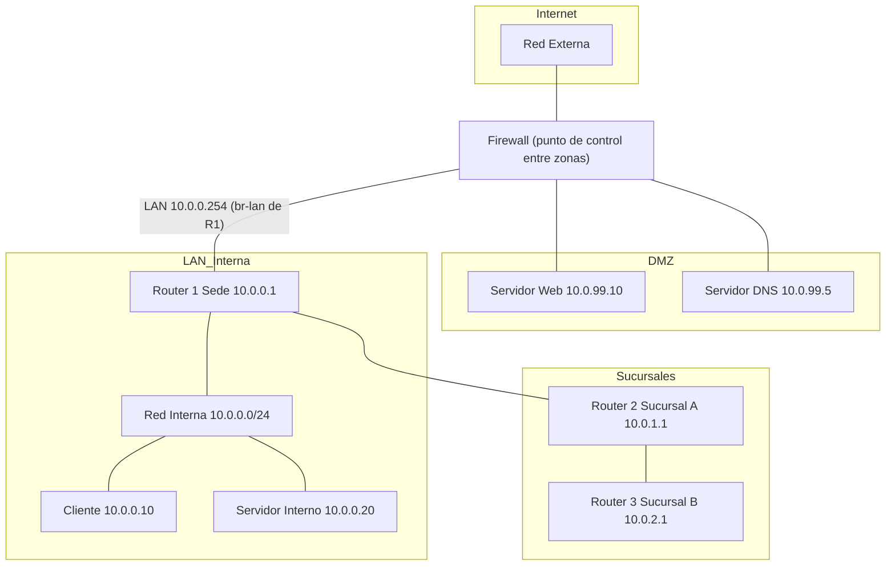
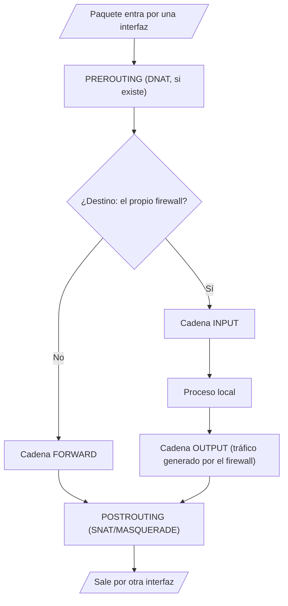

<p class="tema-eyebrow">LABORATORIO 08</p>

# SEGURIDAD EN REDES

<p class="tema-meta"><span>18 secciones</span><span>2 diagramas</span><span>9 tablas</span></p>

## Primero, protegerse

Con los servicios básicos funcionando (laboratorio 07), el equipo de seguridad y el CISO identifican que la red debe protegerse de amenazas internas y externas: controlar el tráfico entre zonas, restringir los servicios administrativos, aislar los servidores públicos y cifrar las comunicaciones. En este laboratorio implementarás un firewall con `iptables`, ACL, una DMZ, SSH con verificación del servidor y un servicio TLS de pruebas, y comprobarás cada medida con tráfico permitido y bloqueado.

## Introducción técnica

Hasta aquí todo el tráfico entre redes está permitido: los servicios administrativos se exponen a toda la red, no hay segmentación para servidores públicos y las comunicaciones internas no se cifran.

Este laboratorio introduce un **firewall** con `iptables`, listas de control de acceso para restringir los servicios administrativos, una **DMZ** para aislar los servidores públicos, acceso **SSH** con verificación de identidad del servidor y **TLS** con un certificado autofirmado. Cada medida se prueba con tráfico permitido y con tráfico que debe quedar bloqueado.

## Objetivos de aprendizaje

Al terminar este laboratorio deberías poder:

- explicar cómo procesa `iptables` un paquete: cadenas, política por defecto y seguimiento de estado;
- distinguir una ACL, una DMZ y el DNAT, y explicar qué publica realmente cada uno;
- distinguir cifrado de validación de identidad (huella SSH, certificado TLS);
- comprobar cada medida con tráfico permitido y con tráfico bloqueado.

### Conocimientos previos y relación con la práctica anterior

- **Conocimientos previos:** Laboratorios 06 y 07: enrutamiento y servicios. Firewall, zonas, cadenas, estado de conexión, DNAT, SSH y TLS se explican en este laboratorio.
- **Relación con la práctica anterior:** *Continúa el escenario anterior.* Requiere el laboratorio 07 funcionando (se comprueba al inicio) y extiende su topología con una DMZ y medidas de seguridad. El `br-wan` que se crea aquí lo conserva el laboratorio 10.

## Estado inicial

- El tráfico entre redes no se controla: todo está permitido.
- SSH está expuesto a toda la red.
- Los servidores públicos comparten segmento con los equipos internos.
- Las comunicaciones de aplicación no están cifradas y no hay políticas definidas.

## Resultado que se construirá

Queda un firewall con política por defecto restrictiva y reglas explícitas entre tres zonas (LAN interna, DMZ e «Internet»); una DMZ con un servidor web (`10.0.99.10`) y un DNS público (`10.0.99.5`) que no alcanza la LAN; SSH con clave y huella del servidor verificada; y un servidor HTTPS de pruebas. Se comprueban los flujos permitidos y los bloqueados, y se contrasta cada medida con los principios de la tríada [CIA](https://csrc.nist.gov/glossary/term/cia_triad).

## Herramientas necesarias

- Linux con privilegios de superusuario.
- Comandos: `ip`, `ping`, `iptables`, `nft` (opcional).
- `openssl` para generar certificados TLS.
- `ssh` para acceso remoto seguro.

## Topología

La topología extiende la del laboratorio 07 agregando una DMZ y medidas de seguridad.



El **firewall es el punto de control entre las tres zonas** (Externa, DMZ e Interna): todo el tráfico entre ellas debe atravesarlo, y no basta con dibujar una conexión. Qué puede alcanzar cada zona queda definido por las reglas del Paso 8:

| Origen \ Destino | Externa | DMZ | Interna |
|------------------|:-------:|:---:|:-------:|
| **Externa** | — | Solo servicios publicados (80/443 al web, 53/UDP al DNS) | Denegado |
| **DMZ** | Denegado (no hay regla de salida) | — | Denegado |
| **Interna** | Permitido (con NAT) | Limitado: ICMP, SSH y HTTPS | — |

Las respuestas a conexiones ya establecidas se permiten por seguimiento de estado (`ESTABLISHED,RELATED`).

**Cómo se conectan R1 y el firewall.** Ambos están en el **mismo segmento de capa 2** de la sede: el firewall (`10.0.0.254`) se une al bridge `br-lan` de R1 (Paso 6). Los equipos internos (clientes y servidor interno) usan como *gateway* predeterminado a **R1 (`10.0.0.1`)**; R1 conoce las sucursales y envía al firewall (`10.0.0.254`) todo lo que no conoce (su ruta por defecto). El firewall, a su vez, devuelve a R1 el tráfico hacia las sucursales (`10.0.1.0/24` y `10.0.2.0/24`).

**Direccionamiento:**

| Dispositivo | Interfaz | Dirección IP | Zona |
|-------------|----------|--------------|------|
| Firewall | veth-fw-wan (WAN) | 192.168.100.1/24 (host: 192.168.100.2/24) | Externa |
| Firewall | br-dmz (DMZ) | 10.0.99.1/24 | DMZ |
| Firewall | veth-fw-lan (LAN) | 10.0.0.254/24 | Interna |
| R1 (Sede) | `br-lan` (LAN) | 10.0.0.1/24 | Interna |
| R1 (Sede) | `veth-r1r2` (R1-R2) | 192.168.1.1/30 | Interna |
| R2 (Sucursal A) | `veth-r2c` (LAN) | 10.0.1.1/24 | Interna |
| R3 (Sucursal B) | `veth-r3c` (LAN) | 10.0.2.1/24 | Interna |
| Servidor Web | - | 10.0.99.10/24 | DMZ |
| Servidor DNS | - | 10.0.99.5/24 | DMZ |
| Cliente Interno (`clienteSede`) | - | 10.0.0.10/24 | Interna |
| Servidor Interno | - | 10.0.0.20/24 | Interna |

## Construcción de la red

### Paso 1: Verificar infraestructura existente

Asegurémonos de que el laboratorio 07 está funcionando:

```bash
# Verificar namespaces
sudo ip netns list

# El cliente DHCP sigue en la LAN y alcanza a una sucursal
sudo ip netns exec clienteDHCP ip -4 addr show dev veth-dhcpcl
sudo ip netns exec clienteDHCP ping -c 2 10.0.1.10
```

Si el cliente perdió su concesión DHCP, se renueva con `sudo ip netns exec clienteDHCP dhclient -pf /tmp/lab07/dhclient.pid -lf /tmp/lab07/dhclient.leases veth-dhcpcl`. Se comprueba que no existan namespaces de una ejecución anterior del laboratorio 08:

```bash
for ns in firewall servidorWeb servidorDNS_PUB servidorInterno; do
  if sudo ip netns list | awk '{print $1}' | grep -qx "$ns"; then
    echo "El namespace $ns ya existe: ejecuta la limpieza del laboratorio 08 antes de repetirlo"
    exit 1
  fi
done
sudo apt-get install -y openssh-server openssh-client openssl conntrack
```

### Paso 2: El firewall pasa a ser la única salida

Hasta ahora R1 tenía su propia salida a Internet. Con un firewall perimetral, **toda la salida debe pasar por él**. Se elimina la WAN de R1 (al borrar `veth-wan` desaparece también `veth-host` del host, junto con la ruta por defecto de R1 y su IP `192.168.100.2`):

```bash
if [ -e /tmp/lab08 ]; then
  if [ -f /tmp/lab08/.networking-lab-lab-08 ]; then echo "Existe una ejecución anterior del laboratorio 08; ejecuta su limpieza.";
  else echo "/tmp/lab08 existe sin marca de propiedad; no se modifica."; fi
  exit 1
fi
if [ "$(sudo ip netns exec R1 cat /sys/class/net/veth-wan/ifalias 2>/dev/null)" != networking-lab-lab-07 ] || [ "$(cat /sys/class/net/veth-host/ifalias 2>/dev/null)" != networking-lab-lab-07 ]; then
  echo "La WAN de R1 no conserva las marcas del laboratorio 07; se aborta sin eliminarla."
  exit 1
fi
mkdir -p /tmp/lab08
touch /tmp/lab08/.networking-lab-lab-08
sudo ip netns exec R1 ip route show default > /tmp/lab08/R1-default.before
if [ -f /tmp/lab07/R1-nat.added ] && sudo ip netns exec R1 iptables -t nat -C POSTROUTING -o veth-wan -j MASQUERADE; then
  sudo ip netns exec R1 iptables -t nat -D POSTROUTING -o veth-wan -j MASQUERADE
  touch /tmp/lab08/R1-nat-removed.added
fi
sudo ip netns exec R1 ip link del veth-wan
touch /tmp/lab08/r1-wan-removed.added
```

### Paso 3: Crear namespaces para firewall y DMZ

```bash
# Firewall
sudo ip netns add firewall
sudo ip netns exec firewall ip link set lo alias networking-lab-lab-08

# Servidores DMZ
sudo ip netns add servidorWeb
sudo ip netns exec servidorWeb ip link set lo alias networking-lab-lab-08
sudo ip netns add servidorDNS_PUB
sudo ip netns exec servidorDNS_PUB ip link set lo alias networking-lab-lab-08

# Servidor Interno
sudo ip netns add servidorInterno
sudo ip netns exec servidorInterno ip link set lo alias networking-lab-lab-08
```

### Paso 4: Conectar el firewall a la zona externa (WAN)

El host hace de "Internet". Su lado de la WAN será un bridge (`br-wan`) para poder conectar más equipos "externos" en el Laboratorio 09:

```bash
# ⚠ CAMBIOS EN EL HOST (no en un namespace): bridge, IP, ip_forward y NAT.
#   Anota antes `sysctl net.ipv4.ip_forward`; reversión al final del laboratorio.
# Bridge del lado Internet (en el host). No reutilizar nombres preexistentes.
if [ -e /sys/class/net/br-wan ] || [ -e /sys/class/net/veth-wan-fw ]; then
  echo "br-wan o veth-wan-fw ya existe; ejecuta la reversión del lab08 y verifica su propiedad antes de continuar."
  exit 1
fi
sudo ip link add br-wan type bridge
sudo ip link set br-wan up
sudo ip addr add 192.168.100.2/24 dev br-wan
sudo ip link set br-wan alias networking-lab-lab-08

# Enlace firewall <-> Internet
sudo ip link add veth-fw-wan type veth peer name veth-wan-fw
sudo ip link set veth-fw-wan alias networking-lab-lab-08
sudo ip link set veth-wan-fw alias networking-lab-lab-08
sudo ip link set veth-fw-wan netns firewall
sudo ip netns exec firewall ip addr add 192.168.100.1/24 dev veth-fw-wan
sudo ip netns exec firewall ip link set veth-fw-wan up
sudo ip link set veth-wan-fw master br-wan
sudo ip link set veth-wan-fw up
sudo ip netns exec firewall ip route add default via 192.168.100.2

# El host reenvía y traduce hacia la red real (cambia eth0 por tu interfaz de salida).
# El valor original de ip_forward y la creación de la regla NAT quedan registrados para revertirlos.
if [ ! -e /tmp/lab08-ip_forward.orig ]; then
  sudo sysctl -n net.ipv4.ip_forward | sudo tee /tmp/lab08-ip_forward.orig >/dev/null
fi
sudo sysctl -w net.ipv4.ip_forward=1
if ! sudo iptables -t nat -C POSTROUTING -s 192.168.100.0/24 -o eth0 -j MASQUERADE; then
  sudo iptables -t nat -A POSTROUTING -s 192.168.100.0/24 -o eth0 -j MASQUERADE && touch /tmp/lab08-host-nat.added
fi
# El host también filtra FORWARD. Autoriza solo la WAN de este laboratorio y el retorno establecido.
if ! sudo iptables -C FORWARD -i br-wan -o eth0 -s 192.168.100.0/24 -j ACCEPT; then
  sudo iptables -I FORWARD 1 -i br-wan -o eth0 -s 192.168.100.0/24 -j ACCEPT && touch /tmp/lab08-forward-out.added
fi
if ! sudo iptables -C FORWARD -i eth0 -o br-wan -d 192.168.100.0/24 -m conntrack --ctstate RELATED,ESTABLISHED -j ACCEPT; then
  sudo iptables -I FORWARD 1 -i eth0 -o br-wan -d 192.168.100.0/24 -m conntrack --ctstate RELATED,ESTABLISHED -j ACCEPT && touch /tmp/lab08-forward-in.added
fi
```

### Paso 5: Crear la DMZ (un único segmento con los dos servidores)

Los dos servidores públicos comparten **una sola subred** (`10.0.99.0/24`) y por tanto un único segmento de capa 2. Se logra con un bridge dentro del firewall: la IP `10.0.99.1` es la del firewall (el *gateway* de la DMZ) y cada servidor tiene una IP **distinta**.

```bash
# Bridge de la DMZ en el firewall
sudo ip netns exec firewall ip link add br-dmz type bridge
sudo ip netns exec firewall ip addr add 10.0.99.1/24 dev br-dmz
sudo ip netns exec firewall ip link set br-dmz up

# Servidor Web (10.0.99.10)
sudo ip link add veth-web type veth peer name veth-fw-web
sudo ip link set veth-web alias networking-lab-lab-08
sudo ip link set veth-fw-web alias networking-lab-lab-08
sudo ip link set veth-web netns servidorWeb
sudo ip link set veth-fw-web netns firewall
sudo ip netns exec firewall ip link set veth-fw-web master br-dmz
sudo ip netns exec firewall ip link set veth-fw-web up
sudo ip netns exec servidorWeb ip addr add 10.0.99.10/24 dev veth-web
sudo ip netns exec servidorWeb ip link set veth-web up
sudo ip netns exec servidorWeb ip link set lo up
sudo ip netns exec servidorWeb ip route add default via 10.0.99.1

# Servidor DNS público (10.0.99.5)
sudo ip link add veth-dnspub type veth peer name veth-fw-dnspub
sudo ip link set veth-dnspub alias networking-lab-lab-08
sudo ip link set veth-fw-dnspub alias networking-lab-lab-08
sudo ip link set veth-dnspub netns servidorDNS_PUB
sudo ip link set veth-fw-dnspub netns firewall
sudo ip netns exec firewall ip link set veth-fw-dnspub master br-dmz
sudo ip netns exec firewall ip link set veth-fw-dnspub up
sudo ip netns exec servidorDNS_PUB ip addr add 10.0.99.5/24 dev veth-dnspub
sudo ip netns exec servidorDNS_PUB ip link set veth-dnspub up
sudo ip netns exec servidorDNS_PUB ip link set lo up
sudo ip netns exec servidorDNS_PUB ip route add default via 10.0.99.1
```

### Paso 6: Conectar el firewall a la LAN interna

El firewall se une al bridge `br-lan` de R1 con la IP `10.0.0.254`. R1 pasa a enviarle todo lo que no conoce (su nueva ruta por defecto), y el firewall conoce las sucursales a través de R1.

```bash
# Firewall dentro de la LAN de la sede
sudo ip link add veth-fw-lan type veth peer name veth-lan-fw
sudo ip link set veth-fw-lan alias networking-lab-lab-08
sudo ip link set veth-lan-fw alias networking-lab-lab-08
sudo ip link set veth-fw-lan netns firewall
sudo ip link set veth-lan-fw netns R1
sudo ip netns exec firewall ip addr add 10.0.0.254/24 dev veth-fw-lan
sudo ip netns exec firewall ip link set veth-fw-lan up
sudo ip netns exec R1 ip link set veth-lan-fw master br-lan
sudo ip netns exec R1 ip link set veth-lan-fw up

# R1 envía su tráfico externo al firewall
sudo ip netns exec R1 ip route replace default via 10.0.0.254

# Servidor Interno (10.0.0.20) en la misma LAN
sudo ip link add veth-srv type veth peer name veth-r1srv
sudo ip link set veth-srv alias networking-lab-lab-08
sudo ip link set veth-r1srv alias networking-lab-lab-08
sudo ip link set veth-srv netns servidorInterno
sudo ip link set veth-r1srv netns R1
sudo ip netns exec R1 ip link set veth-r1srv master br-lan
sudo ip netns exec R1 ip link set veth-r1srv up
sudo ip netns exec servidorInterno ip addr add 10.0.0.20/24 dev veth-srv
sudo ip netns exec servidorInterno ip link set veth-srv up
sudo ip netns exec servidorInterno ip link set lo up
sudo ip netns exec servidorInterno ip route add default via 10.0.0.1
```

El cliente interno es `clienteSede` (`10.0.0.10`, del laboratorio 06): ya está en la LAN y no hay que tocarlo.

### Paso 7: Configurar el firewall (reenvío y rutas)

```bash
# Habilitar forwarding
sudo ip netns exec firewall sysctl -w net.ipv4.ip_forward=1

# Rutas hacia las sucursales (la LAN 10.0.0.0/24 ya es directa)
sudo ip netns exec firewall ip route add 10.0.1.0/24 via 10.0.0.1
sudo ip netns exec firewall ip route add 10.0.2.0/24 via 10.0.0.1
```

### Paso 8: Reglas de firewall (iptables)

Definimos "red interna" como `10.0.0.0/22`, que agrupa la sede (`10.0.0.0/24`) y las sucursales (`10.0.1.0/24`, `10.0.2.0/24`).

**Política por defecto: denegar todo**

Una política de firewall se evalúa **por cadena, dirección y zona**, no solo por puerto. En Netfilter hay que distinguir:

| Tipo de tráfico | Cadena | Ejemplo aquí |
|-----------------|--------|--------------|
| Entrante (destinado al propio firewall) | `INPUT` | SSH al firewall: denegado por la política |
| Reenviado (atraviesa el firewall entre zonas) | `FORWARD` | Internet → DMZ, LAN → Internet |
| Saliente (generado por el propio firewall) | `OUTPUT` | Aceptado por defecto |
| Respuestas de conexiones establecidas | `INPUT`/`FORWARD` con `state` | Aceptadas por las reglas `ESTABLISHED,RELATED` |

Casi todas las reglas de este laboratorio son de `FORWARD` porque el firewall controla tráfico que **lo atraviesa**; una regla de `INPUT` no afecta a ese tráfico.

```bash
# Establecer políticas por defecto
sudo ip netns exec firewall iptables -P INPUT DROP
sudo ip netns exec firewall iptables -P FORWARD DROP
sudo ip netns exec firewall iptables -P OUTPUT ACCEPT

# Permitir tráfico de loopback
sudo ip netns exec firewall iptables -A INPUT -i lo -j ACCEPT

# Permitir conexiones establecidas y relacionadas
sudo ip netns exec firewall iptables -A INPUT -m conntrack --ctstate ESTABLISHED,RELATED -j ACCEPT
sudo ip netns exec firewall iptables -A FORWARD -m conntrack --ctstate ESTABLISHED,RELATED -j ACCEPT
```

**Reglas desde Internet hacia DMZ (servidores públicos):**

```bash
# Servidor Web (puerto 80 y 443)
sudo ip netns exec firewall iptables -A FORWARD -i veth-fw-wan -o br-dmz -p tcp -d 10.0.99.10 --dport 80 -j ACCEPT
sudo ip netns exec firewall iptables -A FORWARD -i veth-fw-wan -o br-dmz -p tcp -d 10.0.99.10 --dport 443 -j ACCEPT

# Servidor DNS (puerto 53 UDP)
sudo ip netns exec firewall iptables -A FORWARD -i veth-fw-wan -o br-dmz -p udp -d 10.0.99.5 --dport 53 -j ACCEPT
```

!!! info "Permitir el reenvío no equivale a publicar el servicio"
    Estas reglas permiten el reenvío **si el paquete llega con ese destino** por la interfaz externa. En una red real, los servidores de la DMZ tienen direcciones privadas y para publicarlos se necesita además una traducción de destino (**[DNAT](https://netfilter.org/documentation/HOWTO/NAT-HOWTO-6.html)**) o direccionamiento público, junto con las rutas y políticas de seguridad. Aquí, para probar, el host añade una ruta directa hacia la DMZ (Paso 10).

**Reglas desde Internet hacia LAN Interna (denegado):**

```bash
# Denegar explícitamente (la política ya lo hace; esta regla permite contar los intentos)
sudo ip netns exec firewall iptables -A FORWARD -i veth-fw-wan -o veth-fw-lan -j DROP
```

**Reglas desde LAN Interna hacia Internet (permitido):**

```bash
# NAT para salida a Internet
sudo ip netns exec firewall iptables -t nat -A POSTROUTING -o veth-fw-wan -j MASQUERADE
sudo ip netns exec firewall iptables -A FORWARD -i veth-fw-lan -o veth-fw-wan -j ACCEPT
```

**Reglas desde LAN Interna hacia DMZ (administración y pruebas):**

```bash
# Ping, SSH y HTTPS hacia el servidor web; SSH hacia el DNS público
sudo ip netns exec firewall iptables -A FORWARD -i veth-fw-lan -o br-dmz -s 10.0.0.0/22 -p icmp --icmp-type echo-request -j ACCEPT
sudo ip netns exec firewall iptables -A FORWARD -i veth-fw-lan -o br-dmz -s 10.0.0.0/22 -p tcp -d 10.0.99.10 -m multiport --dports 22,443 -j ACCEPT
sudo ip netns exec firewall iptables -A FORWARD -i veth-fw-lan -o br-dmz -s 10.0.0.0/22 -p tcp -d 10.0.99.5 --dport 22 -j ACCEPT
```

**Reglas desde DMZ hacia LAN Interna (denegado):**

```bash
# Principio de mínimo privilegio: una DMZ comprometida no debe alcanzar la LAN
sudo ip netns exec firewall iptables -A FORWARD -i br-dmz -o veth-fw-lan -j DROP
```

Un servidor público **no debe recibir acceso irrestricto a la red interna**: la comunicación DMZ → LAN debe limitarse a políticas explícitas (por ejemplo, solo el puerto de base de datos de un servidor concreto, si la aplicación lo requiere). Aquí se deniega por completo. Se observa también que el lado contrario (LAN → DMZ) está **acotado**: solo ICMP, SSH y HTTPS hacia hosts concretos, y no «todo».

!!! info "[ACL](https://www.cisco.com/c/en/us/td/docs/switches/lan/c9000/security/acls/acls-configuration-guide/access-control-lists.html) frente a firewall con seguimiento de estado"
    Una **ACL** es un mecanismo de control de tráfico (una lista ordenada de reglas permitir/denegar) que puede aplicarse en distintos puntos: un router, un switch, una interfaz. Una ACL clásica evalúa cada paquete de forma independiente. Un **firewall con seguimiento de estado** (como `iptables` con `conntrack` o `nftables`) además recuerda las conexiones y permite automáticamente las respuestas. En este laboratorio las reglas de `FORWARD` con `-m conntrack --ctstate` actúan como firewall con estado; las reglas que restringen orígenes y puertos (por ejemplo `-s 10.0.0.0/22`) se comportan como las ACL.

### Recorrido de un paquete por el firewall

La cadena que se aplica depende de **de dónde viene y a dónde va** el paquete:



### DNAT y [SNAT](https://netfilter.org/documentation/HOWTO/NAT-HOWTO-6.html)

| Traducción | Qué cambia | Para qué sirve | Aquí |
|------------|------------|----------------|------|
| **SNAT / MASQUERADE** | La IP de **origen** (en POSTROUTING) | Salida de redes privadas a Internet | `MASQUERADE` en `veth-fw-wan` |
| **DNAT** | La IP de **destino** (en PREROUTING) | **Publicar** un servidor privado | No se usa (se añade una ruta en el host) |

Para publicar de verdad el web de la DMZ habría que añadir, por ejemplo, `iptables -t nat -A PREROUTING -i veth-fw-wan -p tcp --dport 443 -j DNAT --to-destination 10.0.99.10`, además de la regla `FORWARD` que ya existe.

### Los controles frente a la tríada CIA

| Propiedad | Qué protege | Control de este laboratorio |
|-----------|-------------|------------------------------|
| **Confidencialidad** | Que solo quien debe vea la información | TLS (Paso 12), SSH con clave (Paso 11), DMZ sin acceso a la LAN |
| **Integridad** | Que los datos no se alteren sin detección | TLS y SSH incluyen verificación de integridad |
| **Disponibilidad** | Que el servicio siga accesible | Solo se expone lo necesario (no hay alta disponibilidad: véase el laboratorio 11) |

### Comparaciones útiles

| | ACL | Firewall con estado (*[stateful](https://csrc.nist.gov/glossary/term/stateful_inspection)*) |
|--|-----|-----------------------------------|
| Evalúa | Cada paquete por separado | El paquete **y** el estado de la conexión |
| Respuestas | Hay que permitirlas con otra regla | Se permiten solas (`ESTABLISHED,RELATED`) |
| Ejemplo | `-s 10.0.0.0/22 -p tcp --dport 443` | `-m conntrack --ctstate ESTABLISHED,RELATED` |

| | Cifrado | Autenticación |
|--|---------|----------------|
| Pregunta que responde | ¿Alguien puede **leer** esto en tránsito? | ¿Estoy hablando con **quien creo**? |
| Con certificado autofirmado | Sí, el canal queda cifrado | **No** demuestra la identidad si no se confía en él |

### Paso 9: Verificar reglas de firewall

```bash
# Ver todas las reglas
sudo ip netns exec firewall iptables -L -v -n

# Ver tabla NAT
sudo ip netns exec firewall iptables -t nat -L -v -n
```

### Paso 10: Probar conectividad

```bash
# Cliente interno hacia "Internet" (el host, 192.168.100.2): debe funcionar
sudo ip netns exec clienteSede ping -c 4 192.168.100.2

# Una sucursal hacia "Internet" (pasa por R2 -> R1 -> firewall): debe funcionar
sudo ip netns exec clienteSucA ping -c 4 192.168.100.2

# Cliente interno a la DMZ: debe funcionar (ICMP permitido)
sudo ip netns exec clienteSede ping -c 4 10.0.99.10

# DMZ a la LAN: debe FALLAR (denegado)
sudo ip netns exec servidorWeb ping -c 2 -W 1 10.0.0.10
```

**Probar la regla "Internet → DMZ" desde el host** (que hace de Internet). El host necesita una ruta hacia la DMZ a través del firewall:

```bash
if ! sudo ip route show 10.0.99.0/24 | grep -q 'via 192.168.100.1'; then sudo ip route add 10.0.99.0/24 via 192.168.100.1 && touch /tmp/lab08/host-route-dmz.added; fi
if ! sudo ip route show 10.0.0.0/22 | grep -q 'via 192.168.100.1'; then sudo ip route add 10.0.0.0/22 via 192.168.100.1 && touch /tmp/lab08/host-route-lan.added; fi

# A la LAN interna: debe FALLAR (no hay servicio publicado y la política lo bloquea)
ping -c 2 -W 1 10.0.0.10

# Al servidor web por HTTPS: se publica en el Paso 12 (TLS); vuelve a probarlo allí.
```

Al terminar las pruebas elimina las rutas temporales:

```bash
if [ -f /tmp/lab08/host-route-dmz.added ]; then sudo ip route del 10.0.99.0/24 via 192.168.100.1 2>/dev/null || true; rm -f /tmp/lab08/host-route-dmz.added; fi
if [ -f /tmp/lab08/host-route-lan.added ]; then sudo ip route del 10.0.0.0/22 via 192.168.100.1 2>/dev/null || true; rm -f /tmp/lab08/host-route-lan.added; fi
```

### Servidor DNS público en la DMZ

La topología incluye un servidor DNS en la DMZ y el firewall permite UDP 53 hacia él, así que conviene que **exista de verdad** y no solo en el dibujo. Reutilizamos `dnsmasq` como en el laboratorio 07, esta vez solo con la función DNS y un dominio de demostración (`secops.example`):

```bash
cat > /tmp/lab08/dns-pub.conf << 'EOF'
listen-address=10.0.99.5
bind-interfaces
no-resolv
no-hosts
local=/secops.example/
address=/www.secops.example/10.0.99.10
EOF

sudo ip netns exec servidorDNS_PUB dnsmasq --conf-file=/tmp/lab08/dns-pub.conf --pid-file=/tmp/lab08/dns-pub.pid

# Probar desde el host (que hace de Internet) con la ruta temporal del Paso 10
if ! sudo ip route show 10.0.99.0/24 | grep -q 'via 192.168.100.1'; then sudo ip route add 10.0.99.0/24 via 192.168.100.1 && touch /tmp/lab08/host-route-dmz.added; fi
dig @10.0.99.5 www.secops.example +short          # debe devolver 10.0.99.10
if [ -f /tmp/lab08/host-route-dmz.added ]; then sudo ip route del 10.0.99.0/24 via 192.168.100.1 2>/dev/null || true; rm -f /tmp/lab08/host-route-dmz.added; fi
```

La consulta pasa porque la regla `FORWARD` de UDP/53 la permite. Desde la **LAN interna** la misma consulta se descarta: la política solo deja ICMP, SSH y HTTPS hacia la DMZ. Compruébalo con `sudo ip netns exec clienteSede dig @10.0.99.5 www.secops.example +time=2 +tries=1`. El proceso queda registrado para detenerlo en la limpieza del laboratorio.

!!! note "Qué representa este DNS"
    Es un servidor de **demostración** que responde para una zona local; no es un DNS autoritativo de producción (sin delegación, sin transferencias de zona, sin DNSSEC).

!!! info "Sobre el puerto 80"
    El firewall permite TCP 80 hacia el servidor web, pero en este laboratorio **solo se sirve HTTPS (443)**: el puerto 80 queda reservado para una futura redirección a HTTPS. Sin servicio escuchando, el servidor responde con un rechazo (RST). Si prefieres un diseño más estricto, elimina la regla:

    ```bash
    sudo ip netns exec firewall iptables -D FORWARD -i veth-fw-wan -o br-dmz -p tcp -d 10.0.99.10 --dport 80 -j ACCEPT
    ```

### Paso 11: Configurar SSH para acceso seguro

!!! warning "Habilitar SSH no equivale a asegurar el servicio"
    **SSH protege el canal de administración** (autenticación y cifrado), pero la seguridad del servicio depende además de la gestión de claves, la restricción de orígenes, la desactivación de contraseñas y root, la actualización del software y el registro de accesos. Aquí aplicamos solo una parte (clave en lugar de contraseña, acceso limitado por el firewall) con un `sshd` de demostración (`StrictModes no`, claves en `/tmp`); no es una configuración de producción.

Se arranca un `sshd` **dentro** del namespace del servidor web (no con `systemctl`, que actuaría sobre el host), con una configuración propia: solo se permite autenticación por clave.

```bash
mkdir -p /tmp/lab08
if [ ! -d /run/sshd ]; then sudo mkdir -p /run/sshd; touch /tmp/lab08/run-sshd-dir.created; fi

# Clave del servidor y clave del administrador
ssh-keygen -q -t ed25519 -N '' -f /tmp/lab08/host_key
ssh-keygen -q -t ed25519 -N '' -f /tmp/lab08/id_admin
cp /tmp/lab08/id_admin.pub /tmp/lab08/authorized_keys

cat > /tmp/lab08/sshd_config << 'EOF'
ListenAddress 10.0.99.10
Port 22
HostKey /tmp/lab08/host_key
PidFile /tmp/lab08/sshd.pid
AuthorizedKeysFile /tmp/lab08/authorized_keys
PasswordAuthentication no
PermitRootLogin prohibit-password
StrictModes no
EOF

# Arrancar sshd en el namespace del servidor web
sudo ip netns exec servidorWeb /usr/sbin/sshd -f /tmp/lab08/sshd_config

# Obtener la clave pública correspondiente a la clave privada del servidor.
ssh-keygen -y -f /tmp/lab08/host_key > /tmp/lab08/host_key.pub
# Registrar la clave esperada del laboratorio (huella verificable con ssh-keygen -lf).
awk '{print "[10.0.99.10]:22 " $1 " " $2}' /tmp/lab08/host_key.pub > /tmp/lab08/known_hosts
ssh-keygen -lf /tmp/lab08/host_key.pub

# Conectar validando estrictamente la identidad del servidor.
sudo ip netns exec clienteSede ssh -i /tmp/lab08/id_admin \
  -o UserKnownHostsFile=/tmp/lab08/known_hosts \
  -o StrictHostKeyChecking=yes root@10.0.99.10 'echo conectado a $(hostname)'

# Desde la sucursal B también se permite (red interna 10.0.0.0/22); desde la DMZ hacia la LAN no
```

### Paso 12: Configurar TLS para el servidor web

!!! warning "Generar un certificado no equivale a asegurar la comunicación"
    **TLS protege las comunicaciones de aplicación** mediante autenticación del servidor y cifrado, **siempre que** el cliente valide el certificado (cadena de confianza, nombre, caducidad) y se usen versiones y cifrados adecuados. Un certificado **autofirmado** como el de este paso cifra el canal, pero no demuestra la identidad del servidor a quien no lo haya aceptado previamente.

Se genera un certificado autofirmado y se sirve HTTPS con `openssl s_server` dentro del namespace del servidor web (un servidor mínimo, suficiente para observar el cifrado; `-ign_eof` evita que se cierre al ejecutarse en segundo plano sin teclado):

```bash
openssl req -x509 -newkey rsa:2048 -nodes -days 365 \
  -keyout /tmp/lab08/key.pem -out /tmp/lab08/cert.pem -subj "/CN=servidorWeb" \
  -addext "subjectAltName=DNS:servidorWeb,IP:10.0.99.10" 2>/dev/null

sudo ip netns exec servidorWeb sh -c 'openssl s_server -accept 443 -cert /tmp/lab08/cert.pem -key /tmp/lab08/key.pem -www -ign_eof < /dev/null > /tmp/lab08/tls.log 2>&1 & echo $! > /tmp/lab08/tls.pid'

# Desde el cliente interno: negociar TLS y ver el certificado y el cifrado elegido
sudo ip netns exec clienteSede sh -c 'openssl s_client -connect 10.0.99.10:443 -brief </dev/null'
```

Ahora prueba la regla "Internet → DMZ" desde el host (con las rutas temporales del Paso 10 creadas de nuevo):

```bash
sudo ip route add 10.0.99.0/24 via 192.168.100.1
openssl s_client -connect 10.0.99.10:443 -brief </dev/null
sudo ip route del 10.0.99.0/24 via 192.168.100.1
```

Para comprobar que el tráfico **va cifrado**, se captura durante la conexión: se ve el *handshake* TLS y datos ilegibles en lugar de texto en claro (`sudo ip netns exec firewall tcpdump -i br-dmz -n -A port 443`).

### Cifrado frente a validación de identidad

TLS aporta dos cosas distintas: **cifrado** del canal y **autenticación** del servidor mediante su certificado. Que la conexión se cifre no implica que el cliente haya comprobado con quién habla. Se pide al cliente que **exija** la validación:

```bash
# 1. Validación obligatoria sin confiar en el certificado: falla (autofirmado, sin cadena de confianza)
sudo ip netns exec clienteSede sh -c 'openssl s_client -connect 10.0.99.10:443 -verify_return_error -brief </dev/null'

# 2. Confiando explícitamente en este certificado y comprobando el nombre: funciona
sudo ip netns exec clienteSede sh -c 'openssl s_client -connect 10.0.99.10:443 -CAfile /tmp/lab08/cert.pem -verify_hostname servidorWeb -verify_return_error -brief </dev/null'

# 3. Mismo certificado, pero esperando otro nombre de servidor: falla por nombre incorrecto
sudo ip netns exec clienteSede sh -c 'openssl s_client -connect 10.0.99.10:443 -CAfile /tmp/lab08/cert.pem -verify_hostname otro.ejemplo -verify_return_error -brief </dev/null'
```

En las tres pruebas el canal **se cifra**; solo en la segunda el cliente ha verificado la identidad del servidor (cadena de confianza y nombre). En producción, el certificado lo emite una autoridad en la que el cliente ya confía, o una [PKI](https://csrc.nist.gov/pubs/sp/800/57/pt1/r5/final) propia, y el nombre consultado debe figurar en el certificado.

### Registro (*logs*) de firewall

Un firewall que descarta sin dejar rastro es difícil de auditar. Se añade una regla `LOG` **antes** del `DROP` final para registrar los intentos Internet → LAN:

Por defecto, el kernel solo permite registrar con `LOG` desde el espacio de nombres principal. Para que el *namespace* `firewall` escriba en el registro del sistema hace falta activarlo en el host:

!!! danger "Cambio en el host"
    `sudo sysctl -w net.netfilter.nf_log_all_netns=1` modifica un parámetro global del host. El bloque guarda el valor previo en `/tmp/lab08-nf_log_all_netns.orig`; la limpieza restaura exactamente ese valor, no presupone que fuera `0`.

```bash
if [ ! -e /tmp/lab08-nf_log_all_netns.orig ]; then
  sudo sysctl -n net.netfilter.nf_log_all_netns | sudo tee /tmp/lab08-nf_log_all_netns.orig >/dev/null
fi
sudo sysctl -w net.netfilter.nf_log_all_netns=1
sudo ip netns exec firewall iptables -I FORWARD 1 -i veth-fw-wan -o veth-fw-lan -m limit --limit 5/min -j LOG --log-prefix "FW-DENY-WAN-LAN: "
sudo dmesg | grep FW-DENY | tail
```

`--limit` evita llenar el registro y el prefijo facilita filtrar. Si el sistema no muestra el mensaje con `dmesg`, se revisa `journalctl -k`. Los registros son la base de la **auditoría** y alimentan sistemas como el colector del laboratorio 13.

### Las mismas reglas en nftables (comparación)

```bash
sudo ip netns exec firewall nft add table inet filtro
sudo ip netns exec firewall nft 'add chain inet filtro forward { type filter hook forward priority 0; policy drop; }'
sudo ip netns exec firewall nft add rule inet filtro forward ct state established,related accept
sudo ip netns exec firewall nft add rule inet filtro forward iifname "veth-fw-wan" oifname "br-dmz" ip daddr 10.0.99.10 tcp dport 443 accept
```

Es la misma política «denegar por defecto» expresada con la herramienta moderna (se desarrolla en los laboratorios 14 y 15). Es **solo una comparación**: no la apliques a la vez que las reglas `iptables`, porque ambos conjuntos se evalúan en el mismo punto del recorrido y el paquete debe superar los dos. Para probarla, usa un firewall recién creado.

## Pruebas de comportamiento

### Prueba 1: SSH restringido a la red de administración

Se sustituye la regla de SSH hacia el servidor web por una que solo acepte el origen `10.0.0.10` (`clienteSede`) y se comprueba que `clienteSucA` ya no puede conectar. (Esa regla comparte `multiport 22,443`: se separa en dos para no perder el acceso HTTPS.) **Efecto esperado:** el intento de SSH desde `clienteSucA` expira, mientras que desde `clienteSede` sigue funcionando y HTTPS no se ve afectado.

### Prueba 2: Bloqueo de ICMP

Una regla añadida con `-A` queda **después** de las que aceptan el ping y no tiene efecto. Insértala al principio de la cadena:

```bash
sudo ip netns exec firewall iptables -I FORWARD 1 -p icmp -j DROP
sudo ip netns exec clienteSede ping -c 2 -W 1 10.0.99.10
```

Elimínala después con `sudo ip netns exec firewall iptables -D FORWARD 1`.

### Prueba 3: Tabla de conexiones

```bash
sudo ip netns exec firewall conntrack -L
```

## Diagnóstico de problemas frecuentes
| Error | Causa | Solución |
|-------|-------|----------|
| No se puede acceder a Internet | NAT no configurado. | Verificar reglas de iptables y `ip_forward=1`. |
| Cliente no puede acceder a DMZ | Regla de forward bloquea. | Verificar reglas de iptables. |
| SSH no funciona | Puerto bloqueado o `sshd` no arrancado dentro del namespace. | Verificar la regla del puerto 22 y `sudo ip netns exec servidorWeb ss -tlnp`. |
| Certificado TLS inválido | Certificado autofirmado: ninguna CA lo avala. | Indicar al cliente en qué certificado concreto confiar (`openssl s_client -CAfile cert.pem`, `curl --cacert cert.pem`). En producción, un certificado emitido por una CA. |

## Conceptos clave del Tema 8 aplicados

| Concepto | Aplicación en el laboratorio |
|----------|------------------------------|
| Tríada CIA | Confidencialidad (TLS, SSH), Integridad (TLS, SSH), Disponibilidad (filtrado y política por defecto) |
| Firewall | Control entre zonas con seguimiento de estado (`iptables`) |
| DMZ | Segmentación de servidores públicos con acceso limitado a la LAN |
| ACLs | Reglas de control de tráfico (origen, destino, puerto); no equivalen a un firewall con estado |
| SSH | Canal de administración cifrado |
| TLS | Autenticación y cifrado de la comunicación de aplicación |

## Revertir los cambios del host (laboratorio 08)

La limpieza detiene solo los servicios que registraron PID y cuya línea de comandos coincide con su configuración de `/tmp/lab08`. No mata indiscriminadamente todos los procesos de un namespace.

```bash
PROC_LEFT=0
for spec in 'dnsmasq /tmp/lab08/dns-pub.pid' 'sshd /tmp/lab08/sshd.pid' 'openssl /tmp/lab08/tls.pid'; do
  set -- $spec; proceso=$1; pf=$2
  [ -s "$pf" ] || continue
  pid=$(cat "$pf" 2>/dev/null || true)
  [[ "$pid" =~ ^[0-9]+$ ]] || continue
  [ -r "/proc/$pid/cmdline" ] || continue
  cmdline=$(tr '\0' ' ' < "/proc/$pid/cmdline")
  case "$proceso" in
    dnsmasq)
      if [[ "$cmdline" == *dnsmasq* && "$cmdline" == *"$pf"* ]]; then sudo kill -TERM "$pid" 2>/dev/null || true
      else echo "PID $pid no coincide con dnsmasq/$pf; no se detiene."; PROC_LEFT=1; fi ;;
    sshd)
      if [[ "$cmdline" == *sshd* && "$cmdline" == *"/tmp/lab08/sshd_config"* ]]; then sudo kill -TERM "$pid" 2>/dev/null || true
      else echo "PID $pid no coincide con sshd de /tmp/lab08; no se detiene."; PROC_LEFT=1; fi ;;
    openssl)
      if [[ "$cmdline" == *openssl* && "$cmdline" == *s_server* && "$cmdline" == *"/tmp/lab08/cert.pem"* ]]; then sudo kill -TERM "$pid" 2>/dev/null || true
      else echo "PID $pid no coincide con openssl s_server de /tmp/lab08; no se detiene."; PROC_LEFT=1; fi ;;
  esac
done
sleep 1
for spec in 'dnsmasq /tmp/lab08/dns-pub.pid' 'sshd /tmp/lab08/sshd.pid' 'openssl /tmp/lab08/tls.pid'; do
  set -- $spec; proceso=$1; pf=$2
  [ -s "$pf" ] || continue
  pid=$(cat "$pf" 2>/dev/null || true)
  [[ "$pid" =~ ^[0-9]+$ ]] || continue
  [ -r "/proc/$pid/cmdline" ] || continue
  cmdline=$(tr '\0' ' ' < "/proc/$pid/cmdline")
  case "$proceso" in
    dnsmasq) if [[ "$cmdline" == *dnsmasq* && "$cmdline" == *"$pf"* ]]; then sudo kill -KILL "$pid" 2>/dev/null || true; fi ;;
    sshd) if [[ "$cmdline" == *sshd* && "$cmdline" == *"/tmp/lab08/sshd_config"* ]]; then sudo kill -KILL "$pid" 2>/dev/null || true; fi ;;
    openssl) if [[ "$cmdline" == *openssl* && "$cmdline" == *s_server* && "$cmdline" == *"/tmp/lab08/cert.pem"* ]]; then sudo kill -KILL "$pid" 2>/dev/null || true; fi ;;
  esac
done

NS_LEFT=0
PIDS_R1=$(sudo ip netns pids R1 2>/dev/null || true)
if [ -n "$PIDS_R1" ]; then echo "Se conserva R1 y su estado de rutas: hay procesos activos ($PIDS_R1)."; NS_LEFT=1; fi
for ns in servidorDNS_PUB servidorWeb servidorInterno firewall; do
  if sudo ip netns list | awk '{print $1}' | grep -Fxq "$ns"; then
    if [ "$(sudo ip netns exec "$ns" cat /sys/class/net/lo/ifalias 2>/dev/null)" != networking-lab-lab-08 ]; then echo "Se conserva $ns: no tiene la marca exclusiva de Lab08."; NS_LEFT=1
    else
      PIDS=$(sudo ip netns pids "$ns" 2>/dev/null || true)
      if [ -n "$PIDS" ]; then echo "Se conserva $ns: quedan procesos no registrados ($PIDS)."; NS_LEFT=1; fi
    fi
  fi
done

if [ "$NS_LEFT" = 0 ] && [ "$PROC_LEFT" = 0 ]; then
  for ns in servidorDNS_PUB servidorWeb servidorInterno firewall; do
    if sudo ip netns list | awk '{print $1}' | grep -Fxq "$ns"; then sudo ip netns del "$ns" 2>/dev/null || true; fi
  done
  RESTORE_LEFT=0
  if [ -f /tmp/lab08/r1-wan-removed.added ]; then
    R1_WAN_ALIAS=$(sudo ip netns exec R1 cat /sys/class/net/veth-wan/ifalias 2>/dev/null || true)
    HOST_WAN_ALIAS=$(cat /sys/class/net/veth-host/ifalias 2>/dev/null || true)
    if [ "$R1_WAN_ALIAS" = networking-lab-lab-07 ] && [ "$HOST_WAN_ALIAS" = networking-lab-lab-07 ]; then
      echo "La WAN de Lab07 ya está restaurada; se conserva y se restaura su ruta."
    elif [ -z "$R1_WAN_ALIAS" ] && [ -z "$HOST_WAN_ALIAS" ]; then
      :
    else
      echo "Conflicto al restaurar WAN: veth-wan/veth-host existe con estado parcial o marca distinta. No se modifica."
      RESTORE_LEFT=1
    fi
  fi

  if [ "$RESTORE_LEFT" = 0 ]; then
    # El bridge y el veth perimetral pertenecen a Lab08; br-wan no se borra si hay conflicto.
    if [ "$(cat /sys/class/net/veth-wan-fw/ifalias 2>/dev/null)" = networking-lab-lab-08 ]; then sudo ip link del veth-wan-fw; fi
    if [ "$(cat /sys/class/net/br-wan/ifalias 2>/dev/null)" = networking-lab-lab-08 ]; then sudo ip link del br-wan; fi

    # Restaurar la WAN original de Lab07 solo si Lab08 la retiró.
    if [ -f /tmp/lab08/r1-wan-removed.added ] && [ -z "$R1_WAN_ALIAS" ] && [ -z "$HOST_WAN_ALIAS" ]; then
      sudo ip link add veth-wan type veth peer name veth-host
      sudo ip link set veth-wan alias networking-lab-lab-07
      sudo ip link set veth-host alias networking-lab-lab-07
      sudo ip link set veth-wan netns R1
      sudo ip netns exec R1 ip addr add 192.168.100.1/24 dev veth-wan
      sudo ip netns exec R1 ip link set veth-wan up
      sudo ip addr add 192.168.100.2/24 dev veth-host
      sudo ip link set veth-host up
    fi
    if [ -f /tmp/lab08/r1-wan-removed.added ]; then
      sudo ip netns exec R1 ip route del default via 10.0.0.254 2>/dev/null || true
      sudo ip netns exec R1 ip route del default 2>/dev/null || true
      if [ -s /tmp/lab08/R1-default.before ]; then
        while IFS= read -r ruta; do [ -n "$ruta" ] && sudo ip netns exec R1 ip route add $ruta; done < /tmp/lab08/R1-default.before
      fi
    fi
    if [ -f /tmp/lab08/R1-nat-removed.added ] && sudo ip netns exec R1 ip link show veth-wan >/dev/null 2>&1; then
      sudo ip netns exec R1 iptables -t nat -A POSTROUTING -o veth-wan -j MASQUERADE
    fi

    # Restaurar rutas host, NAT, FORWARD, ip_forward y nf_log_all_netns.
    if [ -f /tmp/lab08/host-route-dmz.added ]; then sudo ip route del 10.0.99.0/24 via 192.168.100.1 2>/dev/null || true; fi
    if [ -f /tmp/lab08/host-route-lan.added ]; then sudo ip route del 10.0.0.0/22 via 192.168.100.1 2>/dev/null || true; fi
    if [ -f /tmp/lab08-host-nat.added ]; then sudo iptables -t nat -D POSTROUTING -s 192.168.100.0/24 -o eth0 -j MASQUERADE 2>/dev/null || true; rm -f /tmp/lab08-host-nat.added; fi
    if [ -f /tmp/lab08-forward-out.added ]; then sudo iptables -D FORWARD -i br-wan -o eth0 -s 192.168.100.0/24 -j ACCEPT 2>/dev/null || true; rm -f /tmp/lab08-forward-out.added; fi
    if [ -f /tmp/lab08-forward-in.added ]; then sudo iptables -D FORWARD -i eth0 -o br-wan -d 192.168.100.0/24 -m conntrack --ctstate RELATED,ESTABLISHED -j ACCEPT 2>/dev/null || true; rm -f /tmp/lab08-forward-in.added; fi
    if [ -f /tmp/lab08-ip_forward.orig ]; then sudo sysctl -w net.ipv4.ip_forward="$(cat /tmp/lab08-ip_forward.orig)"; rm -f /tmp/lab08-ip_forward.orig; fi
    if [ -f /tmp/lab08-nf_log_all_netns.orig ]; then sudo sysctl -w net.netfilter.nf_log_all_netns="$(cat /tmp/lab08-nf_log_all_netns.orig)"; rm -f /tmp/lab08-nf_log_all_netns.orig; fi
    if [ -f /tmp/lab08/run-sshd-dir.created ]; then sudo rmdir /run/sshd 2>/dev/null || true; fi
    for f in /sys/class/net/*/ifalias; do
      [ -r "$f" ] || continue
      [ "$(cat "$f")" = networking-lab-lab-08 ] || continue
      dev=${f%/ifalias}; dev=${dev##*/}
      sudo ip link del "$dev" 2>/dev/null || true
    done
    if [ -f /tmp/lab08/.networking-lab-lab-08 ]; then sudo rm -rf /tmp/lab08; fi
  else
    echo "Se conservan br-wan, enlaces, reglas y /tmp/lab08 para resolver la WAN parcialmente restaurada."
  fi
else
  echo "Se conservan interfaces, rutas y /tmp/lab08: quedan procesos o namespaces que requieren inspección."
fi
```

## Profundización: Netfilter, identidad SSH y TLS

### Recorrido de hooks

Para tráfico IPv4 recibido, el esquema simplificado es: PREROUTING → decisión de routing → INPUT si termina en el firewall o FORWARD si atraviesa → POSTROUTING. Conntrack asocia el flujo y NAT puede modificar destino/origen en los hooks correspondientes. El tráfico generado por el propio firewall recorre OUTPUT y POSTROUTING. El orden exacto depende de familia, prioridad de cadenas y backend; no presentes una única lista como si describiera toda combinación de nftables/iptables.

```bash
sudo ip netns exec firewall iptables -t raw -S
sudo ip netns exec firewall iptables -t nat -S
sudo ip netns exec firewall iptables -S
sudo ip netns exec firewall nft list ruleset 2>/dev/null || true
```

`INPUT`, `FORWARD` y `OUTPUT` no son intercambiables: una conexión destinada al firewall no se evalúa como tráfico que atraviesa el firewall.

### SSH: autenticar al servidor y al cliente

La autenticación por clave del cliente no sirve si el cliente acepta cualquier clave de host. No debe usarse `StrictHostKeyChecking=no` ni `UserKnownHostsFile=/dev/null` como práctica principal. Obtén la huella del servidor por un canal confiable, compárala y se registra la clave en `known_hosts`; después conecta con `StrictHostKeyChecking=yes`. En un laboratorio efímero puede usarse un `UserKnownHostsFile` específico bajo `/tmp/lab08/`, siempre que se valide la huella antes de confiar.

### TLS: SAN e identidad

Los clientes TLS modernos validan `subjectAltName` (SAN) para la identidad DNS/IP; no dependas solo de `CN`. El certificado de demostración debe incluir `subjectAltName=DNS:servidorWeb` y el cliente debe comprobar cadena de confianza, vigencia y nombre. Un certificado autofirmado solo puede validarse tras confiar explícitamente en su certificado/CA; desactivar la verificación no demuestra identidad.

### Parámetro global de logging: restaurar el estado previo

`net.netfilter.nf_log_all_netns` pertenece al host. Antes de modificarlo, guarda el valor y restaura exactamente ese valor (no asumas cero):

```bash
if [ ! -e /tmp/lab08-nf_log_all_netns.orig ]; then
  sudo sysctl -n net.netfilter.nf_log_all_netns | sudo tee /tmp/lab08-nf_log_all_netns.orig >/dev/null
fi
sudo sysctl -w net.netfilter.nf_log_all_netns=1
```

En la reversión, ejecuta solo si existe el marcador:

```bash
if [ -f /tmp/lab08-nf_log_all_netns.orig ]; then
  sudo sysctl -w net.netfilter.nf_log_all_netns="$(cat /tmp/lab08-nf_log_all_netns.orig)"
  sudo rm -f /tmp/lab08-nf_log_all_netns.orig
fi
```

## Análisis técnico y decisiones

La separación entre LAN y DMZ se consigue mediante interfaces y políticas explícitas de firewall: el tráfico originado en la DMZ no debe alcanzar la LAN salvo excepciones justificadas. La regla `ESTABLISHED,RELATED` permite el retorno de conexiones ya autorizadas; eliminarla puede bloquear respuestas y romper sesiones legítimas. Permitir el reenvío hacia la DMZ no publica automáticamente un servicio: la publicación requiere una regla de destino (DNAT) y una política de forwarding coherente. Un certificado autofirmado no ofrece confianza pública automática; su autenticidad depende de distribuir y verificar la CA o el certificado. Un DNS público suele ubicarse en una zona expuesta o servicio perimetral separado, nunca mezclado sin control con el DNS interno. IDS/IPS, registros centralizados, segmentación y gestión de identidades complementan el firewall.

## Qué no demuestra esta práctica

- El certificado TLS es autofirmado y el servidor HTTPS es de pruebas: en producción corresponde un servicio real y un certificado emitido por una CA.
- Ninguna medida es suficiente por sí sola: cada una depende de su configuración y mantenimiento.
- El firewall de la práctica protege una topología didáctica; no sustituye un diseño de seguridad completo.

## Comprensión y reflexión

Responde con tus propias palabras antes de abrir las respuestas orientativas. Un resultado correcto en la terminal no demuestra por sí solo que se haya comprendido el mecanismo.

**Nivel 1 — Reconocimiento.** ¿Qué zonas intervienen en el firewall y qué política por defecto se aplica entre ellas?

**Nivel 2 — Interpretación.** Para una regla `DROP`: ¿qué flujo pretende bloquear, qué cadena lo procesa, qué ocurre con las respuestas y cómo compruebas que se aplica?

**Nivel 3 — Razonamiento.** Elimina la regla `ESTABLISHED,RELATED`: predice qué sesiones legítimas se rompen. Después, permite el reenvío hacia la DMZ sin DNAT: ¿queda publicado el servicio?

**Caso de diagnóstico.** El acceso SSH desde la red de administración deja de funcionar. Aplica el [método de diagnóstico](../../04-REFERENCIA/diagnostico.md): síntoma, capa o mecanismo, herramientas, evidencia y conclusión técnica.

??? success "Respuestas orientativas"
    **Nivel 1.** LAN interna, DMZ e «Internet»; la política es restrictiva y los flujos permitidos se declaran de forma explícita.

    **Nivel 2.** La cadena que atraviesa el tráfico (por ejemplo, `FORWARD`) lo descarta; las respuestas dependen de las reglas de estado. Se comprueba con tráfico permitido y bloqueado y con los contadores de la regla.

    **Nivel 3.** Sin `ESTABLISHED,RELATED` se bloquean las respuestas de conexiones ya autorizadas. Permitir el reenvío no publica un servicio: la publicación requiere una regla de destino (DNAT) y una política coherente.

    **Caso de diagnóstico.** Síntoma: SSH sin acceso. Mecanismo: ACL o firewall. Herramientas: `iptables -L -v -n`, `ss`, registros de firewall. Evidencia: contadores de la regla de bloqueo o ausencia del servicio en escucha. Conclusión: regla ausente o mal ubicada, o servicio detenido.

## Estado final

Quedan implementados un firewall con `iptables`, ACL, una DMZ, SSH con verificación del servidor y un servidor TLS de pruebas con certificado autofirmado (en producción corresponde un servidor web real y un certificado emitido por una CA).

Ninguna medida es suficiente por sí sola: cada una depende de su configuración y de su mantenimiento, y la combinación de varias reduce la superficie de ataque.

## Continuidad técnica

La red queda con firewall, DMZ, SSH y un servidor TLS de pruebas. En el laboratorio 09 la empresa conecta de forma segura sus oficinas y a sus empleados remotos con GRE, IPsec, OpenVPN y WireGuard.
