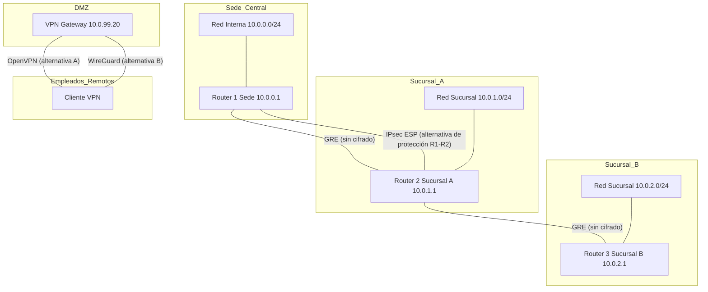
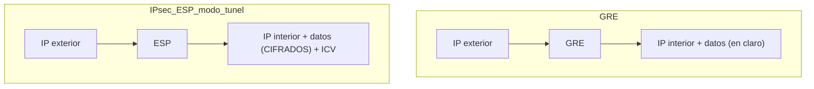
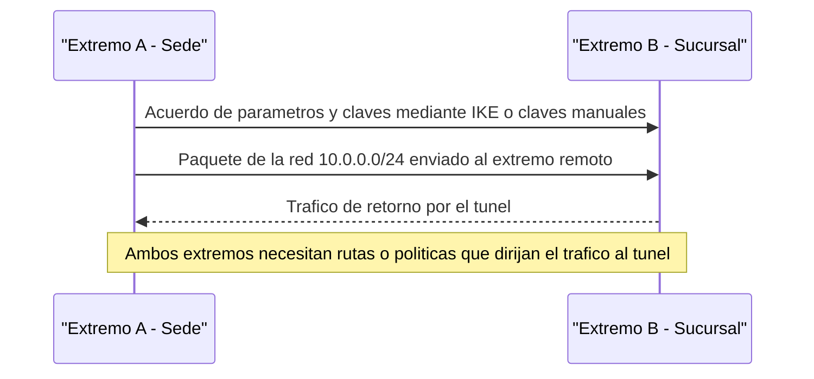

<p class="tema-eyebrow">LABORATORIO 09</p>

# VPN Y TUNELIZACIÓN

<p class="tema-meta"><span>25 secciones</span><span>4 diagramas</span><span>12 tablas</span></p>

## Hacia el exterior

Networking SecOps ya cuenta con firewall, DMZ y servicios (laboratorio 08), pero sus sucursales y los empleados que teletrabajan deben llegar a la sede a través de Internet sin exponer las comunicaciones. En este laboratorio construirás un túnel GRE protegido con IPsec, un acceso remoto con OpenVPN y otro con WireGuard, y compararás las tres tecnologías.

## Introducción técnica

Las sucursales y los usuarios remotos se conectan hasta aquí por enlaces directos sin cifrar o no se conectan. Para atravesar Internet con protección hace falta **encapsular** el tráfico y, además, **autenticarlo y cifrarlo**.

Este laboratorio construye un túnel GRE y lo protege con IPsec (ESP en modo túnel, con claves manuales), publica un acceso remoto con OpenVPN en modo de clave estática y otro con WireGuard, y se comparan las tres tecnologías. El enrutamiento sobre los túneles es estático; el dinámico se introduce en el laboratorio 15.

!!! warning "Túnel no es lo mismo que VPN"
    Un **túnel** es la **encapsulación** de tráfico entre dos extremos. Una **VPN** es una conexión virtual **protegida** mediante mecanismos de seguridad (autenticación, integridad y, normalmente, cifrado). **No todos los túneles son VPN seguras**: GRE es un túnel, pero no cifra ni autentica criptográficamente el tráfico. Puede combinarse con IPsec para obtener protección criptográfica.

## Objetivos de aprendizaje

Al terminar este laboratorio deberías poder:

- distinguir túnel (encapsulación) de VPN (conexión protegida) y explicar por qué GRE no es una VPN segura;
- explicar autenticación, integridad, cifrado y gestión de claves, y qué aporta IPsec sobre GRE;
- comparar GRE, IPsec, OpenVPN y WireGuard según qué añaden a un paquete, alcance y complejidad;
- estimar el *overhead* de cada túnel y su efecto sobre la MTU.

### Conocimientos previos y relación con la práctica anterior

- **Conocimientos previos:** Laboratorios 06 a 08 (rutas, firewall y servicios) y la encapsulación del laboratorio 01. Autenticación, cifrado, integridad y gestión de claves se explican en «Fundamento necesario» antes de usar IPsec.
- **Relación con la práctica anterior:** *Continúa el escenario anterior.* Requiere que los laboratorios 06 a 08 sigan en pie (se comprueba al inicio) y extiende la topología del 08 con túneles VPN.

## Mapa de conceptos y ruta de lectura

| Nivel | Contenido |
|-------|-----------|
| **Concepto principal** | La diferencia entre un túnel (encapsulación) y una VPN (conexión protegida) |
| **Conceptos secundarios** | Encapsulación, autenticación, integridad y cifrado; asociaciones de seguridad y políticas de IPsec; gestión de claves |
| **Tecnologías comparativas** | GRE, IPsec, OpenVPN y WireGuard, vistas como respuestas distintas al mismo problema |
| **Ampliación** | NAT-T, `AllowedIPs`, PKI y TLS en OpenVPN, anti-replay, AH frente a ESP |
| **Reservado para otras prácticas** | Enrutamiento dinámico sobre túneles y ajuste de MSS (laboratorio 15); negociación IKE con un demonio, que esta práctica no implementa |

El laboratorio tiene tres partes:

- **Parte A, de túnel a VPN (Pasos 3 a 8):** se construye GRE, se comprueba que no protege nada y se añade IPsec.
- **Parte B, acceso remoto (Pasos 9 a 13):** OpenVPN y WireGuard terminan en el *gateway* VPN de la DMZ (el Paso 2 lo prepara).
- **Parte C, comparación (Pasos 14 a 16):** capacidades, sobrecarga y efecto sobre la MTU.

**Ruta recomendada en una primera lectura:** primero el concepto, con «Qué propiedades aporta cada tecnología»; después la parte A completa; las partes B y C se leen sabiendo ya qué propiedad busca cada tecnología.

## Estado inicial

- Las sucursales se conectan con enlaces directos, sin cifrado.
- Los usuarios remotos no alcanzan los recursos corporativos.
- Las comunicaciones entre sedes no tienen protección criptográfica.
- Las rutas estáticas sobre túneles no escalan.

## Resultado que se construirá

Quedan operativos un túnel GRE, una asociación IPsec entre dos sedes, un acceso remoto OpenVPN (red `10.8.0.0/24`) y otro WireGuard (red `10.9.0.0/24`) terminados en un *gateway* VPN dentro de la DMZ. Se capturan GRE, ESP y los paquetes de cada VPN, se observan las asociaciones de seguridad y el efecto del túnel sobre la MTU, y se comparan alcance, seguridad y complejidad.

## Herramientas necesarias

- Linux con privilegios de superusuario.
- Comandos: `ip`, `ping`, `tcpdump`, `wg` (para WireGuard).
- `iproute2` (subsistema `xfrm`) para IPsec, `openssl` para generar claves.
- `openvpn` para OpenVPN.
- `wireguard-tools` para WireGuard.

## Fundamento necesario

Cuatro propiedades distintas que suelen confundirse, más la forma de obtener las claves:

- **Encapsulación:** meter un paquete dentro de otro para transportarlo entre dos extremos (un túnel). Por sí sola no protege nada.
- **Autenticación:** comprobar quién está en el otro extremo o quién originó el paquete.
- **Integridad:** detectar que el contenido no se modificó en tránsito.
- **Cifrado (confidencialidad):** impedir que un tercero lea el contenido.
- **Gestión de claves:** cómo se obtienen y renuevan las claves que usan las anteriores. En este laboratorio son manuales o estáticas solo para mostrar el mecanismo; en un despliegue habitual se negocian y se renuevan.

Un túnel GRE aporta solo la primera propiedad; una VPN segura combina las demás con ella.

## Qué propiedades aporta cada tecnología

Cada tecnología responde de forma distinta a las propiedades del apartado anterior. Esta tabla es la clave de lectura de todo el laboratorio; la lectura de «cuántos comandos tiene cada una» no lo es.

| Tecnología | Encapsula | Integridad | Cifra | Autenticación de los extremos | Claves en este laboratorio | Qué se ve en una captura |
|------------|-----------|------------|-------|-------------------------------|----------------------------|--------------------------|
| GRE | Sí | No | No | No | No aplica | Protocolo GRE, con el paquete interior en claro |
| IPsec (ESP, modo túnel) | Sí | Sí (HMAC) | Sí | Sin negociación: claves manuales | Manuales | Solo ESP; el contenido no es legible |
| OpenVPN (clave estática) | Sí | Con la clave compartida | Sí | Sin identidad por cliente ni revocación | Estática compartida | Tráfico UDP al puerto publicado (1194) |
| WireGuard | Sí | Sí | Sí | Mediante la clave pública de cada par | Par de claves por extremo | Tráfico UDP al puerto elegido (51820) |

Dos lecturas útiles:

- **GRE no es una VPN** por sí solo: la fila de IPsec muestra qué añade ESP sobre una encapsulación.
- **Que una VPN cifre no significa que sea segura**: las columnas «autenticación» y «claves» indican qué simplifica esta demostración (véase «Variación de laboratorio frente a despliegue habitual»).

## Topología

La topología extiende la del laboratorio 08 agregando túneles VPN.

!!! note "Son demostraciones alternativas, no una única arquitectura"
    GRE, IPsec, OpenVPN y WireGuard se presentan como **ejemplos didácticos separados**; no se pretende que una empresa real los combine todos a la vez. En la práctica de este laboratorio **coexisten** en los mismos namespaces para ahorrar trabajo, con estas relaciones: GRE (R1–R2 y R2–R3) transporta el tráfico entre oficinas **sin cifrar**; IPsec (manual) protege **solo** el tráfico `10.0.0.0/24` ↔ `10.0.1.0/24`; OpenVPN y WireGuard son **dos alternativas** para el mismo cliente remoto (prueba una a la vez: las dos instalan la ruta `10.0.0.0/22` en el cliente y chocarían).



**Direccionamiento:**

| Dispositivo | Interfaz | Dirección IP |
|-------------|----------|--------------|
| R1 (Sede) | `br-lan` (LAN) | 10.0.0.1/24 |
| R1 (Sede) | `veth-r1r2` (R1-R2) | 192.168.1.1/30 |
| Firewall | `veth-fw-wan` (WAN, laboratorio 08) | 192.168.100.1/24 (R1 ya no tiene WAN desde el laboratorio 08) |
| R2 (Sucursal A) | `veth-r2c` (LAN) | 10.0.1.1/24 |
| R2 (Sucursal A) | `veth-r2r1` (R1-R2) | 192.168.1.2/30 |
| R2 (Sucursal A) | `veth-r2r3` (R2-R3) | 192.168.2.1/30 |
| R3 (Sucursal B) | `veth-r3c` (LAN) | 10.0.2.1/24 |
| R3 (Sucursal B) | `veth-r3r2` (R2-R3) | 192.168.2.2/30 |
| VPN Gateway (en la DMZ) | veth-vpngw | 10.0.99.20/24 (publicado por el firewall en 192.168.100.1) |
| Cliente VPN (remoto) | veth-cvpn | 192.168.100.50/24 |
| Túnel GRE R1-R2 | gre1 | 10.10.0.1/30 y 10.10.0.2/30 |
| Túnel GRE R2-R3 | gre2 | 10.10.0.5/30 y 10.10.0.6/30 |
| OpenVPN (punto a punto) | tun0 | 10.8.0.1 ↔ 10.8.0.2 |
| WireGuard | wg0 | 10.9.0.1/24 (gateway) y 10.9.0.2/24 (cliente) |

## Construcción de la red

### Paso 1: Verificar infraestructura existente

Asegurémonos de que los laboratorios 06 a 08 siguen en pie:

```bash
sudo ip netns list
sudo ip netns exec clienteSede ping -c 2 10.0.1.10
sudo ip netns exec clienteSede ping -c 2 192.168.100.2
```

Los túneles necesitan módulos del kernel; en una VM Linux estándar se cargan solos, o con `sudo modprobe ip_gre wireguard esp4 xfrm_user tun`. Si quedó algún túnel `gre1` del laboratorio 06, elimínalo antes (`sudo ip netns exec R1 ip tunnel del gre1`): el Paso 3 reutiliza ese nombre.

!!! info "Rutas y archivos"
    Un `cat > /etc/...` dentro de un `ip netns exec` escribiría en el `/etc` real del host, y dos routers no pueden compartir el mismo `ipsec.conf`. Por eso los secretos y configuraciones de este laboratorio van en `/tmp/lab09/` y la configuración se hace con comandos (`ip`, `wg`) que **sí** son específicos de cada namespace.

### Paso 2: Crear el VPN Gateway y el cliente remoto

El *VPN Gateway* vive en la **DMZ** (`10.0.99.20`). El empleado remoto (`clienteVPN`) está en "Internet": se conecta al bridge `br-wan` del host (`192.168.100.50`). El firewall publica los puertos VPN hacia la DMZ y permite el acceso de los túneles a la LAN.

```bash
for ns in VPN_GW clienteVPN; do
  if sudo ip netns list | awk '{print $1}' | grep -qx "$ns"; then
    echo "El namespace $ns ya existe: ejecuta la limpieza del laboratorio 09 antes de repetirlo"
    exit 1
  fi
done
if [ -e /sys/class/net/veth-wan-cvpn ]; then
  echo "veth-wan-cvpn ya existe; ejecuta la limpieza del lab09 si tiene la marca networking-lab-lab-09; si no, no lo modifiques."
  exit 1
fi
if [ -e /tmp/lab09 ]; then
  if [ -f /tmp/lab09/.networking-lab-owned ]; then echo "Existe una ejecución anterior; ejecuta la limpieza del lab09.";
  else echo "/tmp/lab09 existe sin marca de propiedad; no se modifica."; fi
  exit 1
fi
if [ "$(sudo ip netns exec firewall cat /sys/class/net/lo/ifalias 2>/dev/null)" != networking-lab-lab-08 ]; then
  echo "firewall no tiene marca de propiedad Networking Lab; se aborta sin modificarlo."; exit 1
fi
BR_WAN_ALIAS=$(cat /sys/class/net/br-wan/ifalias 2>/dev/null || true)
BR_WAN_IP=$(ip -4 -o addr show dev br-wan 2>/dev/null || true)
if [ "$BR_WAN_ALIAS" != networking-lab-lab-08 ] && ! { [ "$BR_WAN_ALIAS" = networking-lab ] && echo "$BR_WAN_IP" | grep -q '192\.168\.100\.2/24'; }; then
  echo "br-wan no está identificado como bridge WAN del laboratorio 08; ejecuta Lab08 y verifica su propiedad."; exit 1
fi
for dev in veth-vpngw veth-cvpn; do
  if ip link show "$dev" >/dev/null 2>&1; then echo "$dev ya existe en el host; no se reutiliza."; exit 1; fi
done
if sudo ip netns exec firewall ip link show veth-fw-vpn >/dev/null 2>&1; then
  echo "firewall/veth-fw-vpn ya existe; no se reutiliza una interfaz preexistente."; exit 1
fi
mkdir -p /tmp/lab09
touch /tmp/lab09/.networking-lab-owned
sudo ip netns add VPN_GW
sudo ip netns exec VPN_GW ip link set lo alias networking-lab-lab-09
sudo ip netns add clienteVPN
sudo ip netns exec clienteVPN ip link set lo alias networking-lab-lab-09

# VPN_GW dentro de la DMZ
sudo ip link add veth-vpngw type veth peer name veth-fw-vpn
sudo ip link set veth-vpngw alias networking-lab-lab-09
sudo ip link set veth-fw-vpn alias networking-lab-lab-09
sudo ip link set veth-vpngw netns VPN_GW
sudo ip link set veth-fw-vpn netns firewall
sudo ip netns exec firewall ip link set veth-fw-vpn master br-dmz
sudo ip netns exec firewall ip link set veth-fw-vpn up
sudo ip netns exec VPN_GW ip addr add 10.0.99.20/24 dev veth-vpngw
sudo ip netns exec VPN_GW ip link set veth-vpngw up
sudo ip netns exec VPN_GW ip link set lo up
sudo ip netns exec VPN_GW ip route add default via 10.0.99.1
sudo ip netns exec VPN_GW sysctl -w net.ipv4.ip_forward=1

# clienteVPN en "Internet"
sudo ip link add veth-cvpn type veth peer name veth-wan-cvpn
sudo ip link set veth-cvpn alias networking-lab-lab-09
sudo ip link set veth-wan-cvpn alias networking-lab-lab-09
sudo ip link set veth-cvpn netns clienteVPN
sudo ip link set veth-wan-cvpn master br-wan
sudo ip link set veth-wan-cvpn up
sudo ip netns exec clienteVPN ip addr add 192.168.100.50/24 dev veth-cvpn
sudo ip netns exec clienteVPN ip link set veth-cvpn up
sudo ip netns exec clienteVPN ip link set lo up
```

Reglas del firewall: publicar los puertos VPN (DNAT), permitir que el gateway y sus túneles lleguen a la LAN, y devolver el tráfico de retorno hacia los túneles. **Qué se publica y qué se permite:** solo `UDP 51820` (WireGuard) y `UDP 1194` (OpenVPN) hacia **un único host** de la DMZ (`10.0.99.20`); y, desde los túneles, el tráfico hacia la red interna `10.0.0.0/22`. La segunda regla es **amplia a propósito para simplificar** (todo origen del túnel hacia toda la LAN). En una red real se acotaría por usuario, recurso y puerto, con la misma lógica de mínimo privilegio del laboratorio 08:

```bash
# Publicar WireGuard (51820/udp) y OpenVPN (1194/udp) hacia el VPN Gateway.
if ! sudo ip netns exec firewall iptables -t nat -C PREROUTING -i veth-fw-wan -p udp -m multiport --dports 51820,1194 -j DNAT --to-destination 10.0.99.20; then
  sudo ip netns exec firewall iptables -t nat -A PREROUTING -i veth-fw-wan -p udp -m multiport --dports 51820,1194 -j DNAT --to-destination 10.0.99.20 && touch /tmp/lab09/fw-dnat.added
fi
if ! sudo ip netns exec firewall iptables -C FORWARD -i veth-fw-wan -o br-dmz -p udp -d 10.0.99.20 -m multiport --dports 51820,1194 -j ACCEPT; then
  sudo ip netns exec firewall iptables -I FORWARD 1 -i veth-fw-wan -o br-dmz -p udp -d 10.0.99.20 -m multiport --dports 51820,1194 -j ACCEPT && touch /tmp/lab09/fw-forward-dmz.added
fi

# Los túneles (10.8.0.0/24 y 10.9.0.0/24, ambas dentro de 10.8.0.0/15) pueden llegar a la red interna.
if ! sudo ip netns exec firewall iptables -C FORWARD -i br-dmz -o veth-fw-lan -s 10.8.0.0/15 -d 10.0.0.0/22 -j ACCEPT; then
  sudo ip netns exec firewall iptables -I FORWARD 1 -i br-dmz -o veth-fw-lan -s 10.8.0.0/15 -d 10.0.0.0/22 -j ACCEPT && touch /tmp/lab09/fw-forward-lan.added
fi
if ! sudo ip netns exec firewall ip route show 10.8.0.0/24 | grep -q 'via 10.0.99.20'; then
  sudo ip netns exec firewall ip route add 10.8.0.0/24 via 10.0.99.20 && touch /tmp/lab09/fw-route-openvpn.added
fi
if ! sudo ip netns exec firewall ip route show 10.9.0.0/24 | grep -q 'via 10.0.99.20'; then
  sudo ip netns exec firewall ip route add 10.9.0.0/24 via 10.0.99.20 && touch /tmp/lab09/fw-route-wireguard.added
fi

# VPN_GW conoce la red interna a través del firewall.
sudo ip netns exec VPN_GW ip route replace 10.0.0.0/22 via 10.0.99.1
```

Se comprueba que el puerto publicado llega al gateway (DNAT), sin ninguna VPN todavía:

```bash
sudo ip netns exec clienteVPN ping -c 2 192.168.100.1
# -w 3: el listener termina solo tras 3 s de inactividad, para no dejar ocupado el puerto 51820 que usará WireGuard
sudo ip netns exec VPN_GW sh -c 'nc -u -l -w 3 -p 51820 > /tmp/lab09/dnat.txt & echo $! > /tmp/lab09/dnat-nc.pid'
sudo ip netns exec clienteVPN sh -c 'echo prueba | nc -u -w 1 192.168.100.1 51820'
cat /tmp/lab09/dnat.txt
```

### Paso 3: Configurar túnel GRE entre R1 y R2

```bash
for spec in 'R1 gre1' 'R2 gre1'; do
  set -- $spec
  if sudo ip netns exec "$1" ip link show "$2" >/dev/null 2>&1; then
    echo "$1/$2 ya existe; no se sobrescribe una interfaz ajena. Ejecuta su limpieza propietaria antes de continuar."
    exit 1
  fi
done
```

GRE encapsula paquetes IP dentro de otros paquetes IP, **sin cifrarlos ni autenticarlos criptográficamente**: cualquiera que capture el enlace verá el contenido original.

```bash
# En R1 (Sede)
sudo ip netns exec R1 ip tunnel add gre1 mode gre remote 192.168.1.2 local 192.168.1.1 ttl 255
sudo ip netns exec R1 ip link set gre1 alias networking-lab-lab-09
sudo ip netns exec R1 ip addr add 10.10.0.1/30 dev gre1
sudo ip netns exec R1 ip link set gre1 up

# En R2 (Sucursal A)
sudo ip netns exec R2 ip tunnel add gre1 mode gre remote 192.168.1.1 local 192.168.1.2 ttl 255
sudo ip netns exec R2 ip link set gre1 alias networking-lab-lab-09
sudo ip netns exec R2 ip addr add 10.10.0.2/30 dev gre1
sudo ip netns exec R2 ip link set gre1 up
```

### Paso 4: Verificar túnel GRE y crear el túnel R2-R3

```bash
for spec in 'R2 gre2' 'R3 gre2'; do
  set -- $spec
  if sudo ip netns exec "$1" ip link show "$2" >/dev/null 2>&1; then
    echo "$1/$2 ya existe; no se sobrescribe una interfaz ajena."
    exit 1
  fi
done
sudo ip netns exec R1 ip tunnel show gre1
sudo ip netns exec R1 ping -c 4 10.10.0.2
```

```bash
# En R2 (Sucursal A)
sudo ip netns exec R2 ip tunnel add gre2 mode gre remote 192.168.2.2 local 192.168.2.1 ttl 255
sudo ip netns exec R2 ip link set gre2 alias networking-lab-lab-09
sudo ip netns exec R2 ip addr add 10.10.0.5/30 dev gre2
sudo ip netns exec R2 ip link set gre2 up

# En R3 (Sucursal B)
sudo ip netns exec R3 ip tunnel add gre2 mode gre remote 192.168.2.1 local 192.168.2.2 ttl 255
sudo ip netns exec R3 ip link set gre2 alias networking-lab-lab-09
sudo ip netns exec R3 ip addr add 10.10.0.6/30 dev gre2
sudo ip netns exec R3 ip link set gre2 up
sudo ip netns exec R2 ping -c 2 10.10.0.6
```

### Paso 5: Enviar el tráfico entre oficinas por los túneles

Las rutas estáticas del laboratorio 06 ya existen para estos prefijos, y un segundo `ip route add` con la misma métrica fallaría (`File exists`). Se da al túnel una **métrica menor (10)** para que sea el camino preferido, o reemplazamos la ruta cuando su métrica era 0:

```bash
# R1: hacia Sucursal B, vía GRE R1-R2 (métrica 10 < 50 < 100)
if ! sudo ip netns exec R1 ip route show 10.0.2.0/24 | grep -q 'via 10.10.0.2.*gre1'; then
  sudo ip netns exec R1 ip route add 10.0.2.0/24 via 10.10.0.2 dev gre1 metric 10 && touch /tmp/lab09/r1-gre-route.added
fi

# R2: hacia Sede y Sucursal B, vía túneles (reemplaza las rutas de métrica 0)
sudo ip netns exec R2 ip route show exact 10.0.0.0/24 > /tmp/lab09/r2-route-10.0.0.0.before
sudo ip netns exec R2 ip route show exact 10.0.2.0/24 > /tmp/lab09/r2-route-10.0.2.0.before
sudo ip netns exec R2 ip route replace 10.0.0.0/24 via 10.10.0.1 dev gre1
sudo ip netns exec R2 ip route replace 10.0.2.0/24 via 10.10.0.6 dev gre2

# R3: hacia Sede, vía túnel GRE R2-R3
if ! sudo ip netns exec R3 ip route show 10.0.0.0/24 | grep -q 'via 10.10.0.5.*gre2'; then
  sudo ip netns exec R3 ip route add 10.0.0.0/24 via 10.10.0.5 dev gre2 metric 10 && touch /tmp/lab09/r3-gre-route.added
fi
```

### Paso 6: Verificar conectividad a través de GRE

```bash
sudo ip netns exec clienteSede ping -c 4 10.0.2.10
sudo ip netns exec R1 ip route get 10.0.2.10
```

La segunda orden debe mostrar `dev gre1`. Para ver la encapsulación, se captura en la interfaz física durante el ping: se ven paquetes con protocolo GRE (47) que contienen el ICMP original **en claro**. Esto demuestra que GRE es un túnel, no una VPN segura.

```bash
sudo ip netns exec R1 tcpdump -i veth-r1r2 -n -c 4 proto gre
```

## Implementación de IPsec

### Paso 7: Cifrar el tráfico Sede ↔ Sucursal A con IPsec (ESP en modo túnel)

Conviene distinguir los elementos de IPsec:

-   **ESP** (Encapsulating Security Payload): el protocolo que, en el plano de datos, aporta cifrado, autenticación e integridad al tráfico.
-   **Asociaciones de seguridad (SA)**: acuerdos unidireccionales que definen algoritmos, claves y SPI. Hace falta una por sentido.
-   **Negociación de parámetros ([IKE](https://www.rfc-editor.org/rfc/rfc7296))**: el protocolo que normalmente acuerda las SA y renueva las claves. **Aquí no existe**: las claves se fijan a mano.
-   **Políticas y estados XFRM**: en Linux, las *políticas* (`ip xfrm policy`) dicen **qué tráfico** se protege y los *estados* (`ip xfrm state`) contienen las SA con sus claves.

La presencia de comandos `xfrm` **no demuestra por sí sola que exista una VPN funcional**: hay que comprobar que el tráfico selecciona la política, sale como ESP y los contadores de la SA aumentan (Paso 8).

En la terminología IPsec, la **SPD** (Security Policy Database) decide qué flujos se descartan, dejan en claro o protegen; la **SAD** (Security Association Database) almacena los parámetros de cada SA. El **SPI** identifica una SA unidireccional en ESP. **AH** aporta autenticación/integridad pero no cifrado y autentica campos del encabezado IP que NAT puede modificar; **ESP** es el uso habitual cuando se requiere confidencialidad. La protección anti-replay usa números de secuencia y una ventana deslizante para rechazar paquetes repetidos; no la desactives en producción. En una implementación con IKEv2, las SA se renuevan (*rekey*) antes de expirar, con nuevos SPI y claves; esta prueba manual no negocia ni renueva claves.


Para que los selectores IPsec protejan los paquetes IP originales, esta prueba utiliza el enlace IP directo R1–R2 como transporte; no apila ESP sobre GRE. Se fijan rutas simétricas por el enlace físico antes de instalar las políticas:

```bash
sudo ip netns exec R1 ip route show exact 10.0.1.0/24 > /tmp/lab09/r1-route-10.0.1.0.before
sudo ip netns exec R1 ip route replace 10.0.1.0/24 via 192.168.1.2 dev veth-r1r2
sudo ip netns exec R2 ip route replace 10.0.0.0/24 via 192.168.1.1 dev veth-r2r1
```

Una VPN IPsec de producción usa un demonio IKE (por ejemplo strongSwan) que negocia las claves. Los demonios guardan su configuración y sus *sockets* en rutas del sistema compartidas, así que **dos routers no pueden ejecutar uno cada uno dentro de namespaces sin trabajo adicional**. Para entender IPsec sin ese problema configuramos el kernel directamente (*manual keying*): definimos las **asociaciones de seguridad** (SA, con sus claves) y las **políticas** que dicen qué tráfico se cifra.

```bash
# Claves de prueba (las mismas en ambos extremos y en ambos sentidos: solo para demostración;
# en producción, IKE genera claves distintas por sentido y las renueva)
KEY_ENC=0x$(openssl rand -hex 32)     # AES-256
KEY_AUTH=0x$(openssl rand -hex 32)    # HMAC-SHA256

for R in R1 R2; do
  if sudo ip netns exec "$R" ip xfrm state list | grep -Eq 'spi 0x1001|spi 0x1002'; then
    echo "$R ya contiene un SPI de esta práctica; no se sobrescribe una SA existente."
    exit 1
  fi
  # SA R1->R2 (spi 0x1001, reqid 1) y SA R2->R1 (spi 0x1002, reqid 2).
  sudo ip netns exec "$R" ip xfrm state add src 192.168.1.1 dst 192.168.1.2 proto esp spi 0x1001 reqid 1 mode tunnel \
      auth 'hmac(sha256)' "$KEY_AUTH" enc 'cbc(aes)' "$KEY_ENC" && touch "/tmp/lab09/$R-state-1001.added"
  sudo ip netns exec "$R" ip xfrm state add src 192.168.1.2 dst 192.168.1.1 proto esp spi 0x1002 reqid 2 mode tunnel \
      auth 'hmac(sha256)' "$KEY_AUTH" enc 'cbc(aes)' "$KEY_ENC" && touch "/tmp/lab09/$R-state-1002.added"
done

# Políticas en R1: no se reemplaza ninguna política preexistente con estos selectores.
if sudo ip netns exec R1 ip xfrm policy list | grep -Fq 'src 10.0.0.0/24 dst 10.0.1.0/24' || sudo ip netns exec R1 ip xfrm policy list | grep -Fq 'src 10.0.1.0/24 dst 10.0.0.0/24'; then
  echo "R1 ya tiene políticas XFRM con los selectores dla prueba; se aborta sin modificarlas."
  exit 1
fi
sudo ip netns exec R1 ip xfrm policy add src 10.0.0.0/24 dst 10.0.1.0/24 dir out \
    tmpl src 192.168.1.1 dst 192.168.1.2 proto esp reqid 1 mode tunnel && touch /tmp/lab09/R1-policy-out.added
sudo ip netns exec R1 ip xfrm policy add src 10.0.1.0/24 dst 10.0.0.0/24 dir in \
    tmpl src 192.168.1.2 dst 192.168.1.1 proto esp reqid 2 mode tunnel && touch /tmp/lab09/R1-policy-in.added
sudo ip netns exec R1 ip xfrm policy add src 10.0.1.0/24 dst 10.0.0.0/24 dir fwd \
    tmpl src 192.168.1.2 dst 192.168.1.1 proto esp reqid 2 mode tunnel && touch /tmp/lab09/R1-policy-fwd.added

# Políticas en R2 (espejo).
if sudo ip netns exec R2 ip xfrm policy list | grep -Fq 'src 10.0.1.0/24 dst 10.0.0.0/24' || sudo ip netns exec R2 ip xfrm policy list | grep -Fq 'src 10.0.0.0/24 dst 10.0.1.0/24'; then
  echo "R2 ya tiene políticas XFRM con los selectores dla prueba; se aborta sin modificarlas."
  exit 1
fi
sudo ip netns exec R2 ip xfrm policy add src 10.0.1.0/24 dst 10.0.0.0/24 dir out \
    tmpl src 192.168.1.2 dst 192.168.1.1 proto esp reqid 2 mode tunnel && touch /tmp/lab09/R2-policy-out.added
sudo ip netns exec R2 ip xfrm policy add src 10.0.0.0/24 dst 10.0.1.0/24 dir in \
    tmpl src 192.168.1.1 dst 192.168.1.2 proto esp reqid 1 mode tunnel && touch /tmp/lab09/R2-policy-in.added
sudo ip netns exec R2 ip xfrm policy add src 10.0.0.0/24 dst 10.0.1.0/24 dir fwd \
    tmpl src 192.168.1.1 dst 192.168.1.2 proto esp reqid 1 mode tunnel && touch /tmp/lab09/R2-policy-fwd.added
```

### Paso 8: Verificar IPsec

```bash
# Generar tráfico entre sede y sucursal A y capturar ESP en el enlace
sudo ip netns exec R1 tcpdump -i veth-r1r2 -n -c 4 esp &
sleep 1
sudo ip netns exec clienteSede ping -c 3 10.0.1.10
wait

# Asociaciones de seguridad (con contadores) y políticas
sudo ip netns exec R1 ip -s xfrm state
sudo ip netns exec R1 ip xfrm policy
```

**Resultado esperado:** el *ping* responde, `tcpdump` solo muestra paquetes ESP (el contenido ICMP no es visible) y los contadores de la SA aumentan.

El selector de las políticas es `10.0.0.0/24` ↔ `10.0.1.0/24`: **solo ese tráfico** se cifra. El que va por los túneles GRE (por ejemplo Sede ↔ Sucursal B) sigue sin cifrar. Además, con manual keying no hay autenticación de los extremos ni reemplazo de claves: es una demostración del plano de datos, no una VPN lista para producción.

## Implementación de OpenVPN

### Paso 9: OpenVPN entre el cliente remoto y el VPN Gateway

!!! danger "Configuración de demostración, no de producción"
    Este paso usa una **clave estática compartida**, una simplificación para ver el funcionamiento. Una implementación de producción usa **TLS con certificados (PKI)**: cada cliente tiene su identidad y se puede revocar. No copies esta configuración a un entorno real.

**OpenVPN** es una solución VPN **basada en TLS**: en su modo normal, cliente y servidor se autentican con certificados (PKI), negocian claves por un canal TLS y transportan el tráfico por UDP o TCP, con sus propios mecanismos de autenticación y cifrado. **No es IPsec ni una variante de GRE.**

Un servidor OpenVPN de acceso remoto "real" necesita esa PKI (CA, certificado de servidor y de cada cliente) y no se genera en unos pocos comandos. Aquí se usa el modo de **clave estática compartida**, que **no usa TLS**, no ofrece secreto perfecto hacia adelante y está en desuso; es suficiente para ver el túnel `tun` y su sobrecarga, pero **no representa una configuración segura de producción**.

```bash
sudo apt-get install -y openvpn
if [ ! -f /tmp/lab09/.networking-lab-owned ]; then
  echo "Ejecuta primero el Paso 2: no existe el directorio temporal marcado del laboratorio 09."
  exit 1
fi

# Matriz de compatibilidad del modo legacy de clave estática (solo para observar tun0).
OVPN_VERSION=$(openvpn --version | awk 'NR==1 {for (i=1; i<=NF; i++) if ($i ~ /^[0-9]+\.[0-9]+/) {print $i; exit}}')
OVPN_MAJOR=${OVPN_VERSION%%.*}
OVPN_MINOR=${OVPN_VERSION#*.}; OVPN_MINOR=${OVPN_MINOR%%.*}
if [ -z "$OVPN_VERSION" ]; then echo "No se pudo detectar la versión de OpenVPN."; exit 1; fi
if [ "$OVPN_MAJOR" -gt 2 ] || { [ "$OVPN_MAJOR" -eq 2 ] && [ "$OVPN_MINOR" -ge 8 ]; }; then
  echo "OpenVPN $OVPN_VERSION: el modo estático --secret puede no estar disponible; omite esta prueba si la versión lo retiró y usa TLS/PKI o --peer-fingerprint."
else
  OVPN_STATIC_FLAGS=()
  if [ "$OVPN_MAJOR" -eq 2 ] && [ "$OVPN_MINOR" -ge 7 ]; then
    OVPN_STATIC_FLAGS=(--allow-deprecated-insecure-static-crypto)
  fi
  if [ "$OVPN_MAJOR" -eq 2 ] && [ "$OVPN_MINOR" -lt 5 ]; then
    openvpn --genkey --secret /tmp/lab09/static.key
  else
    openvpn --genkey secret /tmp/lab09/static.key
  fi

  sudo ip netns exec VPN_GW openvpn --daemon --writepid /tmp/lab09/ovpn-gw.pid --log /tmp/lab09/ovpn-gw.log \
      --dev tun0 --dev-type tun --proto udp --lport 1194 --ifconfig 10.8.0.1 10.8.0.2 \
      --secret /tmp/lab09/static.key --cipher AES-256-CBC "${OVPN_STATIC_FLAGS[@]}"

  sudo ip netns exec clienteVPN openvpn --daemon --writepid /tmp/lab09/ovpn-cli.pid --log /tmp/lab09/ovpn-cli.log \
      --dev tun0 --dev-type tun --proto udp --remote 192.168.100.1 1194 --ifconfig 10.8.0.2 10.8.0.1 \
      --secret /tmp/lab09/static.key --cipher AES-256-CBC "${OVPN_STATIC_FLAGS[@]}" \
      --route 10.0.0.0 255.255.252.0
fi
```

!!! warning "Compatibilidad de OpenVPN"
    | Rama | Modo `--secret` | Acción del laboratorio |
    |---|---|---|
    | 2.4–2.5 | Aceptado como modo legacy sin TLS | No pasar `--allow-deprecated-insecure-static-crypto`; en 2.4 usa `--genkey --secret` |
    | 2.6 | Aceptado con advertencia de obsolescencia | No pasar la opción de excepción |
    | 2.7 | Deshabilitado por defecto; `--secret` falla salvo opt-in explícito | El bloque añade `--allow-deprecated-insecure-static-crypto`; úsalo solo para esta demostración aislada |
    | 2.8 o posterior | Retirada prevista del modo estático; verifica la versión instalada | Si la opción ya no existe, omite la prueba y usa TLS/PKI o `--peer-fingerprint` |

    Se comprueba `openvpn --version` y `openvpn --help` antes de ejecutar opciones legacy. En 2.6 `--secret` emite advertencia; en 2.7 queda bloqueado salvo `--allow-deprecated-insecure-static-crypto`, y su retirada está prevista para 2.8. La clave estática solo ilustra la creación del dispositivo `tun`; no representa una VPN segura de producción.

### Arquitectura de OpenVPN: plano de control y plano de datos

En el modo TLS de producción, el canal de control autentica los extremos y negocia claves; el canal de datos cifra y autentica los paquetes transportados. La PKI valida certificados, cadena de confianza, vigencia y revocación; `--peer-fingerprint` permite fijar la identidad del certificado cuando el diseño lo requiere. `tun` transporta paquetes IP (capa 3); `tap` transporta tramas Ethernet (capa 2) y amplía el dominio de broadcast. El modo `--secret` de esta prueba no crea ese canal TLS ni una identidad por certificado: se mantiene únicamente como demostración legacy.


### Paso 10: Verificar OpenVPN

```bash
if [ -s /tmp/lab09/ovpn-cli.pid ]; then
  sudo ip netns exec clienteVPN ping -c 4 10.8.0.1
  sudo ip netns exec clienteVPN ping -c 4 10.0.0.10
  tail -3 /tmp/lab09/ovpn-cli.log
else
  echo "OpenVPN legacy omitido por versión; continúa con WireGuard y revisa la arquitectura TLS/PKI."
fi
```

## Implementación de WireGuard

### Paso 11: Generar las claves

**WireGuard** funciona con un modelo de **pares** (*peers*): cada extremo tiene un par de claves, conserva su clave privada y entrega solo la **pública** al otro; cada par declara qué direcciones acepta mediante `allowed-ips`, que actúa a la vez como **tabla de enrutamiento criptográfico** y como filtro de origen. Los datos viajan encapsulados en **UDP**.

#### Criptografía y ciclo de claves de WireGuard

WireGuard utiliza una suite criptográfica fija, no una negociación de cifrados por conexión:

| Primitiva | Función |
|---|---|
| **Curve25519 ([X25519](https://www.rfc-editor.org/rfc/rfc7748))** | Acuerdo de claves Diffie–Hellman entre pares |
| **ChaCha20-Poly1305** | Cifrado autenticado de los paquetes de datos (confidencialidad e integridad) |
| **BLAKE2s** | Funciones hash y derivaciones internas |
| **HKDF** | Derivación de claves a partir del secreto compartido |
| **Noise_IK** (con [PSK](https://www.rfc-editor.org/rfc/rfc7296) opcional) | Patrón del handshake que autentica las claves públicas y deriva claves de sesión |

Las claves efímeras y las claves de sesión se renuevan automáticamente según los temporizadores y límites internos del protocolo. Eso **no** rota por sí solo la clave privada de larga duración del peer: para rotarla se genera un nuevo par y se actualiza la clave pública correspondiente en el otro extremo, coordinando el cambio para no perder conectividad.

`PersistentKeepalive` envía paquetes vacíos periódicos (por ejemplo, cada 25 s) para mantener una asignación NAT cuando un peer está detrás de NAT y necesita recibir tráfico iniciado desde el otro lado. No es un mecanismo de failover ni una prueba de que las rutas y reglas de firewall funcionen. Se usa `wg show` para observar el último handshake y contadores; un handshake reciente confirma intercambio criptográfico, no acceso completo a una aplicación.

```bash
sudo apt-get install -y wireguard-tools
mkdir -p /tmp/lab09 && cd /tmp/lab09
# Entre paréntesis (subshell) para que el umask restrictivo no persista en tu sesión
( umask 077
  wg genkey | tee gw.key  | wg pubkey > gw.pub
  wg genkey | tee cli.key | wg pubkey > cli.pub )
```

### Paso 12: Configurar el servidor (VPN Gateway) y el cliente

La creación establece la interfaz **dentro** de cada namespace y se configura con `wg set` (no se usa `wg-quick`, que lee `/etc/wireguard` del host):

```bash
# VPN Gateway: 10.9.0.1, escucha en 51820, conoce la clave pública del cliente
sudo ip -n VPN_GW link add wg0 type wireguard
sudo ip netns exec VPN_GW wg set wg0 listen-port 51820 private-key /tmp/lab09/gw.key \
    peer $(cat /tmp/lab09/cli.pub) allowed-ips 10.9.0.2/32
sudo ip -n VPN_GW addr add 10.9.0.1/24 dev wg0
sudo ip -n VPN_GW link set wg0 up

# Cliente remoto: 10.9.0.2, apunta a la IP pública del firewall
sudo ip -n clienteVPN link add wg0 type wireguard
sudo ip netns exec clienteVPN wg set wg0 private-key /tmp/lab09/cli.key \
    peer $(cat /tmp/lab09/gw.pub) endpoint 192.168.100.1:51820 \
    allowed-ips 10.9.0.1/32,10.0.0.0/22 persistent-keepalive 25
sudo ip -n clienteVPN addr add 10.9.0.2/24 dev wg0
sudo ip -n clienteVPN link set wg0 up
sudo ip -n clienteVPN route add 10.0.0.0/22 dev wg0
```

### Paso 13: Verificar WireGuard

```bash
# Estado del servidor (debe mostrar un handshake reciente tras el primer ping)
sudo ip netns exec clienteVPN ping -c 4 10.9.0.1
sudo ip netns exec VPN_GW wg show

# Acceso a la red interna a través del túnel
sudo ip netns exec clienteVPN ping -c 4 10.0.0.10
```

Configurar un dispositivo WireGuard **no significa que haya conectividad completa** entre las redes detrás de los pares: además hacen falta las **rutas** (aquí, `route add 10.0.0.0/22 dev wg0` en el cliente, y la ruta de retorno en el firewall) y las **políticas de acceso** (reglas de `FORWARD`). Si falta alguna, el *handshake* puede existir y aun así no llegar al destino.

## Análisis y comparación

### Qué añade cada tecnología a un paquete



GRE solo **encapsula**: cualquiera en el camino ve el paquete interior. ESP **cifra y autentica** el interior; por eso un paquete protegido muestra ESP en `tcpdump` y no se puede leer su contenido.

### Establecimiento de un túnel



### Cifrado, autenticación e integridad

| Propiedad | Qué garantiza | Ejemplo |
|-----------|---------------|---------|
| **Cifrado** | Que nadie lea el contenido | [AES](https://csrc.nist.gov/pubs/fips/197/final) en ESP |
| **Autenticación** | Que el origen es quien dice ser | Claves compartidas, certificados, claves públicas de WireGuard |
| **Integridad** | Que no se modificó en tránsito | [HMAC](https://www.rfc-editor.org/rfc/rfc2104)-SHA256 en ESP, etiqueta de autenticación de WireGuard |

### Sitio a sitio frente a acceso remoto

| Aspecto | Sitio a sitio | Acceso remoto |
|---------|---------------|----------------|
| Une | Dos **redes** (sedes) | Un **usuario o equipo** con una red |
| Quién inicia | Los *gateways* de ambas sedes | El cliente |
| Aquí | GRE e IPsec entre R1 y R2 | OpenVPN y WireGuard con el cliente remoto |

### [NAT-T](https://www.rfc-editor.org/rfc/rfc3947) y AllowedIPs

-   **NAT-T**: ESP no tiene puertos, así que un NAT intermedio puede romperlo. IPsec lo resuelve encapsulando ESP en **UDP 4500** cuando detecta NAT en el camino.
-   **AllowedIPs (WireGuard)**: cada par declara qué redes se enrutan **hacia** él y de qué orígenes acepta tráfico. Funciona a la vez como tabla de rutas y como filtro:


### Paso 14: Comparar tecnologías VPN

| Tecnología | Capa | Ventajas | Desventajas |
|------------|------|----------|-------------|
| GRE | 3 (encapsulación) | Sencillo, soporta multicast | Sin cifrado ni autenticación: no es una VPN por sí solo |
| IPsec | 3 | Estándar, cifra y autentica; ESP | Complejo (IKE, políticas); problemas con NAT (NAT-T) |
| OpenVPN | 3 (`tun`) o 2 (`tap`), sobre UDP/TCP | Basado en TLS; flexible | Mayor overhead; configuración de PKI |
| WireGuard | 3, sobre UDP | Ligero, moderno, modelo de pares simple | Menos funciones (sin asignación dinámica de direcciones integrada) |

### Criterio de elección

Orientación didáctica sobre qué aporta cada tecnología; no es una recomendación de diseño.

| Si el escenario necesita… | Se piensa en… | Porque… |
|---------------------------|---------------|---------|
| Transportar tráfico entre dos extremos, incluido multicast, sin protección | GRE | Es sencilla y soporta multicast |
| Unir dos sedes con un estándar muy extendido | IPsec | Cifra y autentica con ESP; exige IKE y políticas, y puede tener problemas con NAT |
| Acceso remoto basado en TLS y flexible | OpenVPN | Usa TLS con certificados (en producción); tiene más sobrecarga y exige PKI |
| Acceso remoto ligero con un modelo de pares sencillo | WireGuard | Tiene suite criptográfica fija y poca configuración; ofrece menos funciones integradas |
| Protección criptográfica sobre un túnel GRE | GRE protegido con IPsec | Combina la encapsulación de GRE con la protección de IPsec |

La pregunta de partida no es «¿cuál es mejor?», sino «¿qué propiedad necesito y qué me cuesta obtenerla?».

### Paso 15: Analizar overhead de encapsulación

```bash
# Capturar tráfico GRE
sudo ip netns exec R1 tcpdump -i gre1 -n -v

# Capturar tráfico IPsec
sudo ip netns exec R1 tcpdump -i veth-r1r2 -n -v esp   # (visto en el Paso 8)
```

**Interpretación:**
Órdenes de magnitud por paquete en IPv4 (varían con el cifrado, el relleno y las opciones):

- GRE añade **24 bytes** (20 de la nueva cabecera IP + 4 de GRE), sin cifrado.
- IPsec ESP en modo túnel (AES-CBC + HMAC-SHA256, como aquí) añade del orden de **55-75 bytes** (IP exterior, ESP, IV, relleno, *trailer* e ICV).
- OpenVPN sobre UDP añade del orden de **40-70 bytes**, según cifrado y modo.
- WireGuard añade **60 bytes** sobre IPv4 (20 IP + 8 UDP + 16 de cabecera WireGuard + 16 de etiqueta de autenticación).

Este *overhead* reduce la MTU efectiva del túnel (véase el laboratorio 15 para MTU y MSS).

### Tabla de overhead por tecnología

| Tecnología | Overhead aproximado por paquete (IPv4) | Efecto en un enlace de MTU 1500 |
|------------|-----------------------------------------|----------------------------------|
| GRE | 24 bytes | MTU efectiva ≈ 1476 |
| IPsec ESP (túnel) | ≈ 55–75 bytes | MTU efectiva ≈ 1425–1445 |
| OpenVPN (UDP) | ≈ 40–70 bytes | Según cifrado y modo |
| WireGuard | 60 bytes | MTU efectiva ≈ 1440 (la interfaz suele fijarse en 1420 por compatibilidad con IPv6) |

### Variación de laboratorio frente a despliegue habitual

| Tecnología | En este laboratorio | Despliegue habitual |
|------------|---------------------|----------------------|
| OpenVPN | Clave estática compartida | TLS con certificados (PKI) |
| IPsec | Claves **manuales** (XFRM) | Negociación con **IKE** |
| GRE | Solo encapsulación | GRE protegido con IPsec si se requiere seguridad |
| WireGuard | Par de claves por extremo | Pares de claves **y** políticas de acceso (AllowedIPs, firewall) |

Estas simplificaciones **muestran el funcionamiento interno** y no deben tomarse como configuración empresarial.

### Paso 16: Comprobar la MTU y la fragmentación en el túnel

La encapsulación reduce la MTU útil. Compruébalo con el túnel GRE R1–R2:

```bash
# MTU de la interfaz del túnel (1476 = 1500 - 24)
sudo ip netns exec R1 ip link show gre1 | grep -o 'mtu [0-9]*'

# Con DF activado: 1448 bytes de datos + 28 de cabeceras ICMP/IP = 1476, cabe
sudo ip netns exec clienteSede ping -c 2 -M do -s 1448 10.0.2.10

# 1472 + 28 = 1500: cabe en el cliente, pero no en el túnel
sudo ip netns exec clienteSede ping -c 2 -M do -s 1472 10.0.2.10   # «Frag needed and DF set (mtu = 1476)»

# Sin DF, el paquete se fragmenta y llega
sudo ip netns exec clienteSede ping -c 2 -M dont -s 1472 10.0.2.10
```

Con DF activado, el router descarta el paquete grande y avisa con ICMP «fragmentación necesaria»; sin DF lo fragmenta, con un coste de rendimiento. Si esos avisos ICMP se filtran, las conexiones TCP con paquetes grandes se quedan colgadas aunque los pings pequeños funcionen. La solución habitual es ajustar la MSS de TCP, tal como se hace en el laboratorio 15.

## Pruebas de comportamiento

### Prueba 1: Túnel GRE adicional

Se configura un túnel GRE entre R1 y R3 sobre el enlace directo `192.168.3.0/30` que se creó en el Paso 6 del laboratorio 06 (debe seguir activo) para tener redundancia.

```bash
for ns in R1 R3; do
  if sudo ip netns exec "$ns" ip link show gre3 >/dev/null 2>&1; then
    echo "$ns/gre3 ya existe; no se sobrescribe una interfaz ajena."; exit 1
  fi
done
# En R1
sudo ip netns exec R1 ip tunnel add gre3 mode gre remote 192.168.3.2 local 192.168.3.1 ttl 255
sudo ip netns exec R1 ip link set gre3 alias networking-lab-lab-09
sudo ip netns exec R1 ip addr add 10.10.0.9/30 dev gre3
sudo ip netns exec R1 ip link set gre3 up

# En R3
sudo ip netns exec R3 ip tunnel add gre3 mode gre remote 192.168.3.1 local 192.168.3.2 ttl 255
sudo ip netns exec R3 ip link set gre3 alias networking-lab-lab-09
sudo ip netns exec R3 ip addr add 10.10.0.10/30 dev gre3
sudo ip netns exec R3 ip link set gre3 up
```

### Prueba 2: Rutas redundantes

Se configura una ruta con métrica distinta a las existentes para failover (en R1 ya hay rutas a `10.0.2.0/24` con métricas 10, 50 y 100; repetir una métrica da `File exists`).

```bash
# En R1
if ! sudo ip netns exec R1 ip route show 10.0.2.0/24 | grep -q 'via 10.10.0.9.*gre3'; then
  sudo ip netns exec R1 ip route add 10.0.2.0/24 via 10.10.0.9 dev gre3 metric 20 && touch /tmp/lab09/r1-gre3-route.added
fi
```

### Prueba 3: WireGuard en la sucursal

Se implementa WireGuard entre R2 y R3 como alternativa a GRE + IPsec en ese tramo. **Efecto esperado:** el túnel cifra con una configuración mucho más corta y, en la captura del enlace, el tráfico entre sucursales aparece como UDP al puerto elegido, sin cabeceras GRE ni ESP.

## Diagnóstico de problemas frecuentes
| Error | Causa | Solución |
|-------|-------|----------|
| Túnel GRE no sube | IPs de extremos incorrectas | Verificar `ip tunnel show` |
| IPsec no cifra | SPI/claves distintos o políticas que no coinciden | Comparar `ip xfrm state` y `ip xfrm policy` en ambos extremos |
| OpenVPN no conecta | Clave estática distinta, puerto no publicado o versión de OpenVPN | Revisar `/tmp/lab09/ovpn-*.log` y la regla DNAT del firewall |
| WireGuard sin handshake | Puerto bloqueado, `endpoint` o claves públicas cruzadas mal | Verificar DNAT/FORWARD en el firewall y `wg show` |

## Conceptos clave del Tema 9 aplicados

| Concepto | Aplicación en el laboratorio |
|----------|------------------------------|
| GRE | Túneles entre R1-R2 y R2-R3 |
| IPsec | Protección criptográfica (ESP, SA, políticas) entre sedes |
| OpenVPN | Acceso remoto basado en TLS (aquí, clave estática simplificada) |
| WireGuard | VPN ligera de pares con claves públicas |
| Tunelización | Encapsulación de tráfico (no equivale a cifrado) |

## Revertir los cambios del host

La reversión detiene primero los procesos de esta VPN y se comprueba que los namespaces compartidos no tengan procesos activos. Si detecta un proceso desconocido o una marca de propiedad distinta, no modifica rutas, SA, reglas ni enlaces.

```bash
PROC_LEFT=0
for pf in /tmp/lab09/ovpn-gw.pid /tmp/lab09/ovpn-cli.pid /tmp/lab09/dnat-nc.pid; do
  [ -s "$pf" ] || continue
  pid=$(cat "$pf" 2>/dev/null || true)
  [[ "$pid" =~ ^[0-9]+$ ]] || { echo "PID inválido en $pf; se conserva el estado."; PROC_LEFT=1; continue; }
  [ -r "/proc/$pid/cmdline" ] || continue
  cmdline=$(tr '\0' ' ' < "/proc/$pid/cmdline")
  if { [[ "$pf" == *ovpn-* && "$cmdline" == *openvpn* && "$cmdline" == *"$pf"* ]]; } || { [[ "$pf" == *dnat-nc.pid && "$cmdline" == *nc* && "$cmdline" == *51820* ]]; }; then
    sudo kill -TERM "$pid" 2>/dev/null || true
  else echo "PID $pid no coincide con el servicio esperado de $pf; no se detiene."; PROC_LEFT=1
  fi
done
sleep 1
for pf in /tmp/lab09/ovpn-gw.pid /tmp/lab09/ovpn-cli.pid /tmp/lab09/dnat-nc.pid; do
  [ -s "$pf" ] || continue
  pid=$(cat "$pf" 2>/dev/null || true)
  [[ "$pid" =~ ^[0-9]+$ ]] || continue
  [ -r "/proc/$pid/cmdline" ] || continue
  cmdline=$(tr '\0' ' ' < "/proc/$pid/cmdline")
  if { [[ "$pf" == *ovpn-* && "$cmdline" == *openvpn* && "$cmdline" == *"$pf"* ]]; } || { [[ "$pf" == *dnat-nc.pid && "$cmdline" == *nc* && "$cmdline" == *51820* ]]; }; then sudo kill -KILL "$pid" 2>/dev/null || true; fi
done

# Preflight de namespaces compartidos y propios; no se elimina R1/R2/R3 ni firewall.
NS_LEFT=0
for ns in R1 R2 R3 firewall VPN_GW clienteVPN; do
  if sudo ip netns list | awk '{print $1}' | grep -Fxq "$ns"; then
    case "$ns" in
      R1|R2|R3) esperado=networking-lab-owned ;;
      firewall) esperado=networking-lab-lab-08 ;;
      VPN_GW|clienteVPN) esperado=networking-lab-lab-09 ;;
    esac
    if [ "$(sudo ip netns exec "$ns" cat /sys/class/net/lo/ifalias 2>/dev/null)" != "$esperado" ]; then
      echo "Se conserva $ns: no tiene la marca esperada ($esperado)."; NS_LEFT=1
    else
      PIDS=$(sudo ip netns pids "$ns" 2>/dev/null || true)
      if [ -n "$PIDS" ]; then echo "Se conserva $ns: hay procesos activos ($PIDS)."; NS_LEFT=1; fi
    fi
  fi
done

if [ "$NS_LEFT" = 0 ] && [ "$PROC_LEFT" = 0 ]; then
  ns_exists() { sudo ip netns list | awk '{print $1}' | grep -Fxq "$1"; }
  # Rutas GRE y rutas reemplazadas: restaurar solo snapshots/entradas marcadas.
  if [ -f /tmp/lab09/r1-gre-route.added ] && ns_exists R1; then sudo ip netns exec R1 ip route del 10.0.2.0/24 via 10.10.0.2 dev gre1 metric 10 2>/dev/null || true; fi
  if [ -f /tmp/lab09/r3-gre-route.added ] && ns_exists R3; then sudo ip netns exec R3 ip route del 10.0.0.0/24 via 10.10.0.5 dev gre2 metric 10 2>/dev/null || true; fi
  if [ -f /tmp/lab09/r1-gre3-route.added ] && ns_exists R1; then sudo ip netns exec R1 ip route del 10.0.2.0/24 via 10.10.0.9 dev gre3 metric 20 2>/dev/null || true; fi
  restaurar_ruta() {
    ns=$1; prefijo=$2; archivo=$3
    [ -f "$archivo" ] || return 0
    ns_exists "$ns" || return 0
    sudo ip netns exec "$ns" ip route del "$prefijo" 2>/dev/null || true
    if [ -s "$archivo" ]; then while IFS= read -r ruta; do [ -n "$ruta" ] && sudo ip netns exec "$ns" ip route add $ruta; done < "$archivo"; fi
  }
  restaurar_ruta R1 10.0.1.0/24 /tmp/lab09/r1-route-10.0.1.0.before
  restaurar_ruta R2 10.0.0.0/24 /tmp/lab09/r2-route-10.0.0.0.before
  restaurar_ruta R2 10.0.2.0/24 /tmp/lab09/r2-route-10.0.2.0.before

  # Eliminar únicamente SA XFRM marcadas como creadas por este laboratorio.
  for R in R1 R2; do
    for spi in 1001 1002; do
      if [ -f "/tmp/lab09/$R-state-$spi.added" ] && ns_exists "$R"; then
        if [ "$spi" = 1001 ]; then sudo ip netns exec "$R" ip xfrm state delete src 192.168.1.1 dst 192.168.1.2 proto esp spi 0x1001 2>/dev/null || true
        else sudo ip netns exec "$R" ip xfrm state delete src 192.168.1.2 dst 192.168.1.1 proto esp spi 0x1002 2>/dev/null || true
        fi
      fi
    done
  done
  for spec in 'R1 out' 'R1 in' 'R1 fwd' 'R2 out' 'R2 in' 'R2 fwd'; do
    set -- $spec; R=$1; dir=$2
    if [ -f "/tmp/lab09/$R-policy-$dir.added" ] && ns_exists "$R"; then
      case "$R:$dir" in
        R1:out) sudo ip netns exec R1 ip xfrm policy delete src 10.0.0.0/24 dst 10.0.1.0/24 dir out 2>/dev/null || true ;;
        R1:in|R1:fwd) sudo ip netns exec R1 ip xfrm policy delete src 10.0.1.0/24 dst 10.0.0.0/24 dir "$dir" 2>/dev/null || true ;;
        R2:out) sudo ip netns exec R2 ip xfrm policy delete src 10.0.1.0/24 dst 10.0.0.0/24 dir out 2>/dev/null || true ;;
        R2:in|R2:fwd) sudo ip netns exec R2 ip xfrm policy delete src 10.0.0.0/24 dst 10.0.1.0/24 dir "$dir" 2>/dev/null || true ;;
      esac
    fi
  done

  # Revertir reglas y rutas insertadas en el firewall compartido de Lab08.
  if [ -f /tmp/lab09/fw-dnat.added ] && ns_exists firewall; then sudo ip netns exec firewall iptables -t nat -D PREROUTING -i veth-fw-wan -p udp -m multiport --dports 51820,1194 -j DNAT --to-destination 10.0.99.20 2>/dev/null || true; fi
  if [ -f /tmp/lab09/fw-forward-dmz.added ] && ns_exists firewall; then sudo ip netns exec firewall iptables -D FORWARD -i veth-fw-wan -o br-dmz -p udp -d 10.0.99.20 -m multiport --dports 51820,1194 -j ACCEPT 2>/dev/null || true; fi
  if [ -f /tmp/lab09/fw-forward-lan.added ] && ns_exists firewall; then sudo ip netns exec firewall iptables -D FORWARD -i br-dmz -o veth-fw-lan -s 10.8.0.0/15 -d 10.0.0.0/22 -j ACCEPT 2>/dev/null || true; fi
  if [ -f /tmp/lab09/fw-route-openvpn.added ] && ns_exists firewall; then sudo ip netns exec firewall ip route del 10.8.0.0/24 via 10.0.99.20 2>/dev/null || true; fi
  if [ -f /tmp/lab09/fw-route-wireguard.added ] && ns_exists firewall; then sudo ip netns exec firewall ip route del 10.9.0.0/24 via 10.0.99.20 2>/dev/null || true; fi
  if ns_exists firewall && [ "$(sudo ip netns exec firewall cat /sys/class/net/veth-fw-vpn/ifalias 2>/dev/null)" = networking-lab-lab-09 ]; then sudo ip netns exec firewall ip link del veth-fw-vpn; fi

  # Retirar los túneles GRE propios de Lab09.
  for spec in 'R1 gre1' 'R2 gre1' 'R2 gre2' 'R3 gre2' 'R1 gre3' 'R3 gre3'; do
    set -- $spec; ns=$1; dev=$2
    if ns_exists "$ns" && [ "$(sudo ip netns exec "$ns" cat "/sys/class/net/$dev/ifalias" 2>/dev/null)" = networking-lab-lab-09 ]; then sudo ip netns exec "$ns" ip tunnel del "$dev" 2>/dev/null || true; fi
  done

  # Borrar namespaces de acceso remoto y el extremo WAN de este laboratorio.
  for ns in VPN_GW clienteVPN; do
    if ns_exists "$ns" && [ "$(sudo ip netns exec "$ns" cat /sys/class/net/lo/ifalias 2>/dev/null)" = networking-lab-lab-09 ]; then sudo ip netns del "$ns" 2>/dev/null || true; fi
  done
  if [ "$(cat /sys/class/net/veth-wan-cvpn/ifalias 2>/dev/null)" = networking-lab-lab-09 ]; then sudo ip link del veth-wan-cvpn; fi
  for f in /sys/class/net/*/ifalias; do
    [ -r "$f" ] || continue
    [ "$(cat "$f")" = networking-lab-lab-09 ] || continue
    dev=${f%/ifalias}; dev=${dev##*/}
    sudo ip link del "$dev" 2>/dev/null || true
  done
  if [ -f /tmp/lab09/.networking-lab-owned ]; then sudo rm -rf /tmp/lab09; fi
else
  echo "Se conserva /tmp/lab09, rutas, SA, reglas y enlaces: hay procesos o namespaces que requieren inspección."
fi
```

El bridge `br-wan`, la regla NAT y `ip_forward` pertenecen al laboratorio 08: se revierten con su sección «Revertir los cambios del host».

## Profundización: fundamentos comunes y límites de cada VPN

### IPsec: conceptos que no deben confundirse

- **SA (Security Association):** asociación unidireccional identificada, entre otros campos, por SPI, destino y protocolo.
- **ESP:** proporciona confidencialidad y puede proporcionar integridad/autenticación y protección anti-replay según el conjunto de algoritmos.
- **AH:** ofrece integridad/autenticación de ciertos campos, pero no confidencialidad y suele ser incompatible con NAT.
- **Modo transporte:** protege la carga del paquete IP original; **modo túnel:** encapsula el paquete IP completo dentro de otro paquete.
- **SPD:** política que decide qué tráfico se protege, descarta o deja pasar; **SAD:** almacena las SA activas.
- **IKE:** negocia parámetros, autentica pares y gestiona claves/renovaciones. La configuración manual XFRM de esta práctica instala estados y políticas de plano de datos; no demuestra por sí misma una negociación IKE.
- **SPI:** identifica la SA en el paquete ESP; no es una clave.
- **Anti-replay:** ventana que rechaza paquetes repetidos; no sustituye cifrado ni autenticación.

La clave simétrica configurada manualmente en XFRM permite demostrar protección criptográfica del tráfico, pero no equivale a un despliegue con gestión segura de claves, identidad negociada y rekeying automático. HMAC puede proporcionar integridad/autenticación del paquete mediante secreto compartido; no debe afirmarse que la ausencia de IKE significa ausencia total de autenticación criptográfica.

### OpenVPN y WireGuard

Una clave estática compartida no proporciona el mismo modelo de identidad, revocación y negociación que una PKI con certificados y autenticación mutua. Se mantiene el modo estático como demostración histórica/limitada y no como configuración recomendada. Se documenta versiones de OpenVPN y valida las opciones disponibles con `openvpn --version` y `openvpn --help`; no dependas de una opción retirada o deprecada.

WireGuard utiliza una arquitectura de pares con claves públicas/privadas; `AllowedIPs` participa tanto en la selección de pares para destinos como en la validación de orígenes recibidos. Un handshake demuestra que hubo intercambio criptográfico reciente, no que existan rutas, forwarding, firewall y retorno hacia toda la LAN. `PersistentKeepalive` mantiene mapeos NAT en escenarios que lo requieren; no es un mecanismo de alta disponibilidad.

### Overhead y MTU

No existe un overhead universal para IPsec u OpenVPN. Depende de IPv4/IPv6 exterior, modo, algoritmo, IV/nonce, etiqueta de autenticación, padding, opciones y encapsulaciones adicionales. Se calcula el overhead de la configuración concreta y valida con capturas; no presentes valores aproximados como constantes de protocolo.

### Reversión selectiva de los recursos añadidos por este laboratorio

La limpieza de este laboratorio debe retirar sus recursos en **R1, R2, R3 y firewall**, no solo `VPN_GW` y `clienteVPN`. Antes de ejecutar, inspecciona las rutas y políticas para confirmar los prefijos/identificadores exactos de esta práctica:

```bash
for r in R1 R2 R3; do
  sudo ip netns exec "$r" ip tunnel show
  sudo ip netns exec "$r" ip xfrm state
  sudo ip netns exec "$r" ip xfrm policy
  sudo ip netns exec "$r" ip route show
 done
```

Se elimina únicamente las rutas de las redes remotas que añadiste en los pasos de [GRE/VPN](https://www.rfc-editor.org/rfc/rfc2784); elimina los túneles `gre1`, `gre2` y `gre3` solo si pertenecen a esta práctica; elimina las SA XFRM por sus selectores `src`, `dst`, `proto esp` y SPI documentados; elimina las políticas por sus selectores y dirección. **No uses `ip xfrm flush`**, porque puede borrar asociaciones ajenas. Se retira además las reglas DNAT/FORWARD insertadas en `firewall` y los procesos OpenVPN/WireGuard que arrancó esta práctica. La WAN `br-wan` y el NAT base pertenecen al laboratorio 08: no los borres aquí; revierte ese laboratorio con su procedimiento propio.

## Análisis técnico y decisiones

GRE encapsula paquetes y crea un enlace lógico, pero no aporta cifrado, integridad ni autenticación; por eso no constituye por sí solo una VPN segura. Crear el túnel sin ruta de retorno deja el tráfico de ida encaminado y las respuestas sin camino. En una captura, GRE identifica el protocolo de encapsulación; ESP corresponde a la protección IPsec y oculta el contenido protegido. OpenVPN con clave estática simplifica una demostración, pero carece de las capacidades de autenticación, negociación y gestión de claves de un despliegue TLS completo. WireGuard ofrece configuración compacta y criptografía moderna; IPsec cuenta con amplia interoperabilidad y perfiles empresariales. ZTNA puede sustituir ciertos accesos remotos de red por acceso a aplicaciones según identidad y contexto, no es un reemplazo universal de toda conectividad sitio a sitio.

## Qué no demuestra esta práctica

- Las claves fijas y el modo estático son solo para demostración; en un despliegue habitual se negocian y renuevan.
- OpenVPN con clave estática carece de la autenticación, negociación y gestión de claves de un despliegue completo.
- La VPN transporta el tráfico: son las rutas y las políticas del firewall las que deciden qué se alcanza a través de ella.

## Comprensión y reflexión

Responde con tus propias palabras antes de abrir las respuestas orientativas. Un resultado correcto en la terminal no demuestra por sí solo que se haya comprendido el mecanismo.

**Nivel 1 — Reconocimiento.** Define túnel y VPN, y clasifica GRE, IPsec (ESP), OpenVPN y WireGuard según qué propiedades aportan.

**Nivel 2 — Interpretación.** En una captura, ¿cómo distingues GRE de ESP y qué contenido es visible en cada caso?

**Nivel 3 — Razonamiento.** Crea el túnel sin ruta de retorno: predice qué ocurre con la ida y con la vuelta. Después explica por qué el túnel reduce la MTU efectiva.

**Caso de diagnóstico.** El túnel figura como activo pero no hay respuestas desde el otro extremo. Aplica el [método de diagnóstico](../../04-REFERENCIA/diagnostico.md): síntoma, capa o mecanismo, herramientas, evidencia y conclusión técnica.

??? success "Respuestas orientativas"
    **Nivel 1.** Un túnel encapsula; una VPN además autentica, protege la integridad y, normalmente, cifra. GRE solo encapsula; IPsec aporta autenticación, integridad y cifrado; OpenVPN y WireGuard son VPN con sus propios mecanismos.

    **Nivel 2.** GRE aparece como protocolo de encapsulación y deja ver el contenido; ESP corresponde a IPsec y oculta el contenido protegido.

    **Nivel 3.** La ida está encaminada pero las respuestas no tienen camino. Cada tecnología añade cabeceras, de modo que cabe menos carga útil por paquete.

    **Caso de diagnóstico.** Síntoma: sin respuesta. Mecanismo: ruta de retorno o política. Herramientas: `ip route`, `tcpdump` en ambos extremos, `ip xfrm state`. Evidencia: paquetes de ida sin vuelta. Conclusión: falta la ruta de retorno o una regla del firewall.

## Estado final

Quedan implementados GRE, IPsec con claves manuales, OpenVPN con clave estática y WireGuard, con tráfico cifrado entre sedes y hacia usuarios remotos.

GRE encapsula pero no protege; IPsec es el estándar empresarial; OpenVPN se apoya en TLS; WireGuard destaca por su simplicidad. En todos los casos, la VPN transporta el tráfico y son **las rutas y las políticas del firewall** las que deciden qué se alcanza a través de ella. Las claves fijas y el modo estático son solo para demostración.

## Continuidad técnica

Las sedes quedan unidas por túneles GRE, IPsec (claves manuales), OpenVPN (clave estática) y WireGuard. En el laboratorio 10 la empresa estudia la red que transporta ese tráfico: un núcleo WAN con routers PE y P y rutas estáticas con redundancia (el enrutamiento dinámico llega en el laboratorio 15).
