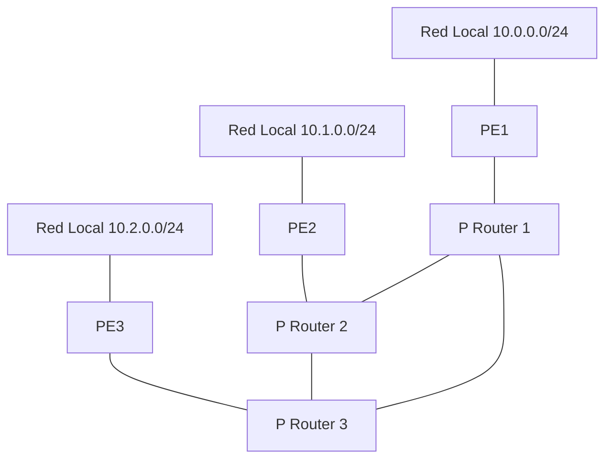
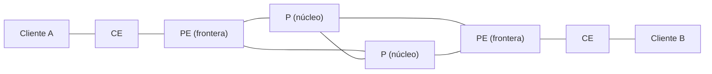
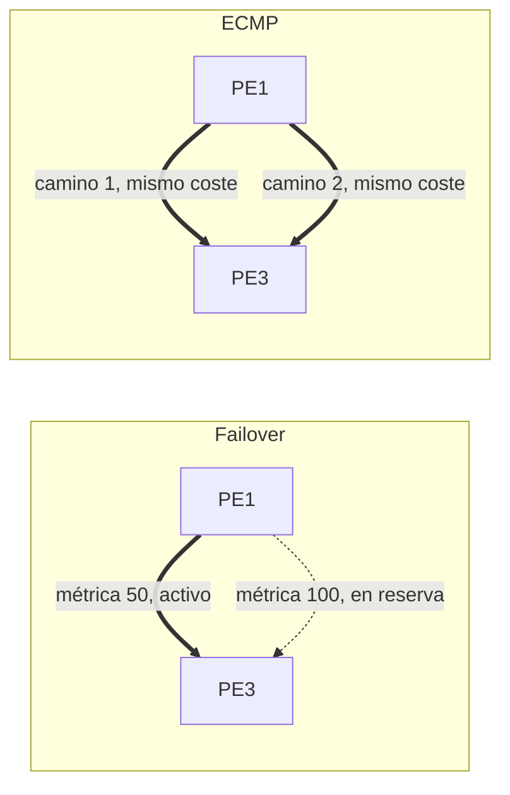

<p class="tema-eyebrow">LABORATORIO 10</p>

# INFRAESTRUCTURA WAN Y CORE

<p class="tema-meta"><span>14 secciones</span><span>4 diagramas</span><span>8 tablas</span></p>

## Contexto empresarial

La empresa **Networking SecOps** ha implementado exitosamente su red con VPN y tunelización (Laboratorio 09). Ahora necesita expandir su infraestructura a nivel geográfico, conectando múltiples sucursales y centros de datos a través de una red WAN robusta y escalable.

## Problema inicial

-   Hasta ahora las sedes se interconectaron con rutas y túneles; falta entender **la red que transporta** ese tráfico.
-   La empresa va a conectar varias sucursales y centros de datos, y debe saber cómo se organiza el núcleo de una WAN de proveedor (roles PE y P, malla parcial, caminos alternativos).
-   Debe comprobar qué ocurre cuando falla un enlace del núcleo y cómo se reparte el tráfico entre caminos de igual preferencia.
-   Antes de elegir una arquitectura WAN, necesita distinguir qué resuelve MPLS y qué resuelve SD-WAN.

## Objetivos del laboratorio

1.  Construir una **simulación de una topología WAN con roles PE/P**: **routers PE** (*Provider Edge*) y **routers P** (*Provider*) en malla parcial, con direccionamiento IP y rutas estáticas.
2.  Interconectar tres LAN remotas a través del núcleo con **rutas estáticas**.
3.  Comprobar la **redundancia** de la malla y el reparto de carga con **[ECMP](https://www.rfc-editor.org/rfc/rfc2992)**.
4.  Comprender (a nivel conceptual) cómo MPLS reenvía por etiquetas, en qué se diferencia del enrutamiento IP convencional y en qué se diferencia de [SD-WAN](https://www.cisco.com/c/en/us/solutions/enterprise-networks/sd-wan/what-is-sd-wan.html).

!!! warning "Qué es ejecutable y qué es conceptual"
    - **Ejecutable:** topología PE/P, rutas estáticas, failover por métricas y ECMP.
    - **Conceptual:** MPLS (*push/swap/pop*) y SD-WAN.
    - **No es** una implementación funcional de un *core* MPLS: la topología usa los **nombres** PE/P para el rol de cada equipo, pero lo que se ejecuta es **enrutamiento IP convencional** con rutas estáticas. Aquí **no** se configuran etiquetas reales (eso exigiría los módulos `mpls_router` y `mpls_iptunnel`) y no se usa OSPF ni [BGP](https://www.rfc-editor.org/rfc/rfc4271): con rutas estáticas el núcleo **no reconverge solo** ante fallos remotos. El enrutamiento dinámico se practica en el Laboratorio 15.

## Topología



**Direccionamiento:**

| Dispositivo | Interfaz | Dirección IP | Rol |
|-------------|----------|--------------|-----|
| PE1 | `veth-pe1lan` (LAN) | 10.0.0.1/24 | Provider Edge |
| host1 | - | 10.0.0.10/24 | Equipo de la LAN 1 |
| PE1 | `veth-pe1p1` (P1) | 192.168.1.1/30 | Core (PE–P) |
| PE2 | `veth-pe2lan` (LAN) | 10.1.0.1/24 | Provider Edge |
| host2 | - | 10.1.0.10/24 | Equipo de la LAN 2 |
| PE2 | `veth-pe2p2` (P2) | 192.168.1.5/30 | Core (PE–P) |
| PE3 | `veth-pe3lan` (LAN) | 10.2.0.1/24 | Provider Edge |
| host3 | - | 10.2.0.10/24 | Equipo de la LAN 3 |
| PE3 | `veth-pe3p3` (P3) | 192.168.1.9/30 | Core (PE–P) |
| P1 | `veth-p1pe1` (R1) | 192.168.1.2/30 | P Router |
| P1 | `veth-p1p2` (P2) | 192.168.1.13/30 | P Router |
| P1 | `veth-p1p3` (P3) | 192.168.1.17/30 | P Router |
| P2 | `veth-p2pe2` (R2) | 192.168.1.6/30 | P Router |
| P2 | `veth-p2p1` (P1) | 192.168.1.14/30 | P Router |
| P2 | `veth-p2p3` (P3) | 192.168.1.21/30 | P Router |
| P3 | `veth-p3pe3` (R3) | 192.168.1.10/30 | P Router |
| P3 | `veth-p3p1` (P1) | 192.168.1.18/30 | P Router |
| P3 | `veth-p3p2` (P2) | 192.168.1.22/30 | P Router |

## Construcción de la red

### Paso 0: Limpiar ejecuciones anteriores de este laboratorio

Este paso solo puede retirar recursos de Lab10. No elimina namespaces, interfaces ni bridges de otros laboratorios; en particular, **`br-wan` pertenece al laboratorio 08 y se conserva**. Si siguen activos recursos de otra práctica, ejecuta la limpieza de esa práctica.

```bash
VETH_WAN_CVPN_OWNED=0
if [ "$(cat /sys/class/net/veth-wan-cvpn/ifalias 2>/dev/null)" = networking-lab-lab-09 ]; then VETH_WAN_CVPN_OWNED=1; fi
if [ "$VETH_WAN_CVPN_OWNED" = 1 ]; then
  echo "veth-wan-cvpn pertenece al laboratorio 09; ejecuta su reversión antes de Lab10. No se elimina aquí."
  exit 1
fi
NS_LAB="PE1 PE2 PE3 P1 P2 P3 host1 host2 host3"
EXISTENTES=$(sudo ip netns list | awk '{print $1}' | while read -r ns; do
  for esperado in $NS_LAB; do [ "$ns" = "$esperado" ] && echo "$ns"; done
done)
NS_SIN_MARCA=""
for ns in $EXISTENTES; do
  if [ "$(sudo ip netns exec "$ns" cat /sys/class/net/lo/ifalias 2>/dev/null)" != networking-lab-lab-10 ]; then NS_SIN_MARCA="$NS_SIN_MARCA $ns"; fi
done
if [ -n "$NS_SIN_MARCA" ]; then echo "Se aborta; namespaces sin marca:$NS_SIN_MARCA"; exit 1; fi
for ns in $EXISTENTES; do
  PIDS=$(sudo ip netns pids "$ns" 2>/dev/null || true)
  if [ -n "$PIDS" ]; then echo "$ns tiene procesos activos ($PIDS); ejecuta su limpieza antes de repetir Lab10."; exit 1; fi
done
for ns in $EXISTENTES; do sudo ip netns del "$ns" 2>/dev/null || true; done
for f in /sys/class/net/*/ifalias; do
  [ -r "$f" ] || continue
  [ "$(cat "$f")" = networking-lab-lab-10 ] || continue
  dev=${f%/ifalias}; dev=${dev##*/}
  sudo ip link del "$dev" 2>/dev/null || true
done
```

Si no existen recursos propios de Lab10, el bloque no modifica nada.

### Paso 1: Crear namespaces

```bash
sudo ip netns add PE1
sudo ip netns exec PE1 ip link set lo alias networking-lab-lab-10
sudo ip netns add PE2
sudo ip netns exec PE2 ip link set lo alias networking-lab-lab-10
sudo ip netns add PE3
sudo ip netns exec PE3 ip link set lo alias networking-lab-lab-10
sudo ip netns add P1
sudo ip netns exec P1 ip link set lo alias networking-lab-lab-10
sudo ip netns add P2
sudo ip netns exec P2 ip link set lo alias networking-lab-lab-10
sudo ip netns add P3
sudo ip netns exec P3 ip link set lo alias networking-lab-lab-10
sudo ip netns add host1
sudo ip netns exec host1 ip link set lo alias networking-lab-lab-10
sudo ip netns add host2
sudo ip netns exec host2 ip link set lo alias networking-lab-lab-10
sudo ip netns add host3
sudo ip netns exec host3 ip link set lo alias networking-lab-lab-10

# Un router solo reenvía si ip_forward vale 1 (en un namespace nuevo vale 0)
for r in PE1 PE2 PE3 P1 P2 P3; do
  sudo ip netns exec $r sysctl -w net.ipv4.ip_forward=1
done
```

### Paso 2: Conectar PE a P

```bash
sudo ip link add veth-pe1p1 type veth peer name veth-p1pe1
sudo ip link set veth-pe1p1 alias networking-lab-lab-10
sudo ip link set veth-p1pe1 alias networking-lab-lab-10
sudo ip link set veth-pe1p1 netns PE1
sudo ip link set veth-p1pe1 netns P1
sudo ip netns exec PE1 ip addr add 192.168.1.1/30 dev veth-pe1p1
sudo ip netns exec PE1 ip link set veth-pe1p1 up
sudo ip netns exec P1 ip addr add 192.168.1.2/30 dev veth-p1pe1
sudo ip netns exec P1 ip link set veth-p1pe1 up

sudo ip link add veth-pe2p2 type veth peer name veth-p2pe2
sudo ip link set veth-pe2p2 alias networking-lab-lab-10
sudo ip link set veth-p2pe2 alias networking-lab-lab-10
sudo ip link set veth-pe2p2 netns PE2
sudo ip link set veth-p2pe2 netns P2
sudo ip netns exec PE2 ip addr add 192.168.1.5/30 dev veth-pe2p2
sudo ip netns exec PE2 ip link set veth-pe2p2 up
sudo ip netns exec P2 ip addr add 192.168.1.6/30 dev veth-p2pe2
sudo ip netns exec P2 ip link set veth-p2pe2 up

sudo ip link add veth-pe3p3 type veth peer name veth-p3pe3
sudo ip link set veth-pe3p3 alias networking-lab-lab-10
sudo ip link set veth-p3pe3 alias networking-lab-lab-10
sudo ip link set veth-pe3p3 netns PE3
sudo ip link set veth-p3pe3 netns P3
sudo ip netns exec PE3 ip addr add 192.168.1.9/30 dev veth-pe3p3
sudo ip netns exec PE3 ip link set veth-pe3p3 up
sudo ip netns exec P3 ip addr add 192.168.1.10/30 dev veth-p3pe3
sudo ip netns exec P3 ip link set veth-p3pe3 up
```

### Paso 3: Conectar P routers

```bash
sudo ip link add veth-p1p2 type veth peer name veth-p2p1
sudo ip link set veth-p1p2 alias networking-lab-lab-10
sudo ip link set veth-p2p1 alias networking-lab-lab-10
sudo ip link set veth-p1p2 netns P1
sudo ip link set veth-p2p1 netns P2
sudo ip netns exec P1 ip addr add 192.168.1.13/30 dev veth-p1p2
sudo ip netns exec P1 ip link set veth-p1p2 up
sudo ip netns exec P2 ip addr add 192.168.1.14/30 dev veth-p2p1
sudo ip netns exec P2 ip link set veth-p2p1 up

sudo ip link add veth-p2p3 type veth peer name veth-p3p2
sudo ip link set veth-p2p3 alias networking-lab-lab-10
sudo ip link set veth-p3p2 alias networking-lab-lab-10
sudo ip link set veth-p2p3 netns P2
sudo ip link set veth-p3p2 netns P3
sudo ip netns exec P2 ip addr add 192.168.1.21/30 dev veth-p2p3
sudo ip netns exec P2 ip link set veth-p2p3 up
sudo ip netns exec P3 ip addr add 192.168.1.22/30 dev veth-p3p2
sudo ip netns exec P3 ip link set veth-p3p2 up

sudo ip link add veth-p1p3 type veth peer name veth-p3p1
sudo ip link set veth-p1p3 alias networking-lab-lab-10
sudo ip link set veth-p3p1 alias networking-lab-lab-10
sudo ip link set veth-p1p3 netns P1
sudo ip link set veth-p3p1 netns P3
sudo ip netns exec P1 ip addr add 192.168.1.17/30 dev veth-p1p3
sudo ip netns exec P1 ip link set veth-p1p3 up
sudo ip netns exec P3 ip addr add 192.168.1.18/30 dev veth-p3p1
sudo ip netns exec P3 ip link set veth-p3p1 up
```

### Paso 4: Configurar redes locales (un equipo en cada LAN)

```bash
for n in 1 2 3; do
  case $n in 1) NET=10.0.0.;; 2) NET=10.1.0.;; 3) NET=10.2.0.;; esac
  sudo ip link add veth-pe${n}lan type veth peer name veth-lanpe${n}
  sudo ip link set veth-pe${n}lan alias networking-lab-lab-10
  sudo ip link set veth-lanpe${n} alias networking-lab-lab-10
  sudo ip link set veth-pe${n}lan netns PE${n}
  sudo ip link set veth-lanpe${n} netns host${n}
  sudo ip netns exec PE${n} ip addr add ${NET}1/24 dev veth-pe${n}lan
  sudo ip netns exec PE${n} ip link set veth-pe${n}lan up
  sudo ip netns exec host${n} ip addr add ${NET}10/24 dev veth-lanpe${n}
  sudo ip netns exec host${n} ip link set veth-lanpe${n} up
  sudo ip netns exec host${n} ip link set lo up
  sudo ip netns exec host${n} ip route add default via ${NET}1
done
```

### Paso 5: Configurar enrutamiento estático

Cada PE envía al P al que está conectado todo lo que no conoce:

```bash
sudo ip netns exec PE1 ip route add default via 192.168.1.2
sudo ip netns exec PE2 ip route add default via 192.168.1.6
sudo ip netns exec PE3 ip route add default via 192.168.1.10
```

Los P conocen el núcleo. Entre P1 y P3 hay un enlace directo (camino preferido) y un camino de respaldo por P2 con `metric 100`:

```bash
# P1
sudo ip netns exec P1 ip route add 192.168.1.4/30 via 192.168.1.14
sudo ip netns exec P1 ip route add 192.168.1.8/30 via 192.168.1.18
sudo ip netns exec P1 ip route add 192.168.1.8/30 via 192.168.1.14 metric 100
sudo ip netns exec P1 ip route add 10.0.0.0/24 via 192.168.1.1
sudo ip netns exec P1 ip route add 10.1.0.0/24 via 192.168.1.14
sudo ip netns exec P1 ip route add 10.2.0.0/24 via 192.168.1.18
sudo ip netns exec P1 ip route add 10.2.0.0/24 via 192.168.1.14 metric 100

# P2
sudo ip netns exec P2 ip route add 192.168.1.0/30 via 192.168.1.13
sudo ip netns exec P2 ip route add 192.168.1.8/30 via 192.168.1.22
sudo ip netns exec P2 ip route add 10.0.0.0/24 via 192.168.1.13
sudo ip netns exec P2 ip route add 10.1.0.0/24 via 192.168.1.5
sudo ip netns exec P2 ip route add 10.2.0.0/24 via 192.168.1.22

# P3
sudo ip netns exec P3 ip route add 192.168.1.0/30 via 192.168.1.17
sudo ip netns exec P3 ip route add 192.168.1.0/30 via 192.168.1.21 metric 100
sudo ip netns exec P3 ip route add 192.168.1.4/30 via 192.168.1.21
sudo ip netns exec P3 ip route add 10.0.0.0/24 via 192.168.1.17
sudo ip netns exec P3 ip route add 10.0.0.0/24 via 192.168.1.21 metric 100
sudo ip netns exec P3 ip route add 10.1.0.0/24 via 192.168.1.21
sudo ip netns exec P3 ip route add 10.2.0.0/24 via 192.168.1.9
```

### Paso 6: Verificar conectividad

```bash
# Entre equipos de LAN distintas, a través del núcleo
sudo ip netns exec host1 ping -c 4 10.1.0.10
sudo ip netns exec host1 ping -c 4 10.2.0.10

# Camino que sigue el tráfico (host1 -> host3 pasa por PE1, P1, P3, PE3).
# Son saltos IP convencionales: en un core MPLS real los P no consultarían la tabla IP, sino etiquetas.
sudo ip netns exec host1 traceroute -n 10.2.0.10

# Entre routers PE
sudo ip netns exec PE1 ping -c 4 192.168.1.5
```

### Red de proveedor: roles PE y P

**PE** y **P** son **funciones** dentro de una arquitectura de proveedor, no tipos de equipo definidos por el nombre ni por el hardware: el mismo modelo de router puede ser PE en un punto y P en otro. La clasificación depende del **papel** que desempeña cada equipo.



| Rol | Dónde está | Qué hace |
|-----|------------|----------|
| **[CE](https://www.rfc-editor.org/rfc/rfc4364)** (*Customer Edge*) | Sede del cliente | Entrega el tráfico al proveedor |
| **PE** (*Provider Edge*) | Frontera del proveedor | Conecta con el cliente; clasifica y aplica servicios |
| **P** (*Provider*) | Núcleo | Reenvía tráfico con rapidez; no conoce las redes del cliente |

### Enrutamiento IP frente a MPLS en el núcleo

| Aspecto | Enrutamiento IP (esta simulación) | MPLS |
|---------|------------------------------------|------|
| Qué consulta cada router | La **dirección IP de destino** en la tabla de rutas | La **etiqueta** en la [LFIB](https://www.rfc-editor.org/rfc/rfc3031) |
| Dónde se decide el camino | En **cada** salto (*longest prefix match*) | En el PE de entrada (clasifica en una FEC) |
| Qué necesita | Rutas (estáticas o un IGP) | IGP + protocolo de etiquetas ([LDP](https://www.rfc-editor.org/rfc/rfc5036)) + LFIB |
| Qué permite | Conectividad | L3VPN, ingeniería de tráfico, QoS |

### Push, swap y pop


(Las etiquetas son inventadas; el recorrido corresponde a la tabla del ejemplo anterior.)

### Servicios que ofrece un proveedor WAN

| Servicio | Qué ofrece | Relación con este laboratorio |
|----------|------------|-------------------------------|
| **L3VPN** | Enrutamiento privado entre sedes (MPLS) | Es lo que justifica los roles PE/P |
| **L2VPN / Ethernet WAN** | Extiende un dominio de capa 2 entre sedes | No se simula |
| **Internet dedicado** | Salida a Internet con SLA | Puede ser un transporte de una SD-WAN |
| **Circuitos con SLA** | Latencia y disponibilidad contratadas | Base de la comparación MPLS/SD-WAN |

### IGP, LDP y BGP (introducción conceptual)

-   **IGP** (OSPF, [IS-IS](https://www.rfc-editor.org/rfc/rfc1195)): da a los routers del proveedor la topología interna.
-   **LDP**: reparte etiquetas MPLS asociadas a los prefijos que conoce el IGP.
-   **BGP**: intercambia rutas entre **sistemas autónomos** y transporta las rutas de los clientes entre PE.

## Análisis MPLS (conceptual)

!!! warning "Lo que ejecutamos arriba no es MPLS"
    Las rutas estáticas del Paso 5 son **rutas IP convencionales**. **No crean una LFIB, no asignan etiquetas MPLS y no demuestran intercambio de etiquetas.** Cada router decide por la **dirección IP de destino** (*longest prefix match*). Lo que sigue explica qué haría MPLS en la misma topología, sin implementarlo.

**MPLS** (*Multiprotocol Label Switching*, [RFC](https://www.rfc-editor.org/) 3031) reenvía paquetes según una **etiqueta** de corta longitud, no según la dirección IP de destino. Los **PE** participan en la **entrada y salida** del dominio MPLS; los **P** realizan **conmutación de etiquetas** sin mirar el paquete IP. Las operaciones son:

1. **Push**: el PE de entrada añade una etiqueta al paquete.
2. **Swap**: cada P sustituye la etiqueta de entrada por la de salida, según su tabla.
3. **Pop**: se retira la etiqueta (en el último P, por *penultimate hop popping*, o en el PE de salida).

**Ejemplo de recorrido** (ilustrativo, los números de etiqueta son inventados) para el tráfico `host1 → host3`, que en MPLS seguiría el mismo camino PE1 → P1 → P3 → PE3:

| Salto | Equipo | Operación | Etiqueta en el paquete |
|-------|--------|-----------|------------------------|
| 1 | PE1 | **Push** (clasifica `10.2.0.0/24` en una FEC) | → 100 |
| 2 | P1 | **Swap** (consulta su LFIB) | 100 → 200 |
| 3 | P3 | **Pop** (*penultimate hop popping*, el PE final recibe el paquete sin etiqueta) | 200 → ninguna |
| 4 | PE3 | Reenvío IP normal hacia `host3` | — |

**Qué le falta a la simulación para ser una red MPLS real:**

-   **Distribución de etiquetas**: un protocolo como **LDP** (o [RSVP-TE](https://www.rfc-editor.org/rfc/rfc3209), o segment routing) reparte las etiquetas entre routers vecinos y las asocia a cada prefijo (FEC) que el IGP conoce. Sin él, no hay correspondencia etiqueta ↔ destino.
-   **Un IGP** (como OSPF o IS-IS) que dé a LDP la topología de transporte.
-   **Las tablas MPLS** (LFIB), que sustituyen en el núcleo a la consulta de la tabla de rutas IP, y el soporte de etiquetas en las interfaces (módulos `mpls_router` y `mpls_iptunnel` en Linux).

Entonces, ¿para qué sirve? Entre otras cosas, para **VPN de capa 3 (L3VPN)**, **ingeniería de tráfico** y **QoS** en redes de proveedor.

## Comparación MPLS vs SD-WAN

**SD-WAN no es sinónimo de MPLS.** MPLS es una **tecnología de reenvío** dentro de la red de un proveedor; SD-WAN es un **enfoque de gestión y control** de la conectividad WAN basado en **políticas y selección de caminos**, que puede utilizar **distintos transportes** (MPLS, Internet de banda ancha, 4G/5G…). De hecho, una SD-WAN puede usar un circuito MPLS como uno de sus transportes.

| Característica | MPLS | SD-WAN |
|----------------|------|--------|
| Naturaleza | Mecanismo de reenvío por etiquetas | Plano de control/gestión centralizado sobre varios transportes |
| Control | Distribuido (protocolos entre routers) | Centralizado (orquestador y políticas) |
| Transporte | Red del proveedor (con SLA) | Varios enlaces (MPLS, banda ancha, móvil) |
| QoS | Posible y con SLA según contrato | Depende del transporte elegido y de las políticas aplicadas |
| Costo | Suele ser mayor por Mbps | Suele ser menor, según el diseño |
| Agilidad | Menor (aprovisionamiento del proveedor) | Mayor |

Los valores de coste y agilidad son tendencias habituales, no reglas.

## Ejercicios

### Ejercicio 1: Simular un fallo en el núcleo

Tiramos el enlace directo P1-P3 (camino preferido) **por sus dos extremos**: así ambos routers retiran su ruta y activan la de respaldo por P2.

```bash
sudo ip netns exec P1 ip link set veth-p1p3 down
sudo ip netns exec P3 ip link set veth-p3p1 down
sudo ip netns exec host1 ping -c 4 10.2.0.10
sudo ip netns exec host1 traceroute -n 10.2.0.10
```

**Resultado esperado:** 0% de pérdida y un salto más (P2, `192.168.1.14`). Restablece después el enlace (`up` en ambos extremos) y vuelve a añadir las rutas que se retiraron al bajar la interfaz:

```bash
sudo ip netns exec P1 ip link set veth-p1p3 up
sudo ip netns exec P3 ip link set veth-p3p1 up
sudo ip netns exec P1 ip route add 192.168.1.8/30 via 192.168.1.18
sudo ip netns exec P1 ip route add 10.2.0.0/24 via 192.168.1.18
sudo ip netns exec P3 ip route add 192.168.1.0/30 via 192.168.1.17
sudo ip netns exec P3 ip route add 10.0.0.0/24 via 192.168.1.17
```

!!! warning "Sin reconvergencia automática"
    Si en lugar del enlace P1-P3 cae el P2-P3, P1 **no se entera** y sigue usando una ruta estática que ya no sirve. Detectar fallos remotos es tarea de OSPF/BGP (Laboratorio 15).

### Ejercicio 2: Balanceo ECMP

**ECMP** (*Equal-Cost Multi-Path*) reparte el tráfico entre varios caminos de **igual coste**: es **balanceo de carga**, distinto del *failover*, que es la **selección de una ruta alternativa** cuando falla la principal (Ejercicio 1). ECMP **no equivale a alta disponibilidad completa**: si un camino cae, los flujos que lo usaban se interrumpen hasta que se detecta el fallo y se reasignan, y las aplicaciones pueden notarlo. Se define con **una sola ruta de varios saltos** (`nexthop`), no con dos `ip route add` (el segundo daría `File exists`). Por defecto el reparto se calcula solo con las IP de origen y destino; con la política 1 también se usan los puertos y se ven los dos caminos. (Aquí los dos caminos tienen distinta longitud: Linux no lo exige en rutas estáticas, pero protocolos como OSPF solo reparten entre caminos de **igual coste**.) Comprueba el reparto:

```bash
sudo ip netns exec P1 sysctl -w net.ipv4.fib_multipath_hash_policy=1
sudo ip netns exec P1 ip route replace 10.2.0.0/24 nexthop via 192.168.1.18 weight 1 nexthop via 192.168.1.14 weight 1
sudo ip netns exec P1 ip route show 10.2.0.0/24

# Varios flujos TCP distintos (puertos de origen distintos) pueden tomar caminos distintos
for sp in 40001 40002 40003 40004 40005 40006; do
  sudo ip netns exec P1 ip route get 10.2.0.10 from 10.0.0.10 iif veth-p1pe1 ipproto tcp sport $sp dport 80 | head -1
done
```

### Failover frente a ECMP

| | *Failover* | ECMP |
|--|-----------|------|
| Idea | Usar un camino **de respaldo** cuando falla el principal | **Repartir** tráfico entre varios caminos de **igual coste** |
| Caminos en uso | Uno (el otro espera) | Varios a la vez |
| Qué aporta | Disponibilidad | Capacidad (y disponibilidad parcial) |
| Cómo se configura aquí | Dos rutas con **distinta** métrica | Dos rutas con **la misma** métrica (`nexthop` múltiple) |



El reparto de ECMP se hace **por flujo**, no por paquete: una sola conexión no usa dos caminos a la vez.

## Conceptos clave

| Concepto | Aplicación |
|----------|------------|
| MPLS | Explicado conceptualmente (push/swap/pop); **no** implementado |
| SD-WAN | Explicado conceptualmente: gestión por políticas sobre varios transportes |
| Topología PE/P | Roles de proveedor con enrutamiento IP y rutas estáticas con respaldo |
| ECMP | Reparto de carga entre caminos de igual coste (no es *failover* ni alta disponibilidad completa) |

## Limpieza del laboratorio

La topología WAN se construye dentro de nueve *namespaces*. Las interfaces, rutas y ajustes MPLS de esta práctica desaparecen al eliminarlos; no es necesario vaciar tablas ni reglas globales del host.

```bash
NS_LEFT=0
for ns in PE1 PE2 PE3 P1 P2 P3 host1 host2 host3; do
  if sudo ip netns list | awk '{print $1}' | grep -Fxq "$ns"; then
    if [ "$(sudo ip netns exec "$ns" cat /sys/class/net/lo/ifalias 2>/dev/null)" != networking-lab-lab-10 ]; then echo "Se conserva $ns: no tiene la marca exclusiva de Lab10."; NS_LEFT=1
    else
      PIDS=$(sudo ip netns pids "$ns" 2>/dev/null || true)
      if [ -n "$PIDS" ]; then echo "Se conserva $ns: quedan procesos activos ($PIDS)."; NS_LEFT=1; fi
    fi
  fi
done
if [ "$NS_LEFT" = 0 ]; then
  for ns in PE1 PE2 PE3 P1 P2 P3 host1 host2 host3; do
    if sudo ip netns list | awk '{print $1}' | grep -Fxq "$ns"; then sudo ip netns del "$ns" 2>/dev/null || true; fi
  done
  for f in /sys/class/net/*/ifalias; do
    [ -r "$f" ] || continue
    [ "$(cat "$f")" = networking-lab-lab-10 ] || continue
    dev=${f%/ifalias}; dev=${dev##*/}
    sudo ip link del "$dev" 2>/dev/null || true
  done
else echo "Se conservan enlaces host: hay namespaces con procesos activos."; fi
```

**Comprobación:** `sudo ip netns list` no debe mostrar esos nueve nombres. Si vas a repetir el laboratorio, comienza desde el Paso 0 para reconstruir la topología.

## Profundización: qué hace realmente un core MPLS

En la topología ejecutada, los routers P reenvían paquetes IP mediante rutas estáticas. No existe MPLS funcional, LDP, LFIB, [LSP](https://www.rfc-editor.org/rfc/rfc3031) ni [VRF](https://www.rfc-editor.org/rfc/rfc4364). La explicación conceptual debe conservar esa frontera: no describas los resultados de esta simulación como si se hubiera conmutado una etiqueta.

En una red MPLS real:

- **CE** conecta la red del cliente con el proveedor; **PE** mantiene la separación de clientes (por ejemplo VRF) y aplica/retira etiquetas de servicio; **P** conmuta etiquetas en el núcleo y normalmente no necesita conocer los prefijos IP de las LAN de clientes.
- **FEC** agrupa paquetes que reciben un tratamiento de forwarding común.
- **LSP** es el camino etiquetado a través del dominio MPLS.
- **LDP** puede distribuir etiquetas asociadas a FEC; otros diseños usan mecanismos distintos.
- **LFIB** consulta la etiqueta entrante y decide operación/next-hop (swap, pop o push).
- En MPLS L3VPN, MP-BGP distribuye rutas VPNv4/VPNv6; RD hace únicas las rutas solapadas y RT controla importación/exportación entre VRF.

La pila de etiquetas puede contener etiqueta de transporte y etiqueta de servicio. PHP permite que el penúltimo router retire la etiqueta de transporte cuando el diseño lo solicita. No reduzcas MPLS a “IP con una etiqueta”: la separación de forwarding, señalización y contexto de cliente es central.

### ECMP: medir y describir el reparto

ECMP reparte normalmente por flujo mediante un hash para conservar afinidad; no implica que cada paquete de una misma sesión siga un camino distinto. Comprueba la ruta multipath y realiza varias conexiones independientes antes de concluir que el reparto es uniforme. Distingue igualdad de coste calculada por un IGP de una ruta multipath estática configurada manualmente con pesos.

```bash
sudo ip route show
sudo ip route get 10.0.2.10
sudo ip -s link show
```

### MPLS y SD-WAN no son equivalentes

MPLS es una tecnología/arquitectura de forwarding del proveedor; SD-WAN es una arquitectura de control, políticas y orquestación de conectividad WAN que puede utilizar MPLS, Internet o enlaces LTE como underlay. Evalúa SLA de aplicaciones con latencia, jitter y pérdida, y diferencia edge, controlador y orquestador.

## Preguntas de reflexión

1.  ¿Qué distingue a un router PE de uno P en una arquitectura de proveedor?
2.  ¿Qué sucedería con el tráfico si caen a la vez los enlaces P1-P3 y P2-P3?
3.  ¿Qué diferencia hay entre lo que esta simulación demuestra (rutas IP) y lo que haría MPLS real?
4.  ¿Qué limitaciones tiene no disponer de un protocolo de enrutamiento dinámico en el núcleo?
5.  ¿Cuándo preferiría una empresa SD-WAN a un servicio MPLS contratado?

## Conclusiones técnicas

Hemos construido una **simulación de una topología WAN con roles PE/P** y rutas IP estáticas, y hemos explicado MPLS de forma conceptual: para que fuese un core MPLS faltarían la distribución de etiquetas (LDP) y las tablas de etiquetas. MPLS permite ingeniería de tráfico y QoS mediante el reenvío por etiquetas (la calidad no es automática: depende de cómo el proveedor la configure). SD-WAN es un enfoque de gestión por políticas que puede apoyarse en MPLS, banda ancha u otros transportes, y suele ofrecer flexibilidad y reducción de costos. Las arquitecturas híbridas combinan ambos.

## Preparación para el siguiente laboratorio

Hasta aquí cada laboratorio estudió **un mecanismo** (rutas, servicios, firewall, VPN, WAN). En el **Laboratorio 11** esos mecanismos se **organizan en una arquitectura empresarial**: capas Core, Distribución y Acceso, con firewall, DMZ y redundancia. Pasamos de configurar piezas a **diseñar un conjunto**.

---

**¡Laboratorio 10 completado!** Continúa con el **Laboratorio 11**.
