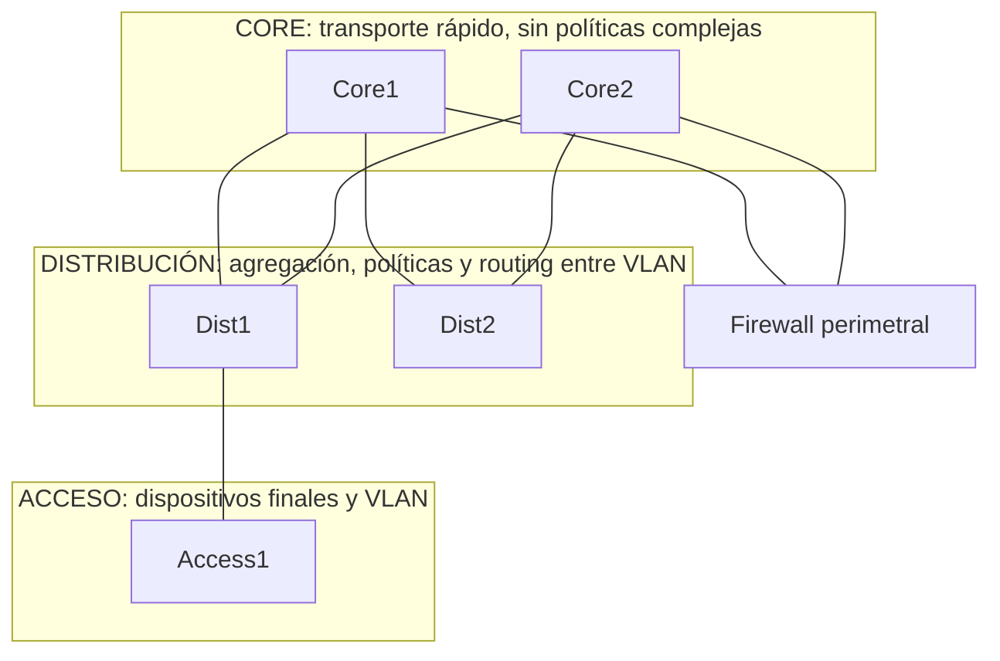
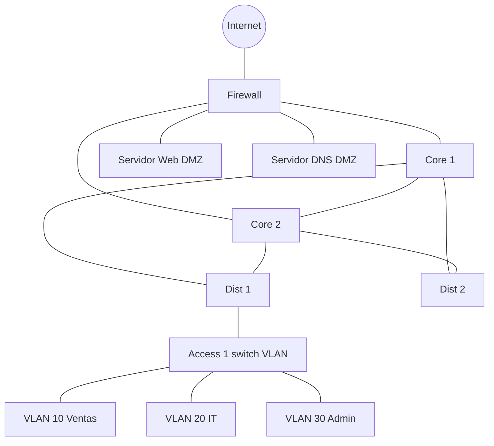
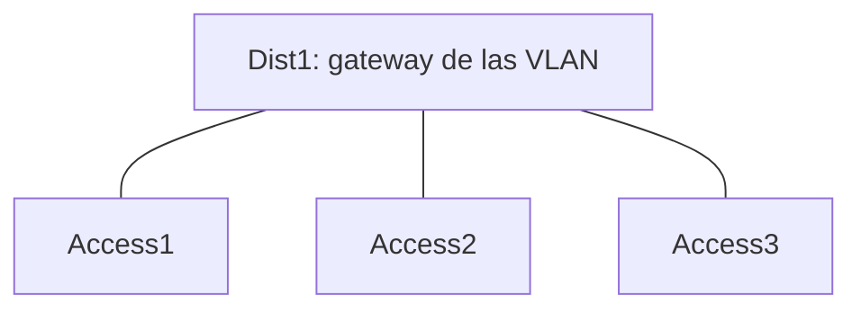

<p class="tema-eyebrow">LABORATORIO 11</p>

# ARQUITECTURA DE RED EMPRESARIAL

<p class="tema-meta"><span>19 secciones</span><span>4 diagramas</span><span>10 tablas</span></p>

## Diseñar el conjunto

La infraestructura WAN ya está operativa (laboratorio 10). Ahora Networking SecOps necesita diseñar la arquitectura completa de su sede central con el modelo jerárquico **Core – Distribución – Acceso**, redundancia en el núcleo y una DMZ. En este laboratorio construirás esa arquitectura y comprobarás qué ocurre cuando falla un componente.

## Introducción técnica

Una red empresarial no es una suma de equipos sino un diseño. El modelo jerárquico **Core – Distribución – Acceso** reparte las funciones: el núcleo transporta con rendimiento, la distribución agrega y aplica políticas, y el acceso conecta los dispositivos finales. Un firewall perimetral separa el interior, la DMZ e Internet.

Este laboratorio construye esa arquitectura en una sede, con redundancia en el núcleo y una DMZ.

### Función de cada capa

| Capa | Función | En este laboratorio |
|------|---------|---------------------|
| **Core** | Transporte de **alto rendimiento** entre los bloques de la arquitectura; debe ser simple y rápido, sin aplicar políticas complejas. | `Core1`, `Core2` |
| **Distribución** | **Agregación** de los switches de acceso, **políticas** y **enrutamiento entre segmentos** (aquí, entre VLAN). | `Dist1` (gateway de las VLAN), `Dist2` |
| **Acceso** | **Conexión de los dispositivos finales** y segmentación en VLAN. | `Access1` (switch con VLAN) |

El **firewall perimetral** controla el tráfico entre el interior, la DMZ e Internet. No basta con dibujar los tres niveles: cada uno tiene una función distinta.

!!! note "Relación con el laboratorio 05"
    En el laboratorio 05 se estudian **de forma aislada** los mecanismos de segmentación (VLAN, trunk 802.1Q, router-on-a-stick). Aquí esos mismos mecanismos se incorporan **dentro de una arquitectura empresarial jerárquica**. No son el mismo escenario: cambian los dispositivos, los nombres y el direccionamiento (aquí `10.0.10–30.0/24` y enlaces `10.255.x.x`).

!!! note "Alcance"
    El escenario base construye **una** capa de acceso completa (`Access1`, con las tres VLAN) y usa **rutas estáticas con métrica**. El **Prueba 1** añade un segundo gateway de distribución con VRRP; el Laboratorio 15 vuelve a integrar VRRP junto con OSPF en una topología más amplia.

!!! warning "Tener dos Core y dos Distribution no demuestra alta disponibilidad"
    La redundancia **física** solo se convierte en **disponibilidad** si existen mecanismos que (1) eviten bucles, (2) detecten el fallo y (3) muevan el tráfico (y los *gateways*) al camino alternativo. En esta práctica: el **núcleo** tolera la caída de `Core1` (mediante rutas de respaldo y fallo **local**), pero las VLAN dependen de **un único *gateway***, `Dist1`, porque `Access1` solo se conecta a él. Si `Dist1` falla, las VLAN pierden conectividad aunque `Dist2` esté sana. Resolverlo requiere un segundo trunk, un protocolo contra bucles de capa 2 (STP/[RSTP](https://1.ieee802.org/spanning-tree/)) y redundancia de *gateway* (VRRP): pruebas de esta práctica y Laboratorio 15.

### Las capas son funciones, no niveles físicos

Core, Distribución y Acceso describen **qué hace** cada equipo, no en qué rack está ni cuántos saltos tiene. En una sede pequeña un mismo equipo puede cumplir dos funciones (un *core* colapsado); lo importante es **no mezclar responsabilidades** sin saberlo.



## Objetivos de aprendizaje

Al terminar este laboratorio deberías poder:

- explicar la función de las capas Core, Distribución y Acceso, y por qué son funciones y no niveles físicos;
- distinguir redundancia física de disponibilidad e identificar puntos únicos de fallo;
- observar la conmutación del núcleo al caer `Core1` y el efecto de depender de un único *gateway*;
- explicar para qué sirven VRRP y STP/RSTP en una arquitectura redundante.

### Conocimientos previos y relación con la práctica anterior

- **Conocimientos previos:** Laboratorios 05 (VLAN y *trunk*), 06 (enrutamiento) y 08 (firewall y DMZ). Core, Distribución y Acceso se explican en la introducción técnica.
- **Relación con la práctica anterior:** *Escenario nuevo.* Reutiliza los mecanismos de segmentación del laboratorio 05, pero dentro de una arquitectura jerárquica con otros dispositivos, nombres y direccionamiento. Su limpieza solo retira recursos de Lab11 y no toca `br-wan` ni otras prácticas.

## Estado inicial

- Los mecanismos de los laboratorios anteriores existen por separado.
- Falta una arquitectura que los organice: capas con funciones distintas, un perímetro y un núcleo sin punto único de fallo.

## Resultado que se construirá

Queda una sede con dos routers de núcleo (`Core1`, `Core2`), dos de distribución (`Dist1`, `Dist2`), un switch de acceso (`Access1`) con tres VLAN, un firewall y una DMZ con servidores públicos. Se observan el camino de cada tipo de tráfico, la conmutación del núcleo cuando cae `Core1`, el comportamiento de las VLAN frente a un único *gateway* y, en variaciones, VRRP y STP.

## Topología



**Direccionamiento.** Los enlaces punto a punto del núcleo usan subredes `/30` (una por enlace, sin repetir direcciones) dentro de `10.255.0.0/16`; las LAN, VLAN y DMZ usan `10.0.0.0/16`.

| Enlace | Subred | Extremo A | Extremo B |
|--------|--------|-----------|-----------|
| Core1 - Core2 | 10.255.0.0/30 | Core1 .1 | Core2 .2 |
| Core1 - Dist1 | 10.255.1.0/30 | Core1 .1 | Dist1 .2 |
| Core1 - Dist2 | 10.255.1.4/30 | Core1 .5 | Dist2 .6 |
| Core2 - Dist1 | 10.255.1.8/30 | Core2 .9 | Dist1 .10 |
| Core2 - Dist2 | 10.255.1.12/30 | Core2 .13 | Dist2 .14 |
| Core1 - Firewall | 10.255.2.0/30 | Core1 .1 | Firewall .2 |
| Core2 - Firewall | 10.255.2.4/30 | Core2 .5 | Firewall .6 |
| Firewall - Internet (host) | 192.168.100.0/24 | Firewall .1 | host .2 |

| Segmento | Subred | Gateway | Equipos |
|----------|--------|---------|---------|
| VLAN 10 Ventas | 10.0.10.0/24 | Dist1 10.0.10.1 | ventas 10.0.10.10 |
| VLAN 20 IT | 10.0.20.0/24 | Dist1 10.0.20.1 | it 10.0.20.10 |
| VLAN 30 Admin | 10.0.30.0/24 | Dist1 10.0.30.1 | admin 10.0.30.10 |
| DMZ | 10.0.99.0/24 | Firewall 10.0.99.1 | Web 10.0.99.10, DNS 10.0.99.5 |

## Construcción

### Paso 0: Limpiar ejecuciones anteriores de este laboratorio

Este paso solo retira namespaces y enlaces marcados como propios de Lab11. No elimina `br-wan`, `veth-host`, `veth-wan-cvpn` ni recursos de otros laboratorios; ejecuta la reversión de cada práctica anterior por separado.

```bash
NS_LAB="Core1 Core2 Dist1 Dist2 Access1 Access2 Firewall ServidorWeb ServidorDNS ventas it admin"
EXISTENTES=$(sudo ip netns list | awk '{print $1}' | while read -r ns; do
  for esperado in $NS_LAB; do [ "$ns" = "$esperado" ] && echo "$ns"; done
done)
NS_SIN_MARCA=""
for ns in $EXISTENTES; do
  if [ "$(sudo ip netns exec "$ns" cat /sys/class/net/lo/ifalias 2>/dev/null)" != networking-lab-lab-11 ]; then NS_SIN_MARCA="$NS_SIN_MARCA $ns"; fi
done
if [ -n "$NS_SIN_MARCA" ]; then echo "Se aborta; namespaces sin marca:$NS_SIN_MARCA"; exit 1; fi
if [ -e /tmp/lab11 ] && [ ! -f /tmp/lab11/.networking-lab-lab-11 ]; then echo "/tmp/lab11 existe sin marca de propiedad; no se modifica."; exit 1; fi
for f in /tmp/lab11-ip_forward.orig /tmp/lab11-host-nat.added /tmp/lab11-forward-out.added /tmp/lab11-forward-in.added; do
  if [ -e "$f" ]; then echo "Existe el marcador $f; ejecuta la reversión completa de Lab11 antes de repetirlo."; exit 1; fi
done
for ns in $EXISTENTES; do
  PIDS=$(sudo ip netns pids "$ns" 2>/dev/null || true)
  if [ -n "$PIDS" ]; then echo "$ns tiene procesos activos ($PIDS); ejecuta la limpieza antes de repetir Lab11."; exit 1; fi
done
for ns in $EXISTENTES; do sudo ip netns del "$ns" 2>/dev/null || true; done
for f in /sys/class/net/*/ifalias; do
  [ -r "$f" ] || continue
  [ "$(cat "$f")" = networking-lab-lab-11 ] || continue
  dev=${f%/ifalias}; dev=${dev##*/}
  sudo ip link del "$dev" 2>/dev/null || true
done
if [ -f /tmp/lab11/.networking-lab-lab-11 ]; then sudo rm -rf /tmp/lab11; fi
```

Si hay recursos activos de otro laboratorio, ejecuta primero la limpieza de ese laboratorio; este paso no los modifica.
### Paso 1: Crear namespaces y una función auxiliar

```bash
for ns in Core1 Core2 Dist1 Dist2 Access1 Firewall ServidorWeb ServidorDNS ventas it admin; do
  sudo ip netns add $ns
done
for ns in Core1 Core2 Dist1 Dist2 Access1 Firewall ServidorWeb ServidorDNS ventas it admin; do sudo ip netns exec "$ns" ip link set lo alias networking-lab-lab-11; done
for r in Core1 Core2 Dist1 Dist2 Firewall; do
  sudo ip netns exec $r sysctl -qw net.ipv4.ip_forward=1
done

# enlace NS_A IF_A IP_A NS_B IF_B IP_B : crea un par veth con una IP en cada extremo
enlace() {
  sudo ip link add $2 type veth peer name $5
  sudo ip link set $2 alias networking-lab-lab-11
  sudo ip link set $5 alias networking-lab-lab-11
  sudo ip link set $2 netns $1
  sudo ip link set $5 netns $4
  sudo ip netns exec $1 ip addr add $3 dev $2
  sudo ip netns exec $1 ip link set $2 up
  sudo ip netns exec $4 ip addr add $6 dev $5
  sudo ip netns exec $4 ip link set $5 up
}
```

### Paso 2: Enlaces del núcleo y de distribución (un /30 por enlace)

```bash
enlace Core1 veth-c1c2 10.255.0.1/30  Core2 veth-c2c1 10.255.0.2/30
enlace Core1 veth-c1d1 10.255.1.1/30  Dist1 veth-d1c1 10.255.1.2/30
enlace Core1 veth-c1d2 10.255.1.5/30  Dist2 veth-d2c1 10.255.1.6/30
enlace Core2 veth-c2d1 10.255.1.9/30  Dist1 veth-d1c2 10.255.1.10/30
enlace Core2 veth-c2d2 10.255.1.13/30 Dist2 veth-d2c2 10.255.1.14/30
```

### Paso 3: Firewall, Internet y DMZ

```bash
# Core <-> Firewall
enlace Core1 veth-c1fw 10.255.2.1/30 Firewall veth-fwc1 10.255.2.2/30
enlace Core2 veth-c2fw 10.255.2.5/30 Firewall veth-fwc2 10.255.2.6/30

# Firewall <-> Internet (el host, 192.168.100.2)
sudo ip link add veth-fw-wan type veth peer name veth-wan-fw
sudo ip link set veth-fw-wan alias networking-lab-lab-11
sudo ip link set veth-wan-fw alias networking-lab-lab-11
sudo ip link set veth-fw-wan netns Firewall
sudo ip netns exec Firewall ip addr add 192.168.100.1/24 dev veth-fw-wan
sudo ip netns exec Firewall ip link set veth-fw-wan up
sudo ip addr add 192.168.100.2/24 dev veth-wan-fw
sudo ip link set veth-wan-fw up
sudo ip netns exec Firewall ip route add default via 192.168.100.2

# El host reenvía y traduce hacia la red real (cambia eth0 por tu interfaz de salida)
if [ ! -e /tmp/lab11-ip_forward.orig ]; then
  sudo sysctl -n net.ipv4.ip_forward | sudo tee /tmp/lab11-ip_forward.orig >/dev/null
fi
sudo sysctl -w net.ipv4.ip_forward=1
if ! sudo iptables -t nat -C POSTROUTING -s 192.168.100.0/24 -o eth0 -j MASQUERADE; then
  sudo iptables -t nat -A POSTROUTING -s 192.168.100.0/24 -o eth0 -j MASQUERADE && touch /tmp/lab11-host-nat.added
fi
# El host puede tener FORWARD=DROP; abre solo el enlace WAN de esta práctica y su retorno.
if ! sudo iptables -C FORWARD -i veth-wan-fw -o eth0 -s 192.168.100.0/24 -j ACCEPT; then
  sudo iptables -I FORWARD 1 -i veth-wan-fw -o eth0 -s 192.168.100.0/24 -j ACCEPT && touch /tmp/lab11-forward-out.added
fi
if ! sudo iptables -C FORWARD -i eth0 -o veth-wan-fw -d 192.168.100.0/24 -m conntrack --ctstate RELATED,ESTABLISHED -j ACCEPT; then
  sudo iptables -I FORWARD 1 -i eth0 -o veth-wan-fw -d 192.168.100.0/24 -m conntrack --ctstate RELATED,ESTABLISHED -j ACCEPT && touch /tmp/lab11-forward-in.added
fi

# DMZ: un bridge en el firewall con los dos servidores públicos
sudo ip netns exec Firewall ip link add br-dmz type bridge
sudo ip netns exec Firewall ip addr add 10.0.99.1/24 dev br-dmz
sudo ip netns exec Firewall ip link set br-dmz up
for s in "ServidorWeb veth-web veth-fw-web 10.0.99.10/24" "ServidorDNS veth-dns veth-fw-dns 10.0.99.5/24"; do
  set -- $s
  sudo ip link add $2 type veth peer name $3
  sudo ip link set $2 alias networking-lab-lab-11
  sudo ip link set $3 alias networking-lab-lab-11
  sudo ip link set $2 netns $1
  sudo ip link set $3 netns Firewall
  sudo ip netns exec Firewall ip link set $3 master br-dmz
  sudo ip netns exec Firewall ip link set $3 up
  sudo ip netns exec $1 ip addr add $4 dev $2
  sudo ip netns exec $1 ip link set $2 up
  sudo ip netns exec $1 ip link set lo up
  sudo ip netns exec $1 ip route add default via 10.0.99.1
done
```

!!! danger "Cambio en el host en el Paso 3"
    Dentro del bloque anterior, **estas líneas actúan sobre el equipo real, no sobre un namespace**: `ip addr add 192.168.100.2/24 dev veth-wan-fw`, `sysctl -w net.ipv4.ip_forward=1` y la regla `iptables -t nat … MASQUERADE`. El bloque conserva el valor original de `ip_forward` y se registra si añadió la regla NAT. Los cambios afectan al host hasta ejecutar «Revertir los cambios del host».

### Paso 4: Rutas estáticas con métrica (camino principal y de respaldo)

Cada router tiene un camino **principal** (métrica 10) y uno de **respaldo** (métrica 20). Dos rutas al mismo destino con la misma métrica no pueden coexistir.

!!! warning "Una métrica mayor no garantiza *failover*"
    La ruta de respaldo (métrica 20) solo se **usa** cuando la principal desaparece de la tabla, y con rutas estáticas eso ocurre únicamente si **la interfaz del propio router** cae. Si la interfaz sigue activa pero existe una falla **más allá** (el siguiente salto no responde, el enlace remoto está cortado), la ruta estática ordinaria **no lo detecta** y el tráfico se pierde. Para cubrir ese caso harían falta un protocolo dinámico (OSPF), detección de fallos ([BFD](https://www.rfc-editor.org/rfc/rfc5880)) o rutas condicionadas a la accesibilidad del siguiente salto.

```bash
# Distribución: salida por defecto hacia el core (principal Core1 en Dist1, Core2 en Dist2)
sudo ip netns exec Dist1 ip route add default via 10.255.1.1  metric 10
sudo ip netns exec Dist1 ip route add default via 10.255.1.9  metric 20
sudo ip netns exec Dist2 ip route add default via 10.255.1.13 metric 10
sudo ip netns exec Dist2 ip route add default via 10.255.1.5  metric 20

# Core: salida por el firewall (respaldo por el otro core) y rutas hacia las VLAN
sudo ip netns exec Core1 ip route add default via 10.255.2.2 metric 10
sudo ip netns exec Core1 ip route add default via 10.255.0.2 metric 20
sudo ip netns exec Core2 ip route add default via 10.255.2.6 metric 10
sudo ip netns exec Core2 ip route add default via 10.255.0.1 metric 20
for v in 10 20 30; do
  sudo ip netns exec Core1 ip route add 10.0.$v.0/24 via 10.255.1.2
  sudo ip netns exec Core2 ip route add 10.0.$v.0/24 via 10.255.1.10
  # Firewall: hacia las VLAN, principal por Core1 y respaldo por Core2
  sudo ip netns exec Firewall ip route add 10.0.$v.0/24 via 10.255.2.1 metric 10
  sudo ip netns exec Firewall ip route add 10.0.$v.0/24 via 10.255.2.5 metric 20
done
```

### Paso 5: Política del firewall y NAT

**Por qué la DMZ usa una red distinta de las VLAN internas** (`10.0.99.0/24` frente a `10.0.10–30.0/24`): son **zonas de confianza diferentes**. La DMZ aloja servidores expuestos a Internet y, si se compromete, no debe dar acceso a la LAN. Al estar en una subred y un segmento propios, **toda comunicación entre ellas pasa por el firewall**, que decide qué se permite (aquí solo desde el interior hacia la DMZ y nunca al revés).

Las VLAN (`10.0.10-30.0/24`) están dentro de `10.0.0.0/18`; la DMZ (`10.0.99.0/24`) queda fuera.

```bash
# INPUT: tráfico destinado al propio firewall. OUTPUT: tráfico originado por él.
# FORWARD: tráfico que atraviesa el firewall entre zonas.
sudo ip netns exec Firewall iptables -P INPUT DROP
sudo ip netns exec Firewall iptables -A INPUT -i lo -j ACCEPT
sudo ip netns exec Firewall iptables -A INPUT -m conntrack --ctstate ESTABLISHED,RELATED -j ACCEPT
sudo ip netns exec Firewall iptables -A INPUT -i br-dmz -s 10.0.99.0/24 -p icmp --icmp-type echo-request -j ACCEPT
sudo ip netns exec Firewall iptables -A INPUT -i br-dmz -s 10.0.99.0/24 -p tcp --dport 22 -j ACCEPT
sudo ip netns exec Firewall iptables -P OUTPUT ACCEPT
sudo ip netns exec Firewall iptables -P FORWARD DROP
sudo ip netns exec Firewall iptables -A FORWARD -m conntrack --ctstate ESTABLISHED,RELATED -j ACCEPT
sudo ip netns exec Firewall iptables -A FORWARD -s 10.0.0.0/18 -o veth-fw-wan -j ACCEPT
sudo ip netns exec Firewall iptables -A FORWARD -s 10.0.0.0/18 -o br-dmz -p icmp --icmp-type echo-request -j ACCEPT
sudo ip netns exec Firewall iptables -A FORWARD -s 10.0.0.0/18 -o br-dmz -p tcp -m multiport --dports 22,80,443 -j ACCEPT
sudo ip netns exec Firewall iptables -t nat -A POSTROUTING -o veth-fw-wan -j MASQUERADE

# Inspeccionar las tres cadenas: INPUT/OUTPUT no sustituyen a FORWARD.
sudo ip netns exec Firewall iptables -L INPUT -n -v
sudo ip netns exec Firewall iptables -L OUTPUT -n -v
sudo ip netns exec Firewall iptables -L FORWARD -n -v
```

### Paso 6: Capa de acceso con VLAN (Access1)

`Access1` es un switch (bridge con filtrado de VLAN) con un puerto de acceso por VLAN y un *trunk* 802.1Q hacia `Dist1`, que hace de *gateway* de cada VLAN con una subinterfaz (*router-on-a-stick*, como en el laboratorio 05). Requiere el módulo `8021q`.

```bash
sudo ip netns exec Access1 ip link add br0 type bridge
sudo ip netns exec Access1 ip link set br0 type bridge vlan_filtering 1 vlan_default_pvid 0
sudo ip netns exec Access1 ip link set br0 up

# Trunk Access1 <-> Dist1
sudo ip link add veth-a1d1 type veth peer name veth-d1a1
sudo ip link set veth-a1d1 alias networking-lab-lab-11
sudo ip link set veth-d1a1 alias networking-lab-lab-11
sudo ip link set veth-a1d1 netns Access1
sudo ip link set veth-d1a1 netns Dist1
sudo ip netns exec Access1 ip link set veth-a1d1 master br0
sudo ip netns exec Access1 ip link set veth-a1d1 up
for v in 10 20 30; do sudo ip netns exec Access1 bridge vlan add dev veth-a1d1 vid $v; done
sudo ip netns exec Dist1 ip link set veth-d1a1 up
for v in 10 20 30; do
  sudo ip netns exec Dist1 ip link add link veth-d1a1 name veth-d1a1.$v type vlan id $v
  sudo ip netns exec Dist1 ip addr add 10.0.$v.1/24 dev veth-d1a1.$v
  sudo ip netns exec Dist1 ip link set veth-d1a1.$v up
done

# Un equipo por VLAN (puerto de acceso sin etiqueta)
for h in "ventas 10 veth-ven veth-a1ven" "it 20 veth-it veth-a1it" "admin 30 veth-adm veth-a1adm"; do
  set -- $h
  sudo ip link add $3 type veth peer name $4
  sudo ip link set $3 alias networking-lab-lab-11
  sudo ip link set $4 alias networking-lab-lab-11
  sudo ip link set $3 netns $1
  sudo ip link set $4 netns Access1
  sudo ip netns exec Access1 ip link set $4 master br0
  sudo ip netns exec Access1 ip link set $4 up
  sudo ip netns exec Access1 bridge vlan add dev $4 vid $2 pvid untagged
  sudo ip netns exec $1 ip addr add 10.0.$2.10/24 dev $3
  sudo ip netns exec $1 ip link set $3 up
  sudo ip netns exec $1 ip link set lo up
  sudo ip netns exec $1 ip route add default via 10.0.$2.1
done
```

**Quién es el *gateway* de cada VLAN.** En el escenario base, `Dist1` mediante las subinterfaces `veth-d1a1.10/.20/.30` (direcciones `.1`); `Dist2` **no** es gateway de ninguna VLAN. El Prueba 1 convierte `Dist2` en segundo gateway mediante VIP VRRP. Si no se ejecuta esa prueba, la caída de `Dist1` deja las VLAN sin gateway.

### Paso 7: Verificar

```bash
# Hacia Internet (el host) y hacia la DMZ, desde un equipo de la VLAN 10
sudo ip netns exec ventas ping -c 4 192.168.100.2
sudo ip netns exec ventas ping -c 4 10.0.99.10

# Entre VLAN (las enruta Dist1)
sudo ip netns exec ventas ping -c 4 10.0.20.10

# Camino seguido hacia la DMZ: Dist1 -> Core1 -> Firewall (-I usa ICMP, que el firewall permite; con UDP el trazado se cortaría en el firewall)
sudo ip netns exec ventas traceroute -n -I 10.0.99.10
```

### Matriz de disponibilidad y puntos únicos de fallo

| Componente que falla | ¿La arquitectura lo tolera? | Por qué |
|----------------------|------------------------------|---------|
| Enlace Dist1–Core1 | Sí | Ruta de respaldo por Core2 (fallo local para Dist1) |
| `Core1` completo | Sí, con el procedimiento de este laboratorio | Los vecinos retiran la ruta al caer sus enlaces |
| `Core2` completo | Sí | Es el camino de respaldo; el principal sigue |
| **`Dist1`** | **No** | Es el **único *gateway*** de las VLAN: **punto único de fallo** |
| **`Access1`** | **No** | Un solo *switch* de acceso para los tres departamentos |
| **Firewall** | **No** | Un solo punto de control perimetral |
| Fallo remoto (más allá de un vecino) | No | Rutas estáticas: no hay detección ni convergencia |

Una arquitectura es tan disponible como su **punto único de fallo más débil**: revisar esta tabla antes de añadir equipos evita invertir en redundancia que no cambia el resultado.

### Rutas estáticas, OSPF y VRRP: problemas distintos

| Mecanismo | Problema que resuelve | Lo que **no** resuelve | Dónde se practica |
|-----------|-----------------------|-------------------------|-------------------|
| **Rutas estáticas con métrica** | Camino de respaldo ante fallo **local** | Fallos remotos | Laboratorios 06, 10, 11 |
| **OSPF** | Aprender topología y **reconverger** ante fallos | Qué *gateway* usan los hosts | Laboratorio 15 |
| **VRRP** | Que los hosts conserven un **gateway** (IP virtual) si falla un router | Redundancia del gateway de VLAN | Prueba 1 de este laboratorio; integración en Laboratorio 15 |

### STP/RSTP: redundancia física sin bucles

Dos caminos de capa 2 entre dos *switches* forman un **bucle**: una trama de *broadcast* circularía sin fin (en Ethernet no hay TTL). STP/RSTP elige un puente raíz y **bloquea** los puertos redundantes, dejando un árbol sin bucles; si el enlace activo falla, desbloquea el de respaldo.


(Esquema conceptual; el Prueba 2 permite observarlo con `bridge link show`.)

### Ejemplo de crecimiento: Access2 y Access3

Añadir `Access2` y `Access3` no cambia el diseño: cada nuevo *switch* se conecta con un trunk que transporta las VLAN 10, 20 y 30 y los hosts de la misma VLAN se alcanzan entre sí.



Es la **escalabilidad** del modelo jerárquico: se crece por capas sin rediseñar el núcleo. El coste es que `Dist1` concentra cada vez más dependencia (otro motivo para duplicarlo con VRRP).

### Cómo clasificar el tráfico en el firewall

| Cadena | Dirección lógica | Ejemplo en esta topología |
|---|---|---|
| `INPUT` | El destino es una dirección del propio namespace `Firewall` | Ping o SSH dirigido a `10.0.99.1` |
| `OUTPUT` | El paquete se origina en el propio firewall | Consulta DNS, [NTP](https://www.rfc-editor.org/rfc/rfc5905) o respuesta generada por el firewall |
| `FORWARD` | El firewall enruta el paquete entre interfaces | Cliente interno hacia WAN o hacia la DMZ |

Una regla `FORWARD` no autoriza automáticamente acceso al propio firewall (`INPUT`), y `OUTPUT ACCEPT` no permite tráfico en tránsito. Inspecciona contadores y reglas con `iptables -S INPUT`, `iptables -S OUTPUT` y `iptables -S FORWARD`; para cada prueba identifica primero si el destino es el propio firewall o un host detrás de él.

## Alta disponibilidad

### Simular el fallo de Core1

Con rutas estáticas, un router solo retira un camino cuando **su propio** enlace cae. Para simular que Core1 deja de funcionar bajamos todos sus enlaces **por ambos extremos**:

```bash
for par in "Core1 veth-c1c2" "Core2 veth-c2c1" "Core1 veth-c1d1" "Dist1 veth-d1c1" \
           "Core1 veth-c1d2" "Dist2 veth-d2c1" "Core1 veth-c1fw" "Firewall veth-fwc1"; do
  set -- $par
  sudo ip netns exec $1 ip link set $2 down
done

# El tráfico sigue funcionando, ahora por Core2
sudo ip netns exec ventas ping -c 4 10.0.99.10
sudo ip netns exec ventas traceroute -n -I 10.0.99.10
```

**Resultado esperado:** 0% de pérdida y un camino distinto (`10.255.1.9`, que es Core2).

Este resultado demuestra la tolerancia a la caída de **un Core** con rutas estáticas y fallo local. **No** demuestra tolerancia a la caída de `Dist1` ni a fallos remotos.

Para recuperar Core1, sube de nuevo esas interfaces y vuelve a añadir las rutas que el kernel retiró al bajarlas (las estáticas no regresan solas):

```bash
for par in "Core1 veth-c1c2" "Core2 veth-c2c1" "Core1 veth-c1d1" "Dist1 veth-d1c1" \
           "Core1 veth-c1d2" "Dist2 veth-d2c1" "Core1 veth-c1fw" "Firewall veth-fwc1"; do
  set -- $par
  sudo ip netns exec $1 ip link set $2 up
done

sudo ip netns exec Dist1 ip route add default via 10.255.1.1 metric 10
sudo ip netns exec Dist2 ip route add default via 10.255.1.5 metric 20
sudo ip netns exec Core1 ip route add default via 10.255.2.2 metric 10
sudo ip netns exec Core1 ip route add default via 10.255.0.2 metric 20
sudo ip netns exec Core2 ip route add default via 10.255.0.1 metric 20
for v in 10 20 30; do
  sudo ip netns exec Core1 ip route add 10.0.$v.0/24 via 10.255.1.2
  sudo ip netns exec Firewall ip route add 10.0.$v.0/24 via 10.255.2.1 metric 10
done
```

### Medir la convergencia

«Funciona tras el fallo» no basta: importa **cuánto tiempo** se interrumpe el servicio. Se lanza un ping continuo con marcas de tiempo, se provoca el fallo de Core1 y se cuentan los paquetes perdidos:

```bash
sudo ip netns exec ventas ping -D -i 0.2 -c 100 10.0.99.10 > /tmp/lab11-conv.txt &
sleep 5
# Aquí repite el bucle que baja los enlaces de Core1 (apartado anterior)
wait
tail -3 /tmp/lab11-conv.txt          # paquetes enviados, recibidos y % de pérdida
```

Cada paquete perdido equivale a unos 0,2 s sin servicio. Con rutas estáticas y fallo local, la conmutación al camino de respaldo es casi inmediata; con un fallo **remoto** (que el router no detecta en su propia interfaz) no habría conmutación y la pérdida sería total hasta intervenir. Esa diferencia es la razón de usar OSPF (laboratorio 15) y VRRP (Prueba 1 de este laboratorio, con integración en Lab15). Se restaura Core1 con el bloque de recuperación anterior y vuelve a medir para confirmar que la red recupera su estado original.

### Experimento: fallo remoto con la interfaz local todavía activa

Ahora no bajes ningún enlace de Core1. Simula que el siguiente salto/firewall deja de reenviar tráfico, aunque el enlace Core1–Firewall conserva portadora. La ruta estática no debe retirar el siguiente salto solo porque el destino final no responda.

En una terminal inicia una prueba continua desde Ventas hacia el servidor DMZ:

```bash
sudo ip netns exec ventas ping -D -i 0.2 -c 30 10.0.99.10
```

En otra terminal comprueba la ruta y el estado de los dos extremos del enlace:

```bash
sudo ip netns exec Core1 ip route get 10.0.99.10
sudo ip netns exec Core1 ip -br link show veth-c1fw
sudo ip netns exec Firewall ip -br link show veth-fwc1
```

Inserta temporalmente una regla de descarte en el firewall remoto (el enlace sigue `UP`):

```bash
sudo ip netns exec Firewall iptables -I FORWARD 1 -i veth-fwc1 -o br-dmz -s 10.0.0.0/18 -d 10.0.99.0/24 -p icmp --icmp-type echo-request -j DROP
mkdir -p /tmp/lab11
[ -f /tmp/lab11/.networking-lab-lab-11 ] || touch /tmp/lab11/.networking-lab-lab-11
 touch /tmp/lab11/remote-drop.added
sudo ip netns exec Core1 ip route get 10.0.99.10
sudo ip netns exec Core1 ip -br link show veth-c1fw
```

**Resultado esperado:** el ping deja de recibir respuestas, pero `ip route get` sigue seleccionando el siguiente salto por `veth-c1fw` y la interfaz permanece `UP`. La ruta estática no detecta que el firewall remoto está descartando paquetes. Se retira la regla exacta y confirma que el ping se recupera:

```bash
sudo ip netns exec Firewall iptables -D FORWARD -i veth-fwc1 -o br-dmz -s 10.0.0.0/18 -d 10.0.99.0/24 -p icmp --icmp-type echo-request -j DROP
rm -f /tmp/lab11/remote-drop.added
sudo ip netns exec ventas ping -c 3 -W 1 10.0.99.10
```

No debe confundirse este caso con una caída local de interfaz: aquí no hay evento de carrier que retire la ruta. Se registra el tiempo y la pérdida en ambos experimentos.

## Segmentación VLAN

| VLAN | ID | Subred | Propósito |
|------|----|--------|-----------|
| Ventas | 10 | 10.0.10.0/24 | Departamento Ventas |
| IT | 20 | 10.0.20.0/24 | Departamento IT |
| Admin | 30 | 10.0.30.0/24 | Administración |

La DMZ (`10.0.99.0/24`) **no** es una VLAN en este laboratorio: es un segmento propio del firewall.

## Pruebas de comportamiento

### Prueba 1: Segundo gateway de distribución con VRRP

Esta prueba convierte a `Dist2` en un segundo gateway de las tres VLAN. Requiere `keepalived`; se ejecuta dentro de namespaces, pero la instalación del paquete modifica el inventario de software del host. Las direcciones físicas de los routers serán `.2` y `.3`; la dirección `.1` quedará reservada para la IP virtual (VIP), que no debe configurarse estáticamente en ninguno de los dos.

```bash
sudo apt-get install -y keepalived
if [ -e /tmp/lab11 ]; then echo "/tmp/lab11 ya existe; ejecuta la reversión antes de repetir la prueba."; exit 1; fi
mkdir -p /tmp/lab11
touch /tmp/lab11/.networking-lab-lab-11

# 1. Añadir un segundo trunk desde Access1 a Dist2.
sudo ip link add veth-a1d2 type veth peer name veth-d2a1
sudo ip link set veth-a1d2 alias networking-lab-lab-11
sudo ip link set veth-d2a1 alias networking-lab-lab-11
sudo ip link set veth-a1d2 netns Access1
sudo ip link set veth-d2a1 netns Dist2
sudo ip netns exec Access1 ip link set veth-a1d2 master br0
sudo ip netns exec Access1 ip link set veth-a1d2 up
for v in 10 20 30; do sudo ip netns exec Access1 bridge vlan add dev veth-a1d2 vid "$v"; done
sudo ip netns exec Dist2 ip link set veth-d2a1 up
for v in 10 20 30; do
  sudo ip netns exec Dist2 ip link add link veth-d2a1 name veth-d2a1.$v type vlan id "$v"
  sudo ip netns exec Dist2 ip addr add 10.0.$v.3/24 dev veth-d2a1.$v
  sudo ip netns exec Dist2 ip link set veth-d2a1.$v up
  # Dist1 deja de usar la VIP como dirección física.
  sudo ip netns exec Dist1 ip addr del 10.0.$v.1/24 dev veth-d1a1.$v
  sudo ip netns exec Dist1 ip addr add 10.0.$v.2/24 dev veth-d1a1.$v
  # Los dos Core conocen a ambos routers de distribución.
  sudo ip netns exec Core1 ip route del 10.0.$v.0/24 via 10.255.1.2
  sudo ip netns exec Core1 ip route add 10.0.$v.0/24 via 10.255.1.2 metric 10
  sudo ip netns exec Core1 ip route add 10.0.$v.0/24 via 10.255.1.6 metric 20
  sudo ip netns exec Core2 ip route del 10.0.$v.0/24 via 10.255.1.10
  sudo ip netns exec Core2 ip route add 10.0.$v.0/24 via 10.255.1.10 metric 10
  sudo ip netns exec Core2 ip route add 10.0.$v.0/24 via 10.255.1.14 metric 20
 done

# 2. Una instancia VRRP por VLAN. Dist1 es MASTER; Dist2 queda BACKUP.
cat > /tmp/lab11/keepalived-dist1.conf <<'EOF'
global_defs {
    router_id LAB11_DIST1
}
vrrp_instance VLAN10 {
    state MASTER
    interface veth-d1a1.10
    virtual_router_id 110
    priority 110
    advert_int 1
    unicast_src_ip 10.0.10.2
    unicast_peer {
        10.0.10.3
    }
    virtual_ipaddress {
        10.0.10.1/24 dev veth-d1a1.10
    }
}
vrrp_instance VLAN20 {
    state MASTER
    interface veth-d1a1.20
    virtual_router_id 120
    priority 110
    advert_int 1
    unicast_src_ip 10.0.20.2
    unicast_peer {
        10.0.20.3
    }
    virtual_ipaddress {
        10.0.20.1/24 dev veth-d1a1.20
    }
}
vrrp_instance VLAN30 {
    state MASTER
    interface veth-d1a1.30
    virtual_router_id 130
    priority 110
    advert_int 1
    unicast_src_ip 10.0.30.2
    unicast_peer {
        10.0.30.3
    }
    virtual_ipaddress {
        10.0.30.1/24 dev veth-d1a1.30
    }
}
EOF
cat > /tmp/lab11/keepalived-dist2.conf <<'EOF'
global_defs {
    router_id LAB11_DIST2
}
vrrp_instance VLAN10 {
    state BACKUP
    interface veth-d2a1.10
    virtual_router_id 110
    priority 100
    advert_int 1
    unicast_src_ip 10.0.10.3
    unicast_peer {
        10.0.10.2
    }
    virtual_ipaddress {
        10.0.10.1/24 dev veth-d2a1.10
    }
}
vrrp_instance VLAN20 {
    state BACKUP
    interface veth-d2a1.20
    virtual_router_id 120
    priority 100
    advert_int 1
    unicast_src_ip 10.0.20.3
    unicast_peer {
        10.0.20.2
    }
    virtual_ipaddress {
        10.0.20.1/24 dev veth-d2a1.20
    }
}
vrrp_instance VLAN30 {
    state BACKUP
    interface veth-d2a1.30
    virtual_router_id 130
    priority 100
    advert_int 1
    unicast_src_ip 10.0.30.3
    unicast_peer {
        10.0.30.2
    }
    virtual_ipaddress {
        10.0.30.1/24 dev veth-d2a1.30
    }
}
EOF
sudo ip netns exec Dist1 keepalived -n -l -P -f /tmp/lab11/keepalived-dist1.conf -p /tmp/lab11/dist1.pid -r /tmp/lab11/dist1.vrrp.pid >/tmp/lab11/dist1.log 2>&1 &
sudo ip netns exec Dist2 keepalived -n -l -P -f /tmp/lab11/keepalived-dist2.conf -p /tmp/lab11/dist2.pid -r /tmp/lab11/dist2.vrrp.pid >/tmp/lab11/dist2.log 2>&1 &
sleep 4

# 3. Verificar que la VIP está en Dist1 y que los clientes conservan gateway .1.
sudo ip netns exec Dist1 ip -br addr show veth-d1a1.10
sudo ip netns exec Dist2 ip -br addr show veth-d2a1.10
sudo ip netns exec ventas ping -c 3 10.0.10.1

# 4. Simular caída de Dist1: detener solo el keepalived arrancado por esta prueba.
sudo kill -TERM "$(cat /tmp/lab11/dist1.pid)"
sleep 4
sudo ip netns exec Dist2 ip -br addr show veth-d2a1.10
sudo ip netns exec ventas ping -c 3 10.0.10.1
```

**Resultado esperado:** la VIP `10.0.10.1` (y las otras dos VIP) aparece primero en Dist1 y, al detener su proceso keepalived, pasa a Dist2. Los hosts no cambian su ruta por defecto. Esto prueba redundancia de gateway en las VLAN; no prueba continuidad de WAN ni de DHCP/DNS. Para volver al estado base, ejecuta el bloque de reversión dla prueba antes de seguir.

**Reversión del prueba 1:**

```bash
for pf in /tmp/lab11/dist1.pid /tmp/lab11/dist2.pid /tmp/lab11/dist1.vrrp.pid /tmp/lab11/dist2.vrrp.pid; do
  [ -s "$pf" ] || continue
  pid=$(cat "$pf")
  if [[ "$pid" =~ ^[0-9]+$ ]] && [ -r "/proc/$pid/cmdline" ] && tr '\0' ' ' < "/proc/$pid/cmdline" | grep -q 'keepalived.*keepalived-dist1.conf'; then
    sudo kill -TERM "$pid" 2>/dev/null || true
  fi
done
sleep 1
for pf in /tmp/lab11/dist1.pid /tmp/lab11/dist2.pid /tmp/lab11/dist1.vrrp.pid /tmp/lab11/dist2.vrrp.pid; do
  [ -s "$pf" ] || continue
  pid=$(cat "$pf"); [[ "$pid" =~ ^[0-9]+$ ]] || continue
  [ -r "/proc/$pid/cmdline" ] || continue
  if tr '\0' ' ' < "/proc/$pid/cmdline" | grep -q 'keepalived.*keepalived-dist1.conf'; then sudo kill -KILL "$pid" 2>/dev/null || true; fi
done
sudo ip netns exec Dist1 ip addr del 10.0.10.2/24 dev veth-d1a1.10 2>/dev/null || true
sudo ip netns exec Dist1 ip addr del 10.0.20.2/24 dev veth-d1a1.20 2>/dev/null || true
sudo ip netns exec Dist1 ip addr del 10.0.30.2/24 dev veth-d1a1.30 2>/dev/null || true
for v in 10 20 30; do
  sudo ip netns exec Dist1 ip addr add 10.0.$v.1/24 dev veth-d1a1.$v
  sudo ip netns exec Dist2 ip link del veth-d2a1.$v 2>/dev/null || true
  sudo ip netns exec Core1 ip route del 10.0.$v.0/24 via 10.255.1.2 metric 10 2>/dev/null || true
  sudo ip netns exec Core1 ip route del 10.0.$v.0/24 via 10.255.1.6 metric 20 2>/dev/null || true
  sudo ip netns exec Core2 ip route del 10.0.$v.0/24 via 10.255.1.10 metric 10 2>/dev/null || true
  sudo ip netns exec Core2 ip route del 10.0.$v.0/24 via 10.255.1.14 metric 20 2>/dev/null || true
  sudo ip netns exec Core1 ip route add 10.0.$v.0/24 via 10.255.1.2
  sudo ip netns exec Core2 ip route add 10.0.$v.0/24 via 10.255.1.10
 done
sudo ip netns exec Access1 ip link del veth-a1d2 2>/dev/null || true
if [ -f /tmp/lab11/.networking-lab-lab-11 ]; then sudo rm -rf /tmp/lab11; fi
```

### Prueba 2: STP en enlaces redundantes de acceso

Linux bridge implementa STP clásico (`stp_state 1`); no implementa RSTP de forma nativa mediante `iproute2`. RSTP se estudia como evolución de STP y requiere un componente compatible específico. La prueba crea dos switches con dos enlaces paralelos: sin STP se forma un bucle de capa 2; con STP, uno de los puertos queda bloqueado.

```bash
if sudo ip netns list | awk '{print $1}' | grep -Fxq Access2; then
  echo "Access2 ya existe; ejecuta la reversión dla prueba STP antes de repetirlo."
  exit 1
fi
sudo ip netns add Access2
sudo ip netns exec Access2 ip link set lo alias networking-lab-lab-11
sudo ip netns exec Access1 ip link set br0 type bridge stp_state 1
sudo ip netns exec Access2 ip link add br0 type bridge vlan_filtering 1 vlan_default_pvid 0 stp_state 1
sudo ip netns exec Access2 ip link set br0 up

# Dos enlaces paralelos entre los bridges: forman un bucle que STP debe bloquear.
for n in 1 2; do
  sudo ip link add veth-a1a2-$n type veth peer name veth-a2a1-$n
  sudo ip link set veth-a1a2-$n alias networking-lab-lab-11
  sudo ip link set veth-a2a1-$n alias networking-lab-lab-11
  sudo ip link set veth-a1a2-$n netns Access1
  sudo ip link set veth-a2a1-$n netns Access2
  sudo ip netns exec Access1 ip link set veth-a1a2-$n master br0
  sudo ip netns exec Access2 ip link set veth-a2a1-$n master br0
  sudo ip netns exec Access1 ip link set veth-a1a2-$n up
  sudo ip netns exec Access2 ip link set veth-a2a1-$n up
  for v in 10 20 30; do
    sudo ip netns exec Access1 bridge vlan add dev veth-a1a2-$n vid $v
    sudo ip netns exec Access2 bridge vlan add dev veth-a2a1-$n vid $v
  done
done
sleep 30
sudo ip netns exec Access1 bridge link show
sudo ip netns exec Access2 bridge link show
```

**Resultado esperado:** los bridges eligen un puerto raíz y uno de los enlaces paralelos queda en estado `blocking` o `disabled` para evitar el bucle. Si el kernel no muestra el estado, se consulta `bridge -d link show` y los registros del kernel. No debe confundirse STP clásico con RSTP.

**Reversión del prueba 2:**

```bash
for n in 1 2; do sudo ip netns exec Access1 ip link del veth-a1a2-$n 2>/dev/null || true; done
sudo ip netns exec Access1 ip link set br0 type bridge stp_state 0
if [ "$(sudo ip netns exec Access2 cat /sys/class/net/lo/ifalias 2>/dev/null)" = networking-lab-lab-11 ]; then
  PIDS=$(sudo ip netns pids Access2 2>/dev/null || true)
  if [ -z "$PIDS" ]; then sudo ip netns del Access2; else echo "Access2 conserva procesos ($PIDS); no se elimina."; fi
fi
```

Esto elimina los dos enlaces redundantes, devuelve `Access1` al estado STP inicial y elimina únicamente el namespace `Access2` marcado por el laboratorio.

### Prueba 3: Réplica de la capa de acceso

Se crea otro switch siguiendo el Paso 6 y se comprueba que los equipos de la misma VLAN en distintos switches se alcanzan cuando todos los trunks transportan la VLAN. No debe añadirse un segundo enlace redundante sin activar antes STP.

## Conceptos clave

| Concepto | Aplicación |
|----------|------------|
| Modelo jerárquico | Core - Distribución - Acceso |
| Redundancia en el núcleo | Camino principal y de respaldo (métricas); limitada a fallos locales |
| Redundancia física | Doble enlace Dist-Core y Core-Firewall (no equivale por sí sola a alta disponibilidad) |
| Segmentación | VLAN 10, 20, 30 en el acceso |
| DMZ | Servidores aislados tras el firewall |

## Revertir los cambios del host

```bash
# 1. Detener únicamente los procesos keepalived registrados y cuya cmdline apunta a esta prueba.
PROC_LEFT=0
for pf in /tmp/lab11/dist1.pid /tmp/lab11/dist2.pid /tmp/lab11/dist1.vrrp.pid /tmp/lab11/dist2.vrrp.pid; do
  [ -s "$pf" ] || continue
  pid=$(cat "$pf" 2>/dev/null || true)
  [[ "$pid" =~ ^[0-9]+$ ]] || continue
  [ -r "/proc/$pid/cmdline" ] || continue
  cmdline=$(tr '\0' ' ' < "/proc/$pid/cmdline")
  if [[ "$cmdline" == *keepalived* && "$cmdline" == *"/tmp/lab11/"* ]]; then sudo kill -TERM "$pid" 2>/dev/null || true
  else echo "PID $pid no coincide con keepalived de /tmp/lab11; no se detiene."; PROC_LEFT=1
  fi
done
sleep 1
for pf in /tmp/lab11/dist1.pid /tmp/lab11/dist2.pid /tmp/lab11/dist1.vrrp.pid /tmp/lab11/dist2.vrrp.pid; do
  [ -s "$pf" ] || continue
  pid=$(cat "$pf" 2>/dev/null || true)
  [[ "$pid" =~ ^[0-9]+$ ]] || continue
  [ -r "/proc/$pid/cmdline" ] || continue
  cmdline=$(tr '\0' ' ' < "/proc/$pid/cmdline")
  if [[ "$cmdline" == *keepalived* && "$cmdline" == *"/tmp/lab11/"* ]]; then sudo kill -KILL "$pid" 2>/dev/null || true; fi
done

# 2. Eliminar solo namespaces propios y sin procesos restantes.
NS_LEFT=0
for ns in Core1 Core2 Dist1 Dist2 Access1 Access2 Firewall ServidorWeb ServidorDNS ventas it admin; do
  if sudo ip netns list | awk '{print $1}' | grep -Fxq "$ns"; then
    if [ "$(sudo ip netns exec "$ns" cat /sys/class/net/lo/ifalias 2>/dev/null)" != networking-lab-lab-11 ]; then echo "Se conserva $ns: no tiene la marca exclusiva de Lab11."; NS_LEFT=1
    else
      PIDS=$(sudo ip netns pids "$ns" 2>/dev/null || true)
      if [ -n "$PIDS" ]; then echo "Se conserva $ns: quedan procesos no registrados ($PIDS)."; NS_LEFT=1; fi
    fi
  fi
done

if [ "$NS_LEFT" = 0 ] && [ "$PROC_LEFT" = 0 ]; then
  if [ -f /tmp/lab11/remote-drop.added ]; then sudo ip netns exec Firewall iptables -D FORWARD -i veth-fwc1 -o br-dmz -s 10.0.0.0/18 -d 10.0.99.0/24 -p icmp --icmp-type echo-request -j DROP 2>/dev/null || true; rm -f /tmp/lab11/remote-drop.added; fi
  for ns in Core1 Core2 Dist1 Dist2 Access1 Access2 Firewall ServidorWeb ServidorDNS ventas it admin; do
    if sudo ip netns list | awk '{print $1}' | grep -Fxq "$ns"; then sudo ip netns del "$ns" 2>/dev/null || true; fi
  done
  # 3. Restaurar NAT, FORWARD e ip_forward del host solo mediante marcadores de propiedad.
  if [ -f /tmp/lab11-host-nat.added ]; then sudo iptables -t nat -D POSTROUTING -s 192.168.100.0/24 -o eth0 -j MASQUERADE 2>/dev/null || true; rm -f /tmp/lab11-host-nat.added; fi
  if [ -f /tmp/lab11-forward-out.added ]; then sudo iptables -D FORWARD -i veth-wan-fw -o eth0 -s 192.168.100.0/24 -j ACCEPT 2>/dev/null || true; rm -f /tmp/lab11-forward-out.added; fi
  if [ -f /tmp/lab11-forward-in.added ]; then sudo iptables -D FORWARD -i eth0 -o veth-wan-fw -d 192.168.100.0/24 -m conntrack --ctstate RELATED,ESTABLISHED -j ACCEPT 2>/dev/null || true; rm -f /tmp/lab11-forward-in.added; fi
  if [ -f /tmp/lab11-ip_forward.orig ]; then sudo sysctl -w net.ipv4.ip_forward="$(cat /tmp/lab11-ip_forward.orig)"; rm -f /tmp/lab11-ip_forward.orig; fi

  # 4. Retirar solo el extremo WAN que creó este laboratorio. br-wan pertenece al laboratorio 08 y se conserva.
  if [ "$(cat /sys/class/net/veth-wan-fw/ifalias 2>/dev/null)" = networking-lab-lab-11 ]; then sudo ip link del veth-wan-fw; fi
  for f in /sys/class/net/*/ifalias; do
    [ -r "$f" ] || continue
    [ "$(cat "$f")" = networking-lab-lab-11 ] || continue
    dev=${f%/ifalias}; dev=${dev##*/}
    sudo ip link del "$dev" 2>/dev/null || true
  done
  sudo rm -f /tmp/lab11-conv.txt
  if [ -f /tmp/lab11/.networking-lab-lab-11 ]; then sudo rm -rf /tmp/lab11; fi
else
  echo "Se conservan enlaces WAN, reglas host y /tmp/lab11: hay procesos o namespaces que requieren inspección."
fi
```

Los *namespaces* se eliminan **por nombre**, no todos los del equipo.

`br-wan` pertenece al laboratorio 08 y debe conservarse durante la limpieza del laboratorio 11. Este laboratorio elimina únicamente su extremo `veth-wan-fw` cuando conserva el alias `networking-lab-lab-11`; no borra el bridge compartido.

## Profundización: disponibilidad real y mecanismos complementarios

La alta disponibilidad debe evaluarse por servicio y segmento, no por contar enlaces o routers. Una ruta alternativa, STP/RSTP y VRRP resuelven problemas distintos:

- Routing alternativo: el plano de capa 3 selecciona otro next-hop cuando el fallo es detectable y la ruta alternativa resulta elegible.
- STP/RSTP: evita bucles de capa 2 y desbloquea caminos redundantes según la topología/temporizadores.
- VRRP: ofrece un gateway virtual a los hosts; no repara automáticamente rutas WAN, DHCP, DNS ni servicios dependientes del router.

### Matriz de disponibilidad del escenario

| Componente/servicio | ¿Está redundado en el escenario base? | Dependencia o punto único de fallo | Prueba necesaria |
|---|---|---|---|
| Gateway de VLAN | No, Dist1 es único | Dist1 y su uplink | Caída de Dist1 y medición de pérdida |
| Core | Parcial | Rutas y conectividad hacia firewall | Caída local y fallo remoto silencioso |
| Acceso | No necesariamente | Access1/trunk | Desconectar cada uplink |
| Firewall/Internet | No necesariamente | Firewall y salida host | Probar tráfico interno y externo por separado |

### Fallo local frente a fallo remoto

Una interfaz `DOWN` puede retirar inmediatamente una ruta conectada; un fallo remoto con portadora activa puede no ser detectado por una ruta estática. Se registra hora de inicio, detección, cambio de ruta, pérdida de paquetes y recuperación. Si se incorpora VRRP en una ampliación, se comprueba prioridad, anuncios, preemption y tracking; no atribuyas a VRRP una convergencia de routing que pertenece a otro protocolo.

## Diagnóstico de problemas frecuentes

| Síntoma | Causa probable | Solución |
|---------|----------------|----------|
| Las VLAN pierden conectividad al caer `Dist1` | Único *gateway* para las VLAN | Añadir un segundo *gateway* con VRRP (Prueba 1). |
| Tormenta de broadcast tras añadir otro enlace de acceso | Bucle de capa 2 sin STP | Habilitar STP/RSTP (Prueba 2). |
| Al caer `Core1` se pierde conectividad | Falta la ruta de respaldo por el otro core | Revisar las rutas y sus métricas. |
| Un fallo remoto no cambia el camino aunque la interfaz local sigue activa | Las rutas estáticas solo detectan fallos locales | Recurrir a un protocolo dinámico (OSPF, laboratorio 15). |

## Análisis técnico y decisiones

La redundancia del núcleo mantiene caminos alternativos entre bloques cuando falla Core1, pero no compensa necesariamente la pérdida de Dist1 si ese equipo concentra los gateways de las VLAN. Añadir un segundo trunk sin STP puede crear un bucle de capa 2, con tormentas broadcast e inestabilidad de tablas MAC. Dos equipos no equivalen a alta disponibilidad: hacen falta caminos independientes, protocolos de elección, sincronización, alimentación, enlaces y pruebas de failover. Un firewall único continúa siendo punto de fallo aunque el núcleo esté duplicado. En sedes pequeñas puede justificarse colapsar Core y Distribución para reducir coste y complejidad, siempre que el tráfico y el crecimiento lo permitan. VRRP/HSRP o gateways distribuidos pueden aportar redundancia al gateway de las VLAN.

## Qué no demuestra esta práctica

- Tener dos routers de núcleo y dos de distribución no demuestra por sí solo alta disponibilidad.
- Las VLAN dependen de un único *gateway* (`Dist1`) hasta que se añade VRRP.
- Con rutas estáticas la conmutación se limita a fallos de enlaces propios; el firewall único sigue siendo un punto único de fallo.

## Comprensión y reflexión

Responde con tus propias palabras antes de abrir las respuestas orientativas. Un resultado correcto en la terminal no demuestra por sí solo que se haya comprendido el mecanismo.

**Nivel 1 — Reconocimiento.** ¿Qué función cumple cada capa y por qué un mismo equipo podría cumplir dos?

**Nivel 2 — Interpretación.** Cae `Core1`: ¿por qué el tráfico sigue pasando? ¿Por qué no ocurre lo mismo si cae `Dist1`?

**Nivel 3 — Razonamiento.** Añade un segundo enlace de acceso sin STP: predice qué sucede. ¿Qué hace falta para que `Dist2` sustituya a `Dist1` como *gateway*?

**Caso de diagnóstico.** Las VLAN pierden conectividad aunque `Dist2` está sana. Aplica el [método de diagnóstico](../../04-REFERENCIA/diagnostico.md): síntoma, capa o mecanismo, herramientas, evidencia y conclusión técnica.

??? success "Respuestas orientativas"
    **Nivel 1.** Core transporta con rendimiento, Distribución agrega y aplica políticas, Acceso conecta los dispositivos finales; las capas describen funciones, y en redes pequeñas pueden colapsarse.

    **Nivel 2.** El núcleo tiene rutas de respaldo hacia el otro router; `Access1` solo se conecta a `Dist1`, que es el único *gateway* de las VLAN.

    **Nivel 3.** Aparece un bucle de capa 2: tormenta de broadcast e inestabilidad de la tabla MAC. Para sustituir al *gateway* hace falta una dirección virtual compartida (VRRP) y detección del fallo.

    **Caso de diagnóstico.** Síntoma: VLAN sin conectividad. Mecanismo: *gateway* único. Herramientas: `ip route`, `ping` al *gateway*, estado de `Dist1`. Evidencia: `Access1` solo llega a `Dist1`. Conclusión: punto único de fallo; hace falta un segundo *gateway* con VRRP.

## Estado final

Queda implementada una arquitectura jerárquica con firewall y DMZ, donde el núcleo tolera la caída de `Core1` mediante rutas de respaldo.

Límites: las VLAN siguen dependiendo de un único *gateway* (`Dist1`) hasta que se añade VRRP; con rutas estáticas la conmutación se limita a fallos de enlaces propios; y los protocolos dinámicos (OSPF), STP/RSTP y VRRP completan la solución. Tener dos routers de cada capa no demuestra por sí solo alta disponibilidad.

## Continuidad técnica

La arquitectura queda como una red tradicional: una sede con núcleo, distribución, acceso, firewall y DMZ, y un perímetro que separa «dentro» de «fuera». La empresa trabaja ahora de forma híbrida, con aplicaciones en la nube y usuarios remotos; en el laboratorio 12 la red se extiende hacia la nube y el modelo de confianza pasa del perímetro al acceso mínimo por aplicación.
