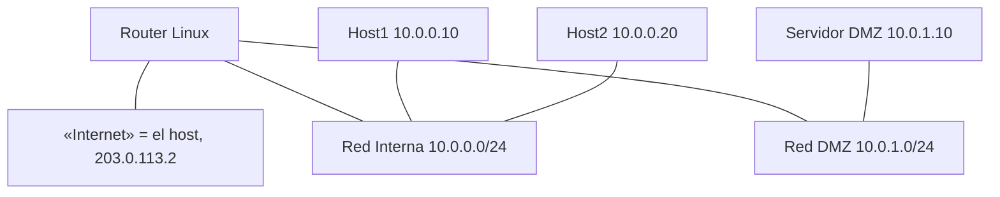
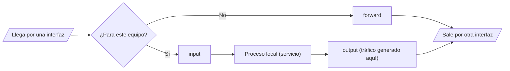

<p class="tema-eyebrow">LABORATORIO 14</p>

# HERRAMIENTAS LINUX AVANZADAS

<p class="tema-meta"><span>16 secciones</span><span>2 diagramas</span><span>8 tablas</span></p>

## Dominar las herramientas

Con el monitoreo en marcha (laboratorio 13), el equipo de operaciones necesita dominar las herramientas avanzadas de Linux para administrar, diagnosticar y optimizar la red. En este laboratorio recorrerás `ip`, `ss`, `conntrack`, `nft`, `ethtool` y `tcpdump` sobre una topología sencilla, para saber qué herramienta responde cada pregunta.

## Introducción técnica

Administrar una red desde la línea de comandos exige saber qué herramienta responde cada pregunta: qué direcciones y rutas existen, quién escucha en un puerto, qué regla bloquea un paquete y qué ve un enlace.

Este laboratorio monta una topología propia y sencilla (un router Linux con una LAN, una DMZ y una salida hacia el host) y recorre `ip`, `ss`, `conntrack`, `nft`, `ethtool` y `tcpdump`, contrastando las herramientas modernas con las clásicas que aún se encuentran en muchos sistemas.

El laboratorio 13 utilizó varias de ellas de forma puntual; aquí se organizan por tipo de pregunta.

!!! note "Laboratorio independiente"
    Este laboratorio monta su **propia** topología (un router Linux con LAN y DMZ) para practicar las herramientas con calma; no depende de los anteriores. Empieza limpiando **solo los recursos propios de este escenario** (no todo lo que haya en el equipo).

## Objetivos de aprendizaje

Al terminar este laboratorio deberías poder:

- elegir la herramienta adecuada según la pregunta técnica (`ip`, `ss`, `conntrack`, `nft`, `ethtool`, `tcpdump`);
- interpretar `ip route get` e `ip rule` para saber qué decisión toma el kernel;
- distinguir sockets locales (`ss`) de conexiones que atraviesan el router (`conntrack`);
- explicar dónde engancha cada regla (`input`, `forward`, `output`) y comparar las herramientas modernas con las clásicas.

### Conocimientos previos y relación con la práctica anterior

- **Conocimientos previos:** Laboratorios 08 y 13: firewall y monitoreo. Este laboratorio organiza las herramientas por tipo de pregunta; no introduce tecnologías nuevas de red.
- **Relación con la práctica anterior:** *Independiente.* Monta su propia topología (un router Linux con LAN `Host1` y `Host2`, DMZ y salida al host) y no depende de los laboratorios anteriores. Comienza limpiando solo los recursos propios de este escenario.

## Estado inicial

- Las redes de los laboratorios anteriores se administran con comandos sueltos, sin un criterio explícito de elección.
- Falta una topología pequeña donde cada herramienta pueda estudiarse sin interferir con otras prácticas.

## Resultado que se construirá

Queda un router con LAN (`Host1` y `Host2`), DMZ y salida al host, y una guía de herramientas verificada sobre él: interfaces, direcciones, rutas, reglas de política y vecinos con `ip`; sockets con `ss` y conexiones que solo atraviesan el router con `conntrack`; filtrado con `nftables` según las cadenas `input`, `forward` y `output`; MTU y alcance de `ethtool` en interfaces virtuales; y capturas con `tcpdump` que muestran dónde desaparece un paquete.

## Topología



**Direccionamiento:**

| Dispositivo | Interfaz | Dirección IP |
|-------------|----------|--------------|
| Router Linux | veth-r-wan (WAN) | 203.0.113.1/30 (host: 203.0.113.2/30) |
| Router Linux | br-lan (LAN, bridge) | 10.0.0.1/24 |
| Router Linux | veth-r-lan2 (DMZ) | 10.0.1.1/24 |
| Host1 | veth-lan1-r | 10.0.0.10/24 |
| Host2 | veth-lan2h | 10.0.0.20/24 |
| Servidor DMZ | veth-lan2-r | 10.0.1.10/24 |

**Sobre `203.0.113.0/30`.** Ese bloque pertenece al espacio **reservado para documentación y ejemplos** (TEST-NET-3, RFC 5737): no es una dirección pública real asignada a un proveedor. Aquí **el host actúa como representación de la red externa** (extremo `203.0.113.2` del enlace virtual); la salida a Internet real, si existe, depende de la interfaz física del host (véase el opcional del Paso 3).

## Construcción

### Paso 0: Limpiar ejecuciones anteriores de este laboratorio

Este paso solo retira los cuatro namespaces de la topología de Lab14, sus dos namespaces opcionales de policy routing y sus enlaces marcados. No elimina recursos de otros laboratorios: en particular, conserva `veth-wan-op` de Lab13 y cualquier bridge compartido.

```bash
NS_LAB="Router Host1 Host2 ServidorDMZ GW_A GW_B"
EXISTENTES=$(sudo ip netns list | awk '{print $1}' | while read -r ns; do
  for esperado in $NS_LAB; do [ "$ns" = "$esperado" ] && echo "$ns"; done
done)
NS_SIN_MARCA=""
for ns in $EXISTENTES; do
  if [ "$(sudo ip netns exec "$ns" cat /sys/class/net/lo/ifalias 2>/dev/null)" != networking-lab-lab-14 ]; then NS_SIN_MARCA="$NS_SIN_MARCA $ns"; fi
done
if [ -n "$NS_SIN_MARCA" ]; then echo "Se aborta; namespaces sin marca:$NS_SIN_MARCA"; exit 1; fi
for ns in $EXISTENTES; do
  PIDS=$(sudo ip netns pids "$ns" 2>/dev/null || true)
  if [ -n "$PIDS" ]; then echo "$ns tiene procesos activos ($PIDS); ejecuta la limpieza antes de repetir Lab14."; exit 1; fi
done
if [ -e /tmp/lab14 ] && [ ! -f /tmp/lab14/.networking-lab-lab-14 ]; then echo "/tmp/lab14 existe sin marca de propiedad; no se modifica."; exit 1; fi
for f in /tmp/lab14-host-nat.added /tmp/lab14-forward-out.added /tmp/lab14-forward-in.added /tmp/lab14-ip_forward.orig; do
  if [ -e "$f" ]; then echo "Existe el marcador $f; ejecuta la reversión completa de Lab14 antes de repetirlo."; exit 1; fi
done
for ns in $EXISTENTES; do sudo ip netns del "$ns" 2>/dev/null || true; done
for f in /sys/class/net/*/ifalias; do
  [ -r "$f" ] || continue
  [ "$(cat "$f")" = networking-lab-lab-14 ] || continue
  dev=${f%/ifalias}; dev=${dev##*/}
  sudo ip link del "$dev" 2>/dev/null || true
done
if [ -f /tmp/lab14/.networking-lab-lab-14 ]; then sudo rm -rf /tmp/lab14; fi
```

sudo apt-get install -y ethtool traceroute tcpdump netcat-openbsd nftables conntrack

Si siguen activos recursos de otra práctica, ejecuta la limpieza de esa práctica; este paso no los elimina.
### Paso 1: Crear namespaces

```bash
sudo ip netns add Router
sudo ip netns exec Router ip link set lo alias networking-lab-lab-14
sudo ip netns add Host1
sudo ip netns exec Host1 ip link set lo alias networking-lab-lab-14
sudo ip netns add Host2
sudo ip netns exec Host2 ip link set lo alias networking-lab-lab-14
sudo ip netns add ServidorDMZ
sudo ip netns exec ServidorDMZ ip link set lo alias networking-lab-lab-14
```

### Paso 2: Conectar interfaces

La LAN `10.0.0.0/24` es un único segmento con dos equipos, así que el router usa un bridge (`br-lan`):

```bash
# ⚠ Desde aquí hasta el MASQUERADE del host: CAMBIOS EN EL HOST (veth-wan-r, ip_forward, NAT).
#   Anota antes `sysctl net.ipv4.ip_forward`; reversión en «Limpieza selectiva».
# WAN: el router se conecta al host (que hace de "Internet")
sudo ip link add veth-r-wan type veth peer name veth-wan-r
sudo ip link set veth-r-wan alias networking-lab-lab-14
sudo ip link set veth-wan-r alias networking-lab-lab-14
sudo ip link set veth-r-wan netns Router
sudo ip netns exec Router ip addr add 203.0.113.1/30 dev veth-r-wan
sudo ip netns exec Router ip link set veth-r-wan up
sudo ip addr add 203.0.113.2/30 dev veth-wan-r
sudo ip link set veth-wan-r up

# LAN: bridge en el router con Host1 y Host2
sudo ip netns exec Router ip link add br-lan type bridge
sudo ip netns exec Router ip addr add 10.0.0.1/24 dev br-lan
sudo ip netns exec Router ip link set br-lan up

sudo ip link add veth-r-lan1 type veth peer name veth-lan1-r
sudo ip link set veth-r-lan1 alias networking-lab-lab-14
sudo ip link set veth-lan1-r alias networking-lab-lab-14
sudo ip link set veth-r-lan1 netns Router
sudo ip link set veth-lan1-r netns Host1
sudo ip netns exec Router ip link set veth-r-lan1 master br-lan
sudo ip netns exec Router ip link set veth-r-lan1 up
sudo ip netns exec Host1 ip addr add 10.0.0.10/24 dev veth-lan1-r
sudo ip netns exec Host1 ip link set veth-lan1-r up
sudo ip netns exec Host1 ip link set lo up
sudo ip netns exec Host1 ip route add default via 10.0.0.1

sudo ip link add veth-r-lan2h type veth peer name veth-lan2h
sudo ip link set veth-r-lan2h alias networking-lab-lab-14
sudo ip link set veth-lan2h alias networking-lab-lab-14
sudo ip link set veth-r-lan2h netns Router
sudo ip link set veth-lan2h netns Host2
sudo ip netns exec Router ip link set veth-r-lan2h master br-lan
sudo ip netns exec Router ip link set veth-r-lan2h up
sudo ip netns exec Host2 ip addr add 10.0.0.20/24 dev veth-lan2h
sudo ip netns exec Host2 ip link set veth-lan2h up
sudo ip netns exec Host2 ip link set lo up
sudo ip netns exec Host2 ip route add default via 10.0.0.1

# DMZ: enlace punto a punto con el servidor
sudo ip link add veth-r-lan2 type veth peer name veth-lan2-r
sudo ip link set veth-r-lan2 alias networking-lab-lab-14
sudo ip link set veth-lan2-r alias networking-lab-lab-14
sudo ip link set veth-r-lan2 netns Router
sudo ip link set veth-lan2-r netns ServidorDMZ
sudo ip netns exec Router ip addr add 10.0.1.1/24 dev veth-r-lan2
sudo ip netns exec Router ip link set veth-r-lan2 up
sudo ip netns exec ServidorDMZ ip addr add 10.0.1.10/24 dev veth-lan2-r
sudo ip netns exec ServidorDMZ ip link set veth-lan2-r up
sudo ip netns exec ServidorDMZ ip link set lo up
sudo ip netns exec ServidorDMZ ip route add default via 10.0.1.1
```

### Paso 3: Configurar enrutamiento y NAT

```bash
sudo ip netns exec Router sysctl -w net.ipv4.ip_forward=1
sudo ip netns exec Router ip route add default via 203.0.113.2
sudo ip netns exec Router ip route show

# NAT del router hacia la WAN
sudo ip netns exec Router iptables -t nat -A POSTROUTING -o veth-r-wan -j MASQUERADE

# (Opcional, para salir de verdad a Internet) El host reenvía y traduce.
# Cambia eth0 por tu interfaz de salida. El valor original de ip_forward y la creación de la regla NAT quedan registrados para revertirlos:
if [ ! -e /tmp/lab14-ip_forward.orig ]; then
  sudo sysctl -n net.ipv4.ip_forward | sudo tee /tmp/lab14-ip_forward.orig >/dev/null
fi
sudo sysctl -w net.ipv4.ip_forward=1
if ! sudo iptables -C FORWARD -i veth-wan-r -o eth0 -s 203.0.113.0/30 -j ACCEPT; then
  sudo iptables -I FORWARD 1 -i veth-wan-r -o eth0 -s 203.0.113.0/30 -j ACCEPT && touch /tmp/lab14-forward-out.added
fi
if ! sudo iptables -C FORWARD -i eth0 -o veth-wan-r -d 203.0.113.0/30 -m conntrack --ctstate RELATED,ESTABLISHED -j ACCEPT; then
  sudo iptables -I FORWARD 1 -i eth0 -o veth-wan-r -d 203.0.113.0/30 -m conntrack --ctstate RELATED,ESTABLISHED -j ACCEPT && touch /tmp/lab14-forward-in.added
fi
if ! sudo iptables -t nat -C POSTROUTING -s 203.0.113.0/30 -o eth0 -j MASQUERADE; then
  sudo iptables -t nat -A POSTROUTING -s 203.0.113.0/30 -o eth0 -j MASQUERADE && touch /tmp/lab14-host-nat.added
fi
```

Se comprueba la conectividad básica:

```bash
sudo ip netns exec Host1 ping -c 2 10.0.0.20
sudo ip netns exec Host1 ping -c 2 10.0.1.10
sudo ip netns exec Host1 ping -c 2 203.0.113.2
```

### Paso 4: iproute2

```bash
sudo ip netns exec Router ip addr show
sudo ip -br addr                              # vista resumida (en el host)
sudo ip netns exec Router ip -s link show veth-r-lan2   # contadores de la interfaz
sudo ip netns exec Router ip neigh show       # tabla ARP
sudo ip netns exec Router ip rule show        # reglas de política de enrutamiento
sudo ip netns exec Router ip route get 10.0.1.10   # ¿qué ruta usaría el router para este destino?
```

**Cambiar la MTU.** Una MTU mayor solo sirve si **todos** los extremos del enlace la soportan. Cámbiala en **ambos** lados del enlace Router - DMZ y verifícalo:

```bash
sudo ip netns exec Router ip link set veth-r-lan2 mtu 9000
sudo ip netns exec ServidorDMZ ip link set veth-lan2-r mtu 9000
sudo ip netns exec Router ping -c 2 -M do -s 8972 10.0.1.10   # 8972 + 28 = 9000: pasa
```

El cálculo `8972 + 28 = 9000` es correcto para IPv4 con cabeceras IP (20) e ICMP (8) **sin opciones**: la opción `-s` de `ping` indica el tamaño de los **datos ICMP**, no el tamaño total del paquete IP (que es `-s` + 28).

(Si la cambiaras en un solo extremo, los paquetes grandes del lado de MTU mayor serían descartados por el otro.) Restablécela:

```bash
sudo ip netns exec Router ip link set veth-r-lan2 mtu 1500
sudo ip netns exec ServidorDMZ ip link set veth-lan2-r mtu 1500
```

**Agregar una ruta estática.** El siguiente salto debe ser **otro** equipo alcanzable directamente (no una dirección del propio router). Se supone que existe una red `10.0.2.0/24` detrás de Host1. Para que **la ruta funcione como se describe**, Host1 tiene que **actuar como siguiente salto de capa 3 y reenviar tráfico**, y tener esa red (o un camino hacia ella); de lo contrario la ruta se instala pero el tráfico no llega. Lo simulamos con una interfaz ficticia:

```bash
# Host1 como siguiente salto: reenvía y tiene la red 10.0.2.0/24 «detrás»
sudo ip netns exec Host1 sysctl -w net.ipv4.ip_forward=1
sudo ip netns exec Host1 ip link add dum0 type dummy
sudo ip netns exec Host1 ip addr add 10.0.2.1/24 dev dum0
sudo ip netns exec Host1 ip link set dum0 up

sudo ip netns exec Router ip route add 10.0.2.0/24 via 10.0.0.10
sudo ip netns exec Router ip route get 10.0.2.1       # muestra via 10.0.0.10
sudo ip netns exec Router ping -c 2 10.0.2.1          # responde (ojo: 10.0.2.1 es del propio Host1; véase abajo)

sudo ip netns exec Router ip route del 10.0.2.0/24
sudo ip netns exec Host1 ip link del dum0
```

El `ping` a `10.0.2.1` demuestra que la ruta y el siguiente salto funcionan, pero **no** prueba el reenvío: esa dirección pertenece al propio Host1, que la contestaría aunque `ip_forward` valiera 0. Sin una red real detrás de Host1, la ruta se instalaría igualmente (`ip route get` la mostraría), pero un paquete dirigido a otro equipo de `10.0.2.0/24` no tendría adónde ir (véase el Prueba 3).

### Paso 5: ss (sockets)

Se arrancan dos servicios de prueba en Host1 y se establece una conexión desde Host2:

```bash
if [ -e /tmp/lab14 ]; then echo "/tmp/lab14 ya existe; ejecuta limpieza."; exit 1; fi
mkdir -p /tmp/lab14; touch /tmp/lab14/.networking-lab-lab-14
sudo ip netns exec Host1 sh -c 'nc -lk -p 9000 >/dev/null 2>&1 </dev/null & echo $! > /tmp/lab14/nc9000.pid'
sudo ip netns exec Host1 sh -c 'nc -lk -p 8443 >/dev/null 2>&1 </dev/null & echo $! > /tmp/lab14/nc8443.pid'
mkfifo /tmp/lab14/nc-input
sudo ip netns exec Host2 sh -c 'sleep 300 > /tmp/lab14/nc-input & echo $! > /tmp/lab14/sleep.pid; nc 10.0.0.10 9000 < /tmp/lab14/nc-input >/dev/null 2>&1 & echo $! > /tmp/lab14/nc-client.pid'

sudo ip netns exec Host1 ss -tln                    # puertos TCP a la escucha
sudo ip netns exec Host1 ss -tlnp                   # ... con el proceso dueño
sudo ip netns exec Host1 ss -tn state established   # conexiones establecidas (verás la de Host2)
sudo ip netns exec Host1 ss -tn dport = :9000       # filtrar por puerto
```

`ss` muestra los sockets **del namespace en el que se ejecuta**. Una conexión TCP solo aparece en los equipos que son sus **extremos**: un router que simplemente **reenvía** tráfico entre sus interfaces **no aparece como extremo** (para él los paquetes pasan, no terminan en un socket; puede verse el seguimiento de la conexión con `conntrack`, no con `ss`).

### Paso 6: nftables

Cuando una orden `nft` lleva llaves y puntos y coma, hay que **entrecomillarla**: sin comillas, el *shell* corta la orden en cada `;`.

```bash
sudo ip netns exec Router nft add table inet filter
sudo ip netns exec Router nft add chain inet filter input '{ type filter hook input priority 0 ; policy drop ; }'
sudo ip netns exec Router nft add rule inet filter input iif lo accept
sudo ip netns exec Router nft add rule inet filter input ct state established,related accept
sudo ip netns exec Router nft add rule inet filter input icmp type echo-request accept
sudo ip netns exec Router nft add rule inet filter input tcp dport 22 accept
sudo ip netns exec Router nft add rule inet filter input tcp dport '{ 80, 443 }' accept
sudo ip netns exec Router nft -a list ruleset
```

La opción `-a` muestra el *handle* de cada regla, que sirve para borrarla (`nft delete rule inet filter input handle N`).

**Las cadenas `input`, `forward` y `output`.** Son tres puntos de enganche distintos del flujo de un paquete en el router:

| Cadena | Qué controla | Ejemplo |
|--------|--------------|---------|
| `input` | Tráfico **dirigido al propio router** (destino = una IP del router) | SSH o ping **al router** (`10.0.0.1`) |
| `forward` | Tráfico que **atraviesa** el router hacia otra red | Host1 → ServidorDMZ |
| `output` | Tráfico **generado por el propio router** | Un `ping` lanzado desde el router |

Una regla de `input` **controla el tráfico dirigido al router, no el que lo atraviesa**. Esta diferencia es fundamental para comprender un firewall. Compruébalo: aunque la cadena `input` tiene política `drop`, Host1 sigue alcanzando al servidor de la DMZ, porque ese tráfico pasa por `forward`, que aún no tiene reglas:

```bash
sudo ip netns exec Host1 ping -c 2 10.0.1.10        # funciona: no pasa por input
```

A continuación se añade una cadena `forward` con política `drop` y solo lo necesario:

```bash
sudo ip netns exec Router nft add chain inet filter forward '{ type filter hook forward priority 0 ; policy drop ; }'
sudo ip netns exec Router nft add rule inet filter forward ct state established,related accept
sudo ip netns exec Router nft add rule inet filter forward iifname "br-lan" oifname "veth-r-lan2" tcp dport 22 accept
sudo ip netns exec Host1 ping -c 2 -W 1 10.0.1.10   # ahora falla: forward lo descarta
```

### Paso 7: Diagnóstico

```bash
sudo ip netns exec Router ethtool veth-r-lan2          # velocidad, dúplex, estado del enlace
sudo ip netns exec Router ethtool -S veth-r-lan2       # estadísticas del controlador
sudo ip netns exec Router ping -c 4 10.0.0.10
sudo ip netns exec Router traceroute -n 203.0.113.2
sudo ip netns exec Router tcpdump -i br-lan -c 5 -n
```

Con Internet disponible en el equipo: `sudo ip netns exec Router traceroute -n 8.8.8.8`.

### Paso 8: Limpieza selectiva

```bash
PROC_LEFT=0
for spec in 'nc /tmp/lab14/nc9000.pid 9000' 'nc /tmp/lab14/nc8443.pid 8443' 'nc /tmp/lab14/nc-client.pid 10.0.0.10' 'sleep /tmp/lab14/sleep.pid 300'; do
  set -- $spec; proceso=$1; pf=$2; firma=$3
  [ -s "$pf" ] || continue
  pid=$(cat "$pf" 2>/dev/null || true)
  [[ "$pid" =~ ^[0-9]+$ ]] || continue
  [ -r "/proc/$pid/cmdline" ] || continue
  cmdline=$(tr '\0' ' ' < "/proc/$pid/cmdline")
  if [[ "$cmdline" == *"$proceso"* && "$cmdline" == *"$firma"* ]]; then sudo kill -TERM "$pid" 2>/dev/null || true
  else echo "PID $pid no coincide con $proceso/$firma; no se detiene."; PROC_LEFT=1
  fi
done
sleep 1
for spec in 'nc /tmp/lab14/nc9000.pid 9000' 'nc /tmp/lab14/nc8443.pid 8443' 'nc /tmp/lab14/nc-client.pid 10.0.0.10' 'sleep /tmp/lab14/sleep.pid 300'; do
  set -- $spec; proceso=$1; pf=$2; firma=$3
  [ -s "$pf" ] || continue
  pid=$(cat "$pf" 2>/dev/null || true)
  [[ "$pid" =~ ^[0-9]+$ ]] || continue
  [ -r "/proc/$pid/cmdline" ] || continue
  cmdline=$(tr '\0' ' ' < "/proc/$pid/cmdline")
  if [[ "$cmdline" == *"$proceso"* && "$cmdline" == *"$firma"* ]]; then sudo kill -KILL "$pid" 2>/dev/null || true; fi
done

NS_LEFT=0
for ns in Router Host1 Host2 ServidorDMZ GW_A GW_B; do
  if sudo ip netns list | awk '{print $1}' | grep -Fxq "$ns"; then
    if [ "$(sudo ip netns exec "$ns" cat /sys/class/net/lo/ifalias 2>/dev/null)" != networking-lab-lab-14 ]; then echo "Se conserva $ns: no tiene marca exclusiva de Lab14."; NS_LEFT=1
    else
      PIDS=$(sudo ip netns pids "$ns" 2>/dev/null || true)
      if [ -n "$PIDS" ]; then echo "Se conserva $ns: quedan procesos no registrados ($PIDS)."; NS_LEFT=1; fi
    fi
  fi
done
if [ "$NS_LEFT" = 0 ] && [ "$PROC_LEFT" = 0 ]; then
  for ns in Router Host1 Host2 ServidorDMZ GW_A GW_B; do
    if sudo ip netns list | awk '{print $1}' | grep -Fxq "$ns"; then sudo ip netns del "$ns" 2>/dev/null || true; fi
  done
  if [ -f /tmp/lab14-host-nat.added ]; then sudo iptables -t nat -D POSTROUTING -s 203.0.113.0/30 -o eth0 -j MASQUERADE 2>/dev/null || true; rm -f /tmp/lab14-host-nat.added; fi
  if [ -f /tmp/lab14-forward-out.added ]; then sudo iptables -D FORWARD -i veth-wan-r -o eth0 -s 203.0.113.0/30 -j ACCEPT 2>/dev/null || true; rm -f /tmp/lab14-forward-out.added; fi
  if [ -f /tmp/lab14-forward-in.added ]; then sudo iptables -D FORWARD -i eth0 -o veth-wan-r -d 203.0.113.0/30 -m conntrack --ctstate RELATED,ESTABLISHED -j ACCEPT 2>/dev/null || true; rm -f /tmp/lab14-forward-in.added; fi
  if [ -f /tmp/lab14-ip_forward.orig ]; then sudo sysctl -w net.ipv4.ip_forward="$(cat /tmp/lab14-ip_forward.orig)"; rm -f /tmp/lab14-ip_forward.orig; fi
  if [ "$(cat /sys/class/net/veth-wan-r/ifalias 2>/dev/null)" = networking-lab-lab-14 ]; then sudo ip link del veth-wan-r; fi
  for f in /sys/class/net/*/ifalias; do
    [ -r "$f" ] || continue
    [ "$(cat "$f")" = networking-lab-lab-14 ] || continue
    dev=${f%/ifalias}; dev=${dev##*/}
    sudo ip link del "$dev" 2>/dev/null || true
  done
  if [ -f /tmp/lab14/.networking-lab-lab-14 ]; then sudo rm -rf /tmp/lab14; fi
else
  echo "Se conservan enlaces host y /tmp/lab14: quedan procesos o namespaces que requieren inspección."
fi
```

Eliminar un *namespace* borra sus interfaces y reglas `nft`/`iptables`; los cambios del **host** (`veth-wan-r`, reglas NAT/FORWARD y `net.ipv4.ip_forward`) se revierten únicamente si sus marcadores prueban que fueron creados por este laboratorio.


### Herramienta según el objetivo operativo

| Objetivo | Comando | Qué responde |
|----------|---------|--------------|
| Ver interfaces y direcciones | `ip -br addr`, `ip link` | ¿Qué IP y estado tiene cada interfaz? |
| Ver rutas / qué ruta se usará | `ip route`, `ip route get <IP>` | ¿Por dónde saldrá un paquete a ese destino? |
| Ver reglas de selección de tabla | `ip rule` | ¿Qué tabla de rutas se consulta y en qué orden? |
| Ver vecinos (ARP) | `ip neigh` | ¿Qué MAC conoce el equipo para cada IP local? |
| Ver sockets locales | `ss -tulpn` | ¿Qué escucha o está conectado **en este namespace**? |
| Ver conexiones que atraviesan el equipo | `conntrack -L` | ¿Qué conexiones reenvía o traduce el router? |
| Filtrar tráfico | `nft list ruleset` | ¿Qué reglas se aplican y en qué cadena? |
| Ver estadísticas y errores de interfaz | `ip -s link`, `ethtool -S` | ¿Hay errores, descartes o colisiones? |
| Probar un puerto | `nc -zv <IP> <puerto>` | ¿Acepta conexiones ese servicio? |

### Recorrido de un paquete: input, forward y output

La cadena de `nftables` depende de **qué le pasa al paquete en este equipo**:



Si una regla `drop` en `input` no detiene el tráfico que **atraviesa** el router, no es un fallo: ese tráfico va por `forward`.

### `ss` frente a `conntrack`

| | `ss` | `conntrack` |
|--|------|-------------|
| Muestra | Sockets **del propio equipo** (los que termina una aplicación local) | Conexiones **seguidas por el kernel**, incluidas las que solo **pasan** por el router y las traducidas por NAT |
| Ejemplo | `Host1` escuchando en el puerto 9000 | Una conexión de `Host1` al `ServidorDMZ` (`10.0.1.10`), que el Router **enruta** |
| Pregunta | ¿Qué servicios tengo? | ¿Qué conexiones atraviesan o traduce mi router? |

Por eso la conexión del Paso 5 aparece en `ss` de Host1 y Host2 y **no** en el del Router. Matiz: Host1 y Host2 comparten el bridge `br-lan`, así que el Router solo **conmuta** esa conexión (capa 2) y `conntrack` tampoco la sigue; una conexión de Host1 al `ServidorDMZ` sí la **enruta** y aparecería en `conntrack -L` (requiere el paquete `conntrack`).

### Interpretar `ip route get` e `ip rule`

```bash
sudo ip netns exec Router ip route get 10.0.2.1     # con la ruta estática del Paso 4
sudo ip netns exec Router ip rule show
```

Ejemplo de salida (representativo):

```
10.0.2.1 via 10.0.0.10 dev br-lan src 10.0.0.1 uid 0
0:      from all lookup local
32766:  from all lookup main
32767:  from all lookup default
```

-   `via 10.0.0.10`: el **siguiente salto** elegido; `dev`, la interfaz de salida; `src`, la IP de origen que usaría.
-   `ip rule` se evalúa **por prioridad** (número menor primero): `local` (direcciones propias), luego `main` (la tabla de `ip route`) y por último `default`. Con reglas adicionales se puede enrutar por origen (política de enrutamiento).

### iptables y nftables

| Aspecto | `iptables` (laboratorios 08 y 09) | `nftables` (este laboratorio y el 15) |
|---------|-----------------------------------|----------------------------------------|
| Estado | Clásica; muchas distribuciones la ofrecen como compatibilidad sobre `nft` | Herramienta actual del *netfilter* |
| Tablas y cadenas | Predefinidas (`filter`, `nat`…) | Las define el administrador (`table inet filtro`) |
| IPv4/IPv6 | Comandos separados | Familia `inet` para ambos |
| Reglas | Una por invocación | Conjuntos, mapas y reglas atómicas |

### Estadísticas de interfaz y errores

```bash
sudo ip netns exec Router ip -s link show veth-r-lan2
sudo ip netns exec Router ethtool -S veth-r-lan2
```

Mira `errors` y `dropped` (y `carrier`/`collsns` en TX): un contador de **errores** que crece indica un problema de la interfaz o del medio (en `veth` casi siempre es 0); los **descartes** que crecen apuntan a saturación o a reglas. El diagnóstico llega más allá de «hay IP y responde `ping`».

### Mini-situaciones de diagnóstico

| Situación | Qué observas | Conclusión razonable |
|-----------|--------------|----------------------|
| `ping` a una dirección detrás de Host1 deja de funcionar | `ip route get` sigue mostrando la ruta; `ip_forward` = 0 en Host1 | Falta reenvío en el equipo intermedio (Prueba 3) |
| Un servicio no recibe conexiones | `ss -tlnp` no lo muestra escuchando | El servicio no está activo o escucha en otra IP |
| El Router ya no responde a `ping` pero Host1 sigue saliendo a Internet | `nft list ruleset`: regla `icmp drop` en la cadena `input` | Afecta al tráfico **destinado al Router**, no al que lo atraviesa (Prueba 1) |

## Pruebas de comportamiento

### Prueba 1: Bloqueo de ICMP con nftables

Una regla añadida con `add` va **al final** de la cadena, después de la que acepta el ping. Insértala al principio:

```bash
sudo ip netns exec Router nft insert rule inet filter input ip protocol icmp drop
sudo ip netns exec Host1 ping -c 2 -W 1 10.0.0.1     # ahora no responde
sudo ip netns exec Router nft -a list chain inet filter input
```

Para quitar la regla usa `nft delete rule inet filter input handle N` con el *handle* que muestra el listado.

### Prueba 2: Conexiones con ss

```bash
sudo ip netns exec Host1 ss -tn state established
sudo ip netns exec Host2 ss -tn state established
```

Se comprueba que la conexión de Paso 5 aparece en **ambos** extremos (Host1 y Host2) pero no en el router. (Esa conexión dura 300 s; si ya expiró, se repite el comando del Paso 5.)

### Prueba 3: Reenvío real frente a respuesta local

Se sustituye la interfaz ficticia `dum0` por un namespace `Detras` unido a Host1 con un `veth` (Host1 `10.0.2.1/24`, Detras `10.0.2.50/24`, con ruta por defecto hacia `10.0.2.1`). Se mantiene la ruta del Router hacia `10.0.2.0/24 via 10.0.0.10` y se hace `ping` a `10.0.2.50` con `ip_forward` en 1 y luego en 0 en Host1. **Efecto esperado:** con `ip_forward=1` el ping responde, porque Host1 reenvía el paquete hacia `Detras`; con 0 deja de responder, porque ahora el paquete no termina en Host1 sino que **pasa por él**.

## Conceptos clave

| Concepto | Aplicación |
|----------|------------|
| iproute2 | Administración moderna de red |
| ss | Análisis de sockets del namespace donde se ejecuta |
| nftables | Firewall moderno; `input` ≠ `forward` ≠ `output` |
| ethtool | Diagnóstico físico |
| Netcat | Pruebas de conectividad |

## Profundización: policy routing y alcance de ethtool

`ip rule` define el orden de evaluación de reglas de política; cada regla puede seleccionar una tabla según origen, destino, marca, interfaz u otros selectores. La tabla `main` no es necesariamente la única tabla consultada.

### Ejemplo aislado de routing por origen

En una ampliación controlada, las tablas nombradas o numeradas se crean en `/etc/iproute2/rt_tables` solo si la prueba requiere persistencia; para una prueba efímera se usan identificadores numéricos y se eliminan las reglas al terminar:

```bash
sudo ip rule show
sudo ip route show table main
sudo ip route get 10.0.2.10 from 10.0.1.10
```

La comprobación compara dos orígenes y dos gateways: una regla `ip rule` selecciona la tabla 101 para el origen definido y otra selecciona la tabla 102 para el segundo origen. `ip route get DESTINO from ORIGEN` muestra la tabla y el siguiente salto efectivos. Se registra la prioridad (`pref`), evita reglas duplicadas y elimina únicamente las reglas y rutas añadidas durante la prueba.

### `ethtool`: virtual frente a físico

Sobre `veth`, `ethtool` puede mostrar información limitada del dispositivo virtual y estadísticas software; no demuestra velocidad negociada, dúplex ni propiedades del transceptor físico. Para una NIC real, se consulta `ethtool <NIC>`, `ethtool -i <NIC>` y `ethtool -S <NIC>` con permisos adecuados. No fuerces velocidad/autonegociación ni reinicies una interfaz productiva como parte de esta práctica.

### Prueba: policy routing por dirección de origen

Esta prueba crea dos siguientes saltos aislados dentro de namespaces; no modifica `/etc/iproute2/rt_tables` ni el enrutamiento del host. Las tablas 101 y 102 existen solo dentro de `Router` y se eliminan con ese namespace.

```bash
for ns in GW_A GW_B; do
  if sudo ip netns list | awk '{print $1}' | grep -Fxq "$ns"; then echo "$ns ya existe; ejecuta limpieza antes de repetir."; exit 1; fi
done
sudo ip netns add GW_A; sudo ip netns exec GW_A ip link set lo alias networking-lab-lab-14
sudo ip netns add GW_B; sudo ip netns exec GW_B ip link set lo alias networking-lab-lab-14
sudo ip link add veth-r-gwa type veth peer name veth-gwa-r
sudo ip link set veth-r-gwa alias networking-lab-lab-14
sudo ip link set veth-gwa-r alias networking-lab-lab-14
sudo ip link set veth-r-gwa netns Router; sudo ip link set veth-gwa-r netns GW_A
sudo ip netns exec Router ip addr add 198.51.100.1/30 dev veth-r-gwa
sudo ip netns exec GW_A ip addr add 198.51.100.2/30 dev veth-gwa-r
sudo ip netns exec Router ip link set veth-r-gwa up; sudo ip netns exec GW_A ip link set veth-gwa-r up
sudo ip link add veth-r-gwb type veth peer name veth-gwb-r
sudo ip link set veth-r-gwb alias networking-lab-lab-14
sudo ip link set veth-gwb-r alias networking-lab-lab-14
sudo ip link set veth-r-gwb netns Router; sudo ip link set veth-gwb-r netns GW_B
sudo ip netns exec Router ip addr add 203.0.113.1/30 dev veth-r-gwb
sudo ip netns exec GW_B ip addr add 203.0.113.2/30 dev veth-gwb-r
sudo ip netns exec Router ip link set veth-r-gwb up; sudo ip netns exec GW_B ip link set veth-gwb-r up

sudo ip netns exec Router ip route add 10.0.0.0/24 dev br-lan table 101
sudo ip netns exec Router ip route add 198.51.100.0/30 dev veth-r-gwa table 101
sudo ip netns exec Router ip route add default via 198.51.100.2 dev veth-r-gwa table 101
sudo ip netns exec Router ip route add 10.0.0.0/24 dev br-lan table 102
sudo ip netns exec Router ip route add 203.0.113.0/30 dev veth-r-gwb table 102
sudo ip netns exec Router ip route add default via 203.0.113.2 dev veth-r-gwb table 102
sudo ip netns exec Router ip rule add pref 100 from 10.0.0.10/32 table 101
sudo ip netns exec Router ip rule add pref 110 from 10.0.0.20/32 table 102

sudo ip netns exec Router ip rule show
sudo ip netns exec Router ip route get 198.51.100.10 from 10.0.0.10
sudo ip netns exec Router ip route get 203.0.113.10 from 10.0.0.20
```

El primer origen debe seleccionar la tabla 101 y el gateway `198.51.100.2`; el segundo, la tabla 102 y `203.0.113.2`. `ip route get` demuestra la decisión local de selección, no conectividad a Internet: los namespaces `GW_A` y `GW_B` son siguientes saltos didácticos, no proveedores externos.

Reversión de la prueba (antes de borrar `Router`):

```bash
sudo ip netns exec Router ip rule del pref 100 from 10.0.0.10/32 table 101 2>/dev/null || true
sudo ip netns exec Router ip rule del pref 110 from 10.0.0.20/32 table 102 2>/dev/null || true
sudo ip netns exec Router ip route flush table 101
sudo ip netns exec Router ip route flush table 102
for ns in GW_A GW_B; do
  if [ "$(sudo ip netns exec "$ns" cat /sys/class/net/lo/ifalias 2>/dev/null)" = networking-lab-lab-14 ]; then
    PIDS=$(sudo ip netns pids "$ns" 2>/dev/null || true)
    if [ -z "$PIDS" ]; then sudo ip netns del "$ns"; else echo "$ns conserva procesos ($PIDS); no se elimina."; fi
  fi
done
```


### Diagnóstico por evidencia

Si el servicio escucha (`ss`), la ruta existe (`ip route get`) y la conexión falla, captura en ambos extremos (`tcpdump`) y revisa reglas/contadores (`nft list ruleset`). El punto donde desaparece el paquete y el contador que aumenta sustentan el diagnóstico; no basta con que una regla parezca sospechosa.

## Diagnóstico de problemas frecuentes

| Síntoma | Causa probable | Solución |
|---------|----------------|----------|
| `ping` hacia una dirección detrás de Host1 deja de funcionar | `ip_forward` en 0 en Host1 | Habilitar el reenvío (Prueba 3). |
| Un servicio no recibe conexiones | `ss -tlnp` no lo muestra escuchando | Iniciar el servicio o corregir la IP en la que escucha. |
| El Router no responde a `ping`, pero Host1 sigue saliendo a Internet | Regla `icmp drop` en la cadena `input` | Afecta solo al tráfico destinado al Router (Prueba 1). |

## Análisis técnico y decisiones

La tabla de rutas y las reglas de política determinan la interfaz de salida; `ip route get` muestra la decisión efectiva para un destino y origen concretos. Una política `drop` en `input` bloquea tráfico dirigido al propio router salvo que existan reglas explícitas para conexiones establecidas y servicios necesarios. `ss` muestra sockets locales y sus estados; conntrack registra flujos que atraviesan o son traducidos por el kernel. `ping` solo comprueba ICMP y no demuestra que DNS, TCP o una aplicación funcionen. La herramienta debe elegirse según la capa del síntoma: `ip` para direcciones/rutas, `ss` para sockets, `nft` para filtrado, `ethtool` para parámetros de interfaz y `tcpdump` para observar paquetes.

## Qué no demuestra esta práctica

- `ping` solo comprueba ICMP: no demuestra que un servicio responda.
- `ethtool` en interfaces virtuales tiene un alcance limitado.
- Conocer las herramientas no sustituye el método: hay que formular una hipótesis antes de elegir el comando.

## Comprensión y reflexión

Responde con tus propias palabras antes de abrir las respuestas orientativas. Un resultado correcto en la terminal no demuestra por sí solo que se haya comprendido el mecanismo.

**Nivel 1 — Reconocimiento.** ¿Qué pregunta responde cada herramienta: `ip`, `ss`, `conntrack`, `nft`, `ethtool` y `tcpdump`?

**Nivel 2 — Interpretación.** Interpreta una salida de `ip route get <destino>`: ¿qué interfaz, siguiente salto y origen eligió el kernel y por qué?

**Nivel 3 — Razonamiento.** Aplica una política `drop` en la cadena `input`: predice qué tráfico se bloquea y cuál no. Compruébalo con tráfico dirigido al router y con tráfico que lo atraviesa.

**Caso de diagnóstico.** `ping` al servidor funciona, pero la aplicación no responde. Aplica el [método de diagnóstico](../../04-REFERENCIA/diagnostico.md): síntoma, capa o mecanismo, herramientas, evidencia y conclusión técnica.

??? success "Respuestas orientativas"
    **Nivel 1.** `ip`: interfaces, direcciones, rutas y vecinos; `ss`: sockets locales; `conntrack`: flujos que atraviesan o se traducen; `nft`: reglas de filtrado; `ethtool`: estado y estadísticas del enlace; `tcpdump`: qué se ve realmente en el cable.

    **Nivel 2.** `ip route get` muestra la decisión efectiva para ese destino: la ruta elegida, el siguiente salto, la interfaz de salida y la dirección de origen.

    **Nivel 3.** Se bloquea el tráfico dirigido al propio router (salvo conexiones establecidas y servicios permitidos); el tráfico que lo atraviesa depende de la cadena `forward`.

    **Caso de diagnóstico.** Síntoma: la aplicación no responde. Mecanismo: servicio o filtrado, no conectividad. Herramientas: `ss -tln`, reglas de `nft`, `tcpdump`. Evidencia: el puerto no escucha o una regla lo descarta. Conclusión: servicio detenido o regla de filtrado.

## Estado final

Queda implementada una topología de práctica con router, LAN y DMZ, y comprobado qué herramienta responde cada pregunta técnica.

`ip`, `ss` y `nft` han sustituido en gran medida a `ifconfig`, `netstat` e `iptables`, que siguen presentes en muchos sistemas. Entender dónde engancha cada regla (`input`, `forward`, `output`) es clave para comprender un firewall.

## Continuidad técnica

El equipo de operaciones ya maneja las herramientas de administración y diagnóstico sobre una topología independiente. En el laboratorio 15 las aplica juntas sobre una infraestructura integral: direccionamiento, OSPF, firewall, DHCP y VRRP, con casos de *troubleshooting* que exigen elegir qué herramienta usar y qué evidencia buscar.
