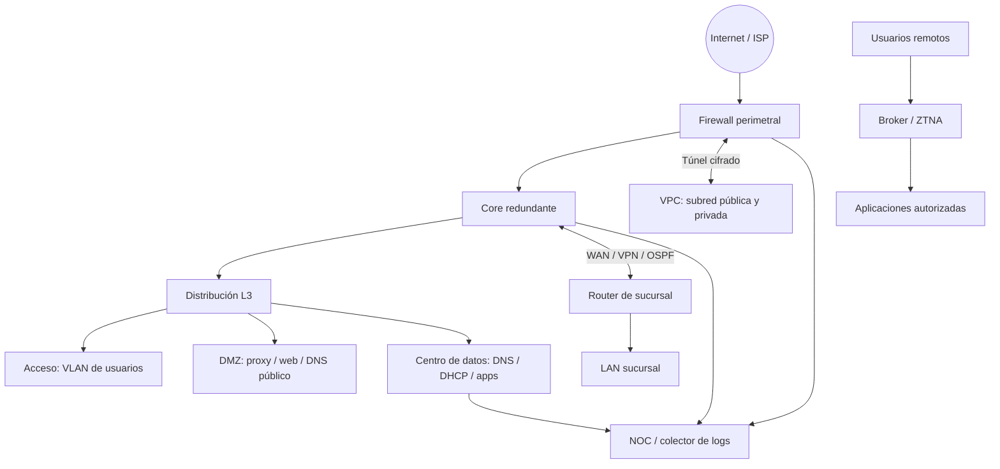

PROYECTO INTEGRADOR · LABORATORIOS 01–15

# PROYECTO FINAL INTEGRADOR · NETWORKING SECOPS ENTERPRISE

## 1. Propósito y alcance

Este proyecto cierra la serie de quince laboratorios. El estudiante diseñará, justificará, implementará (en laboratorio virtual o entorno autorizado), probará y documentará una red empresarial multisede e híbrida para una organización ficticia. No consiste en añadir comandos sin contexto: cada decisión debe relacionarse con un requisito, una amenaza, una prueba y un procedimiento de reversión.

La entrega debe distinguir tres estados: **implementado y probado**, **representado mediante simulación** y **propuesto/conceptual**. No se aceptará presentar una VPN, una nube pública, ZTNA, SASE, un SIEM o una WAN redundante como desplegados si solo aparecen en un diagrama.

## 2. Escenario de negocio

Networking SecOps Enterprise dispone de una sede central, una sucursal, usuarios remotos, servicios corporativos y una VPC de nube. Finanzas, Ventas, Gestión/TI y servidores necesitan conectividad controlada. La organización exige continuidad de aplicaciones críticas, trazabilidad de cambios, acceso de mínimo privilegio y diagnóstico basado en evidencias.

### Requisitos mínimos

- Segmentar usuarios, administración, servidores, DMZ y gestión mediante VLAN/subredes y zonas de seguridad.
- Interconectar sede y sucursal mediante routing documentado; utilizar OSPF donde corresponda y explicar la elección frente a rutas estáticas.
- Incorporar DHCP, DNS, NAT y publicación controlada de servicios.
- Aplicar firewall stateful, política de denegación por defecto, DMZ y microsegmentación.
- Diseñar redundancia para gateways y enlaces; identificar dependencias que siguen siendo puntos únicos de fallo.
- Integrar monitoreo, métricas, syslog, sincronización horaria, retención y alertas.
- Ejecutar pruebas funcionales, pruebas negativas, escenarios de fallo y reversión.
- Entregar diagramas, inventario, matriz de flujos, plan de direccionamiento, bitácora y memoria técnica.

## 3. Arquitectura de referencia

El diagrama es una guía lógica, no una afirmación de que todos sus componentes estén desplegados. Adapta la cantidad de equipos al entorno disponible y marca las partes simuladas.

### Zonas y límites de confianza

| Zona | Activos | Política base |
|---|---|---|
| Usuarios Finanzas | estaciones de Finanzas | acceso solo a aplicaciones y DNS/DHCP necesarios |
| Usuarios Ventas | estaciones de Ventas | acceso solo a aplicaciones autorizadas |
| Gestión | administración de red | acceso administrativo desde equipos autorizados; MFA cuando exista |
| Servidores | aplicaciones y bases de datos | solo puertos y orígenes explícitos |
| DMZ | proxy inverso, web pública, DNS público | conexiones entrantes publicadas; sin confianza implícita hacia LAN |
| Sucursal | usuarios y servicios locales | comunicación con sede por rutas/túnel y reglas documentadas |
| Nube | subred pública y privada | entrada por puntos controlados; datos y backend en privado |
| Monitoreo | NOC, syslog/SIEM | recepción de telemetría; acceso administrativo restringido |

## 4. Plan de direccionamiento y VLAN

Diseña el plan con VLSM, ordenando los requerimientos de mayor a menor tamaño. No reutilices subredes ni asignes la dirección de red, broadcast o una IP ya reservada. La tabla siguiente es una **plantilla de entrega**, no una asignación obligatoria: sustituye los prefijos tras calcular la capacidad real.

| Segmento | VLAN sugerida | Red/prefijo | Gateway | DHCP / estático | Justificación |
|---|---:|---|---|---|---|
| Finanzas | 10 | por calcular | VIP o gateway L3 | DHCP | usuarios sensibles |
| Ventas | 20 | por calcular | VIP o gateway L3 | DHCP | usuarios comerciales |
| Gestión/TI | 30 | por calcular | VIP o gateway L3 | reservas/estático | administración |
| Servidores | 40 | por calcular | gateway redundante | estático/reservas | aplicaciones internas |
| DMZ | 50 | por calcular | firewall | estático | servicios publicados |
| Monitoreo | 60 | por calcular | gateway L3 | estático | NOC/SIEM |
| Sucursal | 70 | por calcular | router sucursal | DHCP | usuarios remotos de sede |
| Enlaces punto a punto | — | /30 o /31 según soporte | extremos | estático | routing entre equipos |

Incluye para cada red: cantidad de hosts, margen de crecimiento, prefijo, máscara, red, primer/último host, broadcast, gateway, DNS, VLAN y equipo responsable. Adjunta la operación VLSM y una comprobación automática o manual de ausencia de solapamientos.

## 5. Routing y conectividad

1. Dibuja todos los enlaces L2/L3 y documenta las interfaces y direcciones de cada extremo.
2. Configura routing inter-VLAN en el equipo L3 designado; evita gateways duplicados en subinterfaces y puertos access.
3. Define OSPF: router-id, áreas, interfaces pasivas, redes anunciadas, costes y autenticación si la plataforma lo soporta.
4. Explica el plano de control: LSDB contiene la topología aprendida mediante LSAs; SPF calcula caminos; las rutas elegidas se instalan en la RIB; la FIB/kernel se utiliza para reenviar paquetes.
5. Documenta rutas por defecto, redistribución (si se usa), filtros y límites de propagación.
6. Prueba caída de enlace local y fallo remoto. Distingue pérdida de portadora, fallo de vecino, fallo de ruta y fallo del servicio final.
7. Si se usa VPN, especifica protocolo, cifrado, autenticación, selectores, MTU/MSS, rutas y rotación de claves. Un enlace virtual no equivale a un túnel cifrado.

**Evidencia:** `show ip ospf neighbor`, base LSDB, RIB, rutas del kernel, `ip route get`, traceroute y capturas antes/después de cada fallo.

## 6. Servicios corporativos

- **DHCP:** scopes por VLAN, exclusiones, reservas, lease, gateway y DNS correctos. Comprueba DORA y renovación.
- **DNS:** zona interna, registros A/AAAA/CNAME/PTR pertinentes, reenviadores, TTL, NXDOMAIN y consultas TCP. Documenta si es autoritativo o solo caché/forwarder.
- **NAT:** define SNAT/PAT de salida y DNAT únicamente para servicios publicados; restringe origen y destino.
- **Aplicaciones:** prueba resolución, conexión TCP/UDP y respuesta de aplicación; `ping` por sí solo no acredita disponibilidad.
- **NTP:** sincroniza equipos y colectores; registra zona horaria y desfase para correlacionar incidentes.

Incluye una secuencia de verificación: **DHCP → dirección/máscara → gateway → DNS → ruta → firewall → servicio**. Aísla cada capa antes de cambiar configuraciones.

## 7. Seguridad, DMZ y acceso

Entrega una matriz de flujos con origen, destino, protocolo/puerto, dirección, motivo, acción y evidencia. Política por defecto: denegar; permitir solo lo necesario. Distingue cadenas `INPUT`, `OUTPUT` y `FORWARD`, tráfico de control (OSPF/VRRP/DHCP) y tráfico de usuario.

- La DMZ no debe iniciar conexiones arbitrarias hacia las redes internas.
- La administración debe limitarse a una VLAN/red de gestión y a protocolos seguros.
- Microsegmenta servidores por aplicación y función; no confundas segmentación por IP/puerto con identidad Zero Trust.
- Para ZTNA, documenta IdP, MFA, postura del dispositivo, PDP, PEP, contexto, expiración y revocación. Si no se despliega un IdP/PDP real, decláralo como diseño conceptual.
- Para SASE, separa SD-WAN, SWG, CASB y ZTNA; no los presentes como sinónimos.
- Revisa compatibilidad entre nftables e iptables y registra qué backend está activo. No mantengas reglas duplicadas o contradictorias.
- Evalúa PMTUD/ICMP y MSS en túneles; aplica reglas al router/namespace correcto, no al host por accidente.

## 8. Alta disponibilidad y continuidad

Diseña la continuidad por servicio, no por cantidad de routers. Documenta qué resuelve cada mecanismo:

| Mecanismo | Qué protege | Qué no garantiza |
|---|---|---|
| STP/RSTP | evita bucles L2 y habilita caminos redundantes | no elige gateway L3 ni recupera una WAN |
| OSPF | reconvergencia de rutas ante cambios de topología | no mantiene la IP gateway de los hosts |
| VRRP | gateway virtual compartido | no recupera DHCP, DNS, WAN o aplicaciones por sí solo |
| ECMP | reparto por caminos de coste equivalente | no equivale a failover de servicio completo |
| Doble ISP/WAN | salida externa alternativa | requiere routing, NAT, firewall y monitorización en ambos caminos |

Incluye matriz de fallos para: caída de switch, router, enlace entre routers, WAN/ISP, DNS, DHCP, firewall, servidor y colector. Para cada caso especifica detección, impacto, conmutación, tiempo medido, pérdida de paquetes, responsable y recuperación. Si R2 depende de R1 para Internet, no declares que VRRP en servidores ofrece continuidad WAN.

## 9. Monitoreo, registros y operación

Define un NOC (estado, disponibilidad, latencia, pérdida, throughput y capacidad) y un colector/SIEM (eventos, correlación y alertas). Documenta:

- SNMP/telemetría o métricas disponibles, intervalos y umbrales con justificación.
- Syslog UDP, TCP o TLS: confiabilidad, confidencialidad, certificados y autenticación.
- NTP/chrony, zona horaria y desfase máximo aceptado.
- Retención, rotación, almacenamiento, control de acceso y protección contra manipulación.
- Alertas con severidad, condición, destinatario, escalamiento y runbook.
- Diferencia entre centralizar logs (`rsyslog`) y correlacionarlos/alertar (SIEM).

## 10. Pruebas y casos de incidente

Para cada prueba registra precondición, comando, resultado esperado, resultado real, evidencia y conclusión. Deben existir pruebas positivas y negativas.

| Incidente simulado | Evidencia mínima | Criterio de diagnóstico |
|---|---|---|
| Cliente obtiene IP pero no navega | lease, gateway, DNS, rutas y captura | separar DHCP, DNS, routing, NAT y firewall |
| Sucursal pierde enlace primario | vecinos OSPF, RIB, traceroute y pérdida | demostrar reconvergencia y camino alternativo |
| Servicio DMZ comprometido/aislado | matriz de flujos y pruebas desde DMZ | impedir movimiento lateral a LAN/servidores |
| DNS interno falla | `dig`, logs, captura UDP/TCP | distinguir resolución, forwarding y conectividad |
| [PMTU](https://www.rfc-editor.org/rfc/rfc1191) rompe aplicación | ping DF, ICMP Fragmentation Needed, MSS | identificar ICMP filtrado o MTU de túnel |
| R1 pierde energía/WAN | VRRP, tracking, rutas y salida real | distinguir gateway activo de conectividad efectiva |
| Logs dejan de llegar | estado rsyslog, TLS, NTP y disco | recuperar telemetría sin perder evidencia |

## 11. Reversión y seguridad del entorno

Todo cambio debe tener procedimiento inverso. Antes de modificar el host, guarda el valor original de sysctl, rutas, reglas de firewall, interfaces y archivos. Registra los PID de procesos iniciados y valida `/proc/<pid>/cmdline` antes de detenerlos; no uses `pkill -f` como limpieza general. Marca namespaces, veth y bridges con identificadores de propiedad. Elimina únicamente recursos creados por el proyecto. No borres bridges preexistentes ni vacíes globalmente XFRM, conntrack o reglas del host.

La memoria debe incluir un bloque de recuperación ante interrupción: qué se restaura si el laboratorio termina a mitad de ejecución y cómo verificar que no quedan procesos, rutas, reglas ni interfaces residuales.

## 12. Entregables

1. Resumen ejecutivo y requisitos del negocio.
2. Diagrama lógico y físico, zonas de confianza y flujo de tráfico.
3. Inventario de equipos, interfaces, VLAN y direccionamiento VLSM.
4. Configuración comentada de routing, OSPF, DHCP, DNS, NAT y firewall.
5. Matriz de flujos permitidos/denegados y justificación de mínimo privilegio.
6. Diseño y matriz de alta disponibilidad y dependencias.
7. Plan de monitoreo, syslog/TLS, NTP, retención y alertas.
8. Plan de pruebas, resultados, capturas y bitácora de incidentes.
9. Procedimiento de reversión y evidencia de limpieza.
10. Memoria técnica con limitaciones, deuda técnica y mejoras futuras.

## 13. Rúbrica de evaluación

| Criterio | Peso | Evidencia esperada |
|---|---:|---|
| Diseño y arquitectura | 15% | diagramas, zonas, requisitos y decisiones justificadas |
| Routing y direccionamiento | 15% | VLSM sin solapamientos, OSPF, RIB/FIB y pruebas de fallo |
| Servicios | 10% | DHCP, DNS, NAT y aplicación verificados por separado |
| Seguridad | 15% | firewall, DMZ, microsegmentación y mínimo privilegio |
| Disponibilidad | 10% | STP/RSTP, OSPF, VRRP/WAN y límites demostrados |
| Monitoreo y operación | 15% | métricas, syslog/TLS, NTP, retención y alertas |
| Pruebas y reversión | 10% | casos positivos/negativos, incidentes y limpieza reproducible |
| Documentación | 10% | memoria técnica, evidencias, inventario y limitaciones |
| **Total** | **100%** | |

**Escala de logro:** 90–100, sólido y reproducible; 80–89, funcional con brechas menores; 70–79, parcialmente integrado; menos de 70, faltan evidencias o controles esenciales. Una topología que responde a `ping` no acredita DNS, seguridad, alta disponibilidad ni operación.

## 14. Criterio de aceptación final

El proyecto se considera terminado cuando otra persona puede reconstruir la arquitectura a partir de la documentación, ejecutar las pruebas, reproducir al menos dos escenarios de fallo, verificar las políticas de seguridad y restaurar el entorno sin afectar recursos ajenos. Toda función no implementada debe figurar expresamente como simulada o propuesta.
