# DIAGRAMACIÓN Y TOPOLOGÍAS

Esta sección reúne los diagramas del proyecto. Es la biblioteca visual central de NETWORKING LAB. Cada ficha identifica su procedencia, propósito, componentes y función técnica; el código Mermaid se conserva para que cada representación se renderice directamente en el sitio.

## Convenciones cromáticas de lectura

| Categoría | Representa |
|---|---|
| <span class="sx-dot d-infra"></span> 01 · Infraestructura de red | Router, switch, bridge, núcleo, distribución, acceso, gateway |
| <span class="sx-dot d-zone"></span> 02 · Segmentación y zonas | LAN, VLAN, subredes, DMZ, segmentos |
| <span class="sx-dot d-system"></span> 03 · Sistemas y servidores | Servidor web, servidor de aplicaciones, servidor DNS (la máquina) |
| <span class="sx-dot d-user"></span> 04 · Usuarios y terminales | Clientes, PC, usuarios remotos, hosts de ventas o administración |
| <span class="sx-dot d-service"></span> 05 · Servicios y aplicaciones | DNS, DHCP, NTP, web, aplicaciones |
| <span class="sx-dot d-security"></span> 06 · Seguridad | Firewall, VPN Gateway, ZTNA, proveedor de identidad, tráfico cifrado |
| <span class="sx-dot d-transport"></span> 07 · Transporte y proveedor | PE, P, CE, WAN, ISP, GRE, túneles, TCP/UDP |
| <span class="sx-dot d-process"></span> 08 · Procesamiento y operaciones | NAT, cadenas de filtrado, rutas, encapsulación, push/swap/pop y **decisiones (rombos)** |
| <span class="sx-dot d-data"></span> 09 · Datos y estructuras | Bases de datos, cabeceras, tramas, paquetes, tablas |
| <span class="sx-dot d-monitor"></span> 10 · Monitoreo y diagnóstico | NOC, SIEM, registros, síntomas, causas halladas, fallos |
| <span class="sx-dot d-cloud"></span> 11 · Nube e infraestructura virtual | VPC, AWS, EC2, RDS, puerta de enlace de Internet |
| <span class="sx-dot d-external"></span> 12 · Elementos externos y referencia | Internet, red externa |

---

## Diagrama 01. Topología { #diagrama-01 }

**Documento de origen:** [`02-LABORATORIOS/lab-01`](../02-LABORATORIOS/lab-01/index.md)

**Función:** Equipos e infraestructura · Topologías y arquitectura

**Descripción:** Presenta la disposición lógica del escenario, los equipos o segmentos que lo componen y las conexiones que permiten la comunicación. Las etiquetas de los enlaces y las direcciones identifican las relaciones relevantes para reproducir la práctica.

**Elementos que deben identificarse:** equipos o participantes, servicios involucrados, operaciones o mensajes y relaciones de comunicación que aparecen rotulados en la figura. La clasificación cromática se aplica por función y se complementa con las etiquetas del propio diagrama.

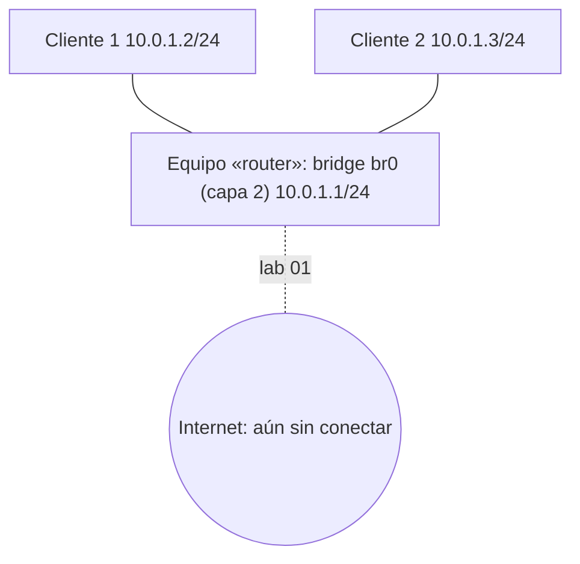

---

## Diagrama 02. Conexión lógica del escenario { #diagrama-02 }

**Documento de origen:** [`02-LABORATORIOS/lab-01`](../02-LABORATORIOS/lab-01/index.md)

**Función:** Equipos e infraestructura

**Descripción:** Resume la relación funcional entre los componentes representados. Identifica los equipos, servicios, procesos y conexiones que participan en el escenario, conservando las etiquetas técnicas del diagrama original.

**Elementos que deben identificarse:** equipos o participantes, servicios involucrados, operaciones o mensajes y relaciones de comunicación que aparecen rotulados en la figura. La clasificación cromática se aplica por función y se complementa con las etiquetas del propio diagrama.

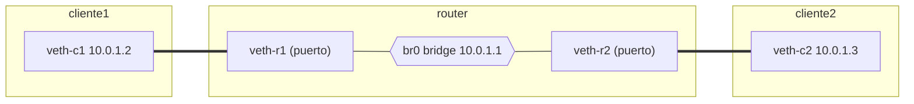

---

## Diagrama 03. Esquema de encapsulación con campos { #diagrama-03 }

**Documento de origen:** [`02-LABORATORIOS/lab-01`](../02-LABORATORIOS/lab-01/index.md)

**Función:** Equipos e infraestructura · Procesos y protocolos

**Descripción:** Descompone las funciones o capas que intervienen en el tratamiento de los datos. La anidación y el orden de los elementos muestran cómo se relacionan las cabeceras, unidades de información y operaciones.

**Elementos que deben identificarse:** equipos o participantes, servicios involucrados, operaciones o mensajes y relaciones de comunicación que aparecen rotulados en la figura. La clasificación cromática se aplica por función y se complementa con las etiquetas del propio diagrama.

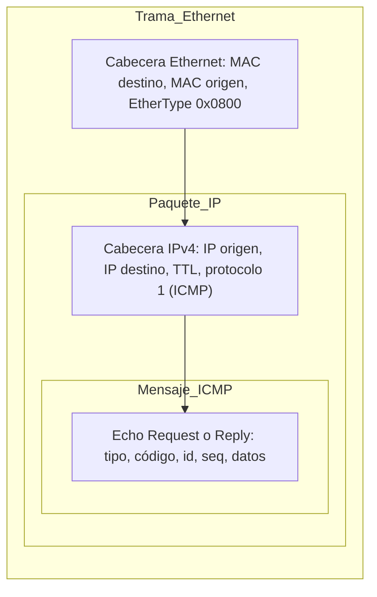

---

## Diagrama 04. Topología { #diagrama-04 }

**Documento de origen:** [`02-LABORATORIOS/lab-02`](../02-LABORATORIOS/lab-02/index.md)

**Función:** Equipos e infraestructura · Topologías y arquitectura

**Descripción:** Presenta la disposición lógica del escenario, los equipos o segmentos que lo componen y las conexiones que permiten la comunicación. Las etiquetas de los enlaces y las direcciones identifican las relaciones relevantes para reproducir la práctica.

**Elementos que deben identificarse:** equipos o participantes, servicios involucrados, operaciones o mensajes y relaciones de comunicación que aparecen rotulados en la figura. La clasificación cromática se aplica por función y se complementa con las etiquetas del propio diagrama.

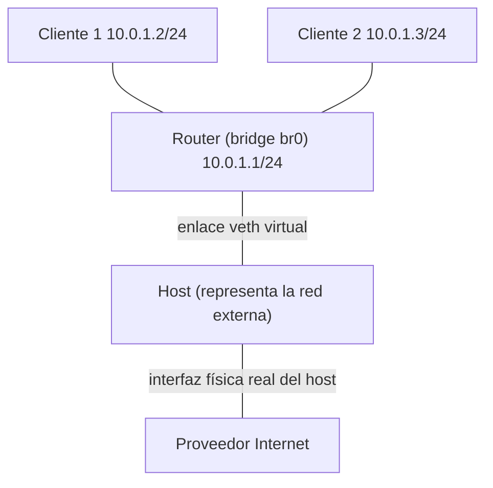

---

## Diagrama 05. Topología { #diagrama-05 }

**Documento de origen:** [`02-LABORATORIOS/lab-03`](../02-LABORATORIOS/lab-03/index.md)

**Función:** Equipos e infraestructura · Topologías y arquitectura

**Descripción:** Presenta la disposición lógica del escenario, los equipos o segmentos que lo componen y las conexiones que permiten la comunicación. Las etiquetas de los enlaces y las direcciones identifican las relaciones relevantes para reproducir la práctica.

**Elementos que deben identificarse:** equipos o participantes, servicios involucrados, operaciones o mensajes y relaciones de comunicación que aparecen rotulados en la figura. La clasificación cromática se aplica por función y se complementa con las etiquetas del propio diagrama.

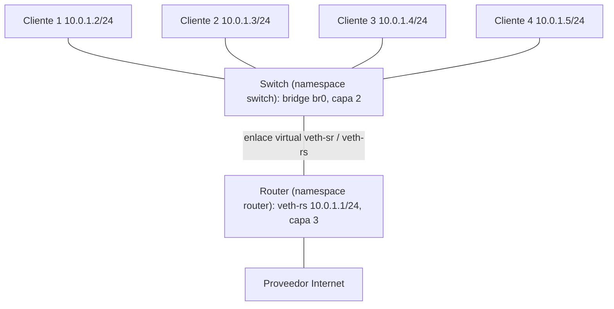

---

## Diagrama 06. Topología { #diagrama-06 }

**Documento de origen:** [`02-LABORATORIOS/lab-04`](../02-LABORATORIOS/lab-04/index.md)

**Función:** Equipos e infraestructura · Topologías y arquitectura

**Descripción:** Presenta la disposición lógica del escenario, los equipos o segmentos que lo componen y las conexiones que permiten la comunicación. Las etiquetas de los enlaces y las direcciones identifican las relaciones relevantes para reproducir la práctica.

**Elementos que deben identificarse:** equipos o participantes, servicios involucrados, operaciones o mensajes y relaciones de comunicación que aparecen rotulados en la figura. La clasificación cromática se aplica por función y se complementa con las etiquetas del propio diagrama.

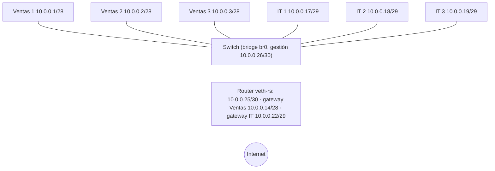

---

## Diagrama 07. Topología { #diagrama-07 }

**Documento de origen:** [`02-LABORATORIOS/lab-05`](../02-LABORATORIOS/lab-05/index.md)

**Función:** Equipos e infraestructura · Topologías y arquitectura

**Descripción:** Presenta la disposición lógica del escenario, los equipos o segmentos que lo componen y las conexiones que permiten la comunicación. Las etiquetas de los enlaces y las direcciones identifican las relaciones relevantes para reproducir la práctica.

**Elementos que deben identificarse:** equipos o participantes, servicios involucrados, operaciones o mensajes y relaciones de comunicación que aparecen rotulados en la figura. La clasificación cromática se aplica por función y se complementa con las etiquetas del propio diagrama.

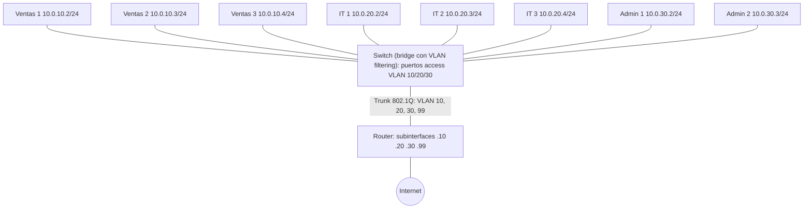

---

## Diagrama 08. Subred frente a VLAN { #diagrama-08 }

**Documento de origen:** [`02-LABORATORIOS/lab-05`](../02-LABORATORIOS/lab-05/index.md)

**Función:** Equipos e infraestructura · Topologías y arquitectura

**Descripción:** Resume la relación funcional entre los componentes representados. Identifica los equipos, servicios, procesos y conexiones que participan en el escenario, conservando las etiquetas técnicas del diagrama original.

**Elementos que deben identificarse:** equipos o participantes, servicios involucrados, operaciones o mensajes y relaciones de comunicación que aparecen rotulados en la figura. La clasificación cromática se aplica por función y se complementa con las etiquetas del propio diagrama.

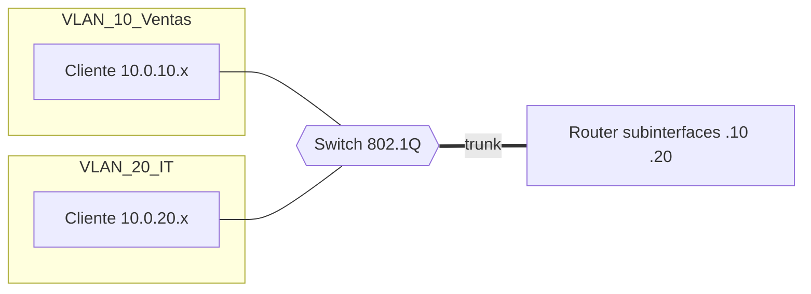

---

## Diagrama 09. Topología { #diagrama-09 }

**Documento de origen:** [`02-LABORATORIOS/lab-06`](../02-LABORATORIOS/lab-06/index.md)

**Función:** Equipos e infraestructura · Topologías y arquitectura

**Descripción:** Presenta la disposición lógica del escenario, los equipos o segmentos que lo componen y las conexiones que permiten la comunicación. Las etiquetas de los enlaces y las direcciones identifican las relaciones relevantes para reproducir la práctica.

**Elementos que deben identificarse:** equipos o participantes, servicios involucrados, operaciones o mensajes y relaciones de comunicación que aparecen rotulados en la figura. La clasificación cromática se aplica por función y se complementa con las etiquetas del propio diagrama.

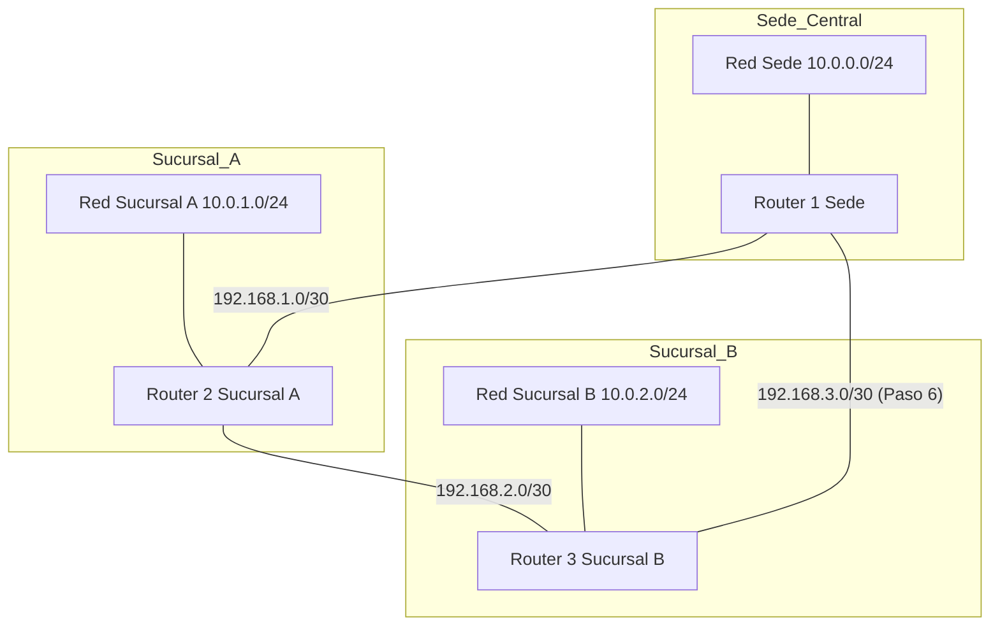

---

## Diagrama 10. Cómo se elige la ruta: *longest prefix match* { #diagrama-10 }

**Documento de origen:** [`02-LABORATORIOS/lab-06`](../02-LABORATORIOS/lab-06/index.md)

**Función:** Procesos y protocolos · Decisiones y flujos

**Descripción:** Explica la lógica de selección o diagnóstico mediante condiciones, caminos alternativos y resultados. Los rombos identifican decisiones; las flechas muestran las ramas y su consecuencia.

**Elementos que deben identificarse:** equipos o participantes, servicios involucrados, operaciones o mensajes y relaciones de comunicación que aparecen rotulados en la figura. La clasificación cromática se aplica por función y se complementa con las etiquetas del propio diagrama.

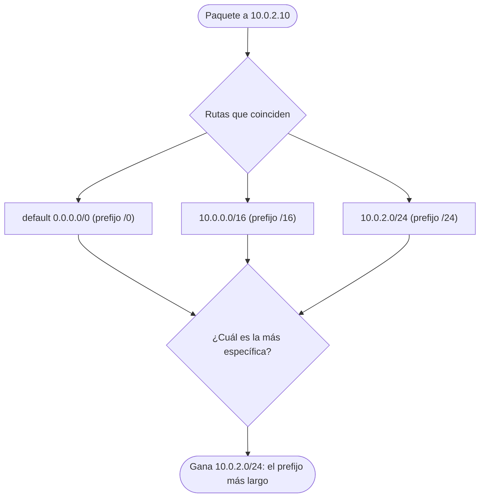

---

## Diagrama 11. Recorrido de un paquete entre sucursales { #diagrama-11 }

**Documento de origen:** [`02-LABORATORIOS/lab-06`](../02-LABORATORIOS/lab-06/index.md)

**Función:** Equipos e infraestructura · Procesos y protocolos · Topologías y arquitectura

**Descripción:** Describe el intercambio ordenado entre participantes. Las flechas indican quién inicia cada mensaje, quién lo recibe y cómo progresa el protocolo o la operación hasta completar el intercambio.

**Elementos que deben identificarse:** equipos o participantes, servicios involucrados, operaciones o mensajes y relaciones de comunicación que aparecen rotulados en la figura. La clasificación cromática se aplica por función y se complementa con las etiquetas del propio diagrama.

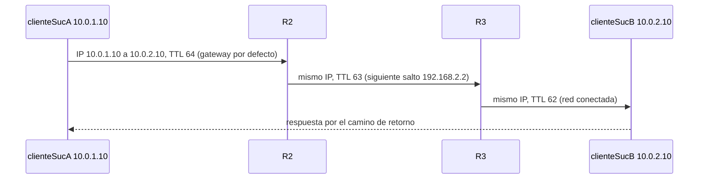

---

## Diagrama 12. La ruta de métrica 50 desaparece y entra la de métrica 100 (por R2) { #diagrama-12 }

**Documento de origen:** [`02-LABORATORIOS/lab-06`](../02-LABORATORIOS/lab-06/index.md)

**Función:** Equipos e infraestructura · Procesos y protocolos · Decisiones y flujos

**Descripción:** Explica la lógica de selección o diagnóstico mediante condiciones, caminos alternativos y resultados. Los rombos identifican decisiones; las flechas muestran las ramas y su consecuencia.

**Elementos que deben identificarse:** equipos o participantes, servicios involucrados, operaciones o mensajes y relaciones de comunicación que aparecen rotulados en la figura. La clasificación cromática se aplica por función y se complementa con las etiquetas del propio diagrama.

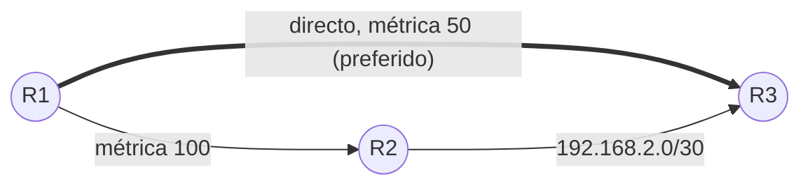

---

## Diagrama 13. Topología { #diagrama-13 }

**Documento de origen:** [`02-LABORATORIOS/lab-07`](../02-LABORATORIOS/lab-07/index.md)

**Función:** Equipos e infraestructura · Servicios y software · Procesos y protocolos · Topologías y arquitectura

**Descripción:** Presenta la disposición lógica del escenario, los equipos o segmentos que lo componen y las conexiones que permiten la comunicación. Las etiquetas de los enlaces y las direcciones identifican las relaciones relevantes para reproducir la práctica.

**Elementos que deben identificarse:** equipos o participantes, servicios involucrados, operaciones o mensajes y relaciones de comunicación que aparecen rotulados en la figura. La clasificación cromática se aplica por función y se complementa con las etiquetas del propio diagrama.

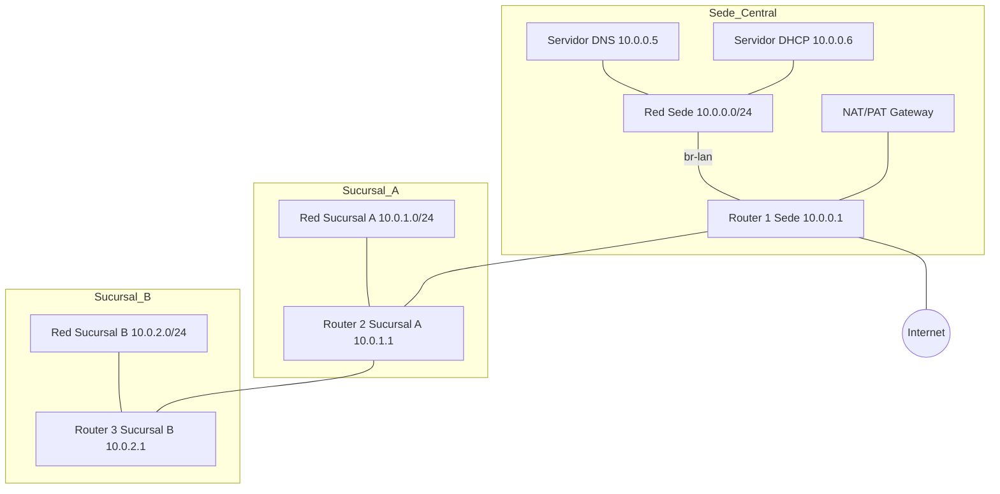

---

## Diagrama 14. Cómo se relacionan los cuatro servicios { #diagrama-14 }

**Documento de origen:** [`02-LABORATORIOS/lab-07`](../02-LABORATORIOS/lab-07/index.md)

**Función:** Equipos e infraestructura · Servicios y software · Procesos y protocolos · Decisiones y flujos

**Descripción:** Representa las etapas y dependencias del mecanismo técnico. Sigue las conexiones para identificar entradas, operaciones intermedias, protocolos implicados y resultado.

**Elementos que deben identificarse:** equipos o participantes, servicios involucrados, operaciones o mensajes y relaciones de comunicación que aparecen rotulados en la figura. La clasificación cromática se aplica por función y se complementa con las etiquetas del propio diagrama.

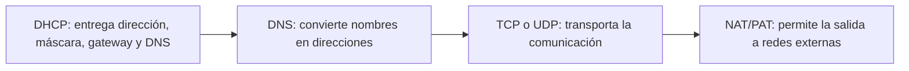

---

## Diagrama 15. Resolución DNS { #diagrama-15 }

**Documento de origen:** [`02-LABORATORIOS/lab-07`](../02-LABORATORIOS/lab-07/index.md)

**Función:** Equipos e infraestructura · Servicios y software

**Descripción:** Describe el intercambio ordenado entre participantes. Las flechas indican quién inicia cada mensaje, quién lo recibe y cómo progresa el protocolo o la operación hasta completar el intercambio.

**Elementos que deben identificarse:** equipos o participantes, servicios involucrados, operaciones o mensajes y relaciones de comunicación que aparecen rotulados en la figura. La clasificación cromática se aplica por función y se complementa con las etiquetas del propio diagrama.

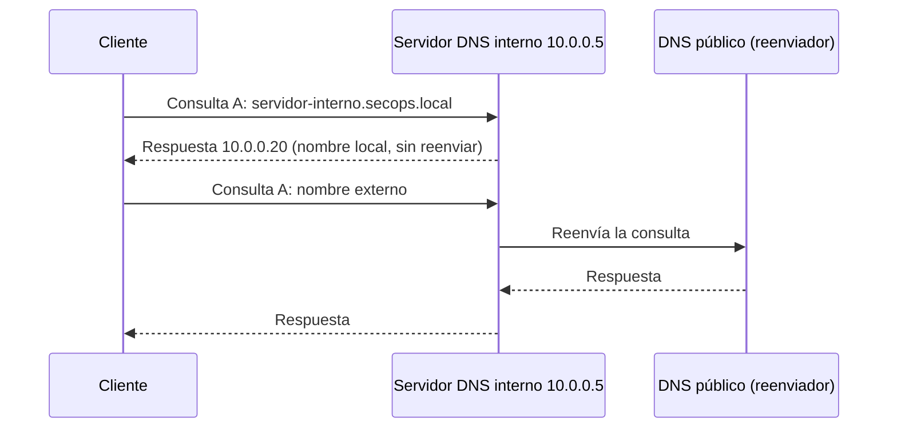

---

## Diagrama 16. Proceso DHCP (DORA) { #diagrama-16 }

**Documento de origen:** [`02-LABORATORIOS/lab-07`](../02-LABORATORIOS/lab-07/index.md)

**Función:** Equipos e infraestructura · Servicios y software · Procesos y protocolos

**Descripción:** Describe el intercambio ordenado entre participantes. Las flechas indican quién inicia cada mensaje, quién lo recibe y cómo progresa el protocolo o la operación hasta completar el intercambio.

**Elementos que deben identificarse:** equipos o participantes, servicios involucrados, operaciones o mensajes y relaciones de comunicación que aparecen rotulados en la figura. La clasificación cromática se aplica por función y se complementa con las etiquetas del propio diagrama.

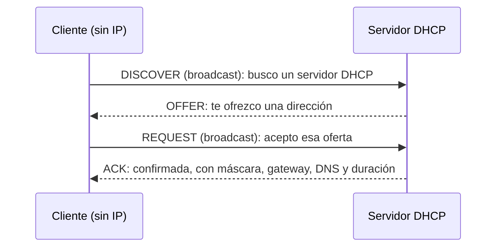

---

## Diagrama 17. Establecimiento y cierre de una conexión TCP { #diagrama-17 }

**Documento de origen:** [`02-LABORATORIOS/lab-07`](../02-LABORATORIOS/lab-07/index.md)

**Función:** Equipos e infraestructura · Servicios y software · Procesos y protocolos

**Descripción:** Describe el intercambio ordenado entre participantes. Las flechas indican quién inicia cada mensaje, quién lo recibe y cómo progresa el protocolo o la operación hasta completar el intercambio.

**Elementos que deben identificarse:** equipos o participantes, servicios involucrados, operaciones o mensajes y relaciones de comunicación que aparecen rotulados en la figura. La clasificación cromática se aplica por función y se complementa con las etiquetas del propio diagrama.

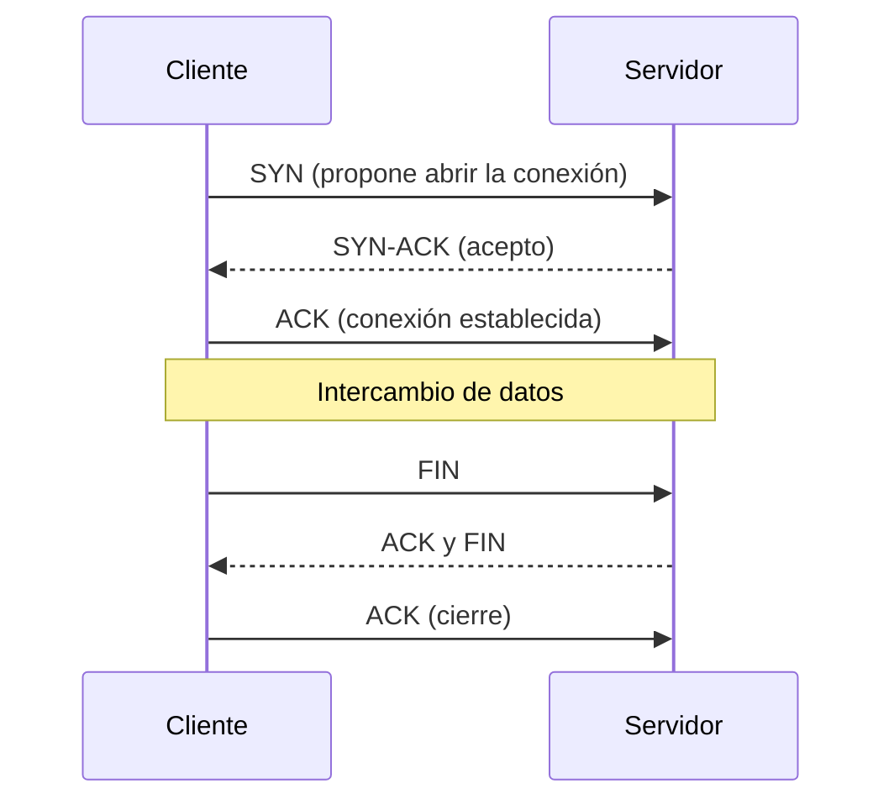

---

## Diagrama 18. Topología { #diagrama-18 }

**Documento de origen:** [`02-LABORATORIOS/lab-08`](../02-LABORATORIOS/lab-08/index.md)

**Función:** Equipos e infraestructura · Servicios y software · Procesos y protocolos · Topologías y arquitectura

**Descripción:** Presenta la disposición lógica del escenario, los equipos o segmentos que lo componen y las conexiones que permiten la comunicación. Las etiquetas de los enlaces y las direcciones identifican las relaciones relevantes para reproducir la práctica.

**Elementos que deben identificarse:** equipos o participantes, servicios involucrados, operaciones o mensajes y relaciones de comunicación que aparecen rotulados en la figura. La clasificación cromática se aplica por función y se complementa con las etiquetas del propio diagrama.

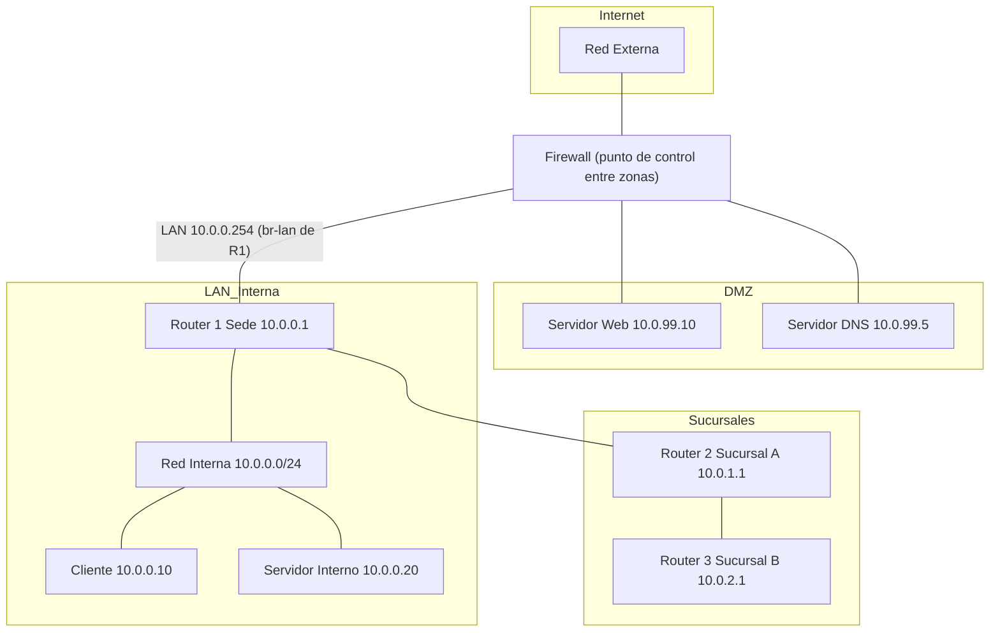

---

## Diagrama 19. Recorrido de un paquete por el firewall { #diagrama-19 }

**Documento de origen:** [`02-LABORATORIOS/lab-08`](../02-LABORATORIOS/lab-08/index.md)

**Función:** Equipos e infraestructura · Procesos y protocolos · Decisiones y flujos

**Descripción:** Describe el intercambio ordenado entre participantes. Las flechas indican quién inicia cada mensaje, quién lo recibe y cómo progresa el protocolo o la operación hasta completar el intercambio.

**Elementos que deben identificarse:** equipos o participantes, servicios involucrados, operaciones o mensajes y relaciones de comunicación que aparecen rotulados en la figura. La clasificación cromática se aplica por función y se complementa con las etiquetas del propio diagrama.

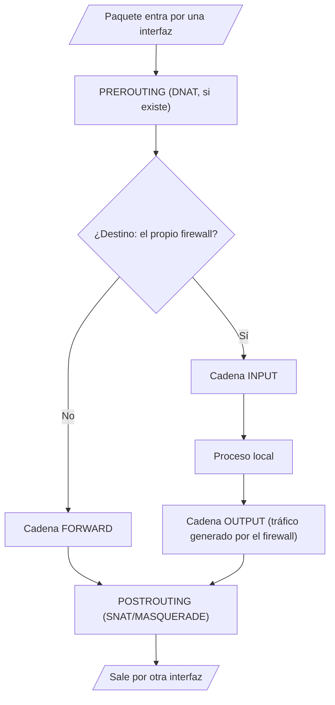

---

## Diagrama 20. Topología { #diagrama-20 }

**Documento de origen:** [`02-LABORATORIOS/lab-09`](../02-LABORATORIOS/lab-09/index.md)

**Función:** Equipos e infraestructura · Procesos y protocolos · Topologías y arquitectura

**Descripción:** Presenta la disposición lógica del escenario, los equipos o segmentos que lo componen y las conexiones que permiten la comunicación. Las etiquetas de los enlaces y las direcciones identifican las relaciones relevantes para reproducir la práctica.

**Elementos que deben identificarse:** equipos o participantes, servicios involucrados, operaciones o mensajes y relaciones de comunicación que aparecen rotulados en la figura. La clasificación cromática se aplica por función y se complementa con las etiquetas del propio diagrama.

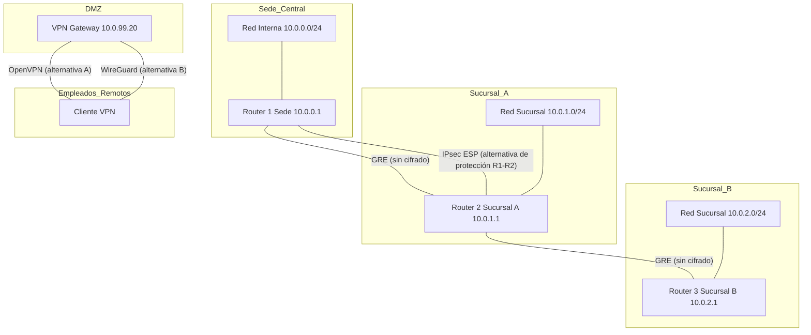

---

## Diagrama 21. Qué añade cada tecnología a un paquete { #diagrama-21 }

**Documento de origen:** [`02-LABORATORIOS/lab-09`](../02-LABORATORIOS/lab-09/index.md)

**Función:** Procesos y protocolos

**Descripción:** Resume la relación funcional entre los componentes representados. Identifica los equipos, servicios, procesos y conexiones que participan en el escenario, conservando las etiquetas técnicas del diagrama original.

**Elementos que deben identificarse:** equipos o participantes, servicios involucrados, operaciones o mensajes y relaciones de comunicación que aparecen rotulados en la figura. La clasificación cromática se aplica por función y se complementa con las etiquetas del propio diagrama.

```mermaid
graph TB
    subgraph GRE
        G1["IP exterior"] --> G2["GRE"] --> G3["IP interior + datos (en claro)"]
    end
    subgraph IPsec_ESP_modo_tunel
        E1["IP exterior"] --> E2["ESP"] --> E3["IP interior + datos (CIFRADOS) + ICV"]
    end
```

---

## Diagrama 22. Establecimiento de un túnel { #diagrama-22 }

**Documento de origen:** [`02-LABORATORIOS/lab-09`](../02-LABORATORIOS/lab-09/index.md)

**Función:** Equipos e infraestructura · Procesos y protocolos · Topologías y arquitectura

**Descripción:** Resume la relación funcional entre los componentes representados. Identifica los equipos, servicios, procesos y conexiones que participan en el escenario, conservando las etiquetas técnicas del diagrama original.

**Elementos que deben identificarse:** equipos o participantes, servicios involucrados, operaciones o mensajes y relaciones de comunicación que aparecen rotulados en la figura. La clasificación cromática se aplica por función y se complementa con las etiquetas del propio diagrama.

```mermaid
sequenceDiagram
    participant A as "Extremo A - Sede"
    participant B as "Extremo B - Sucursal"
    A->>B: Acuerdo de parametros y claves mediante IKE o claves manuales
    A->>B: Paquete de la red 10.0.0.0/24 enviado al extremo remoto
    B-->>A: Trafico de retorno por el tunel
    Note over A,B: Ambos extremos necesitan rutas o politicas que dirijan el trafico al tunel
```

---

## Diagrama 23. NAT-T y AllowedIPs { #diagrama-23 }

**Documento de origen:** [`02-LABORATORIOS/lab-09`](../02-LABORATORIOS/lab-09/index.md)

**Función:** Equipos e infraestructura · Procesos y protocolos

**Descripción:** Resume la relación funcional entre los componentes representados. Identifica los equipos, servicios, procesos y conexiones que participan en el escenario, conservando las etiquetas técnicas del diagrama original.

**Elementos que deben identificarse:** equipos o participantes, servicios involucrados, operaciones o mensajes y relaciones de comunicación que aparecen rotulados en la figura. La clasificación cromática se aplica por función y se complementa con las etiquetas del propio diagrama.

```mermaid
graph LR
    C["Cliente 10.9.0.2"] -- "AllowedIPs = 10.0.0.0/22" --> G["VPN Gateway"]
    G -- "AllowedIPs = 10.9.0.2/32" --> C
```

---

## Diagrama 24. Topología { #diagrama-24 }

**Documento de origen:** [`02-LABORATORIOS/lab-10`](../02-LABORATORIOS/lab-10/index.md)

**Función:** Equipos e infraestructura · Topologías y arquitectura

**Descripción:** Presenta la disposición lógica del escenario, los equipos o segmentos que lo componen y las conexiones que permiten la comunicación. Las etiquetas de los enlaces y las direcciones identifican las relaciones relevantes para reproducir la práctica.

**Elementos que deben identificarse:** equipos o participantes, servicios involucrados, operaciones o mensajes y relaciones de comunicación que aparecen rotulados en la figura. La clasificación cromática se aplica por función y se complementa con las etiquetas del propio diagrama.

```mermaid
graph TB
    R1[PE1]
    R2[PE2]
    R3[PE3]
    P1[P Router 1]
    P2[P Router 2]
    P3[P Router 3]
    LAN1[Red Local 10.0.0.0/24]
    LAN2[Red Local 10.1.0.0/24]
    LAN3[Red Local 10.2.0.0/24]
    R1 --- P1
    R2 --- P2
    R3 --- P3
    LAN1 --- R1
    LAN2 --- R2
    LAN3 --- R3
    P1 --- P2
    P2 --- P3
    P1 --- P3
```

---

## Diagrama 25. Red de proveedor: roles PE y P { #diagrama-25 }

**Documento de origen:** [`02-LABORATORIOS/lab-10`](../02-LABORATORIOS/lab-10/index.md)

**Función:** Equipos e infraestructura · Topologías y arquitectura

**Descripción:** Resume la relación funcional entre los componentes representados. Identifica los equipos, servicios, procesos y conexiones que participan en el escenario, conservando las etiquetas técnicas del diagrama original.

**Elementos que deben identificarse:** equipos o participantes, servicios involucrados, operaciones o mensajes y relaciones de comunicación que aparecen rotulados en la figura. La clasificación cromática se aplica por función y se complementa con las etiquetas del propio diagrama.

```mermaid
graph LR
    H1[Cliente A] --- CE1[CE]
    CE1 --- PE1["PE (frontera)"]
    PE1 --- P1["P (núcleo)"]
    PE1 --- P2["P (núcleo)"]
    P1 --- P2
    P1 --- PE2["PE (frontera)"]
    P2 --- PE2
    PE2 --- CE2[CE]
    CE2 --- H2[Cliente B]
```

---

## Diagrama 26. Push, swap y pop { #diagrama-26 }

**Documento de origen:** [`02-LABORATORIOS/lab-10`](../02-LABORATORIOS/lab-10/index.md)

**Función:** Equipos e infraestructura · Procesos y protocolos

**Descripción:** Representa las etapas y dependencias del mecanismo técnico. Sigue las conexiones para identificar entradas, operaciones intermedias, protocolos implicados y resultado.

**Elementos que deben identificarse:** equipos o participantes, servicios involucrados, operaciones o mensajes y relaciones de comunicación que aparecen rotulados en la figura. La clasificación cromática se aplica por función y se complementa con las etiquetas del propio diagrama.

```mermaid
graph LR
    A["host1"] --> PE1["PE1: PUSH etiqueta 100"]
    PE1 --> P1["P1: SWAP 100 a 200"]
    P1 --> P3["P3: POP (penúltimo salto)"]
    P3 --> PE3["PE3: reenvío IP"]
    PE3 --> B["host3"]
```

---

## Diagrama 27. Failover frente a ECMP { #diagrama-27 }

**Documento de origen:** [`02-LABORATORIOS/lab-10`](../02-LABORATORIOS/lab-10/index.md)

**Función:** Decisiones y flujos

**Descripción:** Explica la lógica de selección o diagnóstico mediante condiciones, caminos alternativos y resultados. Los rombos identifican decisiones; las flechas muestran las ramas y su consecuencia.

**Elementos que deben identificarse:** equipos o participantes, servicios involucrados, operaciones o mensajes y relaciones de comunicación que aparecen rotulados en la figura. La clasificación cromática se aplica por función y se complementa con las etiquetas del propio diagrama.

```mermaid
graph LR
    subgraph Failover
        F1[PE1] ==>|"métrica 50, activo"| F2[PE3]
        F1 -.->|"métrica 100, en reserva"| F2
    end
    subgraph ECMP
        E1[PE1] ==>|"camino 1, mismo coste"| E2[PE3]
        E1 ==>|"camino 2, mismo coste"| E2
    end
```

---

## Diagrama 28. Las capas son funciones, no niveles físicos { #diagrama-28 }

**Documento de origen:** [`02-LABORATORIOS/lab-11`](../02-LABORATORIOS/lab-11/index.md)

**Función:** Equipos e infraestructura · Procesos y protocolos · Topologías y arquitectura

**Descripción:** Descompone las funciones o capas que intervienen en el tratamiento de los datos. La anidación y el orden de los elementos muestran cómo se relacionan las cabeceras, unidades de información y operaciones.

**Elementos que deben identificarse:** equipos o participantes, servicios involucrados, operaciones o mensajes y relaciones de comunicación que aparecen rotulados en la figura. La clasificación cromática se aplica por función y se complementa con las etiquetas del propio diagrama.

```mermaid
graph TB
    subgraph Core["CORE: transporte rápido, sin políticas complejas"]
        C1[Core1]
        C2[Core2]
    end
    subgraph Dist["DISTRIBUCIÓN: agregación, políticas y routing entre VLAN"]
        D1[Dist1]
        D2[Dist2]
    end
    subgraph Acc["ACCESO: dispositivos finales y VLAN"]
        A1[Access1]
    end
    FW[Firewall perimetral]
    C1 --- D1
    C1 --- D2
    C2 --- D1
    C2 --- D2
    D1 --- A1
    C1 --- FW
    C2 --- FW
```

---

## Diagrama 29. Topología { #diagrama-29 }

**Documento de origen:** [`02-LABORATORIOS/lab-11`](../02-LABORATORIOS/lab-11/index.md)

**Función:** Equipos e infraestructura · Servicios y software · Procesos y protocolos · Topologías y arquitectura

**Descripción:** Presenta la disposición lógica del escenario, los equipos o segmentos que lo componen y las conexiones que permiten la comunicación. Las etiquetas de los enlaces y las direcciones identifican las relaciones relevantes para reproducir la práctica.

**Elementos que deben identificarse:** equipos o participantes, servicios involucrados, operaciones o mensajes y relaciones de comunicación que aparecen rotulados en la figura. La clasificación cromática se aplica por función y se complementa con las etiquetas del propio diagrama.

```mermaid
graph TB
    Internet((Internet))
    FW[Firewall]
    C1[Core 1]
    C2[Core 2]
    D1[Dist 1]
    D2[Dist 2]
    A1[Access 1 switch VLAN]
    V10[VLAN 10 Ventas]
    V20[VLAN 20 IT]
    V30[VLAN 30 Admin]
    WEB[Servidor Web DMZ]
    DNS[Servidor DNS DMZ]
    Internet --- FW
    FW --- C1
    FW --- C2
    C1 --- C2
    C1 --- D1
    C1 --- D2
    C2 --- D1
    C2 --- D2
    D1 --- A1
    A1 --- V10
    A1 --- V20
    A1 --- V30
    FW --- WEB
    FW --- DNS
```

---

## Diagrama 30. STP/RSTP: redundancia física sin bucles { #diagrama-30 }

**Documento de origen:** [`02-LABORATORIOS/lab-11`](../02-LABORATORIOS/lab-11/index.md)

**Función:** Equipos e infraestructura · Procesos y protocolos

**Descripción:** Resume la relación funcional entre los componentes representados. Identifica los equipos, servicios, procesos y conexiones que participan en el escenario, conservando las etiquetas técnicas del diagrama original.

**Elementos que deben identificarse:** equipos o participantes, servicios involucrados, operaciones o mensajes y relaciones de comunicación que aparecen rotulados en la figura. La clasificación cromática se aplica por función y se complementa con las etiquetas del propio diagrama.

```mermaid
graph LR
    SA[Switch A raíz] ===|activo| SB[Switch B]
    SA -.-|puerto bloqueado por STP| SB
    SB --- H[Host]
```

---

## Diagrama 31. Ejemplo de crecimiento: Access2 y Access3 { #diagrama-31 }

**Documento de origen:** [`02-LABORATORIOS/lab-11`](../02-LABORATORIOS/lab-11/index.md)

**Función:** Equipos e infraestructura · Topologías y arquitectura

**Descripción:** Resume la relación funcional entre los componentes representados. Identifica los equipos, servicios, procesos y conexiones que participan en el escenario, conservando las etiquetas técnicas del diagrama original.

**Elementos que deben identificarse:** equipos o participantes, servicios involucrados, operaciones o mensajes y relaciones de comunicación que aparecen rotulados en la figura. La clasificación cromática se aplica por función y se complementa con las etiquetas del propio diagrama.

```mermaid
graph TB
    D1[Dist1: gateway de las VLAN] --- A1[Access1]
    D1 --- A2[Access2]
    D1 --- A3[Access3]
```

---

## Diagrama 32. Topología { #diagrama-32 }

**Documento de origen:** [`02-LABORATORIOS/lab-12`](../02-LABORATORIOS/lab-12/index.md)

**Función:** Equipos e infraestructura · Servicios y software · Topologías y arquitectura

**Descripción:** Presenta la disposición lógica del escenario, los equipos o segmentos que lo componen y las conexiones que permiten la comunicación. Las etiquetas de los enlaces y las direcciones identifican las relaciones relevantes para reproducir la práctica.

**Elementos que deben identificarse:** equipos o participantes, servicios involucrados, operaciones o mensajes y relaciones de comunicación que aparecen rotulados en la figura. La clasificación cromática se aplica por función y se complementa con las etiquetas del propio diagrama.

```mermaid
graph TB
    R1[OnPremise Router]
    APP[Servidor App]
    DB[Servidor DB]
    VPC[AWS VPC Router]
    EC2[EC2 Server]
    RDS[RDS Server]
    ZTNA[ZTNA Broker]
    IDP[Identity Provider simulado]
    USER1[Usuario Remoto 1]
    USER2[Usuario Remoto 2]
    USER1 --- ZTNA
    USER2 --- ZTNA
    ZTNA --- IDP
    ZTNA --- R1
    ZTNA --- VPC
    R1 --- APP
    R1 --- DB
    R1 --- VPC
    VPC --- EC2
    VPC --- RDS
    class VPC sxCloud
```

---

## Diagrama 33. Componentes de una arquitectura ZTNA real { #diagrama-33 }

**Documento de origen:** [`02-LABORATORIOS/lab-12`](../02-LABORATORIOS/lab-12/index.md)

**Función:** Equipos e infraestructura · Servicios y software · Decisiones y flujos · Topologías y arquitectura

**Descripción:** Resume la relación funcional entre los componentes representados. Identifica los equipos, servicios, procesos y conexiones que participan en el escenario, conservando las etiquetas técnicas del diagrama original.

**Elementos que deben identificarse:** equipos o participantes, servicios involucrados, operaciones o mensajes y relaciones de comunicación que aparecen rotulados en la figura. La clasificación cromática se aplica por función y se complementa con las etiquetas del propio diagrama.

```mermaid
sequenceDiagram
    participant U as Usuario remoto
    participant B as Broker ZTNA
    participant I as IdP (identidad)
    participant A as Aplicación
    U->>B: Solicita acceso a la aplicación
    B->>I: ¿Quién es y cumple las condiciones?
    I-->>B: Identidad verificada (y estado del dispositivo)
    B->>B: Evalúa política: usuario, aplicación, puerto
    B->>A: Abre solo esa conexión
    A-->>U: Respuesta (por el broker)
```

---

## Diagrama 34. VPC con subred pública y privada { #diagrama-34 }

**Documento de origen:** [`02-LABORATORIOS/lab-12`](../02-LABORATORIOS/lab-12/index.md)

**Función:** Equipos e infraestructura · Servicios y software · Topologías y arquitectura

**Descripción:** Resume la relación funcional entre los componentes representados. Identifica los equipos, servicios, procesos y conexiones que participan en el escenario, conservando las etiquetas técnicas del diagrama original.

**Elementos que deben identificarse:** equipos o participantes, servicios involucrados, operaciones o mensajes y relaciones de comunicación que aparecen rotulados en la figura. La clasificación cromática se aplica por función y se complementa con las etiquetas del propio diagrama.

```mermaid
graph TB
    Internet((Internet)) --- IGW[Puerta de enlace a Internet]
    subgraph VPC["VPC 10.100.0.0/16"]
        subgraph Publica["Subred pública"]
            WEB[Servidor expuesto]
        end
        subgraph Privada["Subred privada"]
            DB[(Base de datos)]
        end
    end
    IGW --- WEB
    WEB --- DB
```

---

## Diagrama 35. Topología { #diagrama-35 }

**Documento de origen:** [`02-LABORATORIOS/lab-13`](../02-LABORATORIOS/lab-13/index.md)

**Función:** Equipos e infraestructura · Servicios y software · Topologías y arquitectura

**Descripción:** Presenta la disposición lógica del escenario, los equipos o segmentos que lo componen y las conexiones que permiten la comunicación. Las etiquetas de los enlaces y las direcciones identifican las relaciones relevantes para reproducir la práctica.

**Elementos que deben identificarse:** equipos o participantes, servicios involucrados, operaciones o mensajes y relaciones de comunicación que aparecen rotulados en la figura. La clasificación cromática se aplica por función y se complementa con las etiquetas del propio diagrama.

```mermaid
graph TB
    MON[NOC 10.0.0.100]
    SIEM[SIEM 10.0.0.200]
    R1[OnPremise Router 10.0.0.1]
    APP[Servidor App 10.0.0.10]
    DB[Servidor DB 10.0.0.20]
    VPC[VPC AWS 10.100.0.0/16]
    EC2[EC2 Server 10.100.1.10]
    MON --- R1
    SIEM --- R1
    APP --- R1
    DB --- R1
    R1 --- VPC
    EC2 --- VPC
    R1 --- Internet
    class Internet sxExternal
```

---

## Diagrama 36. Del síntoma a la causa: método de diagnóstico { #diagrama-36 }

**Documento de origen:** [`02-LABORATORIOS/lab-13`](../02-LABORATORIOS/lab-13/index.md)

**Función:** Equipos e infraestructura · Servicios y software · Procesos y protocolos · Decisiones y flujos

**Descripción:** Explica la lógica de selección o diagnóstico mediante condiciones, caminos alternativos y resultados. Los rombos identifican decisiones; las flechas muestran las ramas y su consecuencia.

**Elementos que deben identificarse:** equipos o participantes, servicios involucrados, operaciones o mensajes y relaciones de comunicación que aparecen rotulados en la figura. La clasificación cromática se aplica por función y se complementa con las etiquetas del propio diagrama.

```mermaid
flowchart TD
    S["Síntoma: el usuario no accede al servicio"] --> A{"¿Hay conectividad IP? ping a la IP"}
    A -- No --> R{"¿Hay ruta y gateway? ip route, traceroute"}
    A -- Sí --> N{"¿Resuelve el nombre? dig"}
    N -- No --> DNS["Problema de DNS"]
    N -- Sí --> P{"¿El puerto responde? nc -zv, ss"}
    P -- No --> FW["Firewall o servicio caído"]
    P -- Sí --> Q{"¿Va lento? iperf3, mtr"}
    Q -- Sí --> PERF["Rendimiento: pérdida, MTU, congestión"]
    R --> LNK["Enlace, ruta o gateway"]
    class DNS,FW,LNK,PERF sxMonitor
```

---

## Diagrama 37. Topología { #diagrama-37 }

**Documento de origen:** [`02-LABORATORIOS/lab-14`](../02-LABORATORIOS/lab-14/index.md)

**Función:** Equipos e infraestructura · Servicios y software · Topologías y arquitectura

**Descripción:** Presenta la disposición lógica del escenario, los equipos o segmentos que lo componen y las conexiones que permiten la comunicación. Las etiquetas de los enlaces y las direcciones identifican las relaciones relevantes para reproducir la práctica.

**Elementos que deben identificarse:** equipos o participantes, servicios involucrados, operaciones o mensajes y relaciones de comunicación que aparecen rotulados en la figura. La clasificación cromática se aplica por función y se complementa con las etiquetas del propio diagrama.

```mermaid
graph TB
    R[Router Linux]
    WAN["«Internet» = el host, 203.0.113.2"]
    LAN1[Red Interna 10.0.0.0/24]
    LAN2[Red DMZ 10.0.1.0/24]
    H1[Host1 10.0.0.10]
    H2[Host2 10.0.0.20]
    S1[Servidor DMZ 10.0.1.10]
    R --- WAN
    R --- LAN1
    R --- LAN2
    H1 --- LAN1
    H2 --- LAN1
    S1 --- LAN2
```

---

## Diagrama 38. Recorrido de un paquete: input, forward y output { #diagrama-38 }

**Documento de origen:** [`02-LABORATORIOS/lab-14`](../02-LABORATORIOS/lab-14/index.md)

**Función:** Procesos y protocolos · Decisiones y flujos

**Descripción:** Describe el intercambio ordenado entre participantes. Las flechas indican quién inicia cada mensaje, quién lo recibe y cómo progresa el protocolo o la operación hasta completar el intercambio.

**Elementos que deben identificarse:** equipos o participantes, servicios involucrados, operaciones o mensajes y relaciones de comunicación que aparecen rotulados en la figura. La clasificación cromática se aplica por función y se complementa con las etiquetas del propio diagrama.

```mermaid
flowchart LR
    E[/"Llega por una interfaz"/] --> R{"¿Para este equipo?"}
    R -- Sí --> I["input"] --> L["Proceso local (servicio)"]
    R -- No --> F["forward"] --> S[/"Sale por otra interfaz"/]
    L --> O["output (tráfico generado aquí)"] --> S
```

---

## Diagrama 39. Topología { #diagrama-39 }

**Documento de origen:** [`02-LABORATORIOS/lab-15`](../02-LABORATORIOS/lab-15/index.md)

**Función:** Equipos e infraestructura · Servicios y software · Topologías y arquitectura

**Descripción:** Presenta la disposición lógica del escenario, los equipos o segmentos que lo componen y las conexiones que permiten la comunicación. Las etiquetas de los enlaces y las direcciones identifican las relaciones relevantes para reproducir la práctica.

**Elementos que deben identificarse:** equipos o participantes, servicios involucrados, operaciones o mensajes y relaciones de comunicación que aparecen rotulados en la figura. La clasificación cromática se aplica por función y se complementa con las etiquetas del propio diagrama.

```mermaid
graph TB
    Internet((Internet host))
    R1[R1 Sede]
    R2[R2 Respaldo y Sucursal]
    SW[Switch Servidores]
    FIN[Finanzas]
    VEN[Ventas]
    GES[Gestion]
    SRV[Servidores]
    SUC[Sucursal]
    Internet --- R1
    R1 --- FIN
    R1 --- VEN
    R1 --- GES
    R1 ---|Enlace A y B| R2
    R1 --- SW
    R2 --- SW
    SW --- SRV
    R2 --- SUC
```

---

## Diagrama 40. Mapa del escenario: redes, *gateways* y caminos { #diagrama-40 }

**Documento de origen:** [`02-LABORATORIOS/lab-15`](../02-LABORATORIOS/lab-15/index.md)

**Función:** Equipos e infraestructura · Servicios y software · Topologías y arquitectura

**Descripción:** Resume la relación funcional entre los componentes representados. Identifica los equipos, servicios, procesos y conexiones que participan en el escenario, conservando las etiquetas técnicas del diagrama original.

**Elementos que deben identificarse:** equipos o participantes, servicios involucrados, operaciones o mensajes y relaciones de comunicación que aparecen rotulados en la figura. La clasificación cromática se aplica por función y se complementa con las etiquetas del propio diagrama.

```mermaid
graph TB
    NET((Internet: el host 192.168.100.2))
    subgraph R1["R1 (sede)"]
        W1["WAN veth-r1-wan 192.168.100.1"]
        F1["Finanzas .1 (10.0.1.0/25)"]
        V1["Ventas .129 (10.0.1.128/26)"]
        G1["Gestión .193 (10.0.1.192/28)"]
        S1["Servidores veth-r1srv (10.0.0.0/24)"]
    end
    subgraph R2["R2 (respaldo y sucursal)"]
        S2["Servidores veth-r2srv"]
        SU["Sucursal .1 (10.0.2.0/24)"]
    end
    NET --- W1
    R1 ===|"Enlace A 10.0.1.208/30 (principal)"| R2
    R1 -.-|"Enlace B 10.0.1.212/30 (respaldo)"| R2
    S1 --- SW[Switch de servidores]
    S2 --- SW
```

---

## Diagrama 41. Cambio de *master* y *backup* { #diagrama-41 }

**Documento de origen:** [`02-LABORATORIOS/lab-15`](../02-LABORATORIOS/lab-15/index.md)

**Función:** Equipos e infraestructura · Decisiones y flujos

**Descripción:** Resume la relación funcional entre los componentes representados. Identifica los equipos, servicios, procesos y conexiones que participan en el escenario, conservando las etiquetas técnicas del diagrama original.

**Elementos que deben identificarse:** equipos o participantes, servicios involucrados, operaciones o mensajes y relaciones de comunicación que aparecen rotulados en la figura. La clasificación cromática se aplica por función y se complementa con las etiquetas del propio diagrama.

```mermaid
sequenceDiagram
    participant S as srv (gateway 10.0.0.1)
    participant R1 as R1 (prioridad 100)
    participant R2 as R2 (prioridad 90)
    R1->>R2: Anuncios VRRP cada 1 s (R1 es MASTER y tiene 10.0.0.1)
    S->>R1: Tráfico hacia el gateway 10.0.0.1
    Note over R1: Falla el servicio VRRP de R1
    R2->>R2: Deja de oír anuncios y pasa a MASTER
    R2->>S: ARP gratuito: 10.0.0.1 ahora está en R2
    S->>R2: El mismo gateway 10.0.0.1, otro equipo detrás
```

---

## Diagrama 42. Mapa integral de una infraestructura empresarial { #diagrama-42 }

**Documento de origen:** [`04-REFERENCIA/arquitectura-integral.md`](../04-REFERENCIA/arquitectura-integral.md)

**Función:** Equipos e infraestructura · Servicios y software · Procesos y protocolos · Topologías y arquitectura

**Descripción:** Resume la relación funcional entre los componentes representados. Identifica los equipos, servicios, procesos y conexiones que participan en el escenario, conservando las etiquetas técnicas del diagrama original.

**Elementos que deben identificarse:** equipos o participantes, servicios involucrados, operaciones o mensajes y relaciones de comunicación que aparecen rotulados en la figura. La clasificación cromática se aplica por función y se complementa con las etiquetas del propio diagrama.

```mermaid
graph TB
    subgraph Remoto["Usuarios remotos"]
        U["Usuario remoto"]
    end
    subgraph Nube["Nube e infraestructura híbrida"]
        VPC["VPC (subredes pública y privada)"]
    end
    subgraph WAN["Red WAN / proveedor"]
        PE["PE / P: núcleo del proveedor"]
    end
    subgraph Sede["Sede central"]
        FW["Firewall perimetral"]
        DMZ["DMZ: servidores públicos"]
        CORE["Core"]
        DIST["Distribución (gateway, políticas)"]
        ACC["Acceso (VLAN)"]
        NOC["NOC y colector de logs"]
    end
    subgraph Suc["Sucursales"]
        RS["Router de sucursal"]
    end
    U -->|"ZTNA / VPN"| FW
    FW --- DMZ
    FW --- CORE
    CORE --- DIST --- ACC
    NOC -.-|"supervisa"| CORE
    FW ---|"WAN"| PE
    PE --- RS
    RS ---|"túnel GRE/IPsec"| FW
    FW ---|"conectividad híbrida"| VPC
```

---

## Diagrama 43. Mapa de seguridad y flujo del tráfico { #diagrama-43 }

**Documento de origen:** [`04-REFERENCIA/arquitectura-integral.md`](../04-REFERENCIA/arquitectura-integral.md)

**Función:** Equipos e infraestructura · Servicios y software · Procesos y protocolos · Decisiones y flujos · Topologías y arquitectura

**Descripción:** Resume la relación funcional entre los componentes representados. Identifica los equipos, servicios, procesos y conexiones que participan en el escenario, conservando las etiquetas técnicas del diagrama original.

**Elementos que deben identificarse:** equipos o participantes, servicios involucrados, operaciones o mensajes y relaciones de comunicación que aparecen rotulados en la figura. La clasificación cromática se aplica por función y se complementa con las etiquetas del propio diagrama.

```mermaid
flowchart LR
    NET((Internet)) -->|"solo servicios publicados"| FW["Firewall"]
    FW -->|"80/443/53 al servidor correspondiente"| DMZ["DMZ"]
    FW -.->|"denegado"| LAN
    LAN["LAN interna"] -->|"permitido con NAT"| FW
    LAN -->|"ICMP, SSH, HTTPS limitados"| DMZ
    DMZ -.->|"denegado"| LAN
    REM["Usuario remoto"] -->|"acceso por aplicación (ZTNA)"| BR["Broker"]
    BR --> APP["Aplicación concreta"]
```

---

## Diagrama 44. El esquema en cinco pasos { #diagrama-44 }

**Documento de origen:** [`04-REFERENCIA/diagnostico.md`](../04-REFERENCIA/diagnostico.md)

**Función:** Decisiones y flujos

**Descripción:** Resume la relación funcional entre los componentes representados. Identifica los equipos, servicios, procesos y conexiones que participan en el escenario, conservando las etiquetas técnicas del diagrama original.

**Elementos que deben identificarse:** equipos o participantes, servicios involucrados, operaciones o mensajes y relaciones de comunicación que aparecen rotulados en la figura. La clasificación cromática se aplica por función y se complementa con las etiquetas del propio diagrama.

```mermaid
flowchart LR
    A(["1. Síntoma"]) --> B["2. Capa o mecanismo"]
    B --> C["3. Herramientas"]
    C --> D["4. Evidencia"]
    D --> E(["5. Conclusión técnica"])
```

---

## Diagrama 45. De lo simple a lo específico { #diagrama-45 }

**Documento de origen:** [`04-REFERENCIA/diagnostico.md`](../04-REFERENCIA/diagnostico.md)

**Función:** Equipos e infraestructura · Servicios y software · Procesos y protocolos · Decisiones y flujos

**Descripción:** Resume la relación funcional entre los componentes representados. Identifica los equipos, servicios, procesos y conexiones que participan en el escenario, conservando las etiquetas técnicas del diagrama original.

**Elementos que deben identificarse:** equipos o participantes, servicios involucrados, operaciones o mensajes y relaciones de comunicación que aparecen rotulados en la figura. La clasificación cromática se aplica por función y se complementa con las etiquetas del propio diagrama.

```mermaid
flowchart TD
    S(["Síntoma"]) --> A{"¿Responde ping a la IP?"}
    A -- No --> B{"¿Hay ruta y gateway? ip route get, traceroute"}
    B -- No --> B1["Ruta, gateway o enlace"]
    B -- Sí --> B2["Filtrado ICMP o equipo apagado: capturar con tcpdump"]
    A -- Sí --> C{"¿Resuelve el nombre? dig"}
    C -- No --> C1["DNS"]
    C -- Sí --> D{"¿Abre el puerto? nc -zv, ss"}
    D -- No --> D1["Firewall o servicio"]
    D -- Sí --> E{"¿Va lento? iperf3, mtr"}
    E -- Sí --> E1["Pérdida, MTU o saturación"]
    E -- No --> E2["Aplicación"]
    class B1,B2,C1,D1,E1 sxMonitor
```

---

## Índice de diagramas

01. [Topología](#diagrama-01) — lab-01
2. [Conexión lógica del escenario](#diagrama-02) — lab-01
3. [Esquema de encapsulación con campos](#diagrama-03) — lab-01
4. [Topología](#diagrama-04) — lab-02
5. [Topología](#diagrama-05) — lab-03
6. [Topología](#diagrama-06) — lab-04
7. [Topología](#diagrama-07) — lab-05
8. [Subred frente a VLAN](#diagrama-08) — lab-05
9. [Topología](#diagrama-09) — lab-06
10. [Cómo se elige la ruta: *longest prefix match*](#diagrama-10) — lab-06
11. [Recorrido de un paquete entre sucursales](#diagrama-11) — lab-06
12. [La ruta de métrica 50 desaparece y entra la de métrica 100 (por R2)](#diagrama-12) — lab-06
13. [Topología](#diagrama-13) — lab-07
14. [Cómo se relacionan los cuatro servicios](#diagrama-14) — lab-07
15. [Resolución DNS](#diagrama-15) — lab-07
16. [Proceso DHCP (DORA)](#diagrama-16) — lab-07
17. [Establecimiento y cierre de una conexión TCP](#diagrama-17) — lab-07
18. [Topología](#diagrama-18) — lab-08
19. [Recorrido de un paquete por el firewall](#diagrama-19) — lab-08
20. [Topología](#diagrama-20) — lab-09
21. [Qué añade cada tecnología a un paquete](#diagrama-21) — lab-09
22. [Establecimiento de un túnel](#diagrama-22) — lab-09
23. [NAT-T y AllowedIPs](#diagrama-23) — lab-09
24. [Topología](#diagrama-24) — lab-10
25. [Red de proveedor: roles PE y P](#diagrama-25) — lab-10
26. [Push, swap y pop](#diagrama-26) — lab-10
27. [Failover frente a ECMP](#diagrama-27) — lab-10
28. [Las capas son funciones, no niveles físicos](#diagrama-28) — lab-11
29. [Topología](#diagrama-29) — lab-11
30. [STP/RSTP: redundancia física sin bucles](#diagrama-30) — lab-11
31. [Ejemplo de crecimiento: Access2 y Access3](#diagrama-31) — lab-11
32. [Topología](#diagrama-32) — lab-12
33. [Componentes de una arquitectura ZTNA real](#diagrama-33) — lab-12
34. [VPC con subred pública y privada](#diagrama-34) — lab-12
35. [Topología](#diagrama-35) — lab-13
36. [Del síntoma a la causa: método de diagnóstico](#diagrama-36) — lab-13
37. [Topología](#diagrama-37) — lab-14
38. [Recorrido de un paquete: input, forward y output](#diagrama-38) — lab-14
39. [Topología](#diagrama-39) — lab-15
40. [Mapa del escenario: redes, *gateways* y caminos](#diagrama-40) — lab-15
41. [Cambio de *master* y *backup*](#diagrama-41) — lab-15
42. [Mapa integral de una infraestructura empresarial](#diagrama-42) — 04-REFERENCIA
43. [Mapa de seguridad y flujo del tráfico](#diagrama-43) — 04-REFERENCIA
44. [El esquema en cinco pasos](#diagrama-44) — 04-REFERENCIA
45. [De lo simple a lo específico](#diagrama-45) — 04-REFERENCIA

--- 
