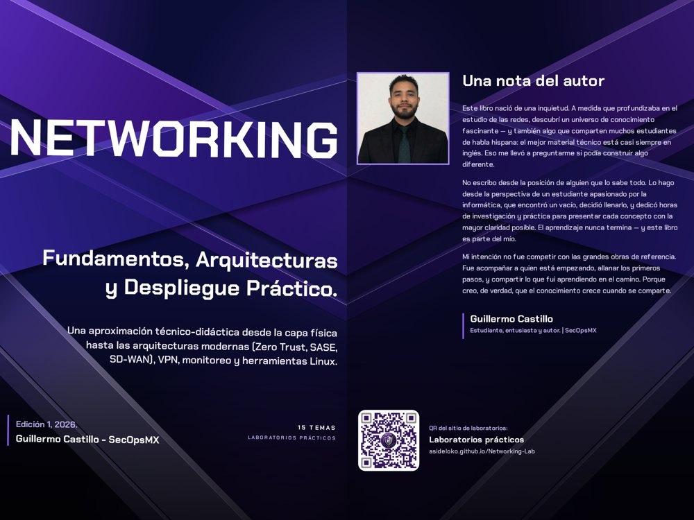

<h1 id="networking-lab">NETWORKING Lab</h1>
Laboratorios de explicación y simulación de redes.

Material práctico complementario del libro NETWORKING — Fundamentos, Arquitecturas y Despliegue Práctico.

<a class="md-button md-button--primary" href="labs/lab-01/index.html">Comenzar por el laboratorio 01</a><a class="md-button" href="https://leanpub.com/networking-fundamentos">Obtener el libro</a>

Material complementario · Guillermo Castillo · SecOpsMX

<b>15</b>laboratorios

<b>41</b>diagramas

<b>266</b>bloques de comandos

Cada laboratorio presenta **escenarios ilustrativos** para comprender protocolos, tecnologías, arquitecturas y procesos de comunicación, y lleva la teoría a la terminal mediante comandos de demostración.

!!! info "Qué son (y qué no son) estos laboratorios"
    Son **representaciones didácticas** construidas con *namespaces* de red de Linux: simplifican la realidad para explicar cómo funciona cada tecnología. **No** son procedimientos de implementación profesional ni reproducen todos los componentes de una infraestructura real. Un ejemplo explica correctamente un proceso cuando **representa correctamente ese proceso**; cuando una simplificación afecta a lo explicado (por ejemplo, rutas IP estáticas en lugar de MPLS real), la página lo indica.

## Metodología

El proyecto consta de **15 laboratorios**, uno por cada tema del libro. Cada laboratorio:

1.  Estudia un tema teórico.
2.  Identifica los conceptos implementables.
3.  Plantea un escenario empresarial ilustrativo.
4.  Diseña la topología y el direccionamiento.
5.  Muestra la configuración paso a paso como ejemplo de demostración.
6.  Explica cada procedimiento.
7.  Verifica cada etapa.
8.  Muestra el resultado esperado o una salida de ejemplo (véase la convención siguiente).
9.  Prepara el siguiente laboratorio.

Al finalizar el laboratorio 15 habrás recorrido un escenario que integra direccionamiento, enrutamiento, firewall, servicios y redundancia de *gateway*, entendiendo qué demuestra cada ejemplo y cuáles son sus límites.

## Cómo leer las salidas de los laboratorios

En los laboratorios se mezclan comandos, capturas y resultados. Para no confundirlos se usan estas etiquetas:

| Etiqueta | Significado |
|----------|-------------|
| **Ejemplo de salida** | Resultado **representativo**, no necesariamente ejecutado: los números, horas y direcciones MAC cambiarán en tu equipo. |
| **Captura de referencia** | Evidencia de una **ejecución concreta**. |
| **Resultado esperado** | Comportamiento que **debería producirse** bajo las condiciones descritas. |
| **Esquema conceptual** | **Representación simplificada** de un proceso; no una transcripción literal. |

Cada laboratorio distingue tres niveles: el **conceptual** (cómo funciona la tecnología), el **representativo** (cómo lo ilustra la topología o el ejemplo) y el **técnico** (qué comportamiento tendría una configuración real y en qué condiciones).

## Requisitos

-   Un sistema Linux (máquina virtual, WSL2 o instalación real) con privilegios de superusuario.
-   Conocimientos básicos de línea de comandos.
-   Paquetes de uso común en la serie: `sudo apt install tcpdump traceroute iperf3 dnsutils curl` (cada laboratorio indica si necesita alguno más).
-   Convención de `sudo`: los laboratorios 01 a 05 muestran los comandos sin `sudo` (asumen una sesión de root, `sudo -i`); desde el 06 aparece explícito. Si trabajas con un usuario normal, antepón `sudo` en todos.
-   Ganas de aprender haciendo.

!!! warning "Antes de empezar"
    Los laboratorios crean *namespaces* de red, interfaces virtuales y reglas de firewall en tu equipo. Hazlos en una **máquina virtual o equipo de pruebas**, no en un servidor en producción. Algunos laboratorios necesitan módulos del kernel: `8021q` (05 y 11), `ip_gre` (06 y 09) y `wireguard`, `esp4`/`xfrm_user` y `tun` (09); una máquina virtual Linux estándar los incluye. El laboratorio 10 trata MPLS solo a nivel conceptual (no requiere `mpls_router`). El laboratorio 15 usa `frr`, `keepalived` y `dnsmasq-base`.

## Laboratorios

Realízalos en orden: **comienza por el laboratorio 01**. No todos usan la misma topología: cuando un laboratorio abre un **escenario nuevo** (otro direccionamiento, otros dispositivos o nombres reutilizados con otra función), la página lo indica al principio.

## Laboratorios 1 a 5

<a class="sx-card" href="labs/lab-01/index.html">01FUNDAMENTOS DE REDES Y ENCAPSULACIÓNTema 1 del libro</a><a class="sx-card" href="labs/lab-02/index.html">02TRANSMISIÓN DE DATOS Y CAPA FÍSICATema 2 del libro</a><a class="sx-card" href="labs/lab-03/index.html">03COMPONENTES DE RED Y CONMUTACIÓNTema 3 del libro</a><a class="sx-card" href="labs/lab-04/index.html">04DIRECCIONAMIENTO IP Y SUBREDESTema 4 del libro</a><a class="sx-card" href="labs/lab-05/index.html">05CONMUTACIÓN Y SEGMENTACIÓN DE REDTema 5 del libro</a>

## Laboratorios 6 a 10

<a class="sx-card" href="labs/lab-06/index.html">06ENRUTAMIENTO Y CONECTIVIDAD ENTRE REDESTema 6 del libro</a><a class="sx-card" href="labs/lab-07/index.html">07PROTOCOLOS Y SERVICIOS DE REDTema 7 del libro</a><a class="sx-card" href="labs/lab-08/index.html">08SEGURIDAD EN REDESTema 8 del libro</a><a class="sx-card" href="labs/lab-09/index.html">09VPN Y TUNELIZACIÓNTema 9 del libro</a><a class="sx-card" href="labs/lab-10/index.html">10INFRAESTRUCTURA WAN Y CORETema 10 del libro</a>

## Laboratorios 11 a 15

<a class="sx-card" href="labs/lab-11/index.html">11ARQUITECTURA DE RED EMPRESARIALTema 11 del libro</a><a class="sx-card" href="labs/lab-12/index.html">12ARQUITECTURAS MODERNAS DE REDTema 12 del libro</a><a class="sx-card" href="labs/lab-13/index.html">13MONITOREO Y DIAGNÓSTICO DE REDESTema 13 del libro</a><a class="sx-card" href="labs/lab-14/index.html">14HERRAMIENTAS LINUX AVANZADASTema 14 del libro</a><a class="sx-card" href="labs/lab-15/index.html">15IMPLEMENTACIÓN PRÁCTICA INTEGRALTema 15 del libro</a>

<figure class="portada-libro" markdown="span"></figure>

## Operaciones que afectan al equipo anfitrión

Un *namespace* aísla la **red**, no el equipo. Los pasos que modifican el **host** (reenvío IPv4, reglas NAT, `/etc/sysctl.d`, rutas temporales) aparecen siempre bajo el aviso **«Cambio en el host»**, y cada laboratorio que los usa (02, 04, 05, 07, 08, 11, 13, 14 y 15) incluye su sección de **reversión**. Las paradas de procesos se hacen por PID o con `ip netns pids <namespace>`, nunca con `pkill` sobre el sistema completo. Antes de empezar anota `sysctl net.ipv4.ip_forward` y `iptables -t nat -S POSTROUTING`; así sabrás a qué estado volver.

## Material de referencia

Además de los laboratorios, el sitio incluye páginas de síntesis para consultar mientras practicas:

-   [Servicios, protocolos y puertos](referencia/servicios-puertos.md): matriz común de la serie.
-   [Comparaciones conceptuales](referencia/comparaciones.md): bridge/router, MAC/IP, subred/VLAN, GRE/IPsec y más.
-   [Método de diagnóstico](referencia/diagnostico.md): del síntoma a la causa.
-   [Arquitectura integral](referencia/arquitectura-integral.md): mapas de síntesis y matriz de disponibilidad.
-   [Glosario](referencia/glosario.md).
-   [Competencias y casos integradores](referencia/competencias.md): qué se espera al terminar y casos para repasar la serie.

Cada laboratorio termina ahora con **preguntas de reflexión**: qué mecanismo se demuestra, qué pasa si se elimina un componente, qué limitaciones tiene y dónde se usaría en una empresa.
