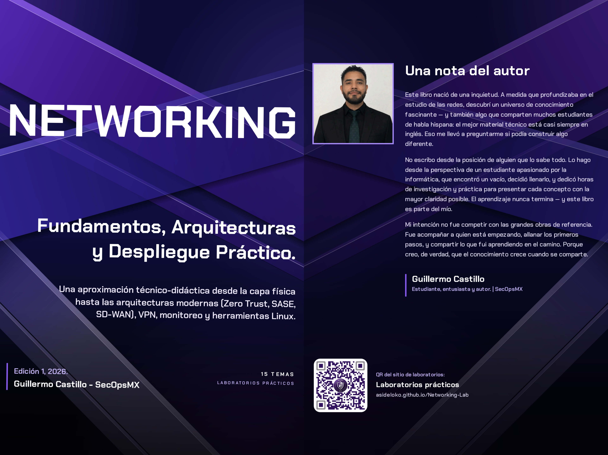

LABORATORIO PRÁCTICO

# NETWORKING Lab

{ .logo-lab }

**Laboratorios de explicación y simulación de redes.** Material práctico complementario del libro **NETWORKING — Fundamentos, Arquitecturas y Despliegue Práctico**. Cada laboratorio presenta **escenarios ilustrativos** para comprender protocolos, tecnologías, arquitecturas y procesos de comunicación, y lleva la teoría a la terminal mediante comandos de demostración.

!!! info "Qué son (y qué no son) estos laboratorios"
    Son **representaciones didácticas** construidas con *namespaces* de red de Linux: simplifican la realidad para explicar cómo funciona cada tecnología. **No** son procedimientos de implementación profesional ni reproducen todos los componentes de una infraestructura real. Un ejemplo explica correctamente un proceso cuando **representa correctamente ese proceso**; cuando una simplificación afecta a lo explicado (por ejemplo, rutas IP estáticas en lugar de MPLS real), la página lo indica.

## Metodología

El proyecto consta de **15 laboratorios**, uno por cada tema del libro. Cada laboratorio:

1.  Estudia un tema teórico.
2.  Identifica los conceptos implementables.
3.  Plantea un escenario empresarial ilustrativo.
4.  Diseña la topología y el direccionamiento.
5.  Muestra la configuración paso a paso como ejemplo de demostración.
6.  Explica cada procedimiento.
7.  Verifica cada etapa.
8.  Muestra el resultado esperado o una salida de ejemplo (véase la convención siguiente).
9.  Prepara el siguiente laboratorio.

Al finalizar el laboratorio 15 habrás recorrido un escenario que integra direccionamiento, enrutamiento, firewall, servicios y redundancia de *gateway*, entendiendo qué demuestra cada ejemplo y cuáles son sus límites.

## Cómo leer las salidas de los laboratorios

En los laboratorios se mezclan comandos, capturas y resultados. Para no confundirlos se usan estas etiquetas:

| Etiqueta | Significado |
|----------|-------------|
| **Ejemplo de salida** | Resultado **representativo**, no necesariamente ejecutado: los números, horas y direcciones MAC cambiarán en tu equipo. |
| **Captura de referencia** | Evidencia de una **ejecución concreta**. |
| **Resultado esperado** | Comportamiento que **debería producirse** bajo las condiciones descritas. |
| **Esquema conceptual** | **Representación simplificada** de un proceso; no una transcripción literal. |

Cada laboratorio distingue tres niveles: el **conceptual** (cómo funciona la tecnología), el **representativo** (cómo lo ilustra la topología o el ejemplo) y el **técnico** (qué comportamiento tendría una configuración real y en qué condiciones).

## Requisitos

-   Un sistema Linux (máquina virtual, WSL2 o instalación real) con privilegios de superusuario.
-   Conocimientos básicos de línea de comandos.
-   Ganas de aprender haciendo.

!!! warning "Antes de empezar"
    Los laboratorios crean *namespaces* de red, interfaces virtuales y reglas de firewall en tu equipo. Hazlos en una **máquina virtual o equipo de pruebas**, no en un servidor en producción. Algunos laboratorios necesitan módulos del kernel: `8021q` (05 y 11), `ip_gre` (06 y 09) y `wireguard`, `esp4`/`xfrm_user` y `tun` (09); una máquina virtual Linux estándar los incluye. El laboratorio 10 trata MPLS solo a nivel conceptual (no requiere `mpls_router`). El laboratorio 15 usa `frr`, `keepalived` y `dnsmasq-base`.

## Laboratorios

Realízalos en orden: **comienza por el laboratorio 01**. No todos usan la misma topología: cuando un laboratorio abre un **escenario nuevo** (otro direccionamiento, otros dispositivos o nombres reutilizados con otra función), la página lo indica al principio.

| N.º | Laboratorio | Libro |
|:---:|-------------|:-----:|
| 01 | [Fundamentos de Redes y Encapsulación](labs/lab-01/index.md) | Tema 1 |
| 02 | [Transmisión de Datos y Capa Física](labs/lab-02/index.md) | Tema 2 |
| 03 | [Componentes de Red y Conmutación](labs/lab-03/index.md) | Tema 3 |
| 04 | [Direccionamiento IP y Subredes](labs/lab-04/index.md) | Tema 4 |
| 05 | [Conmutación y Segmentación de Red](labs/lab-05/index.md) | Tema 5 |
| 06 | [Enrutamiento y Conectividad entre Redes](labs/lab-06/index.md) | Tema 6 |
| 07 | [Protocolos y Servicios de Red](labs/lab-07/index.md) | Tema 7 |
| 08 | [Seguridad en Redes](labs/lab-08/index.md) | Tema 8 |
| 09 | [VPN y Tunelización](labs/lab-09/index.md) | Tema 9 |
| 10 | [Infraestructura WAN y Core](labs/lab-10/index.md) | Tema 10 |
| 11 | [Arquitectura de Red Empresarial](labs/lab-11/index.md) | Tema 11 |
| 12 | [Arquitecturas Modernas de Red](labs/lab-12/index.md) | Tema 12 |
| 13 | [Monitoreo y Diagnóstico de Redes](labs/lab-13/index.md) | Tema 13 |
| 14 | [Herramientas Linux Avanzadas](labs/lab-14/index.md) | Tema 14 |
| 15 | [Implementación Práctica Integral](labs/lab-15/index.md) | Tema 15 |
