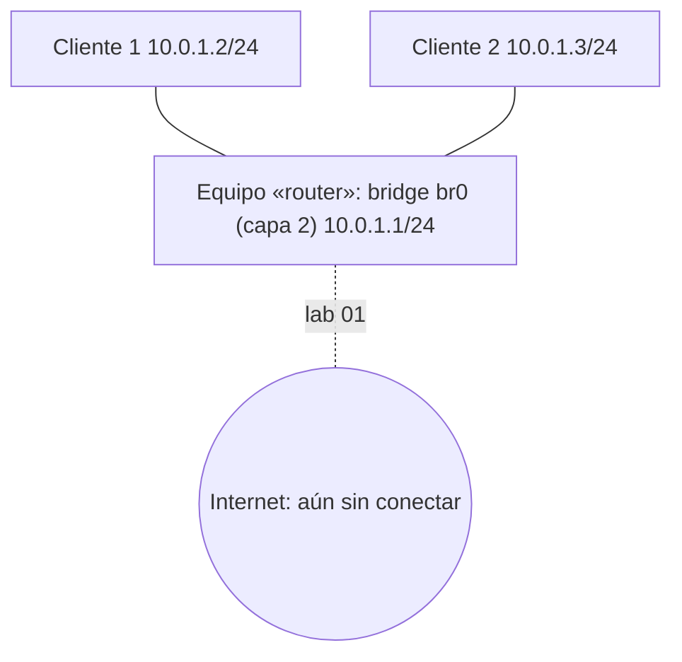
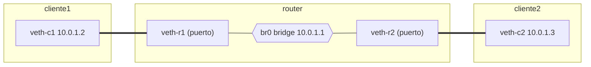
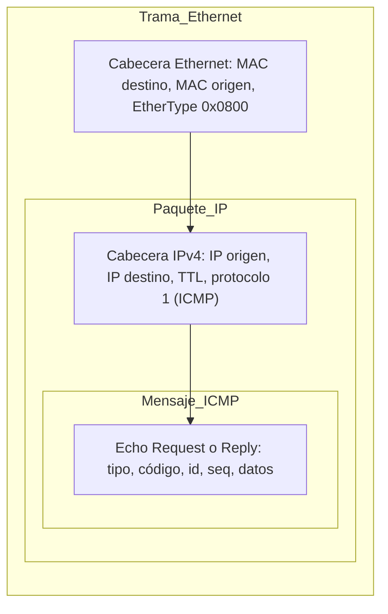

<p class="tema-eyebrow">LABORATORIO 01</p>

# FUNDAMENTOS DE REDES Y ENCAPSULACIÓN

<p class="tema-meta"><span>13 secciones</span><span>3 diagramas</span><span>5 tablas</span></p>

## Contexto empresarial

La empresa **Networking SecOps** acaba de abrir una nueva oficina. Cuenta con dos empleados que necesitan compartir archivos y acceder a Internet. No hay infraestructura de red aún. Se te ha encargado **diseñar la red local** que permita la comunicación entre los equipos y preparar el acceso a la web. Además, debes **demostrar cómo viajan los datos** entre dos equipos y cómo se encapsulan en cada capa.

!!! note "Alcance de este laboratorio"
    En esta primera demostración el equipo intermedio (el namespace `router`) aloja un **bridge Linux** y su función efectiva es la **conmutación Ethernet (capa 2)**. El **enrutamiento entre subredes** todavía no se demuestra; llegará en los laboratorios 02 y 06.

!!! note "Conectividad frente a servicios"
    En este laboratorio se construye la **infraestructura de conectividad local**. Los servicios de compartición de archivos y el acceso a Internet se abordarán después con tecnologías y protocolos específicos (laboratorios 02 y 07). Tener conectividad no es lo mismo que tener servicios funcionando sobre ella.

## Problema inicial

-   Dos PCs (Cliente1 y Cliente2) deben comunicarse entre sí.
-   Ambas necesitarán salir a Internet a través de un router (esa salida se prepara en el laboratorio 02).
-   No se dispone de equipos físicos, pero se puede utilizar **Linux** con herramientas de virtualización de red (namespaces, veth, etc.) para simular la topología.

## Objetivos del laboratorio

1.  Comprender el concepto de red y sus componentes.
2.  Implementar una red local sencilla usando **namespaces de red** en Linux.
3.  Asignar direcciones IP y comprobar conectividad.
4.  Observar el proceso de **encapsulación** mediante captura de paquetes con `tcpdump`.
5.  Analizar el flujo de datos desde la generación hasta la transmisión.

## Conceptos previos

Antes de construir nada conviene fijar seis términos que se usan en todo el laboratorio:

| Concepto | Qué es | Dónde aparece aquí |
|----------|--------|--------------------|
| **Host (dispositivo final)** | Equipo que origina o recibe datos de aplicación. | `cliente1` y `cliente2` |
| **Interfaz de red** | Punto por el que un equipo se conecta a un enlace; tiene MAC y, normalmente, IP. | `veth-c1`, `veth-c2`, `br0` |
| **Enlace** | Conexión que une dos interfaces. Aquí es un par `veth` (virtual), no un cable físico. | `veth-c1` ↔ `veth-r1` |
| **Dirección MAC** | Identifica una interfaz **dentro del enlace local** (capa 2). | Se ve con `ip link` y `tcpdump -e` |
| **Dirección IP** | Direccionamiento **lógico** que permite comunicar redes distintas (capa 3). | `10.0.1.0/24` |
| **Dispositivo intermedio** | Equipo que conecta a otros y reenvía tráfico. | El namespace `router` (aquí, un bridge) |

## Herramientas necesarias

-   Linux (Debian/Ubuntu recomendado) con `root` o `CAP_NET_ADMIN` y `CAP_NET_RAW`; el kernel debe permitir *network namespaces*, bridges y `veth`.
-   Android/Termux permite consultar la documentación, pero no es un entorno compatible garantizado para ejecutar estas prácticas: el sandbox de Android normalmente no concede las capacidades de red necesarias. Usa una VM o PC Linux.
-   Comandos: `ip`, `ping`, `tcpdump` (`nslookup` y `curl` se usarán a partir del laboratorio 02).
-   Paquetes que se usan a lo largo de la serie (instálalos una vez): `sudo apt install tcpdump traceroute iperf3 dnsutils curl`.
-   Editor de texto para scripts (opcional).

## Topología



**Direccionamiento:**

| Dispositivo | Interfaz | Dirección IP       |
|-------------|----------|--------------------|
| Cliente 1   | veth-c1  | 10.0.1.2/24        |
| Cliente 2   | veth-c2  | 10.0.1.3/24        |
| Router (bridge) | br0  | 10.0.1.1/24        |
| (Internet)  | —        | No se configura en este laboratorio |

El namespace `router` es un equipo lógico que aloja el bridge `br0`. La dirección `10.0.1.1` pertenece a la interfaz IP del propio bridge: sirve para que el equipo sea alcanzable y para preparar su papel de *gateway* en el laboratorio 02. **No interviene** en la comunicación entre Cliente 1 y Cliente 2.

### Conexión lógica del escenario

Cada **par `veth`** son los dos extremos de un enlace virtual: lo que entra por un extremo sale por el otro. No es un cable físico, sino una abstracción que el kernel implementa. El bridge `br0` agrupa los dos puertos del lado del equipo intermedio.



!!! info "MAC frente a IP"
    La **MAC** identifica la interfaz en el enlace y solo tiene sentido dentro de él: un **router** la sustituye al reenviar el paquete al siguiente enlace, mientras que un **switch o bridge** conserva las MAC de la trama. La **IP** identifica el destino lógico y se conserva de extremo a extremo. Cuando dos equipos están en la misma subred, el emisor usa la **MAC del destino**; cuando no lo están, usa la **MAC del *gateway*** (se verá en el laboratorio 02). El subnetting en profundidad llega en el laboratorio 04.

## Construcción de la red

Usaremos **namespaces de red** para aislar cada dispositivo en un entorno virtual dentro de la misma máquina Linux. Esto nos permite simular una red sin necesidad de hardware extra.

### Paso 1: Verificar el entorno

Asegúrate de tener permisos de root:

```bash
sudo -i
```

En los laboratorios 01 a 05 los comandos se muestran sin `sudo` porque se asume esta sesión de root; desde el laboratorio 06 aparece `sudo` explícito. Si trabajas con un usuario normal, antepón `sudo` a cada orden en todos los laboratorios.

### Paso 2: Crear los namespaces

Creamos un namespace para cada dispositivo:

```bash
ip netns add cliente1
ip netns exec cliente1 ip link set lo alias networking-lab-owned
ip netns add cliente2
ip netns exec cliente2 ip link set lo alias networking-lab-owned
ip netns add router
ip netns exec router ip link set lo alias networking-lab-owned
```

Verificamos que se hayan creado:

```bash
ip netns list
```

**Ejemplo de salida** (representativo; el orden puede variar y, según la versión de `iproute2`, cada nombre puede llevar un sufijo `(id: N)`):

```
router
cliente1
cliente2
```

### Paso 3: Crear los pares de interfaces virtuales (veth)

Necesitamos conectar cada cliente al router. Para ello, creamos dos pares veth:

```bash
# Par para Cliente 1
ip link add veth-c1 type veth peer name veth-r1
ip link set veth-c1 alias networking-lab-lab-01
ip link set veth-r1 alias networking-lab-lab-01

# Par para Cliente 2
ip link add veth-c2 type veth peer name veth-r2
ip link set veth-c2 alias networking-lab-lab-01
ip link set veth-r2 alias networking-lab-lab-01
```

### Paso 4: Asignar cada extremo a su namespace

```bash
# Cliente 1
ip link set veth-c1 netns cliente1

# Cliente 2
ip link set veth-c2 netns cliente2

# Router (extremos r1 y r2)
ip link set veth-r1 netns router
ip link set veth-r2 netns router
```

### Paso 5: Configurar direcciones IP y activar interfaces

**Cliente 1:**

```bash
ip netns exec cliente1 ip addr add 10.0.1.2/24 dev veth-c1
ip netns exec cliente1 ip link set veth-c1 up
ip netns exec cliente1 ip link set lo up
```

**Cliente 2:**

```bash
ip netns exec cliente2 ip addr add 10.0.1.3/24 dev veth-c2
ip netns exec cliente2 ip link set veth-c2 up
ip netns exec cliente2 ip link set lo up
```

**Router – Usaremos un bridge para conectar ambos clientes:**

```bash
# En el namespace router
ip netns exec router ip link add br0 type bridge
ip netns exec router ip link set br0 alias networking-lab-lab-01
ip netns exec router ip link set veth-r1 master br0
ip netns exec router ip link set veth-r2 master br0
ip netns exec router ip addr add 10.0.1.1/24 dev br0
ip netns exec router ip link set br0 up
ip netns exec router ip link set veth-r1 up
ip netns exec router ip link set veth-r2 up
```

### Paso 6: La salida a Internet (todavía no)

El router todavía **no dispone de una interfaz WAN funcional**: para que los clientes accedan a Internet hará falta una interfaz externa, una ruta por defecto, reenvío IP y NAT. Todo ello se construye en el laboratorio 02. Por ahora nos centramos en la comunicación local.

### Paso 7: Verificar conectividad entre clientes

Desde Cliente 1, hacemos ping a Cliente 2:

```bash
ip netns exec cliente1 ping -c 4 10.0.1.3
```

**Resultado esperado:** 4 respuestas exitosas.

Desde Cliente 2 a Cliente 1:

```bash
ip netns exec cliente2 ping -c 4 10.0.1.2
```

**Resultado esperado:** 4 respuestas exitosas.

### Paso 8: Verificar conectividad con el router

Desde Cliente 1 al router:

```bash
ip netns exec cliente1 ping -c 4 10.0.1.1
```

**Resultado esperado:** 4 respuestas exitosas.

### Qué demuestra cada prueba

| Prueba | Qué permite comprobar |
|--------|-----------------------|
| Cliente 1 → Cliente 2 | Comunicación entre hosts de la misma subred a través del bridge. |
| Cliente 2 → Cliente 1 | Que el camino funciona en **ambos sentidos** (no solo de ida). |
| Cliente 1 → `10.0.1.1` | Que la interfaz IP del equipo intermedio es alcanzable. No implica que el equipo enrute. |

Una respuesta ICMP exitosa (`bytes from … icmp_seq=1 ttl=64 time=0.1 ms`) confirma que la solicitud llegó y que la respuesta volvió. El valor `time` es la **latencia de ida y vuelta**: aquí es mínima porque todo ocurre en memoria del mismo equipo; en redes reales incluye serialización, distancia y colas.

## Observación de la encapsulación

Vamos a capturar el tráfico en el bridge del equipo intermedio para ver cómo viaja un paquete ICMP (ping) desde Cliente 1 a Cliente 2.

### Paso 9: Iniciar captura en el router

Abrimos otra terminal (o usamos `tmux`) y ejecutamos:

```bash
ip netns exec router tcpdump -i br0 -n -v icmp
```

### Paso 10: Enviar un ping desde Cliente 1

En la terminal original:

```bash
ip netns exec cliente1 ping -c 1 10.0.1.3
```

### Paso 11: Analizar la captura

Ejemplo de salida (representativo; los identificadores, las horas y las MAC variarán):

```
tcpdump: listening on br0, link-type EN10MB (Ethernet), capture size 262144 bytes
14:23:45.678901 IP (tos 0x0, ttl 64, id 12345, offset 0, flags [DF], proto ICMP (1), length 84)
    10.0.1.2 > 10.0.1.3: ICMP echo request, id 1, seq 1, length 64
14:23:45.678987 IP (tos 0x0, ttl 64, id 54321, offset 0, flags [none], proto ICMP (1), length 84)
    10.0.1.3 > 10.0.1.2: ICMP echo reply, id 1, seq 1, length 64
```

**Interpretación:**

-   Se ve la trama Ethernet (link-type EN10MB) que contiene el paquete IP.
-   El paquete IP tiene origen 10.0.1.2 y destino 10.0.1.3.
-   El protocolo es ICMP (1).
-   Los datos ICMP (echo request/reply) están encapsulados dentro del paquete IP, que a su vez va dentro de la trama Ethernet.

Podemos ver más detalles si usamos `-e` para mostrar la cabecera Ethernet:

```bash
ip netns exec router tcpdump -i br0 -n -e icmp
```

Aparecerán direcciones MAC de origen y destino, lo que confirma la encapsulación en la capa de enlace. Observa que la MAC de destino de cada trama es la de **Cliente 2** (y la de Cliente 1 en la respuesta), no la del bridge.

### Paso 12: Observar la resolución ARP

En el Paso 7 ya hubo `ping` entre los clientes, así que sus cachés ARP probablemente están **pobladas** y una captura nueva no mostraría ninguna solicitud. Para ver el proceso completo hay que **vaciar la caché** antes de capturar:

```bash
# 1. Vaciar la caché de vecinos (ARP) de Cliente 1
ip netns exec cliente1 ip neigh flush dev veth-c1
ip netns exec cliente1 ip neigh show              # debe quedar vacía

# 2. En otra terminal: capturar solo ARP en el bridge
ip netns exec router tcpdump -i br0 -n -e arp

# 3. En la terminal original: repetir el ping
ip netns exec cliente1 ping -c 1 10.0.1.3
```

Ejemplo de salida (representativo; las MAC variarán):

```
ff:ff:ff:ff:ff:ff (broadcast) ... ARP, Request who-has 10.0.1.3 tell 10.0.1.2, length 28
<MAC de Cliente 2> > <MAC de Cliente 1> ... ARP, Reply 10.0.1.3 is-at <MAC de Cliente 2>, length 28
```

La **solicitud** va por *broadcast* (MAC destino `ff:ff:ff:ff:ff:ff`) y llega a todos los puertos del bridge; la **respuesta** es *unicast* hacia Cliente 1. Tras ella, `ip neigh show` vuelve a mostrar la entrada de Cliente 2.

### Esquema de encapsulación con campos

Cada capa añade su cabecera alrededor de los datos de la capa superior. Esquema conceptual (simplificado; no son todos los campos):



| Capa | Unidad | Campos que aparecen en la captura |
|------|--------|-----------------------------------|
| Enlace | Trama Ethernet | MAC origen y destino (`-e`) |
| Red | Paquete IP | IP origen y destino, TTL, protocolo (`proto ICMP (1)`) |
| Mensaje | ICMP | Tipo (*echo request/reply*), `id`, `seq` |

!!! warning "Qué no muestra tcpdump"
    `tcpdump` muestra cabeceras y datos de los protocolos capturados, pero **no la señal** eléctrica, óptica o radioeléctrica ni la transmisión física de bits. Esa parte se estudia en el laboratorio 02.

## Análisis del flujo de datos

1.  **Cliente 1 genera el mensaje:** La aplicación `ping` crea un mensaje ICMP Echo Request.
2.  **Sin capa de transporte:** ICMP no es un protocolo de transporte: es un protocolo de la capa de red que se encapsula directamente en IP, sin puertos TCP/UDP. El mensaje se entrega a la capa IP.
3.  **Capa de red (IP):** Se añade el encabezado IP con origen 10.0.1.2 y destino 10.0.1.3.
4.  **Resolución ARP:** como 10.0.1.3 pertenece a la misma subred que el origen, Cliente 1 no necesita gateway: envía una solicitud ARP por *broadcast* preguntando «¿quién tiene 10.0.1.3?». Cliente 2 responde con su MAC. (Esos mensajes ARP no aparecen en la captura anterior porque el filtro es `icmp`; se observan en el Paso 12, vaciando antes la caché ARP.)
5.  **Capa de enlace:** Se añade la cabecera Ethernet con MAC origen (de `veth-c1`) y MAC destino (la de `veth-c2`, obtenida por ARP).
6.  **El bridge conmuta la trama.** No desencapsula el paquete IP ni consulta tablas de rutas. Aprende la MAC de origen de cada trama que recibe y la asocia al puerto de entrada; para decidir la salida busca la MAC de destino en su tabla. Si la conoce, reenvía la trama **sin modificarla** solo por ese puerto (`veth-r2`); si no la conoce, la inunda por todos los puertos excepto el de entrada. Puedes ver la tabla con `ip netns exec router bridge fdb show br br0`.
7.  **Cliente 2 recibe la trama**, la desencapsula y entrega el mensaje ICMP a la aplicación, que genera la respuesta y repite el proceso inverso.

!!! info "Bridge frente a router"
    Un **bridge** aprende direcciones MAC y reenvía **tramas Ethernet** dentro de una misma red. Un **router** consulta información de capa 3 y reenvía **paquetes IP** entre redes distintas, reescribiendo la cabecera Ethernet en cada salto. Cuando los dos clientes están en la misma subred, la comunicación es de capa 2 y el router no participa.

### Dominio de broadcast

Todo lo que está conectado al mismo bridge pertenece al mismo **dominio de broadcast de capa 2**: la solicitud ARP del Paso 12 llega a todos los puertos. Este concepto prepara las VLAN del laboratorio 05, que permiten **dividir** ese dominio sin cambiar el hardware.

!!! info "Matiz sobre el bridge"
    En este escenario sencillo el bridge reenvía las tramas **sin modificar sus cabeceras**. No es una regla general de todos los modos de *bridging* (por ejemplo, con VLAN filtering puede añadir o quitar etiquetas, como se verá en el laboratorio 05).

## Limpieza del laboratorio

Esta limpieza elimina únicamente los tres *namespaces* creados en esta práctica. Si continúas con los laboratorios 02 y 03, no la ejecutes todavía: esos laboratorios reutilizan esta topología. Si ya ejecutaste el laboratorio 02 o el 03, utiliza primero las secciones de reversión de esas prácticas para retirar también los cambios que hicieron en el host.

```bash
# Eliminar solo namespaces propios que ya no contienen procesos.
for ns in cliente1 cliente2 router observador; do
  if sudo ip netns list | awk '{print $1}' | grep -Fxq "$ns"; then
    if [ "$(sudo ip netns exec "$ns" cat /sys/class/net/lo/ifalias 2>/dev/null)" = networking-lab-owned ]; then
      PIDS=$(sudo ip netns pids "$ns" 2>/dev/null || true)
      if [ -n "$PIDS" ]; then echo "Se conserva $ns: hay procesos activos ($PIDS); ciérralos desde su terminal.";
      else sudo ip netns del "$ns" 2>/dev/null || true
      fi
    else echo "Se conserva $ns: no tiene la marca de propiedad Networking Lab."
    fi
  fi
done

# Retirar solo interfaces huérfanas en el host con la marca de este laboratorio.
for f in /sys/class/net/*/ifalias; do
  [ -r "$f" ] || continue
  [ "$(cat "$f")" = networking-lab-lab-01 ] || continue
  dev=${f%/ifalias}; dev=${dev##*/}
  ip link del "$dev" 2>/dev/null || true
done
```

**Comprobación:** `ip netns list` no debe mostrar `cliente1`, `cliente2` ni `router`; `ip -br link` no debe mostrar los extremos veth de esta práctica.

## Profundización: reconstruir un paquete de extremo a extremo

La prueba principal no consiste solo en comprobar que `ping` responde: hay que reconstruir la decisión del kernel y el trabajo del bridge.

### Secuencia de observación

Antes de enviar tráfico, predice qué interfaz utilizará el cliente y qué dirección MAC aparecerá como destino:

```bash
sudo ip netns exec cliente1 ip route get 10.0.1.3
sudo ip netns exec cliente1 ip neigh show
sudo ip netns exec router bridge fdb show br br0
```

En una terminal captura el enlace del cliente y, en otra, el bridge y sus puertos. Después genera un único intercambio:

```bash
sudo ip netns exec cliente1 ping -c 1 10.0.1.3
sudo ip netns exec router bridge fdb show br br0
sudo ip netns exec cliente1 ip neigh show
```

**Interpretación causal:** el kernel compara el destino con sus prefijos conectados; al ser local, resuelve por ARP la MAC del destino, no la del gateway. El bridge aprende la MAC de origen al recibir la trama, consulta su FDB y reenvía por el puerto asociado. Si todavía no conoce la MAC de destino, inunda la trama unicast desconocida por los puertos de esa VLAN/dominio, excepto el puerto de entrada. La respuesta permite aprender el sentido inverso.

### Aprendizaje, envejecimiento y ARP obsoleto

```bash
sudo ip netns exec router bridge fdb show br br0
sudo ip netns exec cliente1 ip neigh show
sudo ip netns exec cliente1 ip neigh flush to 10.0.1.3
sudo ip netns exec cliente1 ping -c 1 10.0.1.3
```

No confundas las tablas: la FDB asocia MAC con puerto del bridge; la tabla de vecinos asocia IP con MAC en un enlace. Sus temporizadores son independientes:

- **Caché ARP (`ip neigh`)**: los estados NUD incluyen `REACHABLE`, `STALE`, `DELAY`, `PROBE`, `INCOMPLETE` y `FAILED`. `base_reachable_time_ms` es el tiempo base de alcanzabilidad (habitualmente 30 000 ms, con variación aleatoria); al vencer, una entrada puede pasar a `STALE` y se vuelve a validar cuando se utiliza.
- **FDB del bridge (`bridge fdb`)**: las entradas dinámicas se eliminan tras el `ageing_time` del bridge (habitualmente 300 s sin tráfico); las entradas estáticas no envejecen de esa forma.

Consulta ambos temporizadores y sus estados por separado:

```bash
sudo ip netns exec cliente1 ip -s neigh show dev veth-c1
sudo ip netns exec cliente1 sysctl net.ipv4.neigh.veth-c1.base_reachable_time_ms
sudo ip netns exec router bridge -s fdb show br br0
sudo ip netns exec router cat /sys/class/net/br0/bridge/ageing_time
```

Para observar una nueva resolución ARP sin esperar al temporizador, elimina solo la entrada de prueba y genera tráfico:

```bash
sudo ip netns exec cliente1 ip neigh flush to 10.0.1.3 dev veth-c1
sudo ip netns exec cliente1 ping -c 1 10.0.1.3
sudo ip netns exec cliente1 ip -s neigh show to 10.0.1.3 dev veth-c1
```

El valor sysfs `ageing_time` del bridge se expresa en centésimas de segundo. Una entrada puede seguir presente en una tabla y haber expirado en la otra; no deduzcas la edad de FDB a partir del estado ARP.

### Experimento: aprendizaje, unicast conocido y flooding de unicast desconocido

Para distinguir el flooding de ARP broadcast del *unknown-unicast flooding*, se añade temporalmente un puerto de observación sin dirección IP. El cliente 1 usará una entrada ARP permanente para que la resolución ARP no aprenda primero la MAC de cliente 2 en la FDB.

```bash
if sudo ip netns list | awk '{print $1}' | grep -Fxq observador; then echo "observador ya existe; ejecuta la limpieza antes de repetir."; exit 1; fi
if sudo ip link show veth-obs >/dev/null 2>&1; then echo "veth-obs ya existe; no se modifica."; exit 1; fi
sudo ip netns add observador
sudo ip netns exec observador ip link set lo alias networking-lab-owned
sudo ip link add veth-obs type veth peer name veth-obs-ns
sudo ip link set veth-obs alias networking-lab-lab-01
sudo ip link set veth-obs-ns alias networking-lab-lab-01
sudo ip link set veth-obs netns router
sudo ip link set veth-obs-ns netns observador
sudo ip netns exec router ip link set veth-obs master br0
sudo ip netns exec router ip link set veth-obs up
sudo ip netns exec observador ip link set veth-obs-ns up
MAC_C2=$(sudo ip netns exec cliente2 cat /sys/class/net/veth-c2/address)
sudo ip netns exec cliente1 ip neigh replace 10.0.1.3 lladdr "$MAC_C2" nud permanent dev veth-c1
if ! sudo ip netns exec router bridge fdb flush br br0 dynamic; then
  echo "Tu combinación de iproute2/kernel no admite bridge fdb flush; elimina solo la entrada dinámica de MAC destino o espera el ageing_time del bridge."
  MAC_C2=$(sudo ip netns exec cliente2 cat /sys/class/net/veth-c2/address)
  sudo ip netns exec router bridge fdb del "$MAC_C2" dev veth-r2 master 2>/dev/null || true
fi
sudo ip netns exec router bridge fdb show br br0
```

En una terminal captura el puerto observador:

```bash
sudo ip netns exec router tcpdump -ni veth-obs -e -vv icmp
```

En otra terminal ejecuta dos pings, uno a la vez:

```bash
sudo ip netns exec cliente1 ping -c 1 10.0.1.3
sudo ip netns exec router bridge fdb show br br0
sudo ip netns exec cliente1 ping -c 1 10.0.1.3
```

**Resultado esperado:** el primer Echo Request aparece en `veth-obs`: el bridge aún desconoce el puerto asociado a la MAC destino y replica la trama unicast por los demás puertos. La respuesta de cliente 2 enseña su MAC en la FDB. El segundo Echo Request ya se reenvía solo por el puerto aprendido y no debe aparecer en `veth-obs`. No confundas este caso con ARP: la entrada permanente evita que el ARP broadcast sea el motivo de la copia observada.

Retira la entrada permanente y el puerto temporal:

```bash
sudo ip netns exec cliente1 ip neigh del 10.0.1.3 dev veth-c1 2>/dev/null || true
PIDS=$(sudo ip netns pids observador 2>/dev/null || true)
if [ -z "$PIDS" ] && [ "$(sudo ip netns exec observador cat /sys/class/net/lo/ifalias 2>/dev/null)" = networking-lab-lab-01 ]; then sudo ip netns del observador
else echo "Se conserva observador: tiene procesos activos o no pertenece a Lab01."; fi
```

### Interpretar la trama y la desencapsulación

| Campo observado | Qué representa | Qué debe explicar el estudiante |
|---|---|---|
| MAC destino / MAC origen | Direcciones de enlace Ethernet | La MAC destino permite al bridge consultar la FDB; la MAC origen se aprende en el puerto de entrada |
| EtherType | Protocolo encapsulado (por ejemplo, IPv4 `0x0800` o ARP `0x0806`) | Permite identificar qué protocolo recibe el payload Ethernet |
| IPv4 origen/destino, TTL y protocolo | Cabecera de red | Identifica extremos lógicos, límite de saltos y protocolo superior |
| ICMP tipo/código, identificador y secuencia | Mensaje de control | Distingue Echo Request y Echo Reply y correlaciona solicitud/respuesta |
| FCS | Comprobación de trama Ethernet | Normalmente no aparece en capturas del host porque la NIC/driver lo retira antes de entregar la trama al kernel |

Usa `tcpdump -e -vv -XX` para relacionar los bytes con los campos. En el destino se retira la cabecera Ethernet, se procesa IPv4 y se entrega ICMP; la respuesta se encapsula en una **nueva** trama con MAC origen/destino correspondientes al sentido de retorno. La captura en `any`, bridge o veth puede variar por offloads; no concluyas que falta FCS o VLAN solo porque el host no lo muestra.


**Evidencia que debe entregar el estudiante:** salida de `ip route get`, captura ARP/ICMP, FDB antes y después, tabla de vecinos y explicación de cada transición. No basta con adjuntar la salida sin interpretarla.


## Preguntas de reflexión

1.  ¿Qué mecanismo se está demostrando cuando Cliente 1 y Cliente 2 se comunican sin pasar por una dirección de *gateway*?
2.  ¿Qué sucedería con el `ping` si se elimina `br0` y se dejan solo los dos extremos `veth-r1` y `veth-r2` sin unir?
3.  ¿Qué diferencia hay entre lo que `ping` demuestra (conectividad IP) y lo que `tcpdump -e` permite ver (tramas)?
4.  ¿Qué limitaciones tiene esta red? (Piensa en tamaño, seguridad y salida a otras redes.)
5.  ¿En qué escenario empresarial real se usaría una red local de capa 2 como esta?
6.  ¿Qué otros mecanismos podrían conectar dos equipos de la misma subred? (Un *switch* físico, un cable cruzado…)

## Conclusiones técnicas

-   Hemos implementado una red funcional utilizando **namespaces de red**, que simulan dispositivos independientes.
-   Hemos verificado la conectividad capa a capa (IP y Ethernet).
-   Mediante `tcpdump` hemos observado la **encapsulación** en tiempo real:
    -   Datos → ICMP (mensaje) → IP (paquete) → Ethernet (trama).
-   El equipo lógico denominado `router` contiene un **bridge** que realiza la **conmutación de capa 2** entre los dos clientes. **No se ha demostrado todavía enrutamiento entre subredes**.
-   Este laboratorio sienta las bases para los siguientes, donde agregaremos más dispositivos, VLANs, enrutamiento y servicios.

## Errores comunes y soluciones

| Error | Causa | Solución |
|-------|-------|----------|
| `ping: connect: Network is unreachable` | No se ha asignado IP o la interfaz está down. | Verificar `ip addr show` y `ip link set ... up`. |
| `tcpdump: no suitable device found` | El dispositivo no existe o no se ha activado. | Asegurar que el bridge esté up. |
| No se ven paquetes en tcpdump | La captura está en interfaz incorrecta. | Capturar en `br0` o en `any`. |
| Los clientes no pueden hacer ping al router | El router no tiene la IP en la interfaz correcta. | Verificar que `br0` tenga la IP y esté up. |

## Preparación para el siguiente laboratorio

Hemos dejado la red con los dos clientes y el equipo `router` (con bridge). Este equipo **aún no tiene salida a Internet**. En el **Laboratorio 02** le añadiremos una interfaz externa, una ruta por defecto y NAT para que los clientes puedan salir a la web.

---

**¡Laboratorio 01 completado!** Has construido tu primera red virtual y has observado cómo se encapsulan y conmutan los datos. Continúa con el **Laboratorio 02**.
