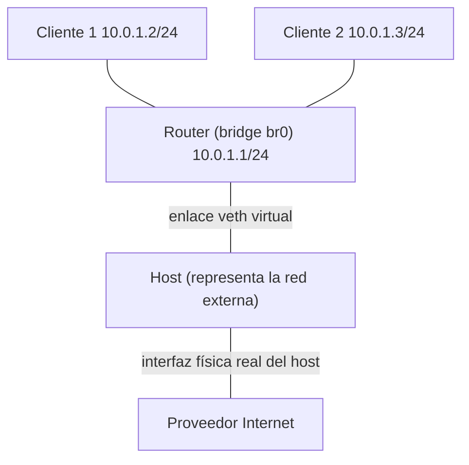

<p class="tema-eyebrow">LABORATORIO 02</p>

# TRANSMISIÓN DE DATOS Y CAPA FÍSICA

<p class="tema-meta"><span>14 secciones</span><span>1 diagrama</span><span>3 tablas</span></p>

## Contexto empresarial

La empresa **Networking SecOps** ya cuenta con su red local funcionando (Clientes 1 y 2 conectados mediante el bridge del equipo `router`, laboratorio 01). El equipo de operaciones ha notado que la red funciona correctamente para comunicaciones internas, pero necesitan **conectar la oficina a Internet** para que los empleados puedan acceder a servicios en la nube, correo electrónico y navegación web.

El CTO ha solicitado que, además de implementar la salida a Internet, se **documente el proceso de transmisión de datos**, explicando cómo viajan los bits desde el equipo del usuario hasta el router y cómo se comporta la señal en el medio físico.

## Problema inicial

-   Los clientes (10.0.1.2 y 10.0.1.3) no tienen salida a Internet.
-   El router todavía no tiene ninguna interfaz hacia el exterior. En este laboratorio le añadimos un enlace virtual hacia el **host**, que actuará como representación de la red externa; la conectividad real hacia Internet depende de la interfaz física o inalámbrica del host (`eth0`, `wlan0`…).
-   Se requiere **enrutar** el tráfico de los clientes hacia ese enlace y aplicar **NAT (Network Address Translation)** para que salgan con una dirección distinta de la privada `10.0.1.x`.
-   Además, se debe **analizar el flujo de bits** y observar cómo se transmite la información a nivel físico.

## Objetivos del laboratorio

1.  Comprender los conceptos de transmisión de datos: bits, señales digitales/analógicas, codificación y modulación.
2.  Implementar la salida a Internet combinando enrutamiento y NAT.
3.  Configurar las rutas por defecto para que los clientes salgan a través del router.
4.  Capturar y analizar paquetes para observar el flujo de datos.
5.  Medir el rendimiento y la latencia en la red.

## Herramientas necesarias

-   Linux con privilegios de superusuario.
-   Comandos: `ip`, `ping`, `tcpdump`, `curl`, `iw` (si se usa WiFi).
-   Herramientas de medición: `ping`, `traceroute`, `iperf3` (opcional).

## Topología



**Direccionamiento:**

| Dispositivo | Interfaz | Dirección IP       |
|-------------|----------|--------------------|
| Cliente 1   | veth-c1  | 10.0.1.2/24        |
| Cliente 2   | veth-c2  | 10.0.1.3/24        |
| Router (LAN)| br0      | 10.0.1.1/24        |
| Router (WAN)| veth-wan | 192.168.1.2/24    |
| Host (extremo del enlace virtual) | veth-host | 192.168.1.1/24 |

**Nota:** `192.168.1.0/24` es aquí el direccionamiento **del enlace virtual** entre el router y el host, y es independiente del direccionamiento de la interfaz física real del host (`eth0`, `wlan0`…). `192.168.1.1` no es «la IP del host», sino la dirección que le damos a `veth-host`; solo debe cambiarse si tu red real ya usa ese rango (véase el aviso del paso 4).

## Fundamentos de transmisión y capa física

La topología `veth` de este laboratorio permite estudiar Ethernet, IP y el comportamiento de la pila del kernel, pero **no genera ni mide una señal eléctrica u óptica real**. La capa física depende de la PHY, el cable, la longitud, los conectores, la negociación y las condiciones del medio.

### Bits, símbolos, codificación y modulación

Un bit es una unidad de información. Un símbolo es un estado de señal transmitido durante un intervalo. En una modulación M-aria ideal, un símbolo puede representar hasta `log2(M)` bits, pero los códigos de línea, la redundancia, la codificación de error, los símbolos reservados y el uso de varios pares hacen que la tasa útil no se obtenga multiplicando sin más la tasa de símbolos por ese valor.

| PHY Ethernet de cobre | Medio y señalización (resumen) | Qué demuestra |
|---|---|---|
| **100BASE-TX** | Dos pares; 4B/5B y código de línea MLT-3; 125 MBd | La codificación transforma bits en una secuencia de símbolos/señales adecuada al medio |
| **1000BASE-T** | Cuatro pares simultáneos; 4D-PAM5, 125 MBd por par, cancelación de eco y codificación | PAM5 es propio de esta PHY; no significa que Ethernet en general use cinco niveles |
| **10GBASE-T** | Cuatro pares; PAM-16, aproximadamente 800 MBd por par, codificación y corrección de errores | PAM-16 permite más estados, pero exige mayor ancho de banda y procesamiento de señal |

**PAM** representa información mediante niveles de amplitud. **QAM** combina amplitud y fase; es común en sistemas como Wi-Fi y cable, pero no debe presentarse como la señalización de las PHY de cobre anteriores. PAM5 y PAM16 son ejemplos de PHY concretas, no propiedades universales de Ethernet.

### Calidad del medio: SNR, atenuación y errores

- **Atenuación:** la señal pierde potencia al propagarse; suele aumentar con la frecuencia y la longitud del cable.
- **Ruido e interferencia:** ruido térmico, interferencia electromagnética y diafonía (*crosstalk*) alteran la señal recibida.
- **SNR:** relación entre potencia de señal y potencia de ruido; se expresa habitualmente en dB. Una SNR menor aumenta la probabilidad de error si el sistema no puede compensarla.
- **BER:** proporción de bits recibidos incorrectamente. La codificación y FEC pueden corregir parte de los errores, pero no hacen ilimitada la capacidad del medio.
- **Autonegociación y dúplex:** los extremos acuerdan velocidad y modo. Un desajuste de dúplex puede producir colisiones, errores y rendimiento asimétrico; no se corrige aumentando la MTU.

### MTU, trama y rendimiento útil

| Elemento | Tamaño típico | Observación |
|---|---:|---|
| MTU IPv4/IPv6 de Ethernet | 1500 bytes | Payload de capa 3, no incluye cabecera Ethernet |
| Cabecera Ethernet | 14 bytes | MAC destino, MAC origen y EtherType |
| Etiqueta 802.1Q | +4 bytes | Se inserta entre origen y EtherType |
| FCS | 4 bytes | Detección de errores; normalmente la NIC lo retira antes de que `tcpdump` entregue la captura |
| Preamble + SFD | 8 bytes | Sincronización y delimitador; no suelen aparecer en captura del host |
| Inter-frame gap | 12 tiempos de byte | Separación entre tramas; no forma parte de la trama capturada |

Con MTU 1500, una trama Ethernet sin etiqueta ocupa normalmente 1518 bytes contando FCS (14 + 1500 + 4); con 802.1Q, 1522 bytes. Preamble/SFD e inter-frame gap consumen tiempo en el medio, aunque no formen parte de esos tamaños de trama.

No confundas **bandwidth** (capacidad nominal del enlace), **throughput** (tasa de datos que realmente atraviesa el punto medido) y **goodput** (datos útiles de aplicación, descontando cabeceras, retransmisiones y otros overheads).

### Observación de una NIC física frente a `veth`

Identifica la interfaz usada por la ruta al exterior y consulta sus parámetros sin cambiarlos:

```bash
WAN_IF=$(ip -4 route get 8.8.8.8 2>/dev/null | awk '{for (i=1;i<=NF;i++) if ($i=="dev") {print $(i+1); exit}}')
echo "Interfaz de salida: ${WAN_IF:-no determinada}"
[ -n "$WAN_IF" ] && ethtool "$WAN_IF"
[ -n "$WAN_IF" ] && ip -s link show dev "$WAN_IF"
[ -n "$WAN_IF" ] && ethtool -S "$WAN_IF" 2>/dev/null | head -30
```

Registra `Speed`, `Duplex`, `Auto-negotiation`, `Link detected` y los contadores de errores/drops. `ethtool -S` depende del controlador y sus nombres de contadores no son universales. La herramienta normalmente no expone la forma de onda ni una medición SNR/BER completa.

Compara con la interfaz virtual del router:

```bash
sudo ip netns exec router ethtool veth-wan 2>/dev/null || true
sudo ip netns exec router ip -s link show dev veth-wan
```

Una `veth` puede informar una velocidad virtual o campos no disponibles; **no tiene PHY, cable, niveles PAM, SNR ni autonegociación física**. Por tanto, una prueba `iperf3` sobre `veth` mide el camino virtual y el coste de CPU/copia, no la capacidad de un cable 1000BASE-T o 10GBASE-T.

### RTT, jitter, pérdida, colas y throughput

Con los clientes del laboratorio 01, mide primero latencia y variación de RTT; después mide TCP y UDP en el mismo segmento virtual. En una terminal inicia el servidor en cliente 2 y en otra ejecuta los clientes. Detén el servidor con `Ctrl+C` al terminar:

```bash
sudo ip netns exec cliente2 iperf3 -s
```

```bash
sudo ip netns exec cliente1 ping -i 0.2 -c 30 10.0.1.3
sudo ip netns exec cliente1 iperf3 -c 10.0.1.3 -P 1 -t 10
sudo ip netns exec cliente1 iperf3 -c 10.0.1.3 -u -b 10M -t 10
sudo ip netns exec router tc -s qdisc show dev br0
sudo ip netns exec router ip -s link show
```

`ping` informa pérdida y estadísticas RTT (incluida desviación); `iperf3` TCP mide throughput, mientras UDP informa jitter y datagramas perdidos para la tasa ofrecida. `tc -s qdisc` y `ip -s link` ayudan a identificar colas, drops y errores. Repite varias veces con la misma duración, dirección y número de flujos; compara medianas y no una única muestra. El resultado entre dos `veth` no predice el throughput de Internet ni el de una NIC física.


## Construcción de la red

### Paso 1: Verificar el estado actual

Primero, asegurémonos de que la red del laboratorio 01 sigue funcionando:

```bash
# Verificar namespaces
ip netns list

# Verificar conectividad entre clientes
ip netns exec cliente1 ping -c 2 10.0.1.3
```

Si no existen los namespaces, ejecuta los comandos del laboratorio 01 para crearlos.

Anota ahora qué directorios DNS por namespace existían ya en tu equipo; la reversión borrará solo los que cree este laboratorio:

```bash
if [ -e /tmp/lab02-netns.preexistente ]; then echo "Existe el inventario previo de Lab02; ejecuta la reversión antes de repetir."; exit 1; fi
touch /tmp/lab02-netns.preexistente
for ns in cliente1 cliente2; do
  [ -e /etc/netns/$ns ] && echo "$ns" >> /tmp/lab02-netns.preexistente
done
```

### Paso 2: Crear una interfaz WAN para el router

Ahora vamos a conectar el router al host. Un par **veth** crea un enlace Ethernet virtual entre dos interfaces; **por sí mismo no proporciona conexión a Internet**. La salida real depende de la interfaz física del host (`eth0`, `wlan0`…), del reenvío IP y de la traducción que configuraremos en los pasos siguientes.

```bash
# Crear par veth para la conexión WAN; no reutilizar una interfaz ajena.
if [ -e /sys/class/net/veth-host ]; then
  echo "veth-host ya existe; comprueba y revierte el laboratorio anterior antes de continuar."
  exit 1
fi
ip link add veth-host type veth peer name veth-wan
ip link set veth-host alias networking-lab-lab-02
ip link set veth-wan alias networking-lab-lab-02

# veth-host permanece en el host (namespace raíz)
# veth-wan lo asignamos al router
ip link set veth-wan netns router
```

### Paso 3: Configurar IP en la interfaz WAN del router

Ambos extremos del enlace virtual necesitan una IP en la misma subred. Usamos `192.168.1.0/24` para este enlace.

```bash
# Configurar IP en el router
ip netns exec router ip addr add 192.168.1.2/24 dev veth-wan
ip netns exec router ip link set veth-wan up

# Configurar IP en el host
ip addr add 192.168.1.1/24 dev veth-host
ip link set veth-host up
```

**Nota:** Ejecuta `ip addr show` y comprueba que ninguna interfaz real del host use ya `192.168.1.0/24`; si es así, elige otro rango para el enlace virtual.

### Paso 4: Dar al router una ruta por defecto hacia el host

El router solo conoce sus redes directamente conectadas (`10.0.1.0/24` y `192.168.1.0/24`). Sin una ruta por defecto no sabe a dónde enviar el tráfico hacia Internet y responde `Destination Net Unreachable`. Su salida es el host (`192.168.1.1`):

```bash
ip netns exec router ip route add default via 192.168.1.1
```

El host también debe reenviar y traducir el tráfico del enlace de laboratorio hacia tu red real. Sustituye `eth0` por la interfaz con la que sales a Internet (`ip route get 8.8.8.8` te la muestra):

```bash
# Si una ejecución anterior se interrumpió, restaura primero el estado que guardó.
# Solo retira NAT cuando el marcador demuestra que lo añadió este laboratorio.
if [ -f /tmp/lab02-host-nat.added ]; then
  iptables -t nat -D POSTROUTING -s 192.168.1.0/24 -o eth0 -j MASQUERADE 2>/dev/null || true
  rm -f /tmp/lab02-host-nat.added
fi
if [ -f /tmp/lab02-forward-out.added ]; then
  iptables -D FORWARD -i veth-host -o eth0 -j ACCEPT 2>/dev/null || true
  rm -f /tmp/lab02-forward-out.added
fi
if [ -f /tmp/lab02-forward-in.added ]; then
  iptables -D FORWARD -i eth0 -o veth-host -m conntrack --ctstate RELATED,ESTABLISHED -j ACCEPT 2>/dev/null || true
  rm -f /tmp/lab02-forward-in.added
fi
if [ -f /tmp/lab02-host-route.added ]; then
  ip route del 10.0.1.0/24 via 192.168.1.2 2>/dev/null || true
  rm -f /tmp/lab02-host-route.added
fi
if [ -f /tmp/lab02-ip_forward.orig ]; then
  sysctl -w net.ipv4.ip_forward="$(cat /tmp/lab02-ip_forward.orig)"
  rm -f /tmp/lab02-ip_forward.orig
fi
# Guarda una copia nueva y aplica los cambios del host.
sysctl -n net.ipv4.ip_forward > /tmp/lab02-ip_forward.orig
sysctl -w net.ipv4.ip_forward=1
if ! iptables -t nat -C POSTROUTING -s 192.168.1.0/24 -o eth0 -j MASQUERADE; then
  iptables -t nat -A POSTROUTING -s 192.168.1.0/24 -o eth0 -j MASQUERADE && touch /tmp/lab02-host-nat.added
fi
```

!!! danger "Cambio en el host (no en un namespace)"
    Los dos comandos anteriores **no se ejecutan dentro de un namespace**: modifican el **equipo real**. Antes de ejecutarlos guarda el estado actual (el bloque anterior ya conserva `ip_forward` en `/tmp/lab02-ip_forward.orig`) y ten a mano la reversión (sección «Revertir los cambios del host», al final del laboratorio).

    | Cambio | Dónde | ¿Persiste tras reiniciar? |
    |--------|-------|---------------------------|
    | `net.ipv4.ip_forward=1` | Host | **No** (con `sysctl -w`), pero otro servicio podría haberlo tenido ya activo |
    | Regla `MASQUERADE` en `nat/POSTROUTING` | Host | **No** (salvo que uses un gestor que guarde reglas) |
    | Par `veth-host` ↔ `veth-wan` | Host | No |

    Antes de empezar: `sysctl net.ipv4.ip_forward` (anota el valor) y `iptables -t nat -S POSTROUTING` (anota las reglas existentes). Ejecuta el laboratorio en una **máquina virtual de pruebas**.

!!! warning "Evita solapar tu red real"
    Si tu red doméstica ya usa `192.168.1.0/24`, el enlace host–router chocará con ella. En ese caso elige otro rango libre para este enlace (por ejemplo `192.168.77.0/24`) y úsalo en todos los pasos y laboratorios siguientes.

### Paso 5: Habilitar reenvío y NAT en el router

El **enrutamiento** y el **NAT** son dos operaciones distintas y consecutivas: primero el router decide, según su tabla de rutas, por qué interfaz sale el paquete (aquí, `veth-wan` por la ruta por defecto); después, al salir, la regla de NAT reescribe la dirección de origen. **NAT por sí solo no proporciona conectividad**: sin ruta y sin `ip_forward` el paquete nunca llegaría a esa regla.

Con esta regla los clientes (10.0.1.0/24) salen con la dirección del router en el enlace (192.168.1.2).

```bash
# Habilitar forwarding en el router
ip netns exec router sysctl -w net.ipv4.ip_forward=1

# Configurar NAT en el router
ip netns exec router iptables -t nat -A POSTROUTING -o veth-wan -j MASQUERADE
if ! ip netns exec router iptables -C FORWARD -i br0 -o veth-wan -j ACCEPT; then
  ip netns exec router iptables -A FORWARD -i br0 -o veth-wan -j ACCEPT && touch /tmp/lab02-router-forward-out.added
fi
if ! ip netns exec router iptables -C FORWARD -i veth-wan -o br0 -m conntrack --ctstate RELATED,ESTABLISHED -j ACCEPT; then
  ip netns exec router iptables -A FORWARD -i veth-wan -o br0 -m conntrack --ctstate RELATED,ESTABLISHED -j ACCEPT && touch /tmp/lab02-router-forward-in.added
fi
```

### Paso 6: Configurar ruta por defecto en los clientes

Los clientes deben enviar todo el tráfico que no sea para la red local al router (10.0.1.1).

```bash
# Cliente 1
ip netns exec cliente1 ip route add default via 10.0.1.1

# Cliente 2
ip netns exec cliente2 ip route add default via 10.0.1.1
```

### Paso 7: Configurar ruta en el host para que el tráfico de retorno llegue al router

En este laboratorio hay **doble NAT** (router y host, véase el paso 10), de modo que el host solo ve la dirección `192.168.1.2` y las respuestas vuelven por la tabla de conexiones, no por una ruta hacia `10.0.1.0/24`. Por eso esta ruta **no es imprescindible** para la salida a Internet; resulta útil si quieres alcanzar `10.0.1.0/24` desde el propio host (por ejemplo, para hacer `ping 10.0.1.2`):

```bash
if ! ip route show 10.0.1.0/24 | grep -q 'via 192.168.1.2'; then
  ip route add 10.0.1.0/24 via 192.168.1.2 && touch /tmp/lab02-host-route.added
fi
```

### Paso 8: Verificar conectividad a Internet

Ahora los clientes deberían poder acceder a Internet:

```bash
# Desde Cliente 1
ip netns exec cliente1 ping -c 4 8.8.8.8

# Desde Cliente 1, resolver DNS
ip netns exec cliente1 nslookup google.com

# Desde Cliente 1, hacer una petición web
ip netns exec cliente1 curl -I http://google.com
```

**Resultado esperado** (si el host dispone de salida real a Internet):

- `ping` 0% de pérdida.
- `nslookup` devuelve una IP.
- `curl` devuelve un código HTTP 301 o 200.

!!! warning "DNS dentro de un namespace"
    Un namespace aísla la **red**, no el sistema de archivos: dentro de él se ve el `/etc/resolv.conf` **del host**, que en muchas distribuciones apunta a `127.0.0.53` (*systemd-resolved*). Esa dirección no existe en el namespace (su `127.0.0.1` es otro), así que `nslookup` o `curl` por nombre pueden fallar aunque `ping 8.8.8.8` funcione. **No** escribas en `/etc/resolv.conf`: sería el del host. En su lugar, da a cada namespace su propio archivo; `ip netns exec` lo monta como `/etc/resolv.conf` solo dentro de ese namespace:

    ```bash
    sudo mkdir -p /etc/netns/cliente1 /etc/netns/cliente2
    echo 'nameserver 8.8.8.8' | sudo tee /etc/netns/cliente1/resolv.conf /etc/netns/cliente2/resolv.conf
    ```

    Repite este paso con cada cliente que necesite resolver nombres en los laboratorios siguientes. (Alternativa rápida: `nslookup google.com 8.8.8.8`.)

!!! warning "El firewall del host también filtra el tráfico reenviado"
    El tráfico del laboratorio **atraviesa el equipo real** (de `veth-host` a `eth0`), así que lo evalúa el *firewall* del host. Si el NAT está bien y aun así no hay salida a Internet, revisa su política de reenvío: Docker, `ufw` y algunas distribuciones dejan la cadena `FORWARD` en `DROP` por defecto.

    ```bash
    iptables -S FORWARD | head -5      # política (-P FORWARD ...) y reglas
    ufw status 2>/dev/null             # si usas ufw
    ```

    Si la política es `DROP`, permite **solo** este enlace y retíralo al terminar (la reversión al final del laboratorio lo incluye):

    ```bash
    if ! iptables -C FORWARD -i veth-host -o eth0 -j ACCEPT; then
      iptables -I FORWARD -i veth-host -o eth0 -j ACCEPT && touch /tmp/lab02-forward-out.added
    fi
    if ! iptables -C FORWARD -i eth0 -o veth-host -m conntrack --ctstate RELATED,ESTABLISHED -j ACCEPT; then
      iptables -I FORWARD -i eth0 -o veth-host -m conntrack --ctstate RELATED,ESTABLISHED -j ACCEPT && touch /tmp/lab02-forward-in.added
    fi
    ```

## Observación de la transmisión de datos

### Paso 9: Capturar el flujo de datos durante una solicitud web

Vamos a observar cómo viajan los datos desde el cliente hasta Internet.

```bash
# Iniciar captura en el router (interfaz br0 y veth-wan)
ip netns exec router tcpdump -i any -n -c 20 'tcp port 80'
```

En otra terminal, ejecutar:

```bash
ip netns exec cliente1 curl -s http://google.com > /dev/null
```

### Paso 10: Analizar la captura

Deberías ver paquetes que entran por `br0` (desde el cliente) y salen por `veth-wan` (hacia el host).

!!! note "Captura esquemática, no transcripción literal"
    `curl http://google.com` conecta con la dirección IP que devuelva el DNS para `google.com`, que **no** es `8.8.8.8` (esa es la IP del DNS público de Google). Para que la lectura sea clara, el esquema siguiente usa `8.8.8.8` como si fuera el servidor web. En tu ejecución real verás la IP de destino que resuelva tu DNS, otros números de secuencia y, si el servidor responde con una redirección, tráfico adicional. Es un **esquema conceptual** del proceso, no una salida garantizada.

```
br0      In  IP 10.0.1.2.54321   > 8.8.8.8.80:       Flags [S]
veth-wan Out IP 192.168.1.2.54321 > 8.8.8.8.80:       Flags [S]
veth-wan In  IP 8.8.8.8.80       > 192.168.1.2.54321: Flags [S.]
br0      Out IP 8.8.8.8.80       > 10.0.1.2.54321:    Flags [S.]
```

**Interpretación:**

1.  El cliente (10.0.1.2) envía un SYN al servidor (8.8.8.8:80) usando como *gateway* a `10.0.1.1`.
2.  El router **reenvía** el paquete según su ruta por defecto y, al salir por `veth-wan`, el NAT cambia la IP de origen por la suya (192.168.1.2).
3.  El paquete llega al host, que aplica una **segunda traducción** (`MASQUERADE` por la interfaz real) antes de salir a la red exterior.
4.  En la respuesta, el origen **sigue siendo el servidor** (`8.8.8.8:80`). Cada traductor deshace su cambio usando su tabla de conexiones: el host restituye `192.168.1.2` y el router restituye `10.0.1.2:54321` como destino.
5.  La dirección `10.0.1.1` es el *gateway* del cliente, nunca el origen de la respuesta del servidor.

### Doble NAT: qué dirección ve cada tramo

| Tramo | Origen visto | Destino visto |
|-------|--------------|---------------|
| Cliente → router (`br0`) | 10.0.1.2:54321 | servidor:80 |
| Router → host (`veth-wan`) | 192.168.1.2:54321 | servidor:80 |
| Host → red exterior (`eth0`) | IP de `eth0` del host, puerto posiblemente reasignado | servidor:80 |

Hay **dos traducciones sucesivas** (una en el router y otra en el host), no una única traducción realizada por el router. Es una arquitectura válida como demostración de doble NAT, aunque en redes reales conviene evitarla cuando es posible. Puedes comprobar el segundo salto capturando en el host: `tcpdump -i veth-host -n 'tcp port 80'`, y las conexiones traducidas con `conntrack -L` (si está instalado).

## Análisis de la transmisión de datos

!!! warning "Un paquete capturado no es una señal medida"
    `tcpdump` muestra **tramas y paquetes** ya formados por el sistema operativo. No permite observar la forma de onda eléctrica, óptica o radioeléctrica, ni el esquema de codificación o modulación empleado: esas magnitudes se miden con otros instrumentos (osciloscopio, analizador de espectro, medidores de potencia óptica) o con estadísticas del controlador (por ejemplo `ethtool` o `iw`). En este laboratorio, además, el medio es un par veth **puramente software**: no existe señal física.

### Bits y señales

Cuando ejecutas `ping` o `curl` sobre un enlace **físico real**, los datos generados por la aplicación se convierten en:

1.  **Bits**: La información se representa como unos y ceros (representación binaria, lógica).
2.  **Señal**: la tarjeta de red (capa física) convierte esos bits en una señal eléctrica, óptica o radioeléctrica mediante un esquema de codificación o modulación.
3.  **Transmisión**: La señal viaja por el medio (cable, fibra o aire).

La diferencia es importante: los bits son una **representación de los datos**; la señal es su **transmisión física**. Un par veth entre namespaces omite el paso 2 y el 3.

No existe un único esquema de señalización para Ethernet: depende del PHY y del medio. Por ejemplo, 100BASE-TX utiliza 4B/5B y MLT-3; 1000BASE-T utiliza señalización 4D-PAM5 sobre cuatro pares; 10GBASE-T utiliza PAM-16 junto con codificación y procesamiento de señal avanzados. Estos son ejemplos de PHY concretos, no características universales de Ethernet.

### Modulación en medios inalámbricos

Si el enlace incluye WiFi, la señal se modula usando **QAM (Quadrature Amplitude Modulation)**:

-   64-QAM → 6 bits por símbolo.
-   256-QAM → 8 bits por símbolo.

Cuantos más bits por símbolo, mayor velocidad, pero se requiere mejor SNR (Relación Señal/Ruido).

### Ancho de banda y rendimiento

En nuestro laboratorio, el enlace entre el cliente y el router está limitado por la velocidad de las interfaces veth (virtuales). En una red real, mediríamos:

-   **Throughput**: cantidad de datos por segundo.
-   **Latencia**: tiempo de ida y vuelta (RTT).
-   **Jitter**: variación en la latencia.

Para medir rendimiento, podemos usar `iperf3`:

```bash
# En el router (servidor)
ip netns exec router iperf3 -s

# En Cliente 1 (cliente)
ip netns exec cliente1 iperf3 -c 10.0.1.1
```

### Medición de latencia

Podemos medir la latencia hacia Internet:

```bash
ip netns exec cliente1 ping -c 10 8.8.8.8
```

La salida mostrará el tiempo mínimo, promedio y máximo (RTT).

## Ejercicios prácticos

### Ejercicio 1: Observar la tabla de enrutamiento

En el router, muestra la tabla de rutas:

```bash
ip netns exec router ip route show
```

**Preguntas:**

- ¿Qué rutas tiene el router?
- ¿Cómo sabe el router que debe enviar el tráfico a 10.0.1.0/24 por br0?
- ¿Qué ruta usa para Internet?

### Ejercicio 2: Ver las reglas de NAT

En el router, muestra las reglas de iptables:

```bash
ip netns exec router iptables -t nat -L -v
```

**Preguntas:**

- ¿Qué regla de NAT está activa?
- ¿Cuántos paquetes han sido traducidos?

### Ejercicio 3: Medir throughput

Instala `iperf3` si no lo tienes y mide el rendimiento entre Cliente 1 y el router.

```bash
# En el router (servidor)
ip netns exec router iperf3 -s &

# En Cliente 1
ip netns exec cliente1 iperf3 -c 10.0.1.1
```

**Pregunta:** ¿Cuál es el throughput alcanzado? ¿De qué depende (CPU, número de núcleos, tamaño de segmento) si el enlace es virtual y no tiene una velocidad nominal fija?

## Errores comunes y soluciones

| Error | Causa | Solución |
|-------|-------|----------|
| `ping: connect: Network is unreachable` | No hay ruta por defecto. | Ejecutar `ip route add default via 10.0.1.1` en el cliente. |
| No sale a Internet | NAT no configurado. | Verificar reglas de iptables y que `ip_forward=1`. |
| `curl: (6) Could not resolve host` | El namespace no tiene un DNS utilizable (hereda el `resolv.conf` del host, que suele apuntar a `127.0.0.53`). | Crear `/etc/netns/cliente1/resolv.conf` (véase la nota «DNS dentro de un namespace» del Paso 8). **No** escribir en `/etc/resolv.conf`: es el del host. |
| Los paquetes no llegan al host | Host no tiene ruta de retorno. | Agregar ruta en el host: `ip route add 10.0.1.0/24 via 192.168.1.2`. |

## Revertir los cambios del host

Al terminar, deshaz **solo lo que hiciste aquí** (no borres reglas ajenas):

```bash
NS_LEFT=0
for ns in cliente1 cliente2 router; do
  if sudo ip netns list | awk '{print $1}' | grep -Fxq "$ns"; then
    if [ "$(sudo ip netns exec "$ns" cat /sys/class/net/lo/ifalias 2>/dev/null)" != networking-lab-owned ]; then echo "Se conserva $ns: no tiene la marca de propiedad Networking Lab."; NS_LEFT=1
    else
      PIDS=$(sudo ip netns pids "$ns" 2>/dev/null || true)
      if [ -n "$PIDS" ]; then echo "Se conserva $ns: quedan procesos activos ($PIDS); deténlos desde su terminal."; NS_LEFT=1; fi
    fi
  fi
done
if [ "$NS_LEFT" = 0 ]; then
  for ns in cliente1 cliente2 router; do
    if sudo ip netns list | awk '{print $1}' | grep -Fxq "$ns"; then sudo ip netns del "$ns" 2>/dev/null || true; fi
  done
  # Reglas del host: retirar solo las marcadas como añadidas por Lab02.
  if [ -f /tmp/lab02-host-nat.added ]; then iptables -t nat -D POSTROUTING -s 192.168.1.0/24 -o eth0 -j MASQUERADE 2>/dev/null || true; rm -f /tmp/lab02-host-nat.added; fi
  if [ -f /tmp/lab02-forward-out.added ]; then iptables -D FORWARD -i veth-host -o eth0 -j ACCEPT 2>/dev/null || true; rm -f /tmp/lab02-forward-out.added; fi
  if [ -f /tmp/lab02-forward-in.added ]; then iptables -D FORWARD -i eth0 -o veth-host -m conntrack --ctstate RELATED,ESTABLISHED -j ACCEPT 2>/dev/null || true; rm -f /tmp/lab02-forward-in.added; fi
  if [ -f /tmp/lab02-host-route.added ]; then ip route del 10.0.1.0/24 via 192.168.1.2 2>/dev/null || true; rm -f /tmp/lab02-host-route.added; fi
  if [ -f /tmp/lab02-ip_forward.orig ]; then sysctl -w net.ipv4.ip_forward="$(cat /tmp/lab02-ip_forward.orig)"; rm -f /tmp/lab02-ip_forward.orig; fi
  rm -f /tmp/lab02-router-forward-out.added /tmp/lab02-router-forward-in.added
  if [ "$(cat /sys/class/net/veth-host/ifalias 2>/dev/null)" = networking-lab-lab-02 ]; then ip link del veth-host; fi
  if [ -f /tmp/lab02-netns.preexistente ]; then
    for ns in cliente1 cliente2; do grep -qx "$ns" /tmp/lab02-netns.preexistente || rm -rf "/etc/netns/$ns"; done
    rm -f /tmp/lab02-netns.preexistente
  fi
  for f in /sys/class/net/*/ifalias; do
    [ -r "$f" ] || continue
    [ "$(cat "$f")" = networking-lab-lab-02 ] || continue
    dev=${f%/ifalias}; dev=${dev##*/}
    ip link del "$dev" 2>/dev/null || true
  done
else
  echo "Se conservan reglas, rutas, veth-host y archivos de estado: hay namespaces con procesos o sin marca."
fi
```

Si tu equipo ya tenía `ip_forward=1`, el paso 2 lo deja en 1, que es su valor original. Si borraste `/tmp/lab02-ip_forward.orig` o abriste otra sesión, consulta el valor que anotaste antes de empezar. Comprueba el resultado con `iptables -t nat -S POSTROUTING` y `sysctl net.ipv4.ip_forward`.

## Profundización: capa física, señalización y límites de la simulación

Ethernet no utiliza un único esquema de señalización. El PHY concreto determina codificación, señalización, velocidad, medio y negociación. No generalices PAM5/PAM16 a todo Ethernet:

| PHY | Medio y señalización (resumen didáctico) | Qué demuestra |
|---|---|---|
| 100BASE-TX | Par trenzado; 4B/5B y MLT-3 | La codificación de línea no equivale a una modulación multinivel genérica |
| 1000BASE-T | Cuatro pares; señalización 4D-PAM5 | Transmisión simultánea por los cuatro pares y procesamiento DSP |
| 10GBASE-T | Par trenzado; PAM-16 con codificación y procesamiento avanzado | La tasa de símbolos, codificación y bits útiles no son lo mismo |

PAM representa niveles de amplitud; QAM combina amplitud y fase y es habitual en Wi-Fi y otros sistemas, pero no debe describirse como el método de modulación de toda conexión Ethernet. La relación ideal de bits por símbolo depende del número de estados, pero la tasa neta también descuenta codificación, redundancia FEC y overhead.

### Parámetros que deben distinguirse

- **Bitrate:** bits transmitidos por segundo en el enlace o interfaz.
- **Tasa de símbolos (baud):** símbolos por segundo.
- **Bandwidth:** capacidad nominal o disponible del canal, según el contexto.
- **Throughput:** datos entregados por unidad de tiempo.
- **Goodput:** carga útil de aplicación, excluyendo cabeceras y retransmisiones.
- **RTT, jitter y pérdida:** dimensiones diferentes de la experiencia temporal.

`veth` es un enlace virtual en software. `iperf3`, `tcpdump` y `ping` sobre él permiten estudiar protocolos, colas y rendimiento del kernel, pero no miden voltaje, potencia óptica, SNR ni una velocidad física negociada. Para observar una NIC real, compara `ethtool <interfaz>` y `ethtool -S <interfaz>`; no cambies autonegociación ni velocidad en una interfaz de producción.

### Atenuación, ruido, SNR y calidad del enlace

La señal recibida no llega idéntica a la transmitida. La **atenuación** reduce su potencia con la distancia y la frecuencia; el **ruido** añade energía no deseada; la **diafonía** (NEXT/FEXT) acopla señal entre pares; y la interferencia electromagnética puede elevar los errores. La relación señal/ruido se expresa como:

\[
SNR_{dB}=10\log_{10}\left(\frac{P_{señal}}{P_{ruido}}\right)
\]

Un SNR menor reduce el margen para distinguir símbolos y puede aumentar la tasa de error. En cobre, la categoría, longitud, terminación, balance de pares y entorno electromagnético condicionan el margen; en fibra importan la atenuación, conectores, empalmes y presupuesto óptico. Un enlace puede negociar a una velocidad menor o presentar errores aun cuando `LOWER_UP` indique portadora.

### Codificación de línea, modulación y tasa de símbolos

No confundas **codificación de línea** (cómo se representan bits/transiciones) con **modulación** (cómo se asignan símbolos a una señal física) ni con la tasa de símbolos (baud). Como referencias de Ethernet:

| Estándar | Señalización física relevante | Precisión didáctica |
|---|---|---|
| 100BASE-TX | 4B/5B y MLT-3 sobre dos pares; 125 MBd | MLT-3 no es PAM ni QAM |
| 1000BASE-T | PAM-5 multidimensional sobre cuatro pares; 125 MBd por par, con cancelación de eco y diafonía | No se calcula su tasa agregada aplicando sin más `log2(5)` a un único par |
| 10GBASE-T | PAM-16 con codificación 128-DSQ; 800 MBd por par y procesamiento avanzado sobre cuatro pares | Mayor densidad de símbolos exige más SNR y cableado de categoría adecuada |

QAM aparece en tecnologías como DOCSIS, Wi-Fi y ciertos sistemas DSL; no debe atribuirse a 1000BASE-T ni a 10GBASE-T. En una modulación M-PAM ideal, cada símbolo puede representar hasta `log2(M)` bits antes de considerar codificación, redundancia y dimensiones; no equivale automáticamente al rendimiento útil del enlace.

### Dúplex, autonegociación y MTU

- **Full-duplex** permite transmitir y recibir simultáneamente; **half-duplex** comparte el medio y puede usar CSMA/CD en Ethernet heredado. Un *duplex mismatch* puede causar errores, retransmisiones y bajo rendimiento.
- La autonegociación acuerda velocidad y dúplex cuando ambos extremos la implementan de forma compatible. No fuerces velocidad/dúplex en una interfaz productiva para hacer una prueba.
- MTU 1500 describe la carga IP Ethernet habitual, no todo lo que ocupa la trama en el medio. Una etiqueta 802.1Q añade 4 bytes; cabecera Ethernet, FCS, preámbulo e intervalo entre tramas también consumen tiempo de transmisión.
- **Ancho de banda**, *throughput* y *goodput* no son sinónimos: el último descuenta cabeceras, retransmisiones y datos de control.

Para observar un enlace físico usa `ethtool INTERFAZ_FISICA` y compara `Speed`, `Duplex`, `Auto-negotiation`, `Link detected` y contadores de errores. En una `veth` o interfaz de namespace los valores son sintéticos; no permiten inferir categoría de cable, potencia óptica ni calidad real del medio.

### Experimento de medición reproducible

Ejecuta TCP y UDP con condiciones documentadas y repite cada prueba al menos tres veces:

```bash
# Servidor en una terminal
sudo ip netns exec router iperf3 -s
# TCP: cliente
sudo ip netns exec cliente1 iperf3 -c 10.0.1.1 -t 15 -i 1
# UDP: fija una tasa ofrecida moderada y compara pérdida/jitter
sudo ip netns exec cliente1 iperf3 -c 10.0.1.1 -u -b 20M -t 15 -i 1
```

Registra CPU, duración, tasa ofrecida, throughput recibido, pérdida y jitter. No compares una tasa UDP ofrecida con el goodput TCP como si fueran la misma magnitud.


## Preguntas de reflexión

1.  ¿Qué mecanismo permite que Cliente 1 llegue a una dirección fuera de `10.0.1.0/24`, y qué dirección MAC usa como destino de la trama?
2.  ¿Qué sucedería si se elimina la regla de NAT pero se mantiene el reenvío (`ip_forward`)?
3.  ¿Qué diferencia hay entre lo que muestra la captura en la interfaz interna y en la WAN del router?
4.  ¿Qué limitaciones tiene simular Internet con el propio equipo anfitrión?
5.  ¿En qué escenario real se usaría doble NAT, y qué problemas puede causar?

## Conclusiones técnicas

En este laboratorio hemos:

1.  **Ampliado la red local** agregando conectividad a Internet mediante NAT.
2.  **Observado el flujo de datos** desde el cliente hasta el router y el host, incluida la doble traducción de direcciones.
3.  **Comprendido conceptualmente la transmisión de datos** a nivel de bits, señales y modulación (sin medirlas físicamente, algo que una captura de paquetes no permite).
4.  **Medido el rendimiento** y la latencia de la red.
5.  **Analizado el proceso de encapsulación** y la traducción de direcciones (NAT), distinguiéndolo del enrutamiento.

Los conceptos de transmisión de datos son fundamentales para entender las limitaciones y capacidades de las redes. El ancho de banda, la latencia, el ruido y la modulación determinan el rendimiento real que los usuarios experimentan.

## Preparación para el siguiente laboratorio

Hemos dejado la red con salida a Internet (doble NAT), rutas y reenvío configurados. En el **Laboratorio 03** agregaremos más dispositivos: un switch con múltiples clientes, el estudio de la tabla MAC y de la MTU. (La segmentación con VLAN llega en el laboratorio 05.)

---

**¡Laboratorio 02 completado!** Ahora los clientes tienen acceso a Internet y hemos analizado el proceso de transmisión de datos. Continúa con el **Laboratorio 03**.
