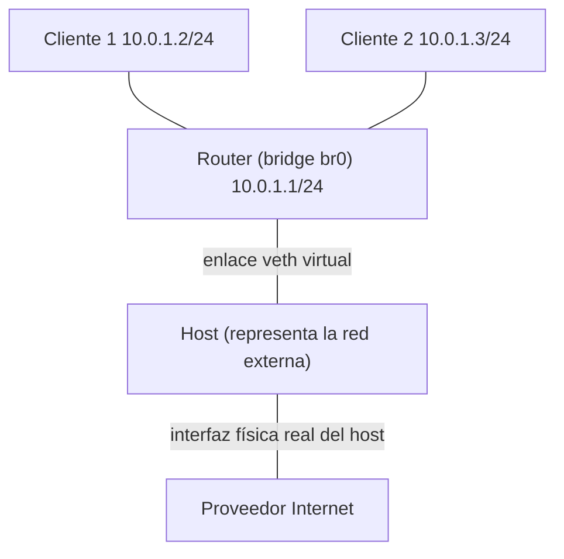

<p class="tema-num">LABORATORIO 02</p>

# Transmisión de Datos y Capa Física

## Contexto empresarial

La empresa **Networking SecOps** ya cuenta con su red local funcionando (Clientes 1 y 2 conectados mediante el bridge del equipo `router`, laboratorio 01). El equipo de operaciones ha notado que la red funciona correctamente para comunicaciones internas, pero necesitan **conectar la oficina a Internet** para que los empleados puedan acceder a servicios en la nube, correo electrónico y navegación web.

El CTO ha solicitado que, además de implementar la salida a Internet, se **documente el proceso de transmisión de datos**, explicando cómo viajan los bits desde el equipo del usuario hasta el router y cómo se comporta la señal en el medio físico.

## Problema inicial

-   Los clientes (10.0.1.2 y 10.0.1.3) no tienen salida a Internet.
-   El router todavía no tiene ninguna interfaz hacia el exterior. En este laboratorio le añadimos un enlace virtual hacia el **host**, que actuará como representación de la red externa; la conectividad real hacia Internet depende de la interfaz física o inalámbrica del host (`eth0`, `wlan0`…).
-   Se requiere **enrutar** el tráfico de los clientes hacia ese enlace y aplicar **NAT (Network Address Translation)** para que salgan con una dirección distinta de la privada `10.0.1.x`.
-   Además, se debe **analizar el flujo de bits** y observar cómo se transmite la información a nivel físico.

## Objetivos del laboratorio

1.  Comprender los conceptos de transmisión de datos: bits, señales digitales/analógicas, codificación y modulación.
2.  Implementar la salida a Internet combinando enrutamiento y NAT.
3.  Configurar las rutas por defecto para que los clientes salgan a través del router.
4.  Capturar y analizar paquetes para observar el flujo de datos.
5.  Medir el rendimiento y la latencia en la red.

## Herramientas necesarias

-   Linux con privilegios de superusuario.
-   Comandos: `ip`, `ping`, `tcpdump`, `curl`, `iwconfig` (si se usa WiFi).
-   Herramientas de medición: `ping`, `traceroute`, `iperf3` (opcional).

## Topología



**Direccionamiento:**

| Dispositivo | Interfaz | Dirección IP       |
|-------------|----------|--------------------|
| Cliente 1   | veth0    | 10.0.1.2/24        |
| Cliente 2   | veth0    | 10.0.1.3/24        |
| Router (LAN)| br0      | 10.0.1.1/24        |
| Router (WAN)| veth-wan | 192.168.1.2/24    |
| Host (extremo del enlace virtual) | veth-host | 192.168.1.1/24 |

**Nota:** `192.168.1.0/24` es aquí el direccionamiento **del enlace virtual** entre el router y el host, y es independiente del direccionamiento de la interfaz física real del host (`eth0`, `wlan0`…). `192.168.1.1` no es «la IP del host», sino la dirección que le damos a `veth-host`; solo debe cambiarse si tu red real ya usa ese rango (véase el aviso del paso 4).

## Construcción de la red

### Paso 1: Verificar el estado actual

Primero, asegurémonos de que la red del laboratorio 01 sigue funcionando:

```bash
# Verificar namespaces
ip netns list

# Verificar conectividad entre clientes
ip netns exec cliente1 ping -c 2 10.0.1.3
```

Si no existen los namespaces, ejecuta los comandos del laboratorio 01 para crearlos.

### Paso 2: Crear una interfaz WAN para el router

Ahora vamos a conectar el router al host. Un par **veth** crea un enlace Ethernet virtual entre dos interfaces; **por sí mismo no proporciona conexión a Internet**. La salida real depende de la interfaz física del host (`eth0`, `wlan0`…), del reenvío IP y de la traducción que configuraremos en los pasos siguientes.

```bash
# Crear par veth para la conexión WAN
ip link add veth-host type veth peer name veth-wan

# veth-host permanece en el host (namespace raíz)
# veth-wan lo asignamos al router
ip link set veth-wan netns router
```

### Paso 3: Configurar IP en la interfaz WAN del router

Ambos extremos del enlace virtual necesitan una IP en la misma subred. Usamos `192.168.1.0/24` para este enlace.

```bash
# Configurar IP en el router
ip netns exec router ip addr add 192.168.1.2/24 dev veth-wan
ip netns exec router ip link set veth-wan up

# Configurar IP en el host
ip addr add 192.168.1.1/24 dev veth-host
ip link set veth-host up
```

**Nota:** Ejecuta `ip addr show` y comprueba que ninguna interfaz real del host use ya `192.168.1.0/24`; si es así, elige otro rango para el enlace virtual.

### Paso 4: Dar al router una ruta por defecto hacia el host

El router solo conoce sus redes directamente conectadas (`10.0.1.0/24` y `192.168.1.0/24`). Sin una ruta por defecto no sabe a dónde enviar el tráfico hacia Internet y responde `Destination Net Unreachable`. Su salida es el host (`192.168.1.1`):

```bash
ip netns exec router ip route add default via 192.168.1.1
```

El host también debe reenviar y traducir el tráfico del enlace de laboratorio hacia tu red real. Sustituye `eth0` por la interfaz con la que sales a Internet (`ip route get 8.8.8.8` te la muestra):

```bash
sysctl -w net.ipv4.ip_forward=1
iptables -t nat -A POSTROUTING -s 192.168.1.0/24 -o eth0 -j MASQUERADE
```

!!! warning "Evita solapar tu red real"
    Si tu red doméstica ya usa `192.168.1.0/24`, el enlace host–router chocará con ella. En ese caso elige otro rango libre para este enlace (por ejemplo `192.168.77.0/24`) y úsalo en todos los pasos y laboratorios siguientes.

### Paso 5: Habilitar reenvío y NAT en el router

El **enrutamiento** y el **NAT** son dos operaciones distintas y consecutivas: primero el router decide, según su tabla de rutas, por qué interfaz sale el paquete (aquí, `veth-wan` por la ruta por defecto); después, al salir, la regla de NAT reescribe la dirección de origen. **NAT por sí solo no proporciona conectividad**: sin ruta y sin `ip_forward` el paquete nunca llegaría a esa regla.

Con esta regla los clientes (10.0.1.0/24) salen con la dirección del router en el enlace (192.168.1.2).

```bash
# Habilitar forwarding en el router
ip netns exec router sysctl -w net.ipv4.ip_forward=1

# Configurar NAT en el router
ip netns exec router iptables -t nat -A POSTROUTING -o veth-wan -j MASQUERADE
ip netns exec router iptables -A FORWARD -i br0 -o veth-wan -j ACCEPT
ip netns exec router iptables -A FORWARD -i veth-wan -o br0 -m state --state RELATED,ESTABLISHED -j ACCEPT
```

### Paso 6: Configurar ruta por defecto en los clientes

Los clientes deben enviar todo el tráfico que no sea para la red local al router (10.0.1.1).

```bash
# Cliente 1
ip netns exec cliente1 ip route add default via 10.0.1.1

# Cliente 2
ip netns exec cliente2 ip route add default via 10.0.1.1
```

### Paso 7: Configurar ruta en el host para que el tráfico de retorno llegue al router

En este laboratorio hay **doble NAT** (router y host, véase el paso 10), de modo que el host solo ve la dirección `192.168.1.2` y las respuestas vuelven por la tabla de conexiones, no por una ruta hacia `10.0.1.0/24`. Por eso esta ruta **no es imprescindible** para la salida a Internet; resulta útil si quieres alcanzar `10.0.1.0/24` desde el propio host (por ejemplo, para hacer `ping 10.0.1.2`):

```bash
ip route add 10.0.1.0/24 via 192.168.1.2
```

### Paso 8: Verificar conectividad a Internet

Ahora los clientes deberían poder acceder a Internet:

```bash
# Desde Cliente 1
ip netns exec cliente1 ping -c 4 8.8.8.8

# Desde Cliente 1, resolver DNS
ip netns exec cliente1 nslookup google.com

# Desde Cliente 1, hacer una petición web
ip netns exec cliente1 curl -I http://google.com
```

**Resultado esperado** (si el host dispone de salida real a Internet):
- `ping` 0% de pérdida.
- `nslookup` devuelve una IP.
- `curl` devuelve un código HTTP 301 o 200.

## Observación de la transmisión de datos

### Paso 9: Capturar el flujo de datos durante una solicitud web

Vamos a observar cómo viajan los datos desde el cliente hasta Internet.

```bash
# Iniciar captura en el router (interfaz br0 y veth-wan)
ip netns exec router tcpdump -i any -n -c 10 'tcp port 80'
```

En otra terminal, ejecutar:

```bash
ip netns exec cliente1 curl -s http://google.com > /dev/null
```

### Paso 10: Analizar la captura

Deberías ver paquetes que entran por `br0` (desde el cliente) y salen por `veth-wan` (hacia el host).

!!! note "Captura esquemática, no transcripción literal"
    `curl http://google.com` conecta con la dirección IP que devuelva el DNS para `google.com`, que **no** es `8.8.8.8` (esa es la IP del DNS público de Google). Para que la lectura sea clara, el esquema siguiente usa `8.8.8.8` como si fuera el servidor web. En tu ejecución real verás la IP de destino que resuelva tu DNS, otros números de secuencia y, si el servidor responde con una redirección, tráfico adicional. Es un **esquema conceptual** del proceso, no una salida garantizada.

```
br0      In  IP 10.0.1.2.54321   > 8.8.8.8.80:       Flags [S]
veth-wan Out IP 192.168.1.2.54321 > 8.8.8.8.80:       Flags [S]
veth-wan In  IP 8.8.8.8.80       > 192.168.1.2.54321: Flags [S.]
br0      Out IP 8.8.8.8.80       > 10.0.1.2.54321:    Flags [S.]
```

**Interpretación:**

1.  El cliente (10.0.1.2) envía un SYN al servidor (8.8.8.8:80) usando como *gateway* a `10.0.1.1`.
2.  El router **reenvía** el paquete según su ruta por defecto y, al salir por `veth-wan`, el NAT cambia la IP de origen por la suya (192.168.1.2).
3.  El paquete llega al host, que aplica una **segunda traducción** (`MASQUERADE` por la interfaz real) antes de salir a la red exterior.
4.  En la respuesta, el origen **sigue siendo el servidor** (`8.8.8.8:80`). Cada traductor deshace su cambio usando su tabla de conexiones: el host restituye `192.168.1.2` y el router restituye `10.0.1.2:54321` como destino.
5.  La dirección `10.0.1.1` es el *gateway* del cliente, nunca el origen de la respuesta del servidor.

### Doble NAT: qué dirección ve cada tramo

| Tramo | Origen visto | Destino visto |
|-------|--------------|---------------|
| Cliente → router (`br0`) | 10.0.1.2:54321 | servidor:80 |
| Router → host (`veth-wan`) | 192.168.1.2:54321 | servidor:80 |
| Host → red exterior (`eth0`) | IP de `eth0` del host, puerto posiblemente reasignado | servidor:80 |

Hay **dos traducciones sucesivas** (una en el router y otra en el host), no una única traducción realizada por el router. Es una arquitectura válida como demostración de doble NAT, aunque en redes reales conviene evitarla cuando es posible. Puedes comprobar el segundo salto capturando en el host: `tcpdump -i veth-host -n 'tcp port 80'`, y las conexiones traducidas con `conntrack -L` (si está instalado).

## Análisis de la transmisión de datos

!!! warning "Un paquete capturado no es una señal medida"
    `tcpdump` muestra **tramas y paquetes** ya formados por el sistema operativo. No permite observar la forma de onda eléctrica, óptica o radioeléctrica, ni el esquema de codificación o modulación empleado: esas magnitudes se miden con otros instrumentos (osciloscopio, analizador de espectro, medidores de potencia óptica) o con estadísticas del controlador (por ejemplo `ethtool` o `iw`). En este laboratorio, además, el medio es un par veth **puramente software**: no existe señal física.

### Bits y señales

Cuando ejecutas `ping` o `curl` sobre un enlace **físico real**, los datos generados por la aplicación se convierten en:

1.  **Bits**: La información se representa como unos y ceros (representación binaria, lógica).
2.  **Señal**: la tarjeta de red (capa física) convierte esos bits en una señal eléctrica, óptica o radioeléctrica mediante un esquema de codificación o modulación.
3.  **Transmisión**: La señal viaja por el medio (cable, fibra o aire).

La diferencia es importante: los bits son una **representación de los datos**; la señal es su **transmisión física**. Un par veth entre namespaces omite el paso 2 y el 3.

En una red Ethernet real, el esquema de codificación más común hoy es **PAM5** (1000BASE-T) o **PAM16** (10GBASE-T), que transmiten múltiples bits por símbolo.

### Modulación en medios inalámbricos

Si el enlace incluye WiFi, la señal se modula usando **QAM (Quadrature Amplitude Modulation)**:

-   64-QAM → 6 bits por símbolo.
-   256-QAM → 8 bits por símbolo.

Cuantos más bits por símbolo, mayor velocidad, pero se requiere mejor SNR (Relación Señal/Ruido).

### Ancho de banda y rendimiento

En nuestro laboratorio, el enlace entre el cliente y el router está limitado por la velocidad de las interfaces veth (virtuales). En una red real, mediríamos:

-   **Throughput**: cantidad de datos por segundo.
-   **Latencia**: tiempo de ida y vuelta (RTT).
-   **Jitter**: variación en la latencia.

Para medir rendimiento, podemos usar `iperf3`:

```bash
# En el router (servidor)
ip netns exec router iperf3 -s

# En Cliente 1 (cliente)
ip netns exec cliente1 iperf3 -c 10.0.1.1
```

### Medición de latencia

Podemos medir la latencia hacia Internet:

```bash
ip netns exec cliente1 ping -c 10 8.8.8.8
```

La salida mostrará el tiempo mínimo, promedio y máximo (RTT).

## Ejercicios prácticos

### Ejercicio 1: Observar la tabla de enrutamiento

En el router, muestra la tabla de rutas:

```bash
ip netns exec router ip route show
```

**Preguntas:**
- ¿Qué rutas tiene el router?
- ¿Cómo sabe el router que debe enviar el tráfico a 10.0.1.0/24 por br0?
- ¿Qué ruta usa para Internet?

### Ejercicio 2: Ver las reglas de NAT

En el router, muestra las reglas de iptables:

```bash
ip netns exec router iptables -t nat -L -v
```

**Preguntas:**
- ¿Qué regla de NAT está activa?
- ¿Cuántos paquetes han sido traducidos?

### Ejercicio 3: Medir throughput

Instala `iperf3` si no lo tienes y mide el rendimiento entre Cliente 1 y el router.

```bash
# En el router (servidor)
ip netns exec router iperf3 -s &

# En Cliente 1
ip netns exec cliente1 iperf3 -c 10.0.1.1
```

**Pregunta:** ¿Cuál es el throughput alcanzado? ¿De qué depende (CPU, número de núcleos, tamaño de segmento) si el enlace es virtual y no tiene una velocidad nominal fija?

## Errores comunes y soluciones

| Error | Causa | Solución |
|-------|-------|----------|
| `ping: connect: Network is unreachable` | No hay ruta por defecto. | Ejecutar `ip route add default via 10.0.1.1` en el cliente. |
| No sale a Internet | NAT no configurado. | Verificar reglas de iptables y que `ip_forward=1`. |
| `curl: (6) Could not resolve host` | DNS no configurado. | Configurar DNS en el cliente: `echo 'nameserver 8.8.8.8' > /etc/resolv.conf` (dentro del namespace). |
| Los paquetes no llegan al host | Host no tiene ruta de retorno. | Agregar ruta en el host: `ip route add 10.0.1.0/24 via 192.168.1.2`. |

## Conclusiones técnicas

En este laboratorio hemos:

1.  **Ampliado la red local** agregando conectividad a Internet mediante NAT.
2.  **Observado el flujo de datos** desde el cliente hasta el router y el host, incluida la doble traducción de direcciones.
3.  **Comprendido conceptualmente la transmisión de datos** a nivel de bits, señales y modulación (sin medirlas físicamente, algo que una captura de paquetes no permite).
4.  **Medido el rendimiento** y la latencia de la red.
5.  **Analizado el proceso de encapsulación** y la traducción de direcciones (NAT), distinguiéndolo del enrutamiento.

Los conceptos de transmisión de datos son fundamentales para entender las limitaciones y capacidades de las redes. El ancho de banda, la latencia, el ruido y la modulación determinan el rendimiento real que los usuarios experimentan.

## Preparación para el siguiente laboratorio

Hemos dejado la red con salida a Internet (doble NAT), rutas y reenvío configurados. En el **Laboratorio 03** agregaremos más dispositivos: un switch con múltiples clientes, el estudio de la tabla MAC y de la MTU. (La segmentación con VLAN llega en el laboratorio 05.)

---

**¡Laboratorio 02 completado!** Ahora los clientes tienen acceso a Internet y hemos analizado el proceso de transmisión de datos. Continúa con el **Laboratorio 03**.
