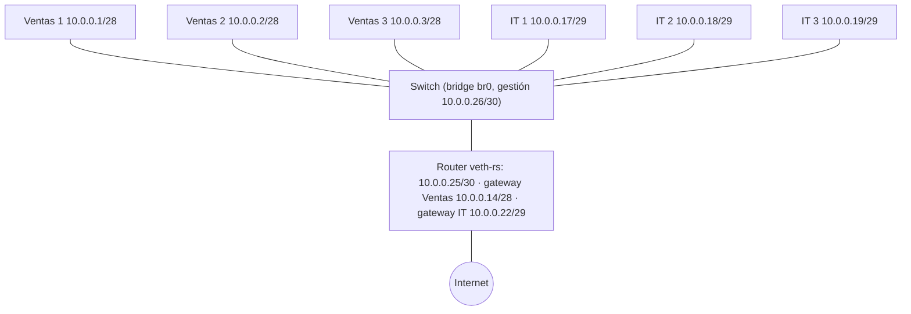

<p class="tema-eyebrow">LABORATORIO 04</p>

# DIRECCIONAMIENTO IP Y SUBREDES

<p class="tema-meta"><span>14 secciones</span><span>1 diagrama</span><span>3 tablas</span></p>

## Contexto empresarial

La empresa **Networking SecOps** ha seguido creciendo. Ahora cuenta con **dos departamentos** con necesidades de red independientes:

-   **Ventas**: 10 empleados que necesitan acceso a Internet y a un servidor interno.
-   **IT/Sistemas**: 5 empleados que administran servidores y necesitan acceso restringido.

La red actual (todos los clientes en una sola subred `10.0.1.0/24`) ya no es suficiente. Se necesita **segmentar la red** en subredes separadas para:

-   Separar lógicamente el direccionamiento de cada departamento (el tráfico entre ellos pasa a ser tráfico **enrutado**, sobre el que se pueden aplicar políticas).
-   Preparar la aplicación de políticas de seguridad diferentes.
-   Optimizar el uso del espacio de direcciones.

!!! warning "Subred IP no es lo mismo que VLAN"
    Una **subred IP** es una división lógica de **capa 3**; una **VLAN** es una división lógica de **capa 2** (dominio de broadcast). Suelen asociarse una VLAN con una subred IP, pero no son conceptos equivalentes. En este laboratorio solo dividimos el direccionamiento (capa 3): todos los equipos siguen conectados al **mismo bridge**, es decir, al mismo dominio de broadcast. Reducir los dominios de broadcast exigirá VLAN (laboratorio 05).

## Problema inicial

-   Todos los clientes están en la misma subred `10.0.1.0/24`.
-   Se necesitan **dos subredes**: una para Ventas y otra para IT.
-   El router debe encaminar el tráfico entre subredes.
-   Se debe implementar **VLSM** para optimizar el uso de direcciones.

## Objetivos del laboratorio

1.  Comprender la estructura de las direcciones IPv4 (32 bits).
2.  Aplicar **subnetting** para dividir una red en subredes más pequeñas.
3.  Implementar **VLSM** (Variable Length Subnet Mask) para optimizar direcciones.
4.  Configurar **varias direcciones IP (una por subred) en la interfaz del router** para que actúe como *gateway* de cada subred. (Las subinterfaces con etiquetas VLAN se estudian en el laboratorio 05.)
5.  Verificar la comunicación entre subredes mediante enrutamiento.
6.  Analizar la relación Red-Subred-Host.

## Herramientas necesarias

-   Linux con privilegios de superusuario.
-   Comandos: `ip`, `ping`, `tcpdump`, `ipcalc` (opcional).
-   Conocimientos de subnetting y notación CIDR.

## Diseño de subredes

**Red base:** `10.0.0.0/24`. Las tres subredes se calculan **dentro** de este bloque. La asignación es un **ejemplo de reparto de direcciones**, no una arquitectura obligatoria para todas las empresas.

**Requisitos:**

-   Subred 1: Ventas → 10 hosts + 1 *gateway* = 11 direcciones (mínimo /28 → 14 hosts útiles).
-   Subred 2: IT → 5 hosts + 1 *gateway* = 6 direcciones (mínimo /29 → 6 hosts útiles).
-   Subred 3: Enlace de gestión router-switch → 2 direcciones, router y switch (mínimo /30 → 2 hosts útiles).

**Recuerda:** el *gateway* y cualquier equipo de infraestructura también consumen una dirección útil. Al dimensionar una subred, cuéntalos junto con los clientes.

**Cálculo VLSM:**

| Subred | Hosts Necesarios | Máscara | Tamaño del Bloque | Dirección de Red | Rango de Hosts | Broadcast |
|--------|------------------|---------|-------------------|------------------|----------------|-----------|
| Ventas | 10 (+1 gateway) | /28 | 16 | 10.0.0.0/28 | 10.0.0.1 - 10.0.0.14 | 10.0.0.15 |
| IT | 5 (+1 gateway) | /29 | 8 | 10.0.0.16/29 | 10.0.0.17 - 10.0.0.22 | 10.0.0.23 |
| Enlace Router-Switch | 2 | /30 | 4 | 10.0.0.24/30 | 10.0.0.25 - 10.0.0.26 | 10.0.0.27 |

**Quién usa cada dirección y por qué:**

| Subred | Hosts (clientes) | Gateway | Motivo |
|--------|------------------|---------|--------|
| Ventas `10.0.0.0/28` | `10.0.0.1` – `10.0.0.3` (los de la demostración; el rango admite hasta `.13`) | `10.0.0.14` (última útil) | Convención de este laboratorio: se reserva la **última** dirección útil para el router y las primeras para los equipos. |
| IT `10.0.0.16/29` | `10.0.0.17` – `10.0.0.19` (admite hasta `.21`) | `10.0.0.22` (última útil) | Misma convención. |
| Enlace `10.0.0.24/30` | — | Router `10.0.0.25`, switch `10.0.0.26` | Las dos únicas direcciones útiles identifican ambos extremos. |

La convención «primera dirección útil = gateway» es habitual, pero no obligatoria: lo importante es que sea una dirección fija, documentada y **no asignada a un cliente**.

## Topología



**Nota sobre la topología (qué diseño se representa):** el router se conecta al switch mediante **un único enlace** (`veth-rs`) que es un **puerto de acceso sin etiquetas** del bridge. **No es un enlace troncal** con VLAN y subinterfaces; ese diseño es distinto y se estudia en el laboratorio 05. Dos consecuencias:

-   Todos los equipos (Ventas, IT, el switch y el router) comparten **un único dominio de broadcast**. Los clientes de subredes distintas *podrían* comunicarse directamente a nivel de enlace si se les configurara una dirección de la otra subred; lo que se les impide es hacerlo por IP, porque cada uno solo considera «local» su propia subred y manda lo demás al gateway.
-   La subred `/30` **no es un enlace de tránsito de capa 3** entre dos redes: es el direccionamiento de **gestión** del switch (`10.0.0.26`) y de una de las direcciones del router (`10.0.0.25`), ambos sobre el mismo segmento de capa 2. Se incluye para practicar VLSM y para dar al switch una IP de administración.

## Construcción de la red

### Paso 1: Verificar el estado actual

Asegurémonos de que los laboratorios anteriores están funcionando:

```bash
# Verificar namespaces
ip netns list

# Verificar conectividad
ip netns exec cliente1 ping -c 2 10.0.1.3
```

Si los namespaces existen, los eliminaremos para empezar desde cero con el nuevo diseño.

### Paso 2: Limpiar configuración anterior

```bash
# Eliminar namespaces anteriores (si existen)
ip netns del cliente1 2>/dev/null || true
ip netns del cliente2 2>/dev/null || true
ip netns del cliente3 2>/dev/null || true
ip netns del cliente4 2>/dev/null || true
ip netns del router 2>/dev/null || true
ip netns del switch 2>/dev/null || true

# Eliminar interfaces veth residuales (si existen)
ip link del veth-c1 2>/dev/null || true
ip link del veth-c2 2>/dev/null || true
ip link del veth-c3 2>/dev/null || true
ip link del veth-c4 2>/dev/null || true
ip link del veth-sr 2>/dev/null || true
ip link del veth-host 2>/dev/null || true
```

### Paso 3: Crear namespaces

```bash
# Router
ip netns add router

# Switch (bridge)
ip netns add switch

# Clientes del departamento Ventas (3 para demostración)
ip netns add ventas1
ip netns add ventas2
ip netns add ventas3

# Clientes del departamento IT (3 para demostración)
ip netns add it1
ip netns add it2
ip netns add it3
```

### Paso 4: Crear el bridge en el switch

```bash
# Crear bridge
ip netns exec switch ip link add br0 type bridge
ip netns exec switch ip link set br0 up
```

### Paso 5: Conectar clientes de Ventas al switch

```bash
# Ventas 1
ip link add veth-v1 type veth peer name veth-sv1
ip link set veth-v1 netns ventas1
ip link set veth-sv1 netns switch
ip netns exec ventas1 ip addr add 10.0.0.1/28 dev veth-v1
ip netns exec ventas1 ip link set veth-v1 up
ip netns exec ventas1 ip link set lo up
ip netns exec ventas1 ip route add default via 10.0.0.14
ip netns exec switch ip link set veth-sv1 master br0
ip netns exec switch ip link set veth-sv1 up

# Ventas 2
ip link add veth-v2 type veth peer name veth-sv2
ip link set veth-v2 netns ventas2
ip link set veth-sv2 netns switch
ip netns exec ventas2 ip addr add 10.0.0.2/28 dev veth-v2
ip netns exec ventas2 ip link set veth-v2 up
ip netns exec ventas2 ip link set lo up
ip netns exec ventas2 ip route add default via 10.0.0.14
ip netns exec switch ip link set veth-sv2 master br0
ip netns exec switch ip link set veth-sv2 up

# Ventas 3
ip link add veth-v3 type veth peer name veth-sv3
ip link set veth-v3 netns ventas3
ip link set veth-sv3 netns switch
ip netns exec ventas3 ip addr add 10.0.0.3/28 dev veth-v3
ip netns exec ventas3 ip link set veth-v3 up
ip netns exec ventas3 ip link set lo up
ip netns exec ventas3 ip route add default via 10.0.0.14
ip netns exec switch ip link set veth-sv3 master br0
ip netns exec switch ip link set veth-sv3 up
```

### Paso 6: Conectar clientes de IT al switch

```bash
# IT 1
ip link add veth-i1 type veth peer name veth-si1
ip link set veth-i1 netns it1
ip link set veth-si1 netns switch
ip netns exec it1 ip addr add 10.0.0.17/29 dev veth-i1
ip netns exec it1 ip link set veth-i1 up
ip netns exec it1 ip link set lo up
ip netns exec it1 ip route add default via 10.0.0.22
ip netns exec switch ip link set veth-si1 master br0
ip netns exec switch ip link set veth-si1 up

# IT 2
ip link add veth-i2 type veth peer name veth-si2
ip link set veth-i2 netns it2
ip link set veth-si2 netns switch
ip netns exec it2 ip addr add 10.0.0.18/29 dev veth-i2
ip netns exec it2 ip link set veth-i2 up
ip netns exec it2 ip link set lo up
ip netns exec it2 ip route add default via 10.0.0.22
ip netns exec switch ip link set veth-si2 master br0
ip netns exec switch ip link set veth-si2 up

# IT 3
ip link add veth-i3 type veth peer name veth-si3
ip link set veth-i3 netns it3
ip link set veth-si3 netns switch
ip netns exec it3 ip addr add 10.0.0.19/29 dev veth-i3
ip netns exec it3 ip link set veth-i3 up
ip netns exec it3 ip link set lo up
ip netns exec it3 ip route add default via 10.0.0.22
ip netns exec switch ip link set veth-si3 master br0
ip netns exec switch ip link set veth-si3 up
```

### Paso 7: Conectar el switch al router (enlace /30)

```bash
# Crear par veth switch-router
ip link add veth-sr type veth peer name veth-rs
ip link set veth-sr netns switch
ip link set veth-rs netns router

# El puerto hacia el router es un puerto más del bridge (capa 2, sin IP propia)
ip netns exec switch ip link set veth-sr master br0
ip netns exec switch ip link set veth-sr up

# IP de gestión del switch en el bridge (enlace /30 con el router)
ip netns exec switch ip addr add 10.0.0.26/30 dev br0
ip netns exec switch ip route add default via 10.0.0.25

# Configurar el router: enlace /30 y una IP de gateway por cada subred
ip netns exec router ip link set veth-rs up
ip netns exec router ip addr add 10.0.0.25/30 dev veth-rs
ip netns exec router ip addr add 10.0.0.14/28 dev veth-rs   # gateway de Ventas
ip netns exec router ip addr add 10.0.0.22/29 dev veth-rs   # gateway de IT
```

!!! note "Por qué el router tiene tres IP en una misma interfaz"
    Todos los equipos cuelgan del mismo bridge (sin VLAN), así que el router debe tener, en esa única interfaz, una dirección dentro de cada subred para actuar como su *gateway*. Las VLAN del laboratorio 05 resolverán esto de forma limpia, con una subinterfaz por segmento.

### Paso 8: Configurar NAT y enrutamiento en el router

El router necesita saber cómo llegar a las subredes de Ventas e IT y tener NAT hacia Internet.

```bash
# Habilitar forwarding
ip netns exec router sysctl -w net.ipv4.ip_forward=1

# Las subredes de Ventas, IT y el enlace /30 ya son redes conectadas al router
# (por las IP de veth-rs): no necesitan rutas estáticas.

# ⚠ CAMBIO EN EL HOST (no en un namespace): veth-host, ruta, ip_forward y NAT.
#   Anota antes `sysctl net.ipv4.ip_forward`; reversión en «Revertir los cambios del host».
# Configurar NAT (asumiendo que el host tiene una interfaz con Internet)
# En este laboratorio, simulamos Internet con el host
ip link add veth-host type veth peer name veth-wan
ip link set veth-wan netns router
ip netns exec router ip addr add 192.168.1.2/24 dev veth-wan
ip netns exec router ip link set veth-wan up
ip addr add 192.168.1.1/24 dev veth-host
ip link set veth-host up

# Ruta por defecto del router hacia el host (sin ella no hay salida a Internet)
ip netns exec router ip route add default via 192.168.1.1

# El host reenvía y traduce el tráfico hacia tu red real (cambia eth0 por tu interfaz)
sysctl -w net.ipv4.ip_forward=1
iptables -t nat -C POSTROUTING -s 192.168.1.0/24 -o eth0 -j MASQUERADE 2>/dev/null || \
  iptables -t nat -A POSTROUTING -s 192.168.1.0/24 -o eth0 -j MASQUERADE

# NAT
ip netns exec router iptables -t nat -A POSTROUTING -o veth-wan -j MASQUERADE
ip netns exec router iptables -A FORWARD -i veth-rs -o veth-wan -j ACCEPT
ip netns exec router iptables -A FORWARD -i veth-wan -o veth-rs -m state --state RELATED,ESTABLISHED -j ACCEPT

# Ruta en el host para el retorno
ip route add 10.0.0.0/24 via 192.168.1.2
```

### Paso 9: Verificar conectividad dentro de la misma subred

```bash
# Ventas 1 a Ventas 2 (misma subred)
ip netns exec ventas1 ping -c 4 10.0.0.2

# IT 1 a IT 2 (misma subred)
ip netns exec it1 ping -c 4 10.0.0.18
```

**Resultado esperado:** 0% de pérdida (comunicación directa a través del switch).

### Paso 10: Verificar conectividad entre subredes

```bash
# Ventas 1 a IT 1 (diferente subred)
ip netns exec ventas1 ping -c 4 10.0.0.17
```

**Resultado esperado:** 0% de pérdida (el tráfico pasa por el router).

### Paso 11: Verificar conectividad a Internet

```bash
# Ventas 1 a Internet
ip netns exec ventas1 ping -c 4 8.8.8.8

# IT 1 a Internet
ip netns exec it1 curl -I http://google.com
```

Si `curl` no resuelve el nombre, consulta la nota «DNS dentro de un namespace» del laboratorio 02.

**Resultado esperado:** Respuestas exitosas (si el host tiene salida real a Internet).

### Paso 11b: Pruebas negativas

Comprobar lo que **debe fallar** confirma que el diseño funciona por las razones correctas.

```bash
# 1. Sin gateway no hay camino hacia otra subred
ip netns exec ventas1 ip route del default
ip netns exec ventas1 ping -c 2 -W 1 10.0.0.17      # Network is unreachable
ip netns exec ventas1 ping -c 2 10.0.0.2            # sigue funcionando: misma subred, no necesita gateway
ip netns exec ventas1 ip route add default via 10.0.0.14   # restaurar

# 2. Dirección válida de la subred IT, pero sin ningún equipo
ip netns exec ventas1 ping -c 2 -W 1 10.0.0.20      # Destination Host Unreachable
```

**Por qué ocurre:** en la prueba 1 el kernel no tiene ninguna ruta hacia `10.0.0.17` (queda fuera de `10.0.0.0/28`), por eso falla de inmediato y sin enviar nada; dentro de la propia subred no hace falta gateway. En la prueba 2 el paquete sí llega al router, pero este no obtiene respuesta ARP de `10.0.0.20` y devuelve un ICMP *host unreachable*: la subred existe, el equipo no.

## Observación y análisis

### Paso 12: Ver las tablas de enrutamiento

```bash
# Ruta en Ventas 1
ip netns exec ventas1 ip route show

# Ruta en el router
ip netns exec router ip route show
```

**Análisis:**

- Los clientes tienen una ruta por defecto hacia su gateway.
- El router tiene una ruta *conectada* por cada subred (por las IP de `veth-rs`) y una ruta por defecto hacia el host.

### Paso 13: Capturar tráfico entre subredes

```bash
# Capturar en el router (interfaz hacia el switch)
ip netns exec router tcpdump -i veth-rs -n icmp
```

En otra terminal:

```bash
ip netns exec ventas1 ping -c 1 10.0.0.17
```

**Interpretación:**

1.  El paquete sale de Ventas 1 con origen 10.0.0.1 y destino 10.0.0.17.
2.  **Es Ventas 1 quien decide** que 10.0.0.17 no está en su subred (`10.0.0.0/28`) y, por su ruta por defecto, envía la trama con IP destino 10.0.0.17 pero **MAC destino = la del gateway** (`10.0.0.14`, resuelta por ARP). El switch no examina direcciones IP: conmuta la trama por la MAC.
3.  El router recibe el paquete, consulta su tabla de enrutamiento (10.0.0.17 pertenece a la red conectada `10.0.0.16/29`) y lo reenvía **por la misma interfaz** con una nueva trama (MAC origen: la del router; MAC destino: la de IT 1). Por entrar y salir por la misma interfaz, Linux puede enviar a Ventas 1 un *ICMP redirect* (aviso de que existe un camino más directo). Si el cliente lo acepta, que es lo habitual por defecto, los paquetes siguientes pueden ir directamente a IT 1 sin pasar por el router; por eso este rebote se observa con claridad en el primer `ping` (`-c 1`) tras vaciar la caché ARP.
4.  El switch conmuta esa trama hacia el puerto de IT 1.

En la captura verás cada ICMP **dos veces** (entrada y salida del router por `veth-rs`), con distintas MAC pero las mismas IP: es la huella de un router que reenvía por una sola interfaz (*router-on-a-stick* sin VLAN).

## Ejercicios prácticos

### Ejercicio 1: Calcular subredes adicionales

Si necesitáramos una tercera subred para **Administración** con 4 hosts, ¿qué máscara usarías y qué rango de direcciones asignarías?

**Solución:**

- 4 hosts + 1 *gateway* = 5 direcciones → /29 (8 direcciones, 6 hosts útiles).
- Las direcciones `10.0.0.0`–`10.0.0.27` ya están asignadas. Un /29 debe empezar en un múltiplo de 8, y `10.0.0.28` no lo es (a partir de ahí solo cabe un /30). El siguiente bloque /29 libre es `10.0.0.32/29` (hosts `.33`–`.38`, broadcast `.39`).

### Ejercicio 2: Verificar la tabla ARP

```bash
# Ver tabla ARP en Ventas 1
ip netns exec ventas1 ip neigh show
```

### Ejercicio 3: Agregar un nuevo cliente

Agrega un cuarto cliente al departamento Ventas (10.0.0.4/28) y verifica que puede comunicarse con los demás.

```bash
ip netns add ventas4
ip link add veth-v4 type veth peer name veth-sv4
ip link set veth-v4 netns ventas4
ip link set veth-sv4 netns switch
ip netns exec ventas4 ip addr add 10.0.0.4/28 dev veth-v4
ip netns exec ventas4 ip link set veth-v4 up
ip netns exec ventas4 ip link set lo up
ip netns exec ventas4 ip route add default via 10.0.0.14
ip netns exec switch ip link set veth-sv4 master br0
ip netns exec switch ip link set veth-sv4 up
ip netns exec ventas4 ping -c 4 10.0.0.1
```

### Ejercicio 4: VLSM con tres departamentos y dos enlaces

Con el bloque `192.168.10.0/24`, diseña subredes para Ventas (**60** hosts), Soporte (**28**), Invitados (**12**) y dos enlaces punto a punto `/30`. Cuenta también la dirección del *gateway*.

??? note "Solución"
    Se asigna de mayor a menor, sin solapar:

    | Segmento | Hosts + gateway | Máscara | Subred | Rango útil |
    |----------|-----------------|---------|--------|------------|
    | Ventas | 61 | /26 (62 útiles) | 192.168.10.0/26 | .1 – .62 |
    | Soporte | 29 | /27 (30 útiles) | 192.168.10.64/27 | .65 – .94 |
    | Invitados | 13 | /28 (14 útiles) | 192.168.10.96/28 | .97 – .110 |
    | Enlace 1 | 2 | /30 | 192.168.10.112/30 | .113 – .114 |
    | Enlace 2 | 2 | /30 | 192.168.10.116/30 | .117 – .118 |

    Quedan libres desde `192.168.10.120` para crecer.

### Ejercicio 5: dimensionar con crecimiento

Ventas tiene **25** equipos y prevé crecer un **50 %** en dos años. ¿Qué máscara necesita (con gateway)? ¿Por qué no basta `/27`?

??? note "Solución"
    25 × 1,5 ≈ 38 equipos + 1 gateway = 39 direcciones. `/27` ofrece 30 útiles (insuficiente); `/26` ofrece 62: **`/26`**. Dimensionar solo para hoy obliga a renumerar al crecer.

### Ejercicio 6: encontrar el solapamiento

¿Es válido este plan? `10.0.0.0/25` (Ventas) y `10.0.0.64/26` (IT).

??? note "Solución"
    **No.** `10.0.0.0/25` abarca `10.0.0.0`–`10.0.0.127`, y `10.0.0.64/26` (`.64`–`.127`) queda **dentro**: se solapan. IT podría ir en `10.0.0.128/26`.

## Errores comunes y soluciones

| Error | Causa | Solución |
|-------|-------|----------|
| Clientes en diferentes subredes no pueden hacer ping | El router no tiene una IP de *gateway* en cada subred, o `ip_forward` vale 0. | Verificar `ip addr show dev veth-rs` en el router y `sysctl net.ipv4.ip_forward`. |
| `ping: connect: Network is unreachable` | Máscara de subred incorrecta. | Verificar `ip addr show` en el cliente. |
| No sale a Internet | NAT no configurado. | Verificar reglas de iptables y `ip_forward=1`. |

## Revertir los cambios del host

Los *namespaces* aíslan la red, pero la salida a Internet de este laboratorio modificó el **equipo real**. Deshaz solo lo que hiciste aquí:

```bash
# 1. Regla NAT y ruta del host (ajusta eth0 a tu interfaz de salida)
iptables -t nat -D POSTROUTING -s 192.168.1.0/24 -o eth0 -j MASQUERADE 2>/dev/null || true
ip route del 10.0.0.0/24 via 192.168.1.2 2>/dev/null || true

# 2. Reenvío: vuelve al valor que anotaste (normalmente 0). Si ya era 1 antes, no lo cambies.
sysctl -w net.ipv4.ip_forward=0

# 3. Enlace virtual del host y namespaces del laboratorio
ip link del veth-host 2>/dev/null || true
for ns in router switch ventas1 ventas2 ventas3 ventas4 it1 it2 it3; do
  ip netns pids $ns 2>/dev/null | xargs -r kill     # solo procesos DENTRO de ese namespace
  ip netns del $ns 2>/dev/null || true
done
```

Comprueba el resultado: `ip netns list`, `ip link show veth-host`, `sysctl net.ipv4.ip_forward` e `iptables -t nat -S POSTROUTING`.

## Preguntas de reflexión

1.  ¿Qué mecanismo decide si un paquete se entrega directamente o se envía al *gateway*?
2.  ¿Qué sucedería si se asigna a un cliente una máscara más corta que la del resto de su subred?
3.  ¿Qué diferencia hay entre el número de direcciones totales de una subred y el de direcciones asignables a hosts?
4.  ¿Qué limitaciones tiene un esquema VLSM cuando la empresa crece más de lo previsto?
5.  ¿Qué otro diseño de direccionamiento resolvería el mismo problema (por ejemplo, con subredes de tamaño fijo)?

## Conclusiones técnicas

En este laboratorio hemos:

1.  **Aplicado subnetting** para dividir una red en subredes más pequeñas.
2.  **Implementado VLSM** para optimizar el uso de direcciones.
3.  **Comprobado** que el router encamina entre las subredes porque las tiene directamente conectadas (no hacen falta rutas estáticas). Hemos visto además que dividir en subredes IP **no** separa los dominios de broadcast.
4.  **Verificado la comunicación entre subredes** a través del router.

## Preparación para el siguiente laboratorio

Hemos dejado la red con dos subredes (Ventas e IT) y un segmento /30 de gestión entre router y switch, todo en un mismo dominio de broadcast. En el **Laboratorio 05** implementaremos **VLAN** para separar también la capa 2. Cambiaremos el direccionamiento a redes `/24` independientes porque allí el objetivo es estudiar la segmentación, no el reparto VLSM: son escenarios distintos y **no** describen la misma infraestructura.

---

**¡Laboratorio 04 completado!** Continúa con el **Laboratorio 05**.
