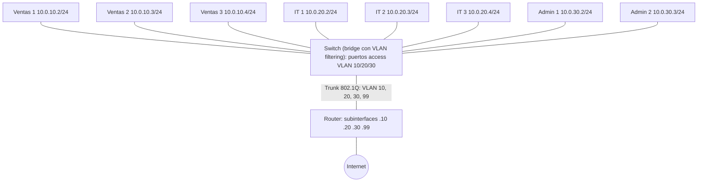

<p class="tema-num">LABORATORIO 05</p>

# Conmutación y Segmentación de Red

## Contexto empresarial

La empresa **Networking SecOps** ha crecido y ahora tiene **tres departamentos** con necesidades de red independientes:

-   **Ventas**: 10 empleados, necesitan acceso a Internet y a un servidor de archivos.
-   **IT/Sistemas**: 6 empleados, administran servidores y necesitan acceso restringido.
-   **Administración**: 4 empleados, incluyendo directivos que requieren acceso a datos sensibles.

La red actual tiene subredes separadas (Ventas e IT) pero **comparten el mismo switch físico**. Esto significa que:

-   El tráfico broadcast de un departamento afecta a los otros.
-   No hay separación a nivel de capa 2: todos comparten el mismo dominio de broadcast.
-   Un problema de capa 2 (por ejemplo, una tormenta de broadcast) en un departamento puede afectar a los demás.

Se necesita **segmentar la red lógicamente en capa 2** usando **VLANs** para:

-   Separar los dominios de broadcast entre departamentos.
-   Reducir la exposición a nivel de enlace (un puerto de un departamento deja de recibir las tramas de otro).
-   Facilitar la administración y expansión.

!!! warning "Las VLAN no son por sí solas una barrera de seguridad suficiente"
    Las VLAN **separan dominios de broadcast**. La comunicación **entre** ellas pasa por el router y debe controlarse mediante **enrutamiento y políticas de filtrado** (véase el apartado «Seguridad entre VLAN»). Una VLAN mal configurada (por ejemplo, un trunk que admite VLAN que no debería) también puede romper la separación.

!!! note "Continuidad con el laboratorio 04"
    Aquí el direccionamiento cambia: pasamos de las subredes VLSM de `10.0.0.0/24` a redes `/24` independientes por VLAN (`10.0.10.0/24`, `10.0.20.0/24`, `10.0.30.0/24`). No es una corrección del laboratorio 04: es **otro escenario**. En el 04 el objetivo era practicar el reparto de direcciones; en este, estudiar la segmentación de capa 2, para lo cual cada VLAN con su propia subred `/24` resulta más clara. Ambas tablas **no describen la misma infraestructura**.

## Problema inicial

-   Todos los clientes están en el mismo switch físico (bridge).
-   Las subredes están separadas lógicamente, pero comparten el mismo dominio de broadcast.
-   Se necesitan **3 VLANs**: VLAN 10 (Ventas), VLAN 20 (IT), VLAN 30 (Administración).
-   El router debe enrutar entre VLANs mediante **subinterfaces (Router-on-a-Stick)**.
-   El switch debe soportar **trunking (802.1Q)** para transportar múltiples VLANs.

## Objetivos del laboratorio

1.  Comprender el concepto de **direcciones MAC** y su papel en la conmutación.
2.  Implementar **VLANs** para segmentar una red física en dominios lógicos.
3.  Configurar **trunking (IEEE 802.1Q)** para transportar múltiples VLANs.
4.  Implementar **Router-on-a-Stick** con subinterfaces para enrutar entre VLANs.
5.  Analizar los **dominios de broadcast** y cómo las VLANs los segmentan.
6.  Diferenciar la **separación en capa 2** (VLAN) del **control del tráfico entre segmentos** (enrutamiento y filtrado).

## Herramientas necesarias

-   Linux con privilegios de superusuario.
-   Comandos: `ip`, `ping`, `tcpdump`, `bridge`, `vlan`.

## Diseño de VLANs y direccionamiento

| VLAN | Nombre | Subred | Gateway |
|------|--------|--------|---------|
| 10 | Ventas | 10.0.10.0/24 | 10.0.10.1 |
| 20 | IT | 10.0.20.0/24 | 10.0.20.1 |
| 30 | Administración | 10.0.30.0/24 | 10.0.30.1 |
| 99 | Gestión (plano de administración, etiquetada) | 10.0.99.0/30 | - (sin gateway: red de gestión local) |

**VLAN 99 — plano de gestión.** No es una VLAN departamental ni un enlace de tránsito hacia otra red: es la red por la que se **administran los equipos de red**. Sus dos únicos miembros son el router (`10.0.99.1/30`, subinterfaz `veth-rs.99`) y la interfaz de gestión del switch (`10.0.99.2/30`, interfaz `br0.99`). Ningún cliente pertenece a ella. Tiene sentido un `/30` porque solo hay dos dispositivos.

**Gateways.** La dirección `.1` de cada VLAN corresponde a una **subinterfaz del router** (`veth-rs.10`, `.20`, `.30`). Quien enruta entre VLAN es el router; el switch, que opera en capa 2, no enruta.

## Topología



**Access y trunk.** Un puerto **access** pertenece a una sola VLAN; el equipo final transmite y recibe tramas **sin etiqueta** y el switch las etiqueta internamente (`pvid untagged`). Un puerto **trunk** transporta varias VLAN a la vez y las tramas viajan **con etiqueta 802.1Q** (4 bytes que incluyen el identificador de VLAN), de modo que el otro extremo sabe a qué VLAN pertenece cada una.

## Construcción de la red

### Paso 1: Limpiar configuración anterior

```bash
ip netns del ventas1 2>/dev/null || true
ip netns del ventas2 2>/dev/null || true
ip netns del ventas3 2>/dev/null || true
ip netns del it1 2>/dev/null || true
ip netns del it2 2>/dev/null || true
ip netns del it3 2>/dev/null || true
ip netns del admin1 2>/dev/null || true
ip netns del admin2 2>/dev/null || true
ip netns del router 2>/dev/null || true
ip netns del switch 2>/dev/null || true
```

### Paso 2: Crear namespaces

```bash
ip netns add router
ip netns add switch
ip netns add ventas1
ip netns add ventas2
ip netns add ventas3
ip netns add it1
ip netns add it2
ip netns add it3
ip netns add admin1
ip netns add admin2
```

### Paso 3: Crear bridge con VLAN filtering

```bash
ip netns exec switch ip link add br0 type bridge
ip netns exec switch ip link set br0 type bridge vlan_filtering 1 vlan_default_pvid 0
ip netns exec switch ip link set br0 up
```

### Paso 4: Configurar clientes VLAN 10 (Ventas)

```bash
# Ventas 1
ip link add veth-v1 type veth peer name veth-sv1
ip link set veth-v1 netns ventas1
ip link set veth-sv1 netns switch
ip netns exec ventas1 ip addr add 10.0.10.2/24 dev veth-v1
ip netns exec ventas1 ip link set veth-v1 up
ip netns exec ventas1 ip route add default via 10.0.10.1
ip netns exec switch ip link set veth-sv1 master br0
ip netns exec switch ip link set veth-sv1 up
ip netns exec switch bridge vlan add dev veth-sv1 vid 10 pvid untagged

# Ventas 2
ip link add veth-v2 type veth peer name veth-sv2
ip link set veth-v2 netns ventas2
ip link set veth-sv2 netns switch
ip netns exec ventas2 ip addr add 10.0.10.3/24 dev veth-v2
ip netns exec ventas2 ip link set veth-v2 up
ip netns exec ventas2 ip route add default via 10.0.10.1
ip netns exec switch ip link set veth-sv2 master br0
ip netns exec switch ip link set veth-sv2 up
ip netns exec switch bridge vlan add dev veth-sv2 vid 10 pvid untagged

# Ventas 3
ip link add veth-v3 type veth peer name veth-sv3
ip link set veth-v3 netns ventas3
ip link set veth-sv3 netns switch
ip netns exec ventas3 ip addr add 10.0.10.4/24 dev veth-v3
ip netns exec ventas3 ip link set veth-v3 up
ip netns exec ventas3 ip route add default via 10.0.10.1
ip netns exec switch ip link set veth-sv3 master br0
ip netns exec switch ip link set veth-sv3 up
ip netns exec switch bridge vlan add dev veth-sv3 vid 10 pvid untagged
```

### Paso 5: Configurar clientes VLAN 20 (IT)

```bash
# IT 1
ip link add veth-i1 type veth peer name veth-si1
ip link set veth-i1 netns it1
ip link set veth-si1 netns switch
ip netns exec it1 ip addr add 10.0.20.2/24 dev veth-i1
ip netns exec it1 ip link set veth-i1 up
ip netns exec it1 ip route add default via 10.0.20.1
ip netns exec switch ip link set veth-si1 master br0
ip netns exec switch ip link set veth-si1 up
ip netns exec switch bridge vlan add dev veth-si1 vid 20 pvid untagged

# IT 2
ip link add veth-i2 type veth peer name veth-si2
ip link set veth-i2 netns it2
ip link set veth-si2 netns switch
ip netns exec it2 ip addr add 10.0.20.3/24 dev veth-i2
ip netns exec it2 ip link set veth-i2 up
ip netns exec it2 ip route add default via 10.0.20.1
ip netns exec switch ip link set veth-si2 master br0
ip netns exec switch ip link set veth-si2 up
ip netns exec switch bridge vlan add dev veth-si2 vid 20 pvid untagged

# IT 3
ip link add veth-i3 type veth peer name veth-si3
ip link set veth-i3 netns it3
ip link set veth-si3 netns switch
ip netns exec it3 ip addr add 10.0.20.4/24 dev veth-i3
ip netns exec it3 ip link set veth-i3 up
ip netns exec it3 ip route add default via 10.0.20.1
ip netns exec switch ip link set veth-si3 master br0
ip netns exec switch ip link set veth-si3 up
ip netns exec switch bridge vlan add dev veth-si3 vid 20 pvid untagged
```

### Paso 6: Configurar clientes VLAN 30 (Administración)

```bash
# Admin 1
ip link add veth-a1 type veth peer name veth-sa1
ip link set veth-a1 netns admin1
ip link set veth-sa1 netns switch
ip netns exec admin1 ip addr add 10.0.30.2/24 dev veth-a1
ip netns exec admin1 ip link set veth-a1 up
ip netns exec admin1 ip route add default via 10.0.30.1
ip netns exec switch ip link set veth-sa1 master br0
ip netns exec switch ip link set veth-sa1 up
ip netns exec switch bridge vlan add dev veth-sa1 vid 30 pvid untagged

# Admin 2
ip link add veth-a2 type veth peer name veth-sa2
ip link set veth-a2 netns admin2
ip link set veth-sa2 netns switch
ip netns exec admin2 ip addr add 10.0.30.3/24 dev veth-a2
ip netns exec admin2 ip link set veth-a2 up
ip netns exec admin2 ip route add default via 10.0.30.1
ip netns exec switch ip link set veth-sa2 master br0
ip netns exec switch ip link set veth-sa2 up
ip netns exec switch bridge vlan add dev veth-sa2 vid 30 pvid untagged
```

### Paso 7: Configurar trunk (802.1Q)

```bash
ip link add veth-sr type veth peer name veth-rs
ip link set veth-sr netns switch
ip link set veth-rs netns router
ip netns exec switch ip link set veth-sr master br0
ip netns exec switch ip link set veth-sr up
ip netns exec switch bridge vlan add dev veth-sr vid 10
ip netns exec switch bridge vlan add dev veth-sr vid 20
ip netns exec switch bridge vlan add dev veth-sr vid 30
ip netns exec switch bridge vlan add dev veth-sr vid 99
```

Al añadir las VLAN **sin** `pvid untagged`, el puerto `veth-sr` las transporta **etiquetadas**: esto es lo que lo convierte en trunk. Las tramas sin etiqueta que llegaran a este puerto no se asignarían a ninguna VLAN (por `vlan_default_pvid 0`) y se descartarían.

**Interfaz de gestión del switch (VLAN 99).** El propio bridge participa en la VLAN 99 mediante una interfaz VLAN sobre `br0`:

```bash
ip netns exec switch bridge vlan add dev br0 vid 99 self
ip netns exec switch ip link add link br0 name br0.99 type vlan id 99
ip netns exec switch ip addr add 10.0.99.2/30 dev br0.99
ip netns exec switch ip link set br0.99 up
```

### Paso 8: Configurar Router-on-a-Stick

```bash
ip netns exec router sysctl -w net.ipv4.ip_forward=1
ip netns exec router ip link add link veth-rs name veth-rs.10 type vlan id 10
ip netns exec router ip link add link veth-rs name veth-rs.20 type vlan id 20
ip netns exec router ip link add link veth-rs name veth-rs.30 type vlan id 30
ip netns exec router ip link add link veth-rs name veth-rs.99 type vlan id 99
ip netns exec router ip addr add 10.0.10.1/24 dev veth-rs.10
ip netns exec router ip addr add 10.0.20.1/24 dev veth-rs.20
ip netns exec router ip addr add 10.0.30.1/24 dev veth-rs.30
ip netns exec router ip addr add 10.0.99.1/30 dev veth-rs.99
ip netns exec router ip link set veth-rs up
ip netns exec router ip link set veth-rs.10 up
ip netns exec router ip link set veth-rs.20 up
ip netns exec router ip link set veth-rs.30 up
ip netns exec router ip link set veth-rs.99 up
```

Cada subinterfaz recibe solo las tramas etiquetadas con su VLAN y se convierte en el **gateway** de esa subred; al reenviar entre subinterfaces, el router quita una etiqueta y pone otra. Este es el esquema *Router-on-a-Stick*: un único enlace físico (o virtual) con varias subinterfaces lógicas.

### Paso 9: Configurar NAT y salida a Internet

```bash
ip link add veth-host type veth peer name veth-wan
ip link set veth-wan netns router
ip netns exec router ip addr add 192.168.1.2/24 dev veth-wan
ip netns exec router ip link set veth-wan up
ip addr add 192.168.1.1/24 dev veth-host
ip link set veth-host up

# El router necesita ruta por defecto hacia el host y NAT hacia fuera
ip netns exec router ip route add default via 192.168.1.1
ip netns exec router iptables -t nat -A POSTROUTING -o veth-wan -j MASQUERADE
ip netns exec router iptables -A FORWARD -i 'veth-rs.+' -o veth-wan -j ACCEPT
ip netns exec router iptables -A FORWARD -i veth-wan -o 'veth-rs.+' -m state --state RELATED,ESTABLISHED -j ACCEPT

# El host reenvía y traduce hacia tu red real (cambia eth0 por tu interfaz de salida)
sysctl -w net.ipv4.ip_forward=1
iptables -t nat -C POSTROUTING -s 192.168.1.0/24 -o eth0 -j MASQUERADE 2>/dev/null || \
  iptables -t nat -A POSTROUTING -s 192.168.1.0/24 -o eth0 -j MASQUERADE
```

El router traduce (NAT) todo lo que sale por `veth-wan`, así que el host solo ve la red `192.168.1.0/24` y **no necesita una ruta de retorno** hacia las VLAN.

### Paso 10: Verificar conectividad

```bash
# Misma VLAN
ip netns exec ventas1 ping -c 4 10.0.10.3

# Entre VLANs (vía router)
ip netns exec ventas1 ping -c 4 10.0.20.2

# Internet (si el host tiene salida real)
ip netns exec ventas1 ping -c 4 8.8.8.8

# Gestión (VLAN 99): router ↔ switch
ip netns exec router ping -c 2 10.0.99.2
```

**Resultado esperado:** 0 % de pérdida en todas. Comprueba también el aislamiento de capa 2: Ventas 1 **no** puede alcanzar a IT 1 por ARP (`ip netns exec ventas1 ping -c 1 10.0.20.2` solo funciona porque pasa por el router; si le configurases una IP de `10.0.20.0/24` y quitaras el gateway, no llegaría).

### Seguridad entre VLAN

Con la política por defecto del router (`FORWARD` en `ACCEPT`), **cualquier VLAN puede comunicarse con cualquier otra**: el ping de Ventas a IT lo demuestra. La separación de VLAN no es, por tanto, una barrera de seguridad suficiente. Para aplicar una política, el filtrado se hace en el router. Por ejemplo, impedir que Ventas llegue a Administración:

```bash
ip netns exec router iptables -I FORWARD -i veth-rs.10 -o veth-rs.30 -j DROP
ip netns exec ventas1 ping -c 2 -W 1 10.0.30.2   # sin respuesta
ip netns exec router iptables -D FORWARD -i veth-rs.10 -o veth-rs.30 -j DROP   # deshacer
```

Una política real debería partir de «denegar por defecto» y permitir solo los flujos necesarios; ese enfoque se desarrolla en los laboratorios 08 y 15.

## Observación

```bash
# Ver VLANs
ip netns exec switch bridge vlan show

# Capturar trunk
ip netns exec switch tcpdump -i veth-sr -n -e -v
```

En `bridge vlan show` verás `veth-sv1` con `10 PVID Egress Untagged` (acceso VLAN 10) y `veth-sr` con las VLAN 10, 20, 30 y 99 **sin** PVID ni *Untagged* (trunk etiquetado). En la captura del trunk, `tcpdump -e` mostrará `vlan 10, p 0` (o 20, 30) en cada trama: es la etiqueta 802.1Q. Si no la ves, añade `-Q` o captura en `veth-rs` del lado del router; algunas versiones ocultan la etiqueta cuando el kernel la extrae como metadato.

## Conclusiones técnicas

En este laboratorio hemos implementado VLANs, trunking (802.1Q) y Router-on-a-Stick para segmentar la red en dominios de broadcast independientes.

-   Las **VLAN separan dominios de broadcast en capa 2**; no son por sí solas una barrera de seguridad.
-   El **enrutamiento entre VLAN** lo realiza el router (subinterfaces), no el switch de capa 2.
-   El tráfico entre VLAN solo se restringe con **filtrado en el router**.
-   La VLAN 99 representa el plano de **gestión** de los dispositivos de red.

---

**¡Laboratorio 05 completado!** Continúa con el **Laboratorio 06**.
