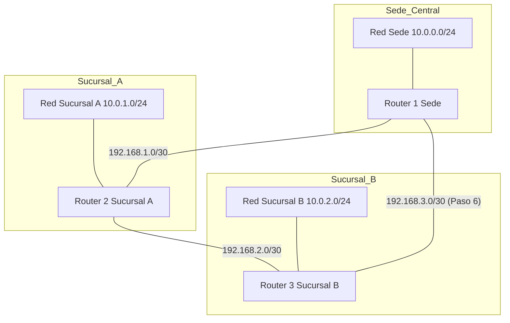

<p class="tema-num">LABORATORIO 06</p>

# Enrutamiento y Conectividad entre Redes

## Contexto empresarial

La empresa **Networking SecOps** ha implementado exitosamente su red con VLANs y Router-on-a-Stick. Ahora necesita **conectar su sede central con dos sucursales** (Sucursal A y Sucursal B) que se encuentran en ubicaciones geográficas diferentes. Cada sucursal tiene su propia red local y necesita comunicarse con la sede y entre sí.

El equipo de redes ha decidido implementar:

1. **Rutas estáticas** para conectar las oficinas, con una ruta alternativa (métricas) para tolerar fallos.
2. **Túneles GRE** para conectar redes no contiguas a través de Internet.

!!! note "Alcance: enrutamiento dinámico"
    Este laboratorio trabaja **solo con enrutamiento estático**. Las rutas estáticas no se adaptan solas a un fallo remoto; esa limitación es la que justifica un protocolo dinámico. **OSPF se implementa de forma real con FRRouting en el Laboratorio 15.**

## Problema inicial

- La sede central tiene una red con VLANs (Ventas, IT, Administración).
- Las sucursales A y B tienen sus propias redes locales.
- No hay conectividad entre las oficinas.
- Se necesita enrutar el tráfico entre todas las redes.

## Objetivos del laboratorio

1.  Comprender los principios del enrutamiento IP.
2.  Configurar **rutas estáticas** y la **ruta por defecto**.
3.  Comprender por qué el enrutamiento estático no basta a escala (OSPF se practica en el Laboratorio 15).
4.  Analizar la **tabla de enrutamiento** y el proceso de **longest prefix match**.
5.  Configurar un **túnel GRE** para interconectar redes remotas.
6.  Verificar la conectividad entre todas las oficinas.

## Topología

La topología consta de tres routers (R1, R2, R3) que representan la sede y dos sucursales. Para centrarnos en el enrutamiento, la sede se simplifica a una sola LAN (`10.0.0.0/24`): las VLAN del Laboratorio 05 no se vuelven a montar aquí.



**Redes de tránsito.** Existen tres redes punto a punto distintas, una por enlace entre routers:

-   `192.168.1.0/30`: R1–R2.
-   `192.168.2.0/30`: R2–R3.
-   `192.168.3.0/30`: R1–R3 (se añade en el Paso 6).

Además, cada router tiene conectada su propia LAN (`10.0.0.0/24`, `10.0.1.0/24`, `10.0.2.0/24`).

**Direccionamiento:**

| Dispositivo | Interfaz | Dirección IP |
|-------------|----------|--------------|
| R1 (Sede) | eth0 (LAN) | 10.0.0.1/24 |
| R1 (Sede) | eth1 (R1-R2) | 192.168.1.1/30 |
| R1 (Sede) | eth2 (R1-R3, Paso 6) | 192.168.3.1/30 |
| R2 (Sucursal A) | eth0 (LAN) | 10.0.1.1/24 |
| R2 (Sucursal A) | eth1 (R1-R2) | 192.168.1.2/30 |
| R2 (Sucursal A) | eth2 (R2-R3) | 192.168.2.1/30 |
| R3 (Sucursal B) | eth0 (LAN) | 10.0.2.1/24 |
| R3 (Sucursal B) | eth1 (R2-R3) | 192.168.2.2/30 |
| R3 (Sucursal B) | eth2 (R1-R3, Paso 6) | 192.168.3.2/30 |
| Cliente Sede | - | 10.0.0.10/24 |
| Cliente Sucursal A | - | 10.0.1.10/24 |
| Cliente Sucursal B | - | 10.0.2.10/24 |

## Construcción de la red

### Paso 0: Limpiar el laboratorio anterior

Este laboratorio construye una topología nueva. Eliminamos lo que dejó el Laboratorio 05 (al borrar un namespace desaparecen también sus interfaces y el extremo `veth-host` del host):

```bash
for ns in ventas1 ventas2 ventas3 it1 it2 it3 admin1 admin2 router switch; do
  sudo ip netns del $ns 2>/dev/null || true
done
sudo ip link del veth-host 2>/dev/null || true
```

### Paso 1: Crear namespaces y enlaces

Creamos tres routers y tres clientes (uno por oficina).

```bash
# Routers
sudo ip netns add R1
sudo ip netns add R2
sudo ip netns add R3

# Clientes
sudo ip netns add clienteSede
sudo ip netns add clienteSucA
sudo ip netns add clienteSucB
```

### Paso 2: Conectar routers y clientes

```bash
# Enlace R1 - R2
sudo ip link add veth-r1r2 type veth peer name veth-r2r1
sudo ip link set veth-r1r2 netns R1
sudo ip link set veth-r2r1 netns R2

# Enlace R2 - R3
sudo ip link add veth-r2r3 type veth peer name veth-r3r2
sudo ip link set veth-r2r3 netns R2
sudo ip link set veth-r3r2 netns R3

# Cliente Sede -> R1
sudo ip link add veth-c1 type veth peer name veth-r1c
sudo ip link set veth-c1 netns clienteSede
sudo ip link set veth-r1c netns R1

# Cliente Sucursal A -> R2
sudo ip link add veth-c2 type veth peer name veth-r2c
sudo ip link set veth-c2 netns clienteSucA
sudo ip link set veth-r2c netns R2

# Cliente Sucursal B -> R3
sudo ip link add veth-c3 type veth peer name veth-r3c
sudo ip link set veth-c3 netns clienteSucB
sudo ip link set veth-r3c netns R3
```

### Paso 3: Asignar direcciones IP y activar interfaces

**Router R1 (Sede):**

```bash
sudo ip netns exec R1 ip addr add 10.0.0.1/24 dev veth-r1c
sudo ip netns exec R1 ip addr add 192.168.1.1/30 dev veth-r1r2
sudo ip netns exec R1 ip link set veth-r1c up
sudo ip netns exec R1 ip link set veth-r1r2 up
sudo ip netns exec R1 ip link set lo up
```

**Router R2 (Sucursal A):**

```bash
sudo ip netns exec R2 ip addr add 10.0.1.1/24 dev veth-r2c
sudo ip netns exec R2 ip addr add 192.168.1.2/30 dev veth-r2r1
sudo ip netns exec R2 ip addr add 192.168.2.1/30 dev veth-r2r3
sudo ip netns exec R2 ip link set veth-r2c up
sudo ip netns exec R2 ip link set veth-r2r1 up
sudo ip netns exec R2 ip link set veth-r2r3 up
sudo ip netns exec R2 ip link set lo up
```

**Router R3 (Sucursal B):**

```bash
sudo ip netns exec R3 ip addr add 10.0.2.1/24 dev veth-r3c
sudo ip netns exec R3 ip addr add 192.168.2.2/30 dev veth-r3r2
sudo ip netns exec R3 ip link set veth-r3c up
sudo ip netns exec R3 ip link set veth-r3r2 up
sudo ip netns exec R3 ip link set lo up
```

**Clientes:**

```bash
# Sede
sudo ip netns exec clienteSede ip addr add 10.0.0.10/24 dev veth-c1
sudo ip netns exec clienteSede ip link set veth-c1 up
sudo ip netns exec clienteSede ip link set lo up

# Sucursal A
sudo ip netns exec clienteSucA ip addr add 10.0.1.10/24 dev veth-c2
sudo ip netns exec clienteSucA ip link set veth-c2 up
sudo ip netns exec clienteSucA ip link set lo up

# Sucursal B
sudo ip netns exec clienteSucB ip addr add 10.0.2.10/24 dev veth-c3
sudo ip netns exec clienteSucB ip link set veth-c3 up
sudo ip netns exec clienteSucB ip link set lo up
```

### Paso 4: Habilitar el reenvío y configurar rutas estáticas

**Cómo decide un router el siguiente salto.** Para cada paquete, el router busca en su tabla la ruta con el prefijo **más específico** que contenga la dirección de destino (*longest prefix match*). Esa ruta indica el siguiente salto (`via`) o la interfaz de salida (`dev`). Un router solo conoce automáticamente las redes **directamente conectadas**; las LAN que están *detrás* de otro router no las conoce hasta que se le indica (ruta estática) o las aprende (protocolo dinámico). Por eso R1 necesita una ruta hacia `10.0.1.0/24` y `10.0.2.0/24`, y cada router otra hacia las LAN remotas.

Un router solo reenvía paquetes entre interfaces si `ip_forward` vale 1. En un namespace nuevo vale 0, así que hay que activarlo **en cada router**:

```bash
for r in R1 R2 R3; do
  sudo ip netns exec $r sysctl -w net.ipv4.ip_forward=1
done
```

Las rutas hacia la sucursal más lejana se declaran con `metric 100` para poder añadir después, sin conflicto, una ruta mejor (Paso 6). Dos rutas al mismo prefijo con la misma métrica no pueden coexistir: `ip route add` respondería `File exists`.

**En R1 (Sede):**

```bash
sudo ip netns exec R1 ip route add 10.0.1.0/24 via 192.168.1.2
sudo ip netns exec R1 ip route add 10.0.2.0/24 via 192.168.1.2 metric 100
```

**En R2 (Sucursal A):**

```bash
sudo ip netns exec R2 ip route add 10.0.0.0/24 via 192.168.1.1
sudo ip netns exec R2 ip route add 10.0.2.0/24 via 192.168.2.2
```

**En R3 (Sucursal B):**

```bash
sudo ip netns exec R3 ip route add 10.0.0.0/24 via 192.168.2.1 metric 100
sudo ip netns exec R3 ip route add 10.0.1.0/24 via 192.168.2.1
```

**Ruta por defecto en clientes:**

```bash
sudo ip netns exec clienteSede ip route add default via 10.0.0.1
sudo ip netns exec clienteSucA ip route add default via 10.0.1.1
sudo ip netns exec clienteSucB ip route add default via 10.0.2.1
```

### Paso 5: Verificar conectividad

```bash
# Desde Sede a Sucursal A
sudo ip netns exec clienteSede ping -c 4 10.0.1.10

# Desde Sucursal A a Sucursal B
sudo ip netns exec clienteSucA ping -c 4 10.0.2.10

# Ver tabla de enrutamiento en R1
sudo ip netns exec R1 ip route show
```

**Resultado esperado:** 0% de pérdida en todos los pings.

### Ruta por defecto frente a ruta específica

Hasta ahora todas las rutas entre oficinas son **específicas** (un prefijo concreto, como `10.0.1.0/24`). Una **ruta por defecto** (`default`, es decir, `0.0.0.0/0`) es la que se usa **solo cuando no existe una coincidencia más específica** en la tabla. Los clientes de este laboratorio la usan: no saben dónde está cada red remota, así que envían todo lo que no es local a su router. Una ruta por defecto en un router de sucursal serviría, por ejemplo, para enviar a la sede todo lo que no sea su LAN; en este laboratorio no la configuramos en los routers porque queremos ver el *longest prefix match* con rutas específicas. Puedes comprobar cuál se elige con:

```bash
sudo ip netns exec R1 ip route get 10.0.2.10
```

### Paso 6: Agregar un enlace directo R1-R3 (camino preferido)

Un enlace directo es un camino más corto. Lo agregamos y le damos una **métrica menor (50)**: Linux elige siempre la ruta de menor métrica, y deja la ruta por R2 (métrica 100) como respaldo.

```bash
# Crear enlace R1-R3
sudo ip link add veth-r1r3 type veth peer name veth-r3r1
sudo ip link set veth-r1r3 netns R1
sudo ip link set veth-r3r1 netns R3
sudo ip netns exec R1 ip addr add 192.168.3.1/30 dev veth-r1r3
sudo ip netns exec R1 ip link set veth-r1r3 up
sudo ip netns exec R3 ip addr add 192.168.3.2/30 dev veth-r3r1
sudo ip netns exec R3 ip link set veth-r3r1 up

# Rutas por el enlace directo (preferidas por su métrica menor)
sudo ip netns exec R1 ip route add 10.0.2.0/24 via 192.168.3.2 metric 50
sudo ip netns exec R3 ip route add 10.0.0.0/24 via 192.168.3.1 metric 50
```

Comprueba qué camino usa ahora el tráfico (debe pasar directamente por R3):

```bash
sudo ip netns exec R1 ip route show 10.0.2.0/24
sudo ip netns exec clienteSede traceroute -n 10.0.2.10
```

### Paso 7: Simular un fallo y verificar la redundancia

Tiramos el **enlace preferido** (R1-R3) por **sus dos extremos**. Con rutas estáticas, un router solo "sabe" que un enlace cayó si es uno de sus propios enlaces: por eso el fallo debe afectar a ambos routers del enlace.

```bash
sudo ip netns exec R1 ip link set veth-r1r3 down
sudo ip netns exec R3 ip link set veth-r3r1 down

# La ruta de métrica 50 desaparece y entra la de métrica 100 (por R2)
sudo ip netns exec R1 ip route show 10.0.2.0/24
sudo ip netns exec clienteSede ping -c 4 10.0.2.10
sudo ip netns exec clienteSede traceroute -n 10.0.2.10
```

**Resultado esperado:** 0% de pérdida y un salto adicional (R2, `192.168.1.2`) en el `traceroute`.

!!! info "Enlaces redundantes no son convergencia automática"
    Tener un camino alternativo **configurado** no equivale a tener un mecanismo de **convergencia**. Aquí la conmutación al respaldo funciona porque el fallo es **local** (el propio router ve su interfaz caer y el kernel retira la ruta). Ante un fallo remoto, o con la interfaz activa pero un camino roto más allá, la ruta estática seguiría instalada y el tráfico se perdería. Un protocolo dinámico (OSPF) intercambia información de topología y recalcula por sí mismo.

!!! warning "Limitación de las rutas estáticas"
    Si en cambio cae el enlace R2-R3 (un fallo **remoto** para R1), R1 seguiría enviando tráfico por R2 y se perdería: las rutas estáticas no detectan fallos que no son de su propio enlace. Para eso existen los protocolos dinámicos (Laboratorio 15).

Restablece el enlace antes de continuar:

```bash
sudo ip netns exec R1 ip link set veth-r1r3 up
sudo ip netns exec R3 ip link set veth-r3r1 up
sudo ip netns exec R1 ip route replace 10.0.2.0/24 via 192.168.3.2 metric 50
sudo ip netns exec R3 ip route replace 10.0.0.0/24 via 192.168.3.1 metric 50
```

### Paso 8: Configurar túnel GRE

**GRE** (Generic Routing Encapsulation) **encapsula paquetes de una red dentro de otros paquetes IP** (protocolo IP 47), de modo que dos extremos pueden comportarse como si tuvieran un enlace punto a punto entre ellos. Cuatro precisiones:

-   Los **extremos del túnel deben ser alcanzables** entre sí por IP (aquí, `192.168.3.1` y `192.168.3.2` sobre el enlace directo del Paso 6).
-   **Crear el túnel no crea rutas** hacia las redes remotas: solo existe la red del propio túnel (`10.100.0.0/30`). Hay que añadir rutas que usen `gre1` como salida.
-   **GRE no cifra ni autentica** el tráfico. Para protegerlo se combina con IPsec (laboratorio 09).
-   El encabezado adicional reduce la MTU efectiva del túnel (en Linux, `gre1` suele quedar en 1476).

Necesitan el módulo `ip_gre` del kernel (`sudo modprobe ip_gre`). El túnel se monta sobre el enlace directo R1-R3 del Paso 6, que debe estar activo. En un caso real los extremos estarían a través de Internet; aquí es un enlace virtual.

```bash
# En R1
sudo ip netns exec R1 ip tunnel add gre1 mode gre remote 192.168.3.2 local 192.168.3.1 ttl 255
sudo ip netns exec R1 ip addr add 10.100.0.1/30 dev gre1
sudo ip netns exec R1 ip link set gre1 up

# En R3
sudo ip netns exec R3 ip tunnel add gre1 mode gre remote 192.168.3.1 local 192.168.3.2 ttl 255
sudo ip netns exec R3 ip addr add 10.100.0.2/30 dev gre1
sudo ip netns exec R3 ip link set gre1 up

# Verificar túnel
sudo ip netns exec R1 ping -c 4 10.100.0.2
```

Para que el túnel transporte tráfico entre las LAN hay que dirigir hacia él las rutas correspondientes. Ejemplo (con métrica menor que las rutas anteriores, y deshaciéndolo después):

```bash
sudo ip netns exec R1 ip route add 10.0.2.0/24 via 10.100.0.2 metric 20
sudo ip netns exec R3 ip route add 10.0.0.0/24 via 10.100.0.1 metric 20
sudo ip netns exec R1 ip route get 10.0.2.10     # sale por gre1
sudo ip netns exec clienteSede ping -c 2 10.0.2.10

# Deshacer
sudo ip netns exec R1 ip route del 10.0.2.0/24 via 10.100.0.2 metric 20
sudo ip netns exec R3 ip route del 10.0.0.0/24 via 10.100.0.1 metric 20
```

Fíjate en que `traceroute` ahora ve el túnel como **un solo salto** (`10.100.0.2`).

## Análisis de la tabla de enrutamiento

```bash
sudo ip netns exec R1 ip route show
```

**Interpretación de la salida:**
- Las rutas conectadas directamente (directas) aparecen con `dev` y `scope link`.
- Las rutas estáticas aparecen con `via` (el siguiente salto) y, si se indicó, `metric`.
- La ruta por defecto (si existe) aparece como `default via …` (equivale a `0.0.0.0/0`); en R1 no hay ninguna.
- Para ver qué ruta se **elegiría** para un destino concreto, usa `ip route get`.

## Ejercicios prácticos

### Ejercicio 1: Agregar una nueva oficina

Agrega una cuarta oficina (Sucursal C) con red 10.0.3.0/24, conéctala a R2 y configura las rutas necesarias para que todos los clientes se comuniquen.

### Ejercicio 2: Verificar el TTL

Desde el cliente Sede, haz un `traceroute` a la Sucursal B y observa cómo los routers decrementan el TTL.

```bash
sudo ip netns exec clienteSede traceroute -n 10.0.2.10
```

### Ejercicio 3: Fallo remoto y rutas de respaldo

Baja el enlace R2-R3 por **ambos extremos** (`veth-r2r3` en R2 y `veth-r3r2` en R3) y comprueba que `clienteSucA` ya no alcanza a `clienteSucB`, aunque físicamente exista el camino R2 → R1 → R3. Después agrega rutas de respaldo con métrica 100 (en R2 hacia `192.168.1.1`; en R3, para la Sucursal A, hacia `192.168.3.1`) y vuelve a probar.

## Errores comunes y soluciones

| Error | Causa | Solución |
|-------|-------|----------|
| Ping falla entre oficinas | Falta ruta de retorno. | Verificar rutas en ambos sentidos. |
| Traceroute muestra asteriscos | Firewall bloquea ICMP. | Permitir ICMP en las políticas. |
| El túnel GRE no funciona | IPs de extremos no accesibles. | Verificar conectividad entre extremos. |

## Conceptos clave del Tema 6 aplicados

| Concepto | Aplicación en el laboratorio |
|----------|------------------------------|
| Enrutamiento | Conexión entre redes diferentes |
| Ruta estática | Configuración manual de rutas |
| Ruta por defecto | Gateway para el tráfico sin coincidencia más específica (la usan los clientes) |
| Tabla de enrutamiento | `ip route show` en cada router |
| Longest prefix match | Selección de ruta más específica |
| Túnel GRE | Conexión de redes no contiguas |

## Conclusiones técnicas

En este laboratorio hemos:

1.  Implementado una topología con tres routers interconectados.
2.  Configurado **rutas estáticas** para interconectar las oficinas.
3.  Analizado la **tabla de enrutamiento** y el proceso de selección.
4.  Agregado **enlaces redundantes** con rutas de respaldo (útiles ante fallos locales, no un mecanismo de convergencia).
5.  Configurado un **túnel GRE** para conectar redes no contiguas (encapsula, pero no cifra).

El enrutamiento es el corazón de la comunicación entre redes. Las rutas estáticas son simples pero no escalan ni reaccionan a fallos remotos. Los protocolos dinámicos como OSPF funcionan de otro modo: los routers establecen adyacencias, intercambian el estado de sus enlaces, construyen una base de datos de topología común y calculan los caminos más cortos (SPF), reconvergiendo cuando algo cambia. Se implementa de forma real en el Laboratorio 15. Los túneles GRE permiten extender redes a través de infraestructuras IP.

## Preparación para el siguiente laboratorio

En el **Laboratorio 07** exploraremos **protocolos y servicios de red** como DHCP, DNS, NAT y firewalls.

---

**¡Laboratorio 06 completado!** Has implementado enrutamiento entre redes. Continúa con el **Laboratorio 07**.
