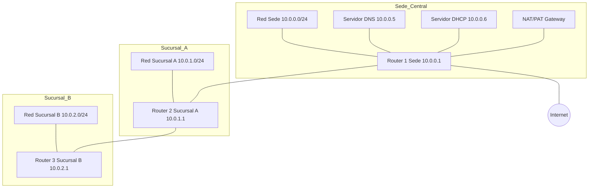

<p class="tema-num">LABORATORIO 07</p>

# Protocolos y Servicios de Red

## Contexto empresarial

La empresa **Networking SecOps** ya tiene su infraestructura de red funcionando con enrutamiento entre la sede y las sucursales (Laboratorio 06). Ahora necesita implementar **servicios de red esenciales** para que los usuarios puedan trabajar eficientemente:

1. **DNS** – Resolución de nombres para acceder a servidores por nombre en lugar de IP.
2. **DHCP** – Asignación automática de direcciones IP a los clientes.
3. **NAT/PAT** – Permitir que los clientes de la red interna accedan a Internet.
4. **TCP/UDP** – Comprender la diferencia entre ambos protocolos.

El equipo de TI ha decidido implementar estos servicios en la sede central y documentar su funcionamiento para futuras expansiones.

## Problema inicial

- Los clientes tienen direcciones IP configuradas manualmente (administración tediosa).
- No hay un servidor DNS interno que resuelva nombres locales.
- Los clientes de la sede y sucursales no pueden acceder a Internet.
- Se necesita implementar NAT para salida a Internet.

## Objetivos del laboratorio

1.  Comprender la diferencia entre **TCP y UDP** y sus casos de uso.
2.  Implementar un servidor **DNS** con `dnsmasq`.
3.  Configurar un servidor **DHCP** para asignación automática de IPs.
4.  Implementar **NAT/PAT** para salida a Internet.
5.  Analizar el **MSS** (Maximum Segment Size) en TCP.
6.  Verificar los servicios con herramientas de diagnóstico.

## Herramientas necesarias

- Linux con privilegios de superusuario.
- Comandos: `ip`, `ping`, `tcpdump`, `curl`, `nslookup`, `dig`.
- `dnsmasq` para servicios DNS y DHCP.
- `iptables` para NAT.

## Topología

La topología extiende la del laboratorio 06 agregando servidores DNS y DHCP en la sede.



**Direccionamiento:**

| Dispositivo | Interfaz | Dirección IP |
|-------------|----------|--------------|
| R1 (Sede) | eth0 (LAN) | 10.0.0.1/24 |
| R1 (Sede) | eth1 (R1-R2) | 192.168.1.1/30 |
| R1 (Sede) | WAN (`veth-wan`) | 192.168.100.1/24 (host: 192.168.100.2/24) |
| R1 (Sede) | br-lan (switch de la LAN) | 10.0.0.1/24 |
| R2 (Sucursal A) | eth0 (LAN) | 10.0.1.1/24 |
| R2 (Sucursal A) | eth1 (R1-R2) | 192.168.1.2/30 |
| R3 (Sucursal B) | eth0 (LAN) | 10.0.2.1/24 |
| R3 (Sucursal B) | eth1 (R2-R3) | 192.168.2.2/30 |
| Servidor DNS | - | 10.0.0.5/24 |
| Servidor DHCP | - | 10.0.0.6/24 |
| Cliente DHCP (`clienteDHCP`) | - | 10.0.0.100-200/24 (por DHCP) |
| Cliente Sucursal A | - | 10.0.1.10/24 |
| Cliente Sucursal B | - | 10.0.2.10/24 |

## Construcción de la red

### Paso 1: Verificar infraestructura existente

Asegurémonos de que el laboratorio 06 está funcionando (con el enlace directo R1-R3 restablecido):

```bash
# Verificar namespaces
sudo ip netns list

# Verificar conectividad entre sede y sucursales
sudo ip netns exec clienteSede ping -c 2 10.0.1.10
```

Si no existen los namespaces, ejecuta los comandos del laboratorio 06.

!!! info "Los namespaces aíslan la red, no los archivos"
    `ip netns exec` solo aísla la **red**. El sistema de archivos es el del host: `apt-get install` instala paquetes en tu equipo, y un `cat > /etc/archivo` escribiría en el `/etc` **real** (la redirección `>` la hace tu *shell*, no el namespace). Por eso, en este y en los siguientes laboratorios, los servicios se arrancan **a mano** dentro del namespace con sus archivos de configuración en `/tmp/labNN/`, sin tocar `/etc` ni los servicios del sistema (`systemctl` actuaría sobre el host, no sobre el namespace).

Instala una sola vez, en el host, las herramientas que usaremos (el paquete `dnsmasq-base` trae el programa sin instalar ni arrancar el servicio del sistema):

```bash
sudo apt-get update
sudo apt-get install -y dnsmasq-base isc-dhcp-client dnsutils netcat-openbsd conntrack
```

### Paso 2: Crear namespaces para servicios

```bash
# Servidores de servicios
sudo ip netns add servidorDNS
sudo ip netns add servidorDHCP
sudo ip netns add clienteDHCP
```

### Paso 3: Convertir la LAN de la sede en un switch (bridge) y conectar los servicios

Hasta ahora `veth-r1c` era el único equipo de la LAN `10.0.0.0/24`. Para que el cliente, los servidores DNS/DHCP y el router compartan **el mismo segmento** necesitamos un switch: creamos un bridge `br-lan` en R1 y le pasamos la IP del router.

```bash
# Bridge de la LAN de la sede dentro de R1
sudo ip netns exec R1 ip link add br-lan type bridge
sudo ip netns exec R1 ip link set br-lan up
sudo ip netns exec R1 ip addr del 10.0.0.1/24 dev veth-r1c
sudo ip netns exec R1 ip link set veth-r1c master br-lan
sudo ip netns exec R1 ip addr add 10.0.0.1/24 dev br-lan
```

Ahora conectamos cada servicio con un par veth cuyo extremo en R1 se une al bridge:

```bash
# Servidor DNS
sudo ip link add veth-dns type veth peer name veth-r1dns
sudo ip link set veth-dns netns servidorDNS
sudo ip link set veth-r1dns netns R1
sudo ip netns exec R1 ip link set veth-r1dns master br-lan
sudo ip netns exec R1 ip link set veth-r1dns up

# Servidor DHCP
sudo ip link add veth-dhcp type veth peer name veth-r1dhcp
sudo ip link set veth-dhcp netns servidorDHCP
sudo ip link set veth-r1dhcp netns R1
sudo ip netns exec R1 ip link set veth-r1dhcp master br-lan
sudo ip netns exec R1 ip link set veth-r1dhcp up

# Cliente DHCP
sudo ip link add veth-dhcpcl type veth peer name veth-r1dhcpcl
sudo ip link set veth-dhcpcl netns clienteDHCP
sudo ip link set veth-r1dhcpcl netns R1
sudo ip netns exec R1 ip link set veth-r1dhcpcl master br-lan
sudo ip netns exec R1 ip link set veth-r1dhcpcl up
```

### Paso 4: Asignar direcciones IP

```bash
# Servidor DNS
sudo ip netns exec servidorDNS ip addr add 10.0.0.5/24 dev veth-dns
sudo ip netns exec servidorDNS ip link set veth-dns up
sudo ip netns exec servidorDNS ip link set lo up
sudo ip netns exec servidorDNS ip route add default via 10.0.0.1

# Servidor DHCP
sudo ip netns exec servidorDHCP ip addr add 10.0.0.6/24 dev veth-dhcp
sudo ip netns exec servidorDHCP ip link set veth-dhcp up
sudo ip netns exec servidorDHCP ip link set lo up
sudo ip netns exec servidorDHCP ip route add default via 10.0.0.1

# Cliente DHCP (sin IP fija, usará DHCP)
sudo ip netns exec clienteDHCP ip link set veth-dhcpcl up
sudo ip netns exec clienteDHCP ip link set lo up
```

Comprueba que el segmento es único: `sudo ip netns exec servidorDNS ping -c 2 10.0.0.1` y `sudo ip netns exec servidorDNS ping -c 2 10.0.0.10` deben responder.

### Paso 5: Salida a Internet para toda la red (NAT en R1)

R1 será la única puerta de salida de la sede **y** de las sucursales. Su interfaz WAN se conecta al host (que hace de "Internet"):

```bash
# Interfaz WAN de R1
sudo ip link add veth-wan type veth peer name veth-host
sudo ip link set veth-wan netns R1
sudo ip netns exec R1 ip addr add 192.168.100.1/24 dev veth-wan
sudo ip netns exec R1 ip link set veth-wan up
sudo ip addr add 192.168.100.2/24 dev veth-host
sudo ip link set veth-host up

# R1: reenvío, ruta por defecto hacia el host y NAT para todo lo que sale por la WAN
sudo ip netns exec R1 sysctl -w net.ipv4.ip_forward=1
sudo ip netns exec R1 ip route add default via 192.168.100.2
sudo ip netns exec R1 iptables -t nat -A POSTROUTING -o veth-wan -j MASQUERADE

# Las sucursales envían a R1 todo lo que no conocen (R3 lo hace a través de R2)
sudo ip netns exec R2 ip route add default via 192.168.1.1
sudo ip netns exec R3 ip route add default via 192.168.2.1

# El host reenvía y traduce hacia tu red real (cambia eth0 por tu interfaz de salida)
sudo sysctl -w net.ipv4.ip_forward=1
sudo iptables -t nat -C POSTROUTING -s 192.168.100.0/24 -o eth0 -j MASQUERADE 2>/dev/null || \
  sudo iptables -t nat -A POSTROUTING -s 192.168.100.0/24 -o eth0 -j MASQUERADE
```

La regla de R1 no filtra por origen (`-o veth-wan`): traduce **todo** lo que sale por la WAN, ya venga de la sede o de las sucursales. Lo que sí hacía falta eran las **rutas por defecto** de R2 y R3. Como R1 enmascara el tráfico con `192.168.100.1`, el host solo conoce la red `192.168.100.0/24` y no necesita rutas de retorno hacia `10.0.0.0/8`.

Comprueba la salida desde cada oficina (el host responde en `192.168.100.2` aunque no tengas Internet):

```bash
sudo ip netns exec clienteSede ping -c 2 192.168.100.2
sudo ip netns exec clienteSucA ping -c 2 192.168.100.2
sudo ip netns exec clienteSucB ping -c 2 192.168.100.2
```

### Paso 6: Servidor DNS (solo DNS)

Un servidor DNS no debe repartir direcciones: ese es el trabajo del servidor DHCP. Configuramos `dnsmasq` únicamente con la función DNS, con un dominio interno y reenvío a DNS públicos:

```bash
mkdir -p /tmp/lab07
touch /tmp/lab07/hosts

cat > /tmp/lab07/dns.conf << 'EOF'
listen-address=10.0.0.5
bind-interfaces
no-resolv
no-hosts
addn-hosts=/tmp/lab07/hosts
server=8.8.8.8
server=8.8.4.4
local=/secops.local/
address=/servidor-interno.secops.local/10.0.0.20
EOF

# Arrancar dnsmasq DENTRO del namespace del servidor DNS
sudo ip netns exec servidorDNS dnsmasq --conf-file=/tmp/lab07/dns.conf --pid-file=/tmp/lab07/dns.pid
```

### Paso 7: Servidor DHCP (solo DHCP)

El servidor DHCP anuncia a los clientes la puerta de enlace (R1) y el servidor DNS (`10.0.0.5`). Con `port=0` se desactiva su función DNS:

```bash
cat > /tmp/lab07/dhcp.conf << 'EOF'
port=0
interface=veth-dhcp
bind-interfaces
dhcp-range=10.0.0.100,10.0.0.200,255.255.255.0,12h
dhcp-option=option:router,10.0.0.1
dhcp-option=option:dns-server,10.0.0.5
dhcp-leasefile=/tmp/lab07/dhcp.leases
EOF

sudo ip netns exec servidorDHCP dnsmasq --conf-file=/tmp/lab07/dhcp.conf --pid-file=/tmp/lab07/dhcp.pid
```

Ambos servidores usan rangos y funciones distintas: no hay dos servidores DHCP compitiendo en la misma LAN.

### Paso 8: Configurar el cliente DHCP

`dhclient` reescribe `/etc/resolv.conf`. Para que no toque el de tu equipo, damos al namespace su propio `resolv.conf` (`ip netns exec` lo monta automáticamente desde `/etc/netns/<nombre>/`):

```bash
sudo mkdir -p /etc/netns/clienteDHCP
sudo touch /etc/netns/clienteDHCP/resolv.conf

# Obtener IP por DHCP
sudo ip netns exec clienteDHCP dhclient -v veth-dhcpcl
sudo ip netns exec clienteDHCP ip addr show dev veth-dhcpcl
sudo ip netns exec clienteDHCP ip route show
sudo ip netns exec clienteDHCP cat /etc/resolv.conf
```

**Salida esperada:** una dirección en `10.0.0.100-200`, una ruta por defecto vía `10.0.0.1` y `nameserver 10.0.0.5`.

### Paso 9: Verificar conectividad y servicios

```bash
# El cliente DHCP alcanza a las sucursales (a través de R1) y a la salida de la red
sudo ip netns exec clienteDHCP ping -c 4 10.0.1.10
sudo ip netns exec clienteDHCP ping -c 4 10.0.2.10
sudo ip netns exec clienteDHCP ping -c 4 192.168.100.2

# Resolución de un nombre interno (el servidor DNS responde sin salir a Internet)
sudo ip netns exec clienteDHCP nslookup -type=A servidor-interno.secops.local

# Con Internet disponible en tu equipo:
sudo ip netns exec clienteDHCP ping -c 4 8.8.8.8
sudo ip netns exec clienteDHCP nslookup google.com
```

**Salida esperada:** 0% de pérdida; `nslookup` devuelve `10.0.0.20` para el nombre interno y una IP pública para `google.com` (esto último solo si tu equipo tiene Internet).

## Análisis de TCP y UDP

### Paso 10: Capturar tráfico TCP

```bash
# Iniciar captura en el bridge de R1 (ve todo el tráfico de la LAN)
sudo ip netns exec R1 tcpdump -i br-lan -n -v tcp port 8000
```

En otra terminal, abrimos una conexión TCP entre dos equipos de la LAN:

```bash
sudo ip netns exec servidorDNS sh -c 'nc -l -p 8000 > /dev/null &'
sudo ip netns exec clienteDHCP sh -c 'echo hola | nc -w 2 10.0.0.5 8000'
```

**Interpretación:** se observa el *handshake* TCP (SYN, SYN-ACK, ACK), la transferencia y el cierre (FIN). Con Internet disponible puedes repetirlo con `curl -s http://google.com > /dev/null` y filtrar `tcp port 80`.

### Paso 11: Capturar tráfico UDP (DNS y DHCP)

```bash
sudo ip netns exec R1 tcpdump -i br-lan -n -v 'udp port 53 or udp port 67 or udp port 68'
```

En otra terminal:

```bash
sudo ip netns exec clienteDHCP nslookup -type=A servidor-interno.secops.local
```

**Interpretación:** se observan paquetes UDP sin *handshake* previo: una consulta y una respuesta. Para ver el intercambio DHCP completo (DISCOVER, OFFER, REQUEST, ACK) libera y renueva la concesión con `sudo ip netns exec clienteDHCP dhclient -r veth-dhcpcl` y luego `sudo ip netns exec clienteDHCP dhclient veth-dhcpcl`.

## Análisis de MSS

### Paso 12: Verificar el MSS en el *handshake* TCP

El MSS se negocia en las opciones del segmento SYN. Captura solo los SYN:

```bash
sudo ip netns exec R1 tcpdump -i br-lan -n -c 2 'tcp[tcpflags] & tcp-syn != 0'
```

En otra terminal repite la conexión del Paso 10 (`nc -l` en el servidor y `nc` en el cliente).

**Interpretación:** en las opciones del SYN aparece `mss 1460`: MTU 1500 − 20 bytes (IP) − 20 bytes (TCP). Cada extremo anuncia el MSS máximo que acepta recibir.

## Ejercicios prácticos

### Ejercicio 1: Agregar registros DNS locales

Agrega una entrada al archivo de hosts **del servidor DNS** (no al `/etc/hosts` de tu equipo) y pide a `dnsmasq` que lo relea con `SIGHUP`:

```bash
echo '10.0.0.30 impresora.secops.local' >> /tmp/lab07/hosts
sudo kill -HUP $(cat /tmp/lab07/dns.pid)
sudo ip netns exec clienteDHCP nslookup -type=A impresora.secops.local
```

### Ejercicio 2: Analizar NAT en R1

```bash
# Ver tabla NAT (fíjate en los contadores de paquetes de MASQUERADE)
sudo ip netns exec R1 iptables -t nat -L -v

# Ver conexiones NAT activas (haz antes un ping desde una sucursal a 192.168.100.2)
sudo ip netns exec R1 conntrack -L
```

### Ejercicio 3: Verificar con dig

```bash
sudo ip netns exec clienteDHCP dig @10.0.0.5 servidor-interno.secops.local
```

### Ejercicio 4: Probar el NAT desde las sucursales

Haz un `ping -c 2 192.168.100.2` desde `clienteSucB` y observa en `conntrack -L` cómo R1 traduce el origen `10.0.2.10` a `192.168.100.1`. ¿Qué ocurriría si R3 no tuviera su ruta por defecto?

## Conceptos clave del Tema 7 aplicados

| Concepto | Aplicación en el laboratorio |
|----------|------------------------------|
| TCP | Transferencia HTTP, conexión orientada |
| UDP | Consultas DNS, no orientado a conexión |
| MSS | Tamaño máximo de segmento TCP (1460 bytes) |
| DNS | Resolución de nombres con dnsmasq |
| DHCP | Asignación automática de IPs |
| NAT/PAT | Traducción de direcciones para salida a Internet |

## Conclusiones técnicas

En este laboratorio hemos:

1.  Implementado **servicios DNS y DHCP** en la red.
2.  Configurado **NAT/PAT** para salida a Internet.
3.  Analizado la diferencia entre **TCP y UDP** mediante capturas.
4.  Verificado el **MSS** en conexiones TCP.
5.  Comprendido la importancia de los servicios de red para los usuarios.

Los protocolos y servicios de red son la capa que permite a los usuarios finales utilizar la infraestructura de red de manera transparente. DNS y DHCP simplifican la administración, mientras que NAT permite el acceso a Internet con direcciones privadas.

## Preparación para el siguiente laboratorio

Hemos dejado la red con servicios DNS, DHCP y NAT funcionando en la sede. En el **Laboratorio 08** exploraremos **Seguridad en Redes**, implementando firewalls, ACLs y una DMZ para proteger la infraestructura.

---

**¡Laboratorio 07 completado!** Has implementado servicios de red esenciales. Continúa con el **Laboratorio 08**.
