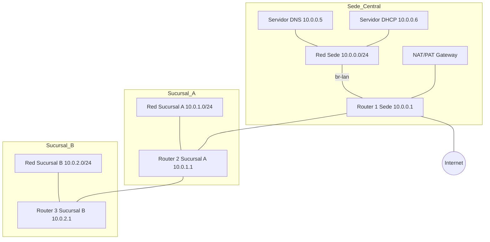
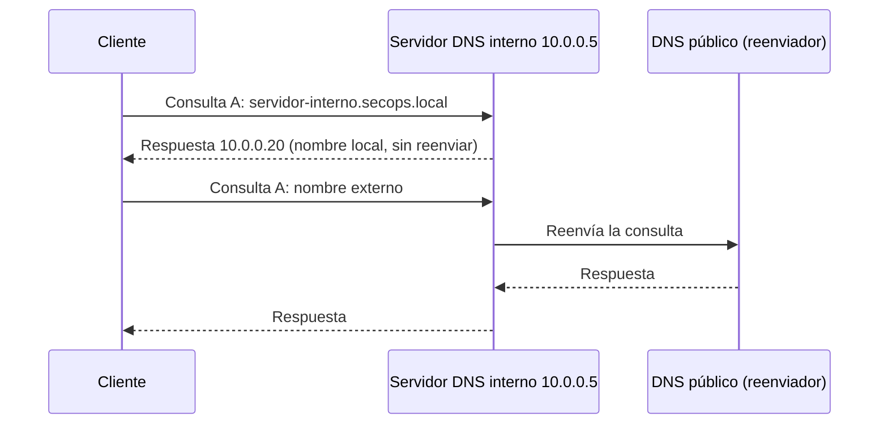
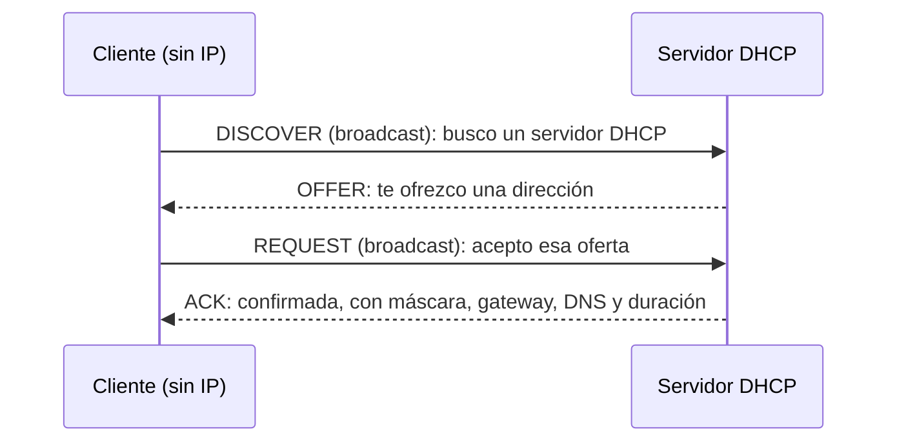
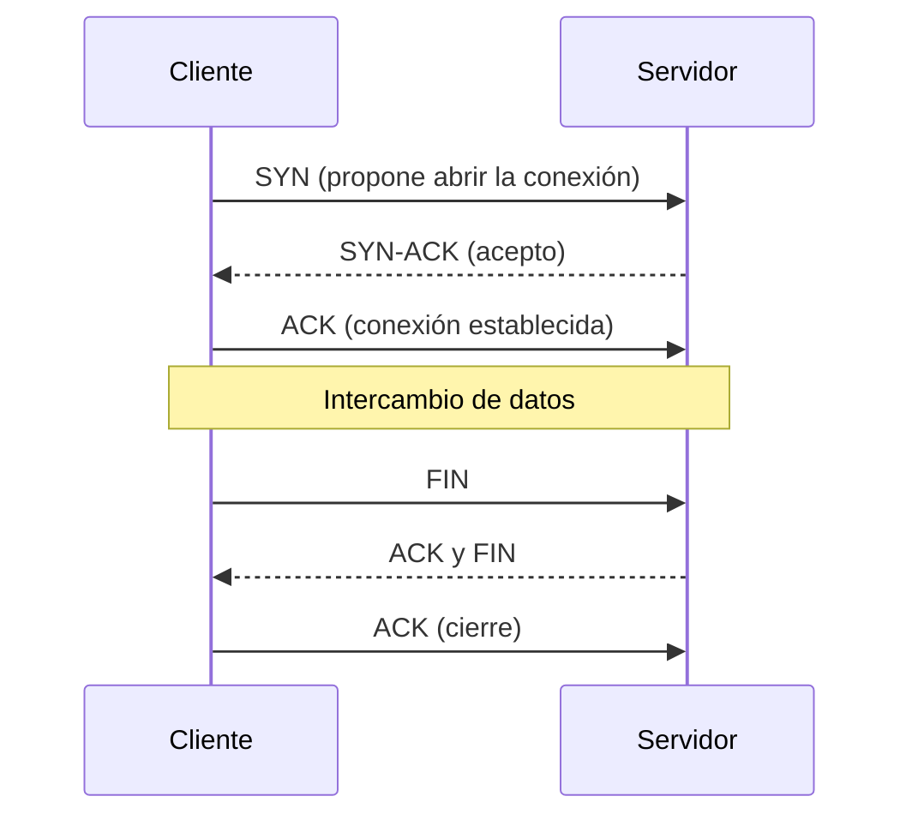

<p class="tema-eyebrow">LABORATORIO 07</p>

# PROTOCOLOS Y SERVICIOS DE RED

<p class="tema-meta"><span>14 secciones</span><span>5 diagramas</span><span>5 tablas</span></p>

## Contexto empresarial

La empresa **Networking SecOps** ya tiene su infraestructura de red funcionando con enrutamiento entre la sede y las sucursales (Laboratorio 06). Ahora necesita implementar **servicios de red esenciales** para que los usuarios puedan trabajar eficientemente:

1. **DNS** – Resolución de nombres para acceder a servidores por nombre en lugar de IP.
2. **DHCP** – Asignación automática de direcciones IP a los clientes.
3. **NAT/PAT** – Permitir que los clientes de la red interna accedan a Internet.
4. **TCP/UDP** – Comprender la diferencia entre ambos protocolos.

El equipo de TI ha decidido implementar estos servicios en la sede central y documentar su funcionamiento para futuras expansiones.

!!! info "Servicios independientes"
    **DHCP** entrega parámetros de configuración de red (dirección, máscara, gateway, servidor DNS). **DNS** resuelve nombres a registros de recursos (direcciones, entre otros). Son servicios **independientes**: recibir una IP por DHCP no garantiza que la resolución DNS funcione (por ejemplo, si el servidor DNS anunciado no responde), y un DNS operativo no sirve de nada a un cliente sin dirección. Aquí los alojamos en equipos distintos y los verificamos por separado.

## Problema inicial

- Los clientes tienen direcciones IP configuradas manualmente (administración tediosa). En este laboratorio automatizamos solo la **LAN de la sede**; las sucursales mantienen direccionamiento fijo (véase «Alcance de DHCP»).
- No hay un servidor DNS interno que resuelva nombres locales.
- Los clientes de la sede y sucursales no pueden acceder a Internet.
- Se necesita implementar NAT para salida a Internet.

## Objetivos del laboratorio

1.  Comprender la diferencia entre **TCP y UDP** y sus casos de uso.
2.  Implementar un servidor **DNS** con `dnsmasq`.
3.  Configurar un servidor **DHCP** para asignación automática de IPs.
4.  Implementar **NAT/PAT** para salida a Internet y distinguir la traducción de direcciones de la traducción de puertos.
5.  Analizar el **MSS** (Maximum Segment Size) en TCP y no confundirlo con la MTU.
6.  Verificar los servicios con herramientas de diagnóstico.

## Herramientas necesarias

- Linux con privilegios de superusuario.
- Comandos: `ip`, `ping`, `tcpdump`, `curl`, `nslookup`, `dig`.
- `dnsmasq` para servicios DNS y DHCP.
- `iptables` para NAT.

## Topología

La topología extiende la del laboratorio 06 agregando servidores DNS y DHCP en la sede.



**Direccionamiento:**

| Dispositivo | Interfaz | Dirección IP |
|-------------|----------|--------------|
| R1 (Sede) | `br-lan` (interfaz IP de la LAN; el bridge hace de switch) | 10.0.0.1/24 |
| R1 (Sede) | `veth-r1c`, `veth-r1dns`, `veth-r1dhcp`, `veth-r1dhcpcl` (miembros de `br-lan`) | sin IP propia |
| R1 (Sede) | `veth-r1r2` (R1-R2) | 192.168.1.1/30 |
| R1 (Sede) | `veth-r1r3` (R1-R3, laboratorio 06) | 192.168.3.1/30 |
| R1 (Sede) | WAN (`veth-wan`) | 192.168.100.1/24 (host: 192.168.100.2/24) |
| R2 (Sucursal A) | `veth-r2c` (LAN) | 10.0.1.1/24 |
| R2 (Sucursal A) | `veth-r2r1` (R1-R2) | 192.168.1.2/30 |
| R2 (Sucursal A) | `veth-r2r3` (R2-R3) | 192.168.2.1/30 |
| R3 (Sucursal B) | `veth-r3c` (LAN) | 10.0.2.1/24 |
| R3 (Sucursal B) | `veth-r3r2` (R2-R3) | 192.168.2.2/30 |
| R3 (Sucursal B) | `veth-r3r1` (R1-R3) | 192.168.3.2/30 |
| Servidor DNS | - | 10.0.0.5/24 |
| Servidor DHCP | - | 10.0.0.6/24 |
| Cliente DHCP (`clienteDHCP`) | - | 10.0.0.100-200/24 (por DHCP) |
| Cliente Sucursal A | - | 10.0.1.10/24 |
| Cliente Sucursal B | - | 10.0.2.10/24 |

Cuando una interfaz es **miembro de un bridge** (`veth-r1c`…), no mantiene una configuración IP propia: la dirección pertenece a la interfaz del bridge (`br-lan`). Por eso el Paso 3 retira `10.0.0.1/24` de `veth-r1c` y la asigna a `br-lan`: no hay dos interfaces con la misma dirección.

## Construcción de la red

### Paso 1: Verificar infraestructura existente

Asegurémonos de que el laboratorio 06 está funcionando (con el enlace directo R1-R3 restablecido):

```bash
# Verificar namespaces
sudo ip netns list

# Verificar conectividad entre sede y sucursales
sudo ip netns exec clienteSede ping -c 2 10.0.1.10
```

Si no existen los namespaces, ejecuta los comandos del laboratorio 06.

!!! info "Los namespaces aíslan la red, no los archivos"
    `ip netns exec` solo aísla la **red**. El sistema de archivos es el del host: `apt-get install` instala paquetes en tu equipo, y un `cat > /etc/archivo` escribiría en el `/etc` **real** (la redirección `>` la hace tu *shell*, no el namespace). Por eso, en este y en los siguientes laboratorios, los servicios se arrancan **a mano** dentro del namespace con sus archivos de configuración en `/tmp/labNN/`, sin tocar `/etc` ni los servicios del sistema (`systemctl` actuaría sobre el host, no sobre el namespace).

Instala una sola vez, en el host, las herramientas que usaremos (el paquete `dnsmasq-base` trae el programa sin instalar ni arrancar el servicio del sistema):

```bash
sudo apt-get update
sudo apt-get install -y dnsmasq-base isc-dhcp-client dnsutils netcat-openbsd conntrack
```

### Paso 2: Crear namespaces para servicios

```bash
for ns in servidorDNS servidorDHCP clienteDHCP; do
  if sudo ip netns list | awk '{print $1}' | grep -Fxq "$ns"; then
    echo "El namespace $ns ya existe: ejecuta la limpieza del laboratorio 07 antes de repetirlo"
    exit 1
  fi
done
if [ -e /tmp/lab07 ]; then
  if [ -f /tmp/lab07/.networking-lab-owned ]; then echo "Existe una ejecución anterior del laboratorio 07; ejecuta su limpieza.";
  else echo "/tmp/lab07 existe sin marca de propiedad; no se modifica."; fi
  exit 1
fi
mkdir -p /tmp/lab07
touch /tmp/lab07/.networking-lab-owned

# Servidores de servicios
sudo ip netns add servidorDNS
sudo ip netns exec servidorDNS ip link set lo alias networking-lab-owned
sudo ip netns add servidorDHCP
sudo ip netns exec servidorDHCP ip link set lo alias networking-lab-owned
sudo ip netns add clienteDHCP
sudo ip netns exec clienteDHCP ip link set lo alias networking-lab-owned
```

### Paso 3: Convertir la LAN de la sede en un switch (bridge) y conectar los servicios

Hasta ahora `veth-r1c` era el único equipo de la LAN `10.0.0.0/24`. Para que el cliente, los servidores DNS/DHCP y el router compartan **el mismo segmento** necesitamos un switch: creamos un bridge `br-lan` en R1 y le pasamos la IP del router.

```bash
# Bridge de la LAN de la sede dentro de R1: no reutilizar uno preexistente.
if sudo ip netns exec R1 ip link show br-lan >/dev/null 2>&1; then
  echo "R1/br-lan ya existe; no se modifica una interfaz preexistente."
  exit 1
fi
sudo ip netns exec R1 ip link add br-lan type bridge
sudo ip netns exec R1 ip link set br-lan alias networking-lab-lab-07
sudo ip netns exec R1 ip link set br-lan up
sudo ip netns exec R1 ip addr del 10.0.0.1/24 dev veth-r1c
sudo ip netns exec R1 ip link set veth-r1c master br-lan
sudo ip netns exec R1 ip addr add 10.0.0.1/24 dev br-lan
```

Ahora conectamos cada servicio con un par veth cuyo extremo en R1 se une al bridge:

```bash
# Servidor DNS
sudo ip link add veth-dns type veth peer name veth-r1dns
sudo ip link set veth-dns alias networking-lab-lab-07
sudo ip link set veth-r1dns alias networking-lab-lab-07
sudo ip link set veth-dns netns servidorDNS
sudo ip link set veth-r1dns netns R1
sudo ip netns exec R1 ip link set veth-r1dns master br-lan
sudo ip netns exec R1 ip link set veth-r1dns up

# Servidor DHCP
sudo ip link add veth-dhcp type veth peer name veth-r1dhcp
sudo ip link set veth-dhcp alias networking-lab-lab-07
sudo ip link set veth-r1dhcp alias networking-lab-lab-07
sudo ip link set veth-dhcp netns servidorDHCP
sudo ip link set veth-r1dhcp netns R1
sudo ip netns exec R1 ip link set veth-r1dhcp master br-lan
sudo ip netns exec R1 ip link set veth-r1dhcp up

# Cliente DHCP
sudo ip link add veth-dhcpcl type veth peer name veth-r1dhcpcl
sudo ip link set veth-dhcpcl alias networking-lab-lab-07
sudo ip link set veth-r1dhcpcl alias networking-lab-lab-07
sudo ip link set veth-dhcpcl netns clienteDHCP
sudo ip link set veth-r1dhcpcl netns R1
sudo ip netns exec R1 ip link set veth-r1dhcpcl master br-lan
sudo ip netns exec R1 ip link set veth-r1dhcpcl up
```

### Paso 4: Asignar direcciones IP

```bash
# Servidor DNS
sudo ip netns exec servidorDNS ip addr add 10.0.0.5/24 dev veth-dns
sudo ip netns exec servidorDNS ip link set veth-dns up
sudo ip netns exec servidorDNS ip link set lo up
sudo ip netns exec servidorDNS ip route add default via 10.0.0.1

# Servidor DHCP
sudo ip netns exec servidorDHCP ip addr add 10.0.0.6/24 dev veth-dhcp
sudo ip netns exec servidorDHCP ip link set veth-dhcp up
sudo ip netns exec servidorDHCP ip link set lo up
sudo ip netns exec servidorDHCP ip route add default via 10.0.0.1

# Cliente DHCP (sin IP fija, usará DHCP)
sudo ip netns exec clienteDHCP ip link set veth-dhcpcl up
sudo ip netns exec clienteDHCP ip link set lo up
```

Comprueba que el segmento es único: `sudo ip netns exec servidorDNS ping -c 2 10.0.0.1` y `sudo ip netns exec servidorDNS ping -c 2 10.0.0.10` deben responder.

### Paso 5: Salida a Internet para toda la red (NAT en R1)

!!! danger "Cambio en el host (no en un namespace)"
    Las líneas con `veth-host`, `sysctl -w net.ipv4.ip_forward=1` e `iptables -t nat` **sin** `ip netns exec` actúan sobre el equipo real. Las de `ip netns exec R1 …` están aisladas. El bloque conserva el valor original de `ip_forward` y registra si añadió la regla NAT. La reversión está en la sección «Revertir los cambios del host».

R1 será la única puerta de salida de la sede **y** de las sucursales. Su interfaz WAN se conecta al host (que hace de "Internet"):

```bash
# Interfaz WAN de R1
if [ -e /sys/class/net/veth-host ]; then
  echo "veth-host ya existe; comprueba la propiedad y ejecuta la reversión anterior."
  exit 1
fi
sudo ip link add veth-wan type veth peer name veth-host
sudo ip link set veth-wan alias networking-lab-lab-07
sudo ip link set veth-host alias networking-lab-lab-07
sudo ip link set veth-wan netns R1
sudo ip netns exec R1 ip addr add 192.168.100.1/24 dev veth-wan
sudo ip netns exec R1 ip link set veth-wan up
sudo ip addr add 192.168.100.2/24 dev veth-host
sudo ip link set veth-host up

# Guardar el estado previo de R1/R2/R3 antes de reemplazar sus rutas por defecto.
for ns in R1 R2 R3; do sudo ip netns exec "$ns" ip route show default > "/tmp/lab07/$ns-default.before"; done
sudo ip netns exec R1 sysctl -n net.ipv4.ip_forward > /tmp/lab07/R1-ip_forward.before

# R1: reenvío, ruta por defecto hacia el host y NAT para todo lo que sale por la WAN.
sudo ip netns exec R1 sysctl -w net.ipv4.ip_forward=1
sudo ip netns exec R1 ip route replace default via 192.168.100.2
if ! sudo ip netns exec R1 iptables -t nat -C POSTROUTING -o veth-wan -j MASQUERADE; then
  sudo ip netns exec R1 iptables -t nat -A POSTROUTING -o veth-wan -j MASQUERADE && touch /tmp/lab07/R1-nat.added
fi

# Las sucursales envían a R1 todo lo que no conocen (R3 lo hace a través de R2).
sudo ip netns exec R2 ip route replace default via 192.168.1.1
sudo ip netns exec R3 ip route replace default via 192.168.2.1

# El host reenvía y traduce hacia tu red real (cambia eth0 por tu interfaz de salida)
if [ ! -e /tmp/lab07-ip_forward.orig ]; then
  sudo sysctl -n net.ipv4.ip_forward | sudo tee /tmp/lab07-ip_forward.orig >/dev/null
fi
sudo sysctl -w net.ipv4.ip_forward=1
if ! sudo iptables -C FORWARD -i veth-host -o eth0 -s 192.168.100.0/24 -j ACCEPT; then
  sudo iptables -I FORWARD 1 -i veth-host -o eth0 -s 192.168.100.0/24 -j ACCEPT && touch /tmp/lab07-forward-out.added
fi
if ! sudo iptables -C FORWARD -i eth0 -o veth-host -d 192.168.100.0/24 -m conntrack --ctstate RELATED,ESTABLISHED -j ACCEPT; then
  sudo iptables -I FORWARD 1 -i eth0 -o veth-host -d 192.168.100.0/24 -m conntrack --ctstate RELATED,ESTABLISHED -j ACCEPT && touch /tmp/lab07-forward-in.added
fi
if ! sudo iptables -t nat -C POSTROUTING -s 192.168.100.0/24 -o eth0 -j MASQUERADE; then
  sudo iptables -t nat -A POSTROUTING -s 192.168.100.0/24 -o eth0 -j MASQUERADE && touch /tmp/lab07-host-nat.added
fi
```

Conviene distinguir dos términos: **NAT** (traducción de direcciones) cambia la IP de origen o destino; **PAT** (traducción de direcciones y puertos; en Linux se logra con `MASQUERADE` o `SNAT`, que reasignan el puerto de origen cuando hay colisión) permite que **múltiples conexiones privadas compartan una dirección de salida** (`192.168.100.1`), diferenciándolas por la información de transporte (puerto de origen TCP/UDP o identificador ICMP). La tabla `conntrack` recuerda qué conexión corresponde a cada traducción.

La regla de R1 no filtra por origen (`-o veth-wan`): traduce **todo** lo que sale por la WAN, ya venga de la sede o de las sucursales. Lo que sí hacía falta eran las **rutas por defecto** de R2 y R3. Como R1 enmascara el tráfico con `192.168.100.1`, el host solo conoce la red `192.168.100.0/24` y no necesita rutas de retorno hacia `10.0.0.0/8`.

Comprueba la salida desde cada oficina (el host responde en `192.168.100.2` aunque no tengas Internet):

```bash
sudo ip netns exec clienteSede ping -c 2 192.168.100.2
sudo ip netns exec clienteSucA ping -c 2 192.168.100.2
sudo ip netns exec clienteSucB ping -c 2 192.168.100.2
```

### Paso 6: Servidor DNS (solo DNS)

Un servidor DNS no debe repartir direcciones: ese es el trabajo del servidor DHCP. Configuramos `dnsmasq` únicamente con la función DNS, con un dominio interno y reenvío a DNS públicos. `8.8.8.8` y `8.8.4.4` son **DNS públicos de ejemplo** (reenviadores externos), no servidores internos de la empresa: el servidor interno es `10.0.0.5`, que consulta a los externos solo para nombres que no conoce:

```bash
touch /tmp/lab07/hosts

cat > /tmp/lab07/dns.conf << 'EOF'
listen-address=10.0.0.5
bind-interfaces
no-resolv
no-hosts
addn-hosts=/tmp/lab07/hosts
server=8.8.8.8
server=8.8.4.4
local=/secops.local/
address=/servidor-interno.secops.local/10.0.0.20
EOF

# Arrancar dnsmasq DENTRO del namespace del servidor DNS
sudo ip netns exec servidorDNS dnsmasq --conf-file=/tmp/lab07/dns.conf --pid-file=/tmp/lab07/dns.pid
```

### Cómo se relacionan los cuatro servicios

Son piezas de una misma experiencia de conectividad, no temas aislados:


### Resolución DNS



### Paso 7: Servidor DHCP (solo DHCP)

El servidor DHCP anuncia a los clientes la puerta de enlace (R1) y el servidor DNS (`10.0.0.5`). Con `port=0` se desactiva su función DNS:

```bash
cat > /tmp/lab07/dhcp.conf << 'EOF'
port=0
interface=veth-dhcp
bind-interfaces
dhcp-range=10.0.0.100,10.0.0.200,255.255.255.0,12h
dhcp-option=option:router,10.0.0.1
dhcp-option=option:dns-server,10.0.0.5
dhcp-leasefile=/tmp/lab07/dhcp.leases
EOF

sudo ip netns exec servidorDHCP dnsmasq --conf-file=/tmp/lab07/dhcp.conf --pid-file=/tmp/lab07/dhcp.pid
```

Ambos servidores usan rangos y funciones distintas: no hay dos servidores DHCP compitiendo en la misma LAN.

### Paso 8: Configurar el cliente DHCP

`dhclient` reescribe `/etc/resolv.conf`. Para que no toque el de tu equipo, damos al namespace su propio `resolv.conf` (`ip netns exec` lo monta automáticamente desde `/etc/netns/<nombre>/`):

```bash
if [ -L /etc/netns/clienteDHCP/resolv.conf ]; then
  echo "/etc/netns/clienteDHCP/resolv.conf es un enlace simbólico; se aborta para no escribir fuera del directorio de namespace."
  exit 1
fi
if [ -e /etc/netns/clienteDHCP/resolv.conf ]; then
  sudo cp -a /etc/netns/clienteDHCP/resolv.conf /tmp/lab07/resolv.conf.before
  touch /tmp/lab07/resolv.conf.preexisting
else
  touch /tmp/lab07/resolv.conf.absent
fi
if [ ! -d /etc/netns/clienteDHCP ]; then
  sudo mkdir -p /etc/netns/clienteDHCP
  touch /tmp/lab07/netns-dir.created
fi
sudo touch /etc/netns/clienteDHCP/resolv.conf

# Obtener IP por DHCP
# -pf / -lf: pid y concesiones propios, para no interferir con el dhclient del host
sudo ip netns exec clienteDHCP dhclient -v -pf /tmp/lab07/dhclient.pid -lf /tmp/lab07/dhclient.leases veth-dhcpcl
sudo ip netns exec clienteDHCP ip addr show dev veth-dhcpcl
sudo ip netns exec clienteDHCP ip route show
sudo ip netns exec clienteDHCP cat /etc/resolv.conf
```

**Resultado esperado:** una dirección en `10.0.0.100-200`, una ruta por defecto vía `10.0.0.1` y `nameserver 10.0.0.5`.

!!! warning "Alcance de DHCP: quién recibe concesión directa y quién necesitaría relay"
    DHCPv4 comienza con un `DHCPDISCOVER` enviado por **broadcast** de capa 2, y los broadcasts **no atraviesan routers** de forma ordinaria. Por eso:

    -   Los clientes de la **LAN de la sede** (mismo dominio de broadcast que `servidorDHCP`, a través de `br-lan`) reciben concesión **directamente**. Es el caso de `clienteDHCP`.
    -   Los clientes de la **Sucursal A y B** estarían en otro dominio de broadcast: para que el servidor de la sede les diera concesiones haría falta un **agente DHCP relay** en R2 y R3 (por ejemplo `dhcrelay` o `dhcp-helper`), que retransmite las solicitudes como unicast hacia `10.0.0.6`, y un `dhcp-range` en el servidor para sus subredes.
    -   Que exista **conectividad IP** entre sede y sucursal **no basta**: el DISCOVER inicial no usa IP enrutable. En este laboratorio los clientes de sucursal mantienen IP fija y el relay se deja como concepto.

### Paso 9: Verificar conectividad y servicios

```bash
# El cliente DHCP alcanza a las sucursales (a través de R1) y a la salida de la red
sudo ip netns exec clienteDHCP ping -c 4 10.0.1.10
sudo ip netns exec clienteDHCP ping -c 4 10.0.2.10
sudo ip netns exec clienteDHCP ping -c 4 192.168.100.2

# Resolución de un nombre interno (el servidor DNS responde sin salir a Internet)
sudo ip netns exec clienteDHCP nslookup -type=A servidor-interno.secops.local

# Con Internet disponible en tu equipo:
sudo ip netns exec clienteDHCP ping -c 4 8.8.8.8
sudo ip netns exec clienteDHCP nslookup google.com
```

**Resultado esperado:** 0% de pérdida; `nslookup` devuelve `10.0.0.20` para el nombre interno y una IP pública para `google.com` (esto último solo si tu equipo tiene Internet).

### Proceso DHCP (DORA)



Como el cliente aún no tiene IP, usa *broadcast* (`0.0.0.0 → 255.255.255.255`, UDP 68 → 67). Por eso las solicitudes **no cruzan routers** por sí solas: para dar servicio a una sucursal desde la sede haría falta un **agente DHCP relay** (ampliación opcional, fuera del escenario principal).

### Puertos y protocolos habituales

| Servicio | Transporte | Puerto | Laboratorio |
|----------|------------|--------|-------------|
| DNS | UDP (TCP para respuestas grandes y transferencias) | 53 | 07, 08 |
| DHCP | UDP | 67 (servidor) / 68 (cliente) | 07, 15 |
| HTTP | TCP | 80 | 08 |
| HTTPS | TCP | 443 | 08 |
| SSH | TCP | 22 | 08 |

La matriz completa de la serie (incluye OSPF, VRRP, GRE, IPsec, OpenVPN y WireGuard) está en [Servicios, protocolos y puertos](../../referencia/servicios-puertos.md).

## Análisis de TCP y UDP

### Paso 10: Capturar tráfico TCP

```bash
# Iniciar captura en el bridge de R1 (ve todo el tráfico de la LAN)
sudo ip netns exec R1 tcpdump -i br-lan -n -v tcp port 8000
```

En otra terminal, abrimos una conexión TCP entre dos equipos de la LAN:

```bash
sudo ip netns exec servidorDNS sh -c 'nc -l -p 8000 > /dev/null &'
sudo ip netns exec clienteDHCP sh -c 'echo hola | nc -w 2 10.0.0.5 8000'
```

**Interpretación:** se observa el *handshake* TCP (SYN, SYN-ACK, ACK), la transferencia y el cierre (FIN). Con Internet disponible puedes repetirlo con `curl -s http://google.com > /dev/null` y filtrar `tcp port 80`. (Si tu versión de `nc` no admite `-l -p`, usa la forma portable `nc -l 8000`.)

### Paso 11: Capturar tráfico UDP (DNS y DHCP)

```bash
sudo ip netns exec R1 tcpdump -i br-lan -n -v 'udp port 53 or udp port 67 or udp port 68'
```

En otra terminal:

```bash
sudo ip netns exec clienteDHCP nslookup -type=A servidor-interno.secops.local
```

**Interpretación:** se observan paquetes UDP sin *handshake* previo: una consulta y una respuesta. Para ver el intercambio DHCP completo (DISCOVER, OFFER, REQUEST, ACK) libera y renueva la concesión con `sudo ip netns exec clienteDHCP dhclient -r -pf /tmp/lab07/dhclient.pid -lf /tmp/lab07/dhclient.leases veth-dhcpcl` y luego `sudo ip netns exec clienteDHCP dhclient -pf /tmp/lab07/dhclient.pid -lf /tmp/lab07/dhclient.leases veth-dhcpcl`.

### TCP frente a UDP: casos de uso

| Aspecto | TCP | UDP |
|---------|-----|-----|
| Conexión | Orientado a conexión (*handshake*) | Sin conexión |
| Fiabilidad | Retransmite, ordena, controla flujo y congestión | No garantiza entrega ni orden |
| Coste | Mayor (estado y cabecera) | Menor |
| Ejemplos | Web, SSH, correo, transferencia de archivos | DNS, DHCP, VoIP, vídeo en tiempo real |
| Criterio de elección | Importa que **todo llegue correcto** | Importa la **baja latencia**, o la aplicación gestiona la pérdida |

### Establecimiento y cierre de una conexión TCP



### NAT/PAT y la tabla de conexiones

R1 traduce el origen de cada conexión privada y lo recuerda en `conntrack`; así las respuestas vuelven al equipo correcto aunque varias conexiones compartan `192.168.100.1`:

| Origen privado | Destino | Origen traducido (visible fuera) |
|----------------|---------|-----------------------------------|
| `10.0.0.10:40001` | `192.168.100.2:80` | `192.168.100.1:40001` |
| `10.0.1.10:40001` | `192.168.100.2:80` | `192.168.100.1:` **otro puerto** (PAT evita la colisión) |
| `10.0.2.10` (ICMP, id 7) | `192.168.100.2` | `192.168.100.1` (con el identificador ICMP) |

(Valores ilustrativos: comprueba los reales con `conntrack -L`.)

## Análisis de MSS

### Paso 12: Verificar el MSS en el *handshake* TCP

El MSS se negocia en las opciones del segmento SYN. Captura solo los SYN:

```bash
sudo ip netns exec R1 tcpdump -i br-lan -n -c 2 'tcp[tcpflags] & tcp-syn != 0'
```

En otra terminal repite la conexión del Paso 10 (`nc -l` en el servidor y `nc` en el cliente).

**Interpretación:** en las opciones del SYN aparece `mss 1460`. El **MSS** es el tamaño máximo de **datos TCP** que un extremo anuncia que puede recibir en un segmento, **sin contar las cabeceras TCP e IP**. Se deduce de la MTU de la interfaz: 1500 (MTU) − 20 (IP) − 20 (TCP) = 1460. No debe confundirse con la **MTU**, que es el tamaño máximo del **paquete IP** completo en un enlace. Cada extremo anuncia su propio MSS y el emisor no enviará segmentos mayores que el MSS del otro. (Los 40 bytes de cabeceras se restan suponiendo IPv4 sin opciones; si hay opciones TCP, como marcas de tiempo, los datos por segmento son algo menos.)

## Ejercicios prácticos

### Ejercicio 1: Agregar registros DNS locales

Agrega una entrada al archivo de hosts **del servidor DNS** (no al `/etc/hosts` de tu equipo) y pide a `dnsmasq` que lo relea con `SIGHUP`:

```bash
echo '10.0.0.30 impresora.secops.local' >> /tmp/lab07/hosts
sudo kill -HUP $(cat /tmp/lab07/dns.pid)
sudo ip netns exec clienteDHCP nslookup -type=A impresora.secops.local
```

### Ejercicio 2: Analizar NAT en R1

```bash
# Ver tabla NAT (fíjate en los contadores de paquetes de MASQUERADE)
sudo ip netns exec R1 iptables -t nat -L -v

# Ver conexiones NAT activas (haz antes un ping desde una sucursal a 192.168.100.2)
sudo ip netns exec R1 conntrack -L
```

### Ejercicio 3: Verificar con dig

```bash
sudo ip netns exec clienteDHCP dig @10.0.0.5 servidor-interno.secops.local
```

### Ejercicio 4: Probar el NAT desde las sucursales

Haz un `ping -c 2 192.168.100.2` desde `clienteSucB` y observa en `conntrack -L` cómo R1 traduce el origen `10.0.2.10` a `192.168.100.1`. ¿Qué ocurriría si R3 no tuviera su ruta por defecto?

### Ejercicio 5: DNS y servicios desde las sucursales

Las sucursales conservan direccionamiento fijo, así que **no reciben el DNS por DHCP**. Comprueba que, con las rutas del laboratorio 06, una sucursal alcanza el DNS de la sede y resuelve un nombre interno:

```bash
sudo ip netns exec clienteSucA dig @10.0.0.5 servidor-interno.secops.local +short
```

Si responde `10.0.0.20`, la consulta UDP/53 atravesó los routers hasta `10.0.0.5` y volvió. Si no responde, razona por capas: ¿hay ruta de ida **y de vuelta**?, ¿el servidor DNS escucha en `10.0.0.5`?, ¿algún filtro bloquea UDP/53? Para que la sucursal use el DNS **sin indicarlo en cada consulta** haría falta configurarlo en su resolvedor (en un namespace, con `/etc/netns/<ns>/resolv.conf`) o entregarlo con DHCP relay.

## Conceptos clave del Tema 7 aplicados

| Concepto | Aplicación en el laboratorio |
|----------|------------------------------|
| TCP | Transferencia HTTP, conexión orientada |
| UDP | Consultas DNS, no orientado a conexión |
| MSS | Máximo de datos TCP por segmento, sin cabeceras (1460 bytes con MTU 1500); no es la MTU |
| DNS | Resolución de nombres con dnsmasq |
| DHCP | Asignación automática de IPs |
| NAT/PAT | Traducción de direcciones (y puertos) para salida a Internet |

## Revertir los cambios del host (laboratorio 07)

La reversión detiene únicamente los procesos identificados por los PID files del laboratorio, elimina sus namespaces si ya no contienen procesos y restaura las rutas y parámetros que se guardaron antes de la práctica. No usa `pkill` ni mata todos los procesos de un namespace.

```bash
PROC_LEFT=0
for spec in 'dnsmasq /tmp/lab07/dns.pid' 'dnsmasq /tmp/lab07/dhcp.pid' 'dhclient /tmp/lab07/dhclient.pid'; do
  set -- $spec; proceso=$1; pf=$2
  [ -s "$pf" ] || continue
  pid=$(cat "$pf" 2>/dev/null || true)
  [[ "$pid" =~ ^[0-9]+$ ]] || continue
  [ -r "/proc/$pid/cmdline" ] || continue
  cmdline=$(tr '\0' ' ' < "/proc/$pid/cmdline")
  if [[ "$cmdline" == *"$proceso"* && "$cmdline" == *"$pf"* ]]; then sudo kill -TERM "$pid" 2>/dev/null || true
  else echo "PID $pid no coincide con $proceso/$pf; no se detiene."; PROC_LEFT=1
  fi
done
sleep 1
for spec in 'dnsmasq /tmp/lab07/dns.pid' 'dnsmasq /tmp/lab07/dhcp.pid' 'dhclient /tmp/lab07/dhclient.pid'; do
  set -- $spec; proceso=$1; pf=$2
  [ -s "$pf" ] || continue
  pid=$(cat "$pf" 2>/dev/null || true)
  [[ "$pid" =~ ^[0-9]+$ ]] || continue
  [ -r "/proc/$pid/cmdline" ] || continue
  cmdline=$(tr '\0' ' ' < "/proc/$pid/cmdline")
  if [[ "$cmdline" == *"$proceso"* && "$cmdline" == *"$pf"* ]]; then sudo kill -KILL "$pid" 2>/dev/null || true; fi
done

NS_LEFT=0
# R1/R2/R3 pertenecen a Lab06; se modifican sus rutas, pero nunca se borran aquí.
for ns in R1 R2 R3; do
  PIDS=$(sudo ip netns pids "$ns" 2>/dev/null || true)
  if [ -n "$PIDS" ]; then echo "Se conservan rutas y estado host: $ns tiene procesos activos ($PIDS)."; NS_LEFT=1; fi
done
# Preflight de todos los namespaces de servicio antes de eliminar cualquiera.
for ns in servidorDNS servidorDHCP clienteDHCP; do
  if sudo ip netns list | awk '{print $1}' | grep -Fxq "$ns"; then
    if [ "$(sudo ip netns exec "$ns" cat /sys/class/net/lo/ifalias 2>/dev/null)" != networking-lab-owned ]; then echo "Se conserva $ns: no tiene la marca de propiedad Networking Lab."; NS_LEFT=1
    else
      PIDS=$(sudo ip netns pids "$ns" 2>/dev/null || true)
      if [ -n "$PIDS" ]; then echo "Se conserva $ns: quedan procesos no registrados ($PIDS)."; NS_LEFT=1; fi
    fi
  fi
done

if [ "$NS_LEFT" = 0 ] && [ "$PROC_LEFT" = 0 ]; then
  for ns in servidorDNS servidorDHCP clienteDHCP; do
    if sudo ip netns list | awk '{print $1}' | grep -Fxq "$ns"; then sudo ip netns del "$ns" 2>/dev/null || true; fi
  done
  # Restaurar rutas por defecto e ip_forward de R1, R2 y R3.
  restaurar_default() {
    ns=$1; archivo=$2
    [ -f "$archivo" ] || return 0
    sudo ip netns exec "$ns" ip route del default 2>/dev/null || true
    if [ -s "$archivo" ]; then
      while IFS= read -r ruta; do [ -n "$ruta" ] && sudo ip netns exec "$ns" ip route add $ruta; done < "$archivo"
    fi
  }
  for ns in R1 R2 R3; do restaurar_default "$ns" "/tmp/lab07/$ns-default.before"; done
  if [ -s /tmp/lab07/R1-ip_forward.before ]; then
    sudo ip netns exec R1 sysctl -w net.ipv4.ip_forward="$(cat /tmp/lab07/R1-ip_forward.before)"
  fi
  if [ -f /tmp/lab07/R1-nat.added ]; then
    sudo ip netns exec R1 iptables -t nat -D POSTROUTING -o veth-wan -j MASQUERADE 2>/dev/null || true
  fi

  # Restaurar el estado de la LAN del laboratorio 06.
  if [ "$(sudo ip netns exec R1 cat /sys/class/net/br-lan/ifalias 2>/dev/null)" = networking-lab-lab-07 ]; then
    sudo ip netns exec R1 ip addr del 10.0.0.1/24 dev br-lan 2>/dev/null || true
    sudo ip netns exec R1 ip link set veth-r1c nomaster 2>/dev/null || true
    sudo ip netns exec R1 ip link del br-lan
    if sudo ip netns exec R1 ip link show veth-r1c >/dev/null 2>&1; then
      sudo ip netns exec R1 ip addr replace 10.0.0.1/24 dev veth-r1c
      sudo ip netns exec R1 ip link set veth-r1c up
    fi
  fi

  # Revertir cambios del host únicamente si sus marcadores prueban que fueron añadidos aquí.
  if [ -f /tmp/lab07-host-nat.added ]; then sudo iptables -t nat -D POSTROUTING -s 192.168.100.0/24 -o eth0 -j MASQUERADE 2>/dev/null || true; rm -f /tmp/lab07-host-nat.added; fi
  if [ -f /tmp/lab07-forward-out.added ]; then sudo iptables -D FORWARD -i veth-host -o eth0 -s 192.168.100.0/24 -j ACCEPT 2>/dev/null || true; rm -f /tmp/lab07-forward-out.added; fi
  if [ -f /tmp/lab07-forward-in.added ]; then sudo iptables -D FORWARD -i eth0 -o veth-host -d 192.168.100.0/24 -m conntrack --ctstate RELATED,ESTABLISHED -j ACCEPT 2>/dev/null || true; rm -f /tmp/lab07-forward-in.added; fi
  if [ -f /tmp/lab07-ip_forward.orig ]; then sudo sysctl -w net.ipv4.ip_forward="$(cat /tmp/lab07-ip_forward.orig)"; rm -f /tmp/lab07-ip_forward.orig; fi

  if [ "$(cat /sys/class/net/veth-host/ifalias 2>/dev/null)" = networking-lab-lab-07 ]; then sudo ip link del veth-host; fi

  # Restaurar /etc/netns/clienteDHCP sin borrar contenido preexistente.
  if [ -f /tmp/lab07/resolv.conf.preexisting ]; then sudo cp -a /tmp/lab07/resolv.conf.before /etc/netns/clienteDHCP/resolv.conf
  elif [ -f /tmp/lab07/resolv.conf.absent ]; then sudo rm -f /etc/netns/clienteDHCP/resolv.conf
  fi
  if [ -f /tmp/lab07/netns-dir.created ]; then sudo rmdir /etc/netns/clienteDHCP 2>/dev/null || true; fi

  for f in /sys/class/net/*/ifalias; do
    [ -r "$f" ] || continue
    [ "$(cat "$f")" = networking-lab-lab-07 ] || continue
    dev=${f%/ifalias}; dev=${dev##*/}
    sudo ip link del "$dev" 2>/dev/null || true
  done
  if [ -f /tmp/lab07/.networking-lab-owned ]; then sudo rm -rf /tmp/lab07; fi
else
  echo "Se conservan rutas, enlaces y /tmp/lab07: quedan procesos o namespaces que requieren inspección."
fi
```

`dnsmasq-base`, `isc-dhcp-client`, `dnsutils`, `netcat-openbsd` y `conntrack` quedan **instalados** en el equipo: son paquetes, no configuración activa, y puedes desinstalarlos con `apt remove` si no los usabas antes.

## Profundización: DHCP, DNS, transporte y conntrack

### DHCP más allá de DORA

DORA describe el intercambio inicial, pero el cliente mantiene una máquina de estados y un *lease*. T1 inicia la renovación normalmente con el servidor original; T2 permite *rebinding* con cualquier servidor disponible si no se renovó. El tiempo exacto depende de las opciones entregadas. Las reservas vinculan un identificador de cliente (a menudo MAC, según configuración) con una dirección; las exclusiones impiden asignar rangos reservados. DHCP relay reenvía solicitudes entre subredes y utiliza `giaddr` para identificar la red del cliente.

Observa las opciones y tiempos en la concesión real, no supongas valores por defecto universales:

```bash
sudo ip netns exec clienteDHCP tcpdump -ni any 'udp port 67 or udp port 68'
sudo ip netns exec servidorDHCP journalctl --no-pager -n 80 2>/dev/null || true
```

### DNS: quién pregunta y quién responde

Distingue el stub resolver del sistema, el resolver recursivo y el servidor autoritativo. Una respuesta `NXDOMAIN` significa que el nombre consultado no existe según la autoridad/resolución; no equivale a timeout ni a falta de conectividad. El TTL controla cuánto puede conservarse una respuesta en caché. DNS usa UDP y también TCP (por ejemplo, respuestas truncadas, transferencias de zona y otras operaciones); no es correcto enseñar “DNS siempre usa UDP”.

```bash
dig @10.0.0.5 servidor-interno.secops.local A
dig @10.0.0.5 google.com A
dig @10.0.0.5 inexistente.secops.local A
dig @10.0.0.5 google.com A +tcp
```

### TCP, UDP y QUIC

TCP proporciona un flujo de bytes ordenado con números de secuencia, ACK, retransmisión, control de flujo y control de congestión. UDP entrega datagramas sin garantizar por sí mismo entrega ni orden; aplicaciones como QUIC implementan fiabilidad, control de congestión y cifrado sobre UDP. Por tanto, UDP no significa necesariamente aplicación no fiable.

### NAT/PAT y seguimiento de conexiones

Conntrack mantiene el estado y las tuplas originales/respuesta para asociar paquetes de ida y vuelta; NAT aplica traducciones a esa conexión. Inspecciona contadores y entradas en el router del laboratorio y diferencia las dos traducciones sucesivas cuando existe doble NAT:

```bash
sudo ip netns exec R1 conntrack -L 2>/dev/null | head -30
sudo ip netns exec R1 iptables -t nat -vnL
```

Una regla MASQUERADE no garantiza salida si el firewall del host bloquea `FORWARD`; comprueba por separado el firewall del host y el del router. No cambies políticas globales para “hacer que funcione”: autoriza solo el flujo de laboratorio y registra su reversión.


## Preguntas de reflexión

1.  ¿Qué mecanismo permite que un cliente sin IP encuentre un servidor DHCP?
2.  ¿Qué sucedería si el DHCP anuncia un servidor DNS que no responde? ¿Qué parte sigue funcionando?
3.  ¿Qué diferencia hay entre lo que muestra la captura TCP y la de UDP (DNS)?
4.  ¿Qué limitaciones tiene que las sucursales conserven direccionamiento fijo?
5.  ¿Qué otro mecanismo podría entregar configuración a las sucursales sin un servidor propio? (DHCP relay.)

## Conclusiones técnicas

En este laboratorio hemos:

1.  Implementado **servicios DNS y DHCP** independientes en la LAN de la sede (las sucursales necesitarían un relay DHCP).
2.  Configurado **NAT/PAT** para salida a Internet.
3.  Analizado la diferencia entre **TCP y UDP** mediante capturas.
4.  Verificado el **MSS** en conexiones TCP.
5.  Comprendido la importancia de los servicios de red para los usuarios.

Los protocolos y servicios de red son la capa que permite a los usuarios finales utilizar la infraestructura de red de manera transparente. DNS y DHCP simplifican la administración, mientras que NAT permite el acceso a Internet con direcciones privadas.

## Preparación para el siguiente laboratorio

Hemos dejado la red con servicios DNS, DHCP y NAT funcionando en la sede. En el **Laboratorio 08** exploraremos **Seguridad en Redes**, implementando firewalls, ACLs y una DMZ para proteger la infraestructura.

---

**¡Laboratorio 07 completado!** Has implementado servicios de red esenciales. Continúa con el **Laboratorio 08**.
