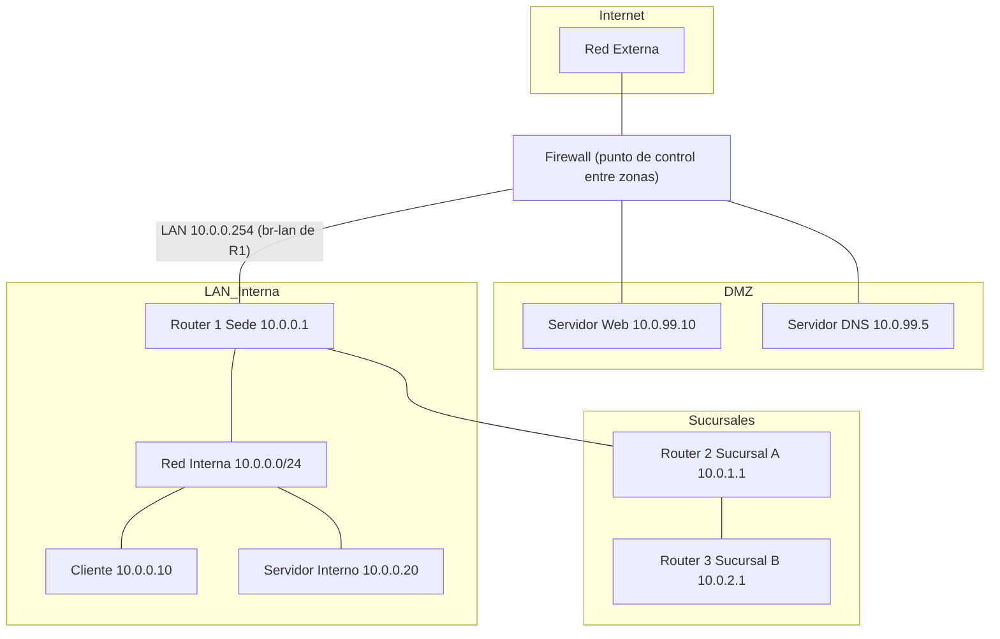

<p class="tema-num">LABORATORIO 08</p>

# Seguridad en Redes

## Contexto empresarial

La empresa **Networking SecOps** ha implementado su infraestructura de red con servicios DNS, DHCP y NAT (Laboratorio 07). Ahora el equipo de seguridad ha identificado la necesidad de **proteger la red** contra amenazas internas y externas.

El CISO (Chief Information Security Officer) ha solicitado implementar las siguientes medidas:

1. **Firewall** para controlar el tráfico entrante y saliente.
2. **ACLs** para restringir acceso a servicios administrativos.
3. **DMZ** para aislar servidores públicos.
4. **Cifrado TLS** para proteger comunicaciones web.
5. **SSH** para acceso seguro a dispositivos.

## Problema inicial

- No hay control de tráfico entre redes (todo el tráfico es permitido).
- Los servicios administrativos (SSH) están expuestos a toda la red.
- No hay segmentación para servidores públicos.
- Las comunicaciones internas no están cifradas.
- No hay políticas de seguridad definidas.

## Objetivos del laboratorio

1.  Comprender los principios de la tríada **CIA** (Confidencialidad, Integridad, Disponibilidad).
2.  Implementar un **firewall** con `iptables` para filtrar tráfico.
3.  Configurar **ACLs** en el router para restringir accesos.
4.  Diseñar una **DMZ** para aislar servidores públicos.
5.  Configurar **SSH** para acceso seguro.
6.  Implementar **TLS** para cifrar comunicaciones web.

## Herramientas necesarias

- Linux con privilegios de superusuario.
- Comandos: `ip`, `ping`, `iptables`, `nft` (opcional).
- `openssl` para generar certificados TLS.
- `ssh` para acceso remoto seguro.

## Topología

La topología extiende la del laboratorio 07 agregando una DMZ y medidas de seguridad.



El **firewall es el punto de control entre las tres zonas** (Externa, DMZ e Interna): todo el tráfico entre ellas debe atravesarlo, y no basta con dibujar una conexión. Qué puede alcanzar cada zona queda definido por las reglas del Paso 8:

| Origen \ Destino | Externa | DMZ | Interna |
|------------------|:-------:|:---:|:-------:|
| **Externa** | — | Solo servicios publicados (80/443 al web, 53/UDP al DNS) | Denegado |
| **DMZ** | Denegado (no hay regla de salida) | — | Denegado |
| **Interna** | Permitido (con NAT) | Limitado: ICMP, SSH y HTTPS | — |

Las respuestas a conexiones ya establecidas se permiten por seguimiento de estado (`ESTABLISHED,RELATED`).

**Cómo se conectan R1 y el firewall.** Ambos están en el **mismo segmento de capa 2** de la sede: el firewall (`10.0.0.254`) se une al bridge `br-lan` de R1 (Paso 6). Los equipos internos (clientes y servidor interno) usan como *gateway* predeterminado a **R1 (`10.0.0.1`)**; R1 conoce las sucursales y envía al firewall (`10.0.0.254`) todo lo que no conoce (su ruta por defecto). El firewall, a su vez, devuelve a R1 el tráfico hacia las sucursales (`10.0.1.0/24` y `10.0.2.0/24`).

**Direccionamiento:**

| Dispositivo | Interfaz | Dirección IP | Zona |
|-------------|----------|--------------|------|
| Firewall | veth-fw-wan (WAN) | 192.168.100.1/24 (host: 192.168.100.2/24) | Externa |
| Firewall | br-dmz (DMZ) | 10.0.99.1/24 | DMZ |
| Firewall | veth-fw-lan (LAN) | 10.0.0.254/24 | Interna |
| R1 (Sede) | `br-lan` (LAN) | 10.0.0.1/24 | Interna |
| R1 (Sede) | `veth-r1r2` (R1-R2) | 192.168.1.1/30 | Interna |
| R2 (Sucursal A) | `veth-r2c` (LAN) | 10.0.1.1/24 | Interna |
| R3 (Sucursal B) | `veth-r3c` (LAN) | 10.0.2.1/24 | Interna |
| Servidor Web | - | 10.0.99.10/24 | DMZ |
| Servidor DNS | - | 10.0.99.5/24 | DMZ |
| Cliente Interno (`clienteSede`) | - | 10.0.0.10/24 | Interna |
| Servidor Interno | - | 10.0.0.20/24 | Interna |

## Construcción de la red

### Paso 1: Verificar infraestructura existente

Asegurémonos de que el laboratorio 07 está funcionando:

```bash
# Verificar namespaces
sudo ip netns list

# El cliente DHCP sigue en la LAN y alcanza a una sucursal
sudo ip netns exec clienteDHCP ip -4 addr show dev veth-dhcpcl
sudo ip netns exec clienteDHCP ping -c 2 10.0.1.10
```

Si el cliente perdió su concesión DHCP, renuévala con `sudo ip netns exec clienteDHCP dhclient veth-dhcpcl`. Instala las herramientas de este laboratorio (en el host):

```bash
sudo apt-get install -y openssh-server openssh-client openssl conntrack
```

### Paso 2: El firewall pasa a ser la única salida

Hasta ahora R1 tenía su propia salida a Internet. Con un firewall perimetral, **toda la salida debe pasar por él**. Eliminamos la WAN de R1 (al borrar `veth-wan` desaparece también `veth-host` del host, junto con la ruta por defecto de R1 y su IP `192.168.100.2`):

```bash
sudo ip netns exec R1 ip link del veth-wan
sudo ip netns exec R1 iptables -t nat -F POSTROUTING
```

### Paso 3: Crear namespaces para firewall y DMZ

```bash
# Firewall
sudo ip netns add firewall

# Servidores DMZ
sudo ip netns add servidorWeb
sudo ip netns add servidorDNS_PUB

# Servidor Interno
sudo ip netns add servidorInterno
```

### Paso 4: Conectar el firewall a la zona externa (WAN)

El host hace de "Internet". Su lado de la WAN será un bridge (`br-wan`) para poder conectar más equipos "externos" en el Laboratorio 09:

```bash
# Bridge del lado Internet (en el host)
sudo ip link add br-wan type bridge
sudo ip link set br-wan up
sudo ip addr add 192.168.100.2/24 dev br-wan

# Enlace firewall <-> Internet
sudo ip link add veth-fw-wan type veth peer name veth-wan-fw
sudo ip link set veth-fw-wan netns firewall
sudo ip netns exec firewall ip addr add 192.168.100.1/24 dev veth-fw-wan
sudo ip netns exec firewall ip link set veth-fw-wan up
sudo ip link set veth-wan-fw master br-wan
sudo ip link set veth-wan-fw up
sudo ip netns exec firewall ip route add default via 192.168.100.2

# El host reenvía y traduce hacia tu red real (cambia eth0 por tu interfaz de salida)
sudo sysctl -w net.ipv4.ip_forward=1
sudo iptables -t nat -C POSTROUTING -s 192.168.100.0/24 -o eth0 -j MASQUERADE 2>/dev/null || \
  sudo iptables -t nat -A POSTROUTING -s 192.168.100.0/24 -o eth0 -j MASQUERADE
```

### Paso 5: Crear la DMZ (un único segmento con los dos servidores)

Los dos servidores públicos comparten **una sola subred** (`10.0.99.0/24`) y por tanto un único segmento de capa 2. Se logra con un bridge dentro del firewall: la IP `10.0.99.1` es la del firewall (el *gateway* de la DMZ) y cada servidor tiene una IP **distinta**.

```bash
# Bridge de la DMZ en el firewall
sudo ip netns exec firewall ip link add br-dmz type bridge
sudo ip netns exec firewall ip addr add 10.0.99.1/24 dev br-dmz
sudo ip netns exec firewall ip link set br-dmz up

# Servidor Web (10.0.99.10)
sudo ip link add veth-web type veth peer name veth-fw-web
sudo ip link set veth-web netns servidorWeb
sudo ip link set veth-fw-web netns firewall
sudo ip netns exec firewall ip link set veth-fw-web master br-dmz
sudo ip netns exec firewall ip link set veth-fw-web up
sudo ip netns exec servidorWeb ip addr add 10.0.99.10/24 dev veth-web
sudo ip netns exec servidorWeb ip link set veth-web up
sudo ip netns exec servidorWeb ip link set lo up
sudo ip netns exec servidorWeb ip route add default via 10.0.99.1

# Servidor DNS público (10.0.99.5)
sudo ip link add veth-dnspub type veth peer name veth-fw-dnspub
sudo ip link set veth-dnspub netns servidorDNS_PUB
sudo ip link set veth-fw-dnspub netns firewall
sudo ip netns exec firewall ip link set veth-fw-dnspub master br-dmz
sudo ip netns exec firewall ip link set veth-fw-dnspub up
sudo ip netns exec servidorDNS_PUB ip addr add 10.0.99.5/24 dev veth-dnspub
sudo ip netns exec servidorDNS_PUB ip link set veth-dnspub up
sudo ip netns exec servidorDNS_PUB ip link set lo up
sudo ip netns exec servidorDNS_PUB ip route add default via 10.0.99.1
```

### Paso 6: Conectar el firewall a la LAN interna

El firewall se une al bridge `br-lan` de R1 con la IP `10.0.0.254`. R1 pasa a enviarle todo lo que no conoce (su nueva ruta por defecto), y el firewall conoce las sucursales a través de R1.

```bash
# Firewall dentro de la LAN de la sede
sudo ip link add veth-fw-lan type veth peer name veth-lan-fw
sudo ip link set veth-fw-lan netns firewall
sudo ip link set veth-lan-fw netns R1
sudo ip netns exec firewall ip addr add 10.0.0.254/24 dev veth-fw-lan
sudo ip netns exec firewall ip link set veth-fw-lan up
sudo ip netns exec R1 ip link set veth-lan-fw master br-lan
sudo ip netns exec R1 ip link set veth-lan-fw up

# R1 envía su tráfico externo al firewall
sudo ip netns exec R1 ip route add default via 10.0.0.254

# Servidor Interno (10.0.0.20) en la misma LAN
sudo ip link add veth-srv type veth peer name veth-r1srv
sudo ip link set veth-srv netns servidorInterno
sudo ip link set veth-r1srv netns R1
sudo ip netns exec R1 ip link set veth-r1srv master br-lan
sudo ip netns exec R1 ip link set veth-r1srv up
sudo ip netns exec servidorInterno ip addr add 10.0.0.20/24 dev veth-srv
sudo ip netns exec servidorInterno ip link set veth-srv up
sudo ip netns exec servidorInterno ip link set lo up
sudo ip netns exec servidorInterno ip route add default via 10.0.0.1
```

El cliente interno es `clienteSede` (`10.0.0.10`, del laboratorio 06): ya está en la LAN y no hay que tocarlo.

### Paso 7: Configurar el firewall (reenvío y rutas)

```bash
# Habilitar forwarding
sudo ip netns exec firewall sysctl -w net.ipv4.ip_forward=1

# Rutas hacia las sucursales (la LAN 10.0.0.0/24 ya es directa)
sudo ip netns exec firewall ip route add 10.0.1.0/24 via 10.0.0.1
sudo ip netns exec firewall ip route add 10.0.2.0/24 via 10.0.0.1
```

### Paso 8: Reglas de firewall (iptables)

Definimos "red interna" como `10.0.0.0/22`, que agrupa la sede (`10.0.0.0/24`) y las sucursales (`10.0.1.0/24`, `10.0.2.0/24`).

**Política por defecto: denegar todo**

Una política de firewall se evalúa **por cadena, dirección y zona**, no solo por puerto. En Netfilter hay que distinguir:

| Tipo de tráfico | Cadena | Ejemplo aquí |
|-----------------|--------|--------------|
| Entrante (destinado al propio firewall) | `INPUT` | SSH al firewall: denegado por la política |
| Reenviado (atraviesa el firewall entre zonas) | `FORWARD` | Internet → DMZ, LAN → Internet |
| Saliente (generado por el propio firewall) | `OUTPUT` | Aceptado por defecto |
| Respuestas de conexiones establecidas | `INPUT`/`FORWARD` con `state` | Aceptadas por las reglas `ESTABLISHED,RELATED` |

Casi todas las reglas de este laboratorio son de `FORWARD` porque el firewall controla tráfico que **lo atraviesa**; una regla de `INPUT` no afecta a ese tráfico.

```bash
# Establecer políticas por defecto
sudo ip netns exec firewall iptables -P INPUT DROP
sudo ip netns exec firewall iptables -P FORWARD DROP
sudo ip netns exec firewall iptables -P OUTPUT ACCEPT

# Permitir tráfico de loopback
sudo ip netns exec firewall iptables -A INPUT -i lo -j ACCEPT

# Permitir conexiones establecidas y relacionadas
sudo ip netns exec firewall iptables -A INPUT -m state --state ESTABLISHED,RELATED -j ACCEPT
sudo ip netns exec firewall iptables -A FORWARD -m state --state ESTABLISHED,RELATED -j ACCEPT
```

**Reglas desde Internet hacia DMZ (servidores públicos):**

```bash
# Servidor Web (puerto 80 y 443)
sudo ip netns exec firewall iptables -A FORWARD -i veth-fw-wan -o br-dmz -p tcp -d 10.0.99.10 --dport 80 -j ACCEPT
sudo ip netns exec firewall iptables -A FORWARD -i veth-fw-wan -o br-dmz -p tcp -d 10.0.99.10 --dport 443 -j ACCEPT

# Servidor DNS (puerto 53 UDP)
sudo ip netns exec firewall iptables -A FORWARD -i veth-fw-wan -o br-dmz -p udp -d 10.0.99.5 --dport 53 -j ACCEPT
```

!!! note "Permitir el reenvío no equivale a publicar el servicio"
    Estas reglas permiten el reenvío **si el paquete llega con ese destino** por la interfaz externa. En una red real, los servidores de la DMZ tienen direcciones privadas y para publicarlos se necesita además una traducción de destino (**DNAT**) o direccionamiento público, junto con las rutas y políticas de seguridad. Aquí, para probar, el host añade una ruta directa hacia la DMZ (Paso 10).

**Reglas desde Internet hacia LAN Interna (denegado):**

```bash
# Denegar explícitamente (la política ya lo hace; esta regla permite contar los intentos)
sudo ip netns exec firewall iptables -A FORWARD -i veth-fw-wan -o veth-fw-lan -j DROP
```

**Reglas desde LAN Interna hacia Internet (permitido):**

```bash
# NAT para salida a Internet
sudo ip netns exec firewall iptables -t nat -A POSTROUTING -o veth-fw-wan -j MASQUERADE
sudo ip netns exec firewall iptables -A FORWARD -i veth-fw-lan -o veth-fw-wan -j ACCEPT
```

**Reglas desde LAN Interna hacia DMZ (administración y pruebas):**

```bash
# Ping, SSH y HTTPS hacia el servidor web; SSH hacia el DNS público
sudo ip netns exec firewall iptables -A FORWARD -i veth-fw-lan -o br-dmz -s 10.0.0.0/22 -p icmp --icmp-type echo-request -j ACCEPT
sudo ip netns exec firewall iptables -A FORWARD -i veth-fw-lan -o br-dmz -s 10.0.0.0/22 -p tcp -d 10.0.99.10 -m multiport --dports 22,443 -j ACCEPT
sudo ip netns exec firewall iptables -A FORWARD -i veth-fw-lan -o br-dmz -s 10.0.0.0/22 -p tcp -d 10.0.99.5 --dport 22 -j ACCEPT
```

**Reglas desde DMZ hacia LAN Interna (denegado):**

```bash
# Principio de mínimo privilegio: una DMZ comprometida no debe alcanzar la LAN
sudo ip netns exec firewall iptables -A FORWARD -i br-dmz -o veth-fw-lan -j DROP
```

Un servidor público **no debe recibir acceso irrestricto a la red interna**: la comunicación DMZ → LAN debe limitarse a políticas explícitas (por ejemplo, solo el puerto de base de datos de un servidor concreto, si la aplicación lo requiere). Aquí se deniega por completo. Observa también que el lado contrario (LAN → DMZ) está **acotado**: solo ICMP, SSH y HTTPS hacia hosts concretos, y no «todo».

!!! info "ACL frente a firewall con seguimiento de estado"
    Una **ACL** es un mecanismo de control de tráfico (una lista ordenada de reglas permitir/denegar) que puede aplicarse en distintos puntos: un router, un switch, una interfaz. Una ACL clásica evalúa cada paquete de forma independiente. Un **firewall con seguimiento de estado** (como `iptables` con `conntrack` o `nftables`) además recuerda las conexiones y permite automáticamente las respuestas. En este laboratorio las reglas de `FORWARD` con `-m state` actúan como firewall con estado; las reglas que restringen orígenes y puertos (por ejemplo `-s 10.0.0.0/22`) se comportan como las ACL.

### Paso 9: Verificar reglas de firewall

```bash
# Ver todas las reglas
sudo ip netns exec firewall iptables -L -v -n

# Ver tabla NAT
sudo ip netns exec firewall iptables -t nat -L -v -n
```

### Paso 10: Probar conectividad

```bash
# Cliente interno hacia "Internet" (el host, 192.168.100.2): debe funcionar
sudo ip netns exec clienteSede ping -c 4 192.168.100.2

# Una sucursal hacia "Internet" (pasa por R2 -> R1 -> firewall): debe funcionar
sudo ip netns exec clienteSucA ping -c 4 192.168.100.2

# Cliente interno a la DMZ: debe funcionar (ICMP permitido)
sudo ip netns exec clienteSede ping -c 4 10.0.99.10

# DMZ a la LAN: debe FALLAR (denegado)
sudo ip netns exec servidorWeb ping -c 2 -W 1 10.0.0.10
```

**Probar la regla "Internet → DMZ" desde el host** (que hace de Internet). El host necesita una ruta hacia la DMZ a través del firewall:

```bash
sudo ip route add 10.0.99.0/24 via 192.168.100.1
sudo ip route add 10.0.0.0/22 via 192.168.100.1

# A la LAN interna: debe FALLAR (no hay servicio publicado y la política lo bloquea)
ping -c 2 -W 1 10.0.0.10

# Al servidor web por HTTPS: se publica en el Paso 12 (TLS); vuelve a probarlo allí.
```

Al terminar las pruebas elimina las rutas temporales:

```bash
sudo ip route del 10.0.99.0/24 via 192.168.100.1
sudo ip route del 10.0.0.0/22 via 192.168.100.1
```

### Paso 11: Configurar SSH para acceso seguro

!!! warning "Habilitar SSH no equivale a asegurar el servicio"
    **SSH protege el canal de administración** (autenticación y cifrado), pero la seguridad del servicio depende además de la gestión de claves, la restricción de orígenes, la desactivación de contraseñas y root, la actualización del software y el registro de accesos. Aquí aplicamos solo una parte (clave en lugar de contraseña, acceso limitado por el firewall) con un `sshd` de demostración (`StrictModes no`, claves en `/tmp`); no es una configuración de producción.

Arrancamos un `sshd` **dentro** del namespace del servidor web (no con `systemctl`, que actuaría sobre el host), con una configuración propia: solo se permite autenticación por clave.

```bash
mkdir -p /tmp/lab08
sudo mkdir -p /run/sshd

# Clave del servidor y clave del administrador
ssh-keygen -q -t ed25519 -N '' -f /tmp/lab08/host_key
ssh-keygen -q -t ed25519 -N '' -f /tmp/lab08/id_admin
cp /tmp/lab08/id_admin.pub /tmp/lab08/authorized_keys

cat > /tmp/lab08/sshd_config << 'EOF'
ListenAddress 10.0.99.10
Port 22
HostKey /tmp/lab08/host_key
PidFile /tmp/lab08/sshd.pid
AuthorizedKeysFile /tmp/lab08/authorized_keys
PasswordAuthentication no
PermitRootLogin prohibit-password
StrictModes no
EOF

# Arrancar sshd en el namespace del servidor web
sudo ip netns exec servidorWeb /usr/sbin/sshd -f /tmp/lab08/sshd_config

# Conectar desde el cliente interno (permitido por el firewall)
sudo ip netns exec clienteSede ssh -i /tmp/lab08/id_admin \
  -o StrictHostKeyChecking=no -o UserKnownHostsFile=/dev/null root@10.0.99.10 'echo conectado a $(hostname)'

# Desde la sucursal B también se permite (red interna 10.0.0.0/22); desde la DMZ hacia la LAN no
```

### Paso 12: Configurar TLS para el servidor web

!!! warning "Generar un certificado no equivale a asegurar la comunicación"
    **TLS protege las comunicaciones de aplicación** mediante autenticación del servidor y cifrado, **siempre que** el cliente valide el certificado (cadena de confianza, nombre, caducidad) y se usen versiones y cifrados adecuados. Un certificado **autofirmado** como el de este paso cifra el canal, pero no demuestra la identidad del servidor a quien no lo haya aceptado previamente.

Generamos un certificado autofirmado y servimos HTTPS con `openssl s_server` dentro del namespace del servidor web (un servidor mínimo, suficiente para observar el cifrado; `-ign_eof` evita que se cierre al ejecutarse en segundo plano sin teclado):

```bash
openssl req -x509 -newkey rsa:2048 -nodes -days 365 \
  -keyout /tmp/lab08/key.pem -out /tmp/lab08/cert.pem -subj "/CN=servidorWeb" 2>/dev/null

sudo ip netns exec servidorWeb sh -c 'openssl s_server -accept 443 -cert /tmp/lab08/cert.pem -key /tmp/lab08/key.pem -www -ign_eof < /dev/null > /tmp/lab08/tls.log 2>&1 &'

# Desde el cliente interno: negociar TLS y ver el certificado y el cifrado elegido
sudo ip netns exec clienteSede sh -c 'openssl s_client -connect 10.0.99.10:443 -brief </dev/null'
```

Ahora prueba la regla "Internet → DMZ" desde el host (con las rutas temporales del Paso 10 creadas de nuevo):

```bash
sudo ip route add 10.0.99.0/24 via 192.168.100.1
openssl s_client -connect 10.0.99.10:443 -brief </dev/null
sudo ip route del 10.0.99.0/24 via 192.168.100.1
```

Para comprobar que el tráfico **va cifrado**, captura mientras haces la conexión: verás el *handshake* TLS y datos ilegibles en lugar de texto en claro (`sudo ip netns exec firewall tcpdump -i br-dmz -n -A port 443`).

## Ejercicios prácticos

### Ejercicio 1: Permitir SSH solo desde la red de administración

Sustituye la regla de SSH hacia el servidor web por una que solo acepte el origen `10.0.0.10` (`clienteSede`) y comprueba que `clienteSucA` ya no puede conectar.

### Ejercicio 2: Bloquear ICMP

Una regla añadida con `-A` queda **después** de las que aceptan el ping y no tiene efecto. Insértala al principio de la cadena:

```bash
sudo ip netns exec firewall iptables -I FORWARD 1 -p icmp -j DROP
sudo ip netns exec clienteSede ping -c 2 -W 1 10.0.99.10
```

Elimínala después con `sudo ip netns exec firewall iptables -D FORWARD 1`.

### Ejercicio 3: Verificar la tabla de conexiones

```bash
sudo ip netns exec firewall conntrack -L
```

## Errores comunes y soluciones

| Error | Causa | Solución |
|-------|-------|----------|
| No se puede acceder a Internet | NAT no configurado. | Verificar reglas de iptables y `ip_forward=1`. |
| Cliente no puede acceder a DMZ | Regla de forward bloquea. | Verificar reglas de iptables. |
| SSH no funciona | Puerto bloqueado o `sshd` no arrancado dentro del namespace. | Verificar la regla del puerto 22 y `sudo ip netns exec servidorWeb ss -tlnp`. |
| Certificado TLS inválido | Certificado autofirmado. | Aceptar manualmente en el navegador. |

## Conceptos clave del Tema 8 aplicados

| Concepto | Aplicación en el laboratorio |
|----------|------------------------------|
| Tríada CIA | Confidencialidad (TLS, SSH), Integridad (TLS, SSH), Disponibilidad (filtrado y política por defecto) |
| Firewall | Control entre zonas con seguimiento de estado (`iptables`) |
| DMZ | Segmentación de servidores públicos con acceso limitado a la LAN |
| ACLs | Reglas de control de tráfico (origen, destino, puerto); no equivalen a un firewall con estado |
| SSH | Canal de administración cifrado |
| TLS | Autenticación y cifrado de la comunicación de aplicación |

## Conclusiones técnicas

En este laboratorio hemos:

1.  Implementado un **firewall** con `iptables` para controlar el tráfico.
2.  Configurado una **DMZ** para aislar servidores públicos.
3.  Establecido **ACLs** para restringir el acceso a servicios administrativos.
4.  Configurado **SSH** para acceso remoto seguro.
5.  Probado **TLS** con un certificado autofirmado y un servidor HTTPS mínimo (`openssl s_server`); en producción se usaría un servidor web real y un certificado emitido por una CA.
6.  Aplicado los principios de la tríada **CIA** en la práctica.

La seguridad en redes es un proceso continuo que combina múltiples capas de defensa. El firewall controla el tráfico entre zonas, la DMZ aísla servidores expuestos, SSH protege el acceso administrativo y TLS cifra las comunicaciones de aplicación. Ninguna medida es suficiente por sí sola, y cada una depende de una buena configuración y de su mantenimiento; la combinación de varias, bien configuradas, reduce la superficie de ataque.

## Preparación para el siguiente laboratorio

Hemos dejado la red con firewall, DMZ, SSH y un servidor TLS de pruebas funcionando. En el **Laboratorio 09** exploraremos **VPN y Tunelización**, implementando GRE, IPsec, OpenVPN y WireGuard para conectar de forma segura las oficinas y empleados remotos.

---

**¡Laboratorio 08 completado!** Has implementado seguridad en redes. Continúa con el **Laboratorio 09**.
