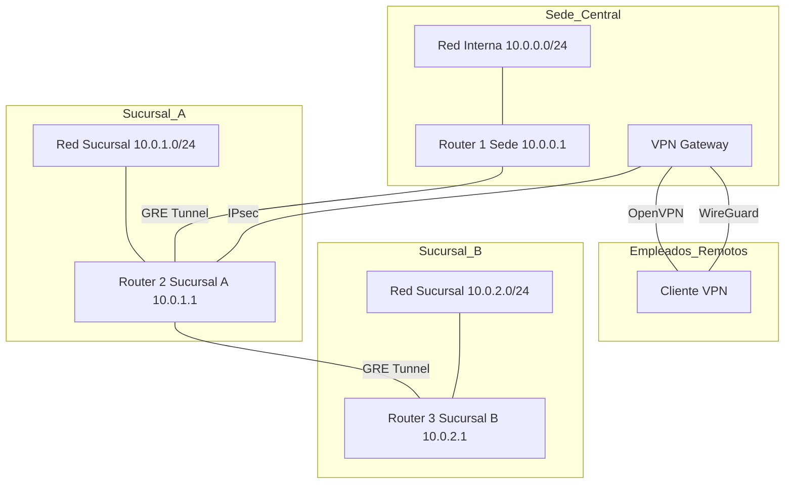

<p class="tema-num">LABORATORIO 09</p>

# VPN y Tunelización

## Contexto empresarial

La empresa **Networking SecOps** ya tiene su infraestructura de red con firewall, DMZ y servicios básicos (Laboratorio 08). Ahora necesita **conectar de forma segura** a empleados remotos y oficinas externas a través de Internet.

El equipo de redes ha identificado los siguientes requisitos:

1. **Conectar sucursales** de forma segura a la sede central.
2. **Permitir teletrabajo** para empleados desde sus casas.
3. **Proteger las comunicaciones** con cifrado.
4. Entender por qué el enrutamiento dinámico sobre túneles (GRE + OSPF/BGP) se aborda más adelante (Laboratorio 15).

## Problema inicial

- Las sucursales están conectadas con enlaces directos (sin cifrado).
- Los empleados remotos no pueden acceder a recursos corporativos.
- No hay seguridad en las comunicaciones entre sedes.
- Se necesita una solución escalable y segura.

## Objetivos del laboratorio

1.  Comprender los conceptos de **VPN** y **tunelización**.
2.  Configurar un **túnel GRE** entre dos routers.
3.  Implementar **IPsec** para cifrar el tráfico entre sedes.
4.  Configurar **OpenVPN** para acceso remoto de empleados.
5.  Implementar **WireGuard** como alternativa ligera.
6.  Comparar las diferentes tecnologías VPN.

## Herramientas necesarias

- Linux con privilegios de superusuario.
- Comandos: `ip`, `ping`, `tcpdump`, `wg` (para WireGuard).
- `iproute2` (subsistema `xfrm`) para IPsec, `openssl` para generar claves.
- `openvpn` para OpenVPN.
- `wireguard-tools` para WireGuard.

## Topología

La topología extiende la del laboratorio 08 agregando túneles VPN.



**Direccionamiento:**

| Dispositivo | Interfaz | Dirección IP |
|-------------|----------|--------------|
| R1 (Sede) | eth0 (LAN) | 10.0.0.1/24 |
| R1 (Sede) | eth1 (R1-R2) | 192.168.1.1/30 |
| R1 (Sede) | WAN | 192.168.100.1/24 |
| R2 (Sucursal A) | eth0 (LAN) | 10.0.1.1/24 |
| R2 (Sucursal A) | eth1 (R1-R2) | 192.168.1.2/30 |
| R2 (Sucursal A) | eth2 (R2-R3) | 192.168.2.1/30 |
| R3 (Sucursal B) | eth0 (LAN) | 10.0.2.1/24 |
| R3 (Sucursal B) | eth1 (R2-R3) | 192.168.2.2/30 |
| VPN Gateway (en la DMZ) | veth-vpngw | 10.0.99.20/24 (publicado por el firewall en 192.168.100.1) |
| Cliente VPN (remoto) | veth-cvpn | 192.168.100.50/24 |
| Túnel GRE R1-R2 | gre1 | 10.10.0.1/30 y 10.10.0.2/30 |
| Túnel GRE R2-R3 | gre2 | 10.10.0.5/30 y 10.10.0.6/30 |
| OpenVPN (punto a punto) | tun0 | 10.8.0.1 ↔ 10.8.0.2 |
| WireGuard | wg0 | 10.9.0.1/24 (gateway) y 10.9.0.2/24 (cliente) |

## Construcción de la red

### Paso 1: Verificar infraestructura existente

Asegurémonos de que los laboratorios 06 a 08 siguen en pie:

```bash
sudo ip netns list
sudo ip netns exec clienteSede ping -c 2 10.0.1.10
sudo ip netns exec clienteSede ping -c 2 192.168.100.2
```

Los túneles necesitan módulos del kernel; en una VM Linux estándar se cargan solos, o con `sudo modprobe ip_gre wireguard esp4 xfrm_user tun`.

!!! info "Rutas y archivos"
    Un `cat > /etc/...` dentro de un `ip netns exec` escribiría en el `/etc` real del host, y dos routers no pueden compartir el mismo `ipsec.conf`. Por eso los secretos y configuraciones de este laboratorio van en `/tmp/lab09/` y la configuración se hace con comandos (`ip`, `wg`) que **sí** son específicos de cada namespace.

### Paso 2: Crear el VPN Gateway y el cliente remoto

El *VPN Gateway* vive en la **DMZ** (`10.0.99.20`). El empleado remoto (`clienteVPN`) está en "Internet": se conecta al bridge `br-wan` del host (`192.168.100.50`). El firewall publica los puertos VPN hacia la DMZ y permite el acceso de los túneles a la LAN.

```bash
sudo ip netns add VPN_GW
sudo ip netns add clienteVPN

# VPN_GW dentro de la DMZ
sudo ip link add veth-vpngw type veth peer name veth-fw-vpn
sudo ip link set veth-vpngw netns VPN_GW
sudo ip link set veth-fw-vpn netns firewall
sudo ip netns exec firewall ip link set veth-fw-vpn master br-dmz
sudo ip netns exec firewall ip link set veth-fw-vpn up
sudo ip netns exec VPN_GW ip addr add 10.0.99.20/24 dev veth-vpngw
sudo ip netns exec VPN_GW ip link set veth-vpngw up
sudo ip netns exec VPN_GW ip link set lo up
sudo ip netns exec VPN_GW ip route add default via 10.0.99.1
sudo ip netns exec VPN_GW sysctl -w net.ipv4.ip_forward=1

# clienteVPN en "Internet"
sudo ip link add veth-cvpn type veth peer name veth-wan-cvpn
sudo ip link set veth-cvpn netns clienteVPN
sudo ip link set veth-wan-cvpn master br-wan
sudo ip link set veth-wan-cvpn up
sudo ip netns exec clienteVPN ip addr add 192.168.100.50/24 dev veth-cvpn
sudo ip netns exec clienteVPN ip link set veth-cvpn up
sudo ip netns exec clienteVPN ip link set lo up
```

Reglas del firewall: publicar los puertos VPN (DNAT), permitir que el gateway y sus túneles lleguen a la LAN, y devolver el tráfico de retorno hacia los túneles:

```bash
# Publicar WireGuard (51820/udp) y OpenVPN (1194/udp) hacia el VPN Gateway
sudo ip netns exec firewall iptables -t nat -A PREROUTING -i veth-fw-wan -p udp -m multiport --dports 51820,1194 -j DNAT --to-destination 10.0.99.20
sudo ip netns exec firewall iptables -I FORWARD 1 -i veth-fw-wan -o br-dmz -p udp -d 10.0.99.20 -m multiport --dports 51820,1194 -j ACCEPT

# Los túneles (10.8.0.0/24 y 10.9.0.0/24, ambas dentro de 10.8.0.0/15) pueden llegar a la red interna
sudo ip netns exec firewall iptables -I FORWARD 1 -i br-dmz -o veth-fw-lan -s 10.8.0.0/15 -d 10.0.0.0/22 -j ACCEPT
sudo ip netns exec firewall ip route add 10.8.0.0/24 via 10.0.99.20
sudo ip netns exec firewall ip route add 10.9.0.0/24 via 10.0.99.20

# VPN_GW conoce la red interna a través del firewall
sudo ip netns exec VPN_GW ip route add 10.0.0.0/22 via 10.0.99.1
```

Comprueba que el puerto publicado llega al gateway (DNAT), sin ninguna VPN todavía:

```bash
sudo ip netns exec clienteVPN ping -c 2 192.168.100.1
sudo ip netns exec VPN_GW sh -c 'nc -u -l -p 51820 > /tmp/lab09_dnat.txt &'
sudo ip netns exec clienteVPN sh -c 'echo prueba | nc -u -w 1 192.168.100.1 51820'
cat /tmp/lab09_dnat.txt
```

### Paso 3: Configurar túnel GRE entre R1 y R2

GRE encapsula paquetes IP dentro de otros paquetes IP, sin cifrarlos.

```bash
# En R1 (Sede)
sudo ip netns exec R1 ip tunnel add gre1 mode gre remote 192.168.1.2 local 192.168.1.1 ttl 255
sudo ip netns exec R1 ip addr add 10.10.0.1/30 dev gre1
sudo ip netns exec R1 ip link set gre1 up

# En R2 (Sucursal A)
sudo ip netns exec R2 ip tunnel add gre1 mode gre remote 192.168.1.1 local 192.168.1.2 ttl 255
sudo ip netns exec R2 ip addr add 10.10.0.2/30 dev gre1
sudo ip netns exec R2 ip link set gre1 up
```

### Paso 4: Verificar túnel GRE y crear el túnel R2-R3

```bash
sudo ip netns exec R1 ip tunnel show gre1
sudo ip netns exec R1 ping -c 4 10.10.0.2
```

```bash
# En R2 (Sucursal A)
sudo ip netns exec R2 ip tunnel add gre2 mode gre remote 192.168.2.2 local 192.168.2.1 ttl 255
sudo ip netns exec R2 ip addr add 10.10.0.5/30 dev gre2
sudo ip netns exec R2 ip link set gre2 up

# En R3 (Sucursal B)
sudo ip netns exec R3 ip tunnel add gre2 mode gre remote 192.168.2.1 local 192.168.2.2 ttl 255
sudo ip netns exec R3 ip addr add 10.10.0.6/30 dev gre2
sudo ip netns exec R3 ip link set gre2 up
sudo ip netns exec R2 ping -c 2 10.10.0.6
```

### Paso 5: Enviar el tráfico entre oficinas por los túneles

Las rutas estáticas del laboratorio 06 ya existen para estos prefijos, y un segundo `ip route add` con la misma métrica fallaría (`File exists`). Damos al túnel una **métrica menor (10)** para que sea el camino preferido, o reemplazamos la ruta cuando su métrica era 0:

```bash
# R1: hacia Sucursal B, vía GRE R1-R2 (métrica 10 < 50 < 100)
sudo ip netns exec R1 ip route add 10.0.2.0/24 via 10.10.0.2 dev gre1 metric 10

# R2: hacia Sede y Sucursal B, vía túneles (reemplaza las rutas de métrica 0)
sudo ip netns exec R2 ip route replace 10.0.0.0/24 via 10.10.0.1 dev gre1
sudo ip netns exec R2 ip route replace 10.0.2.0/24 via 10.10.0.6 dev gre2

# R3: hacia Sede, vía túnel GRE R2-R3
sudo ip netns exec R3 ip route add 10.0.0.0/24 via 10.10.0.5 dev gre2 metric 10
```

### Paso 6: Verificar conectividad a través de GRE

```bash
sudo ip netns exec clienteSede ping -c 4 10.0.2.10
sudo ip netns exec R1 ip route get 10.0.2.10
```

La segunda orden debe mostrar `dev gre1`. Para ver la encapsulación, captura en la interfaz física mientras haces ping: verás paquetes con protocolo GRE (47) que contienen el ICMP original.

```bash
sudo ip netns exec R1 tcpdump -i veth-r1r2 -n -c 4 proto gre
```

## Implementación de IPsec

### Paso 7: Cifrar el tráfico Sede ↔ Sucursal A con IPsec (ESP en modo túnel)

Una VPN IPsec de producción usa un demonio IKE (por ejemplo strongSwan) que negocia las claves. Los demonios guardan su configuración y sus *sockets* en rutas del sistema compartidas, así que **dos routers no pueden ejecutar uno cada uno dentro de namespaces sin trabajo adicional**. Para entender IPsec sin ese problema configuramos el kernel directamente (*manual keying*): definimos las **asociaciones de seguridad** (SA, con sus claves) y las **políticas** que dicen qué tráfico se cifra.

```bash
# Claves de prueba (las mismas en ambos extremos)
KEY_ENC=0x$(openssl rand -hex 32)     # AES-256
KEY_AUTH=0x$(openssl rand -hex 32)    # HMAC-SHA256

for R in R1 R2; do
  # SA R1->R2 (spi 0x1001, reqid 1) y SA R2->R1 (spi 0x1002, reqid 2)
  sudo ip netns exec $R ip xfrm state add src 192.168.1.1 dst 192.168.1.2 proto esp spi 0x1001 reqid 1 mode tunnel \
      auth 'hmac(sha256)' $KEY_AUTH enc 'cbc(aes)' $KEY_ENC
  sudo ip netns exec $R ip xfrm state add src 192.168.1.2 dst 192.168.1.1 proto esp spi 0x1002 reqid 2 mode tunnel \
      auth 'hmac(sha256)' $KEY_AUTH enc 'cbc(aes)' $KEY_ENC
done

# Políticas en R1: cifrar 10.0.0.0/24 -> 10.0.1.0/24 y aceptar lo recibido cifrado
sudo ip netns exec R1 ip xfrm policy add src 10.0.0.0/24 dst 10.0.1.0/24 dir out \
    tmpl src 192.168.1.1 dst 192.168.1.2 proto esp reqid 1 mode tunnel
sudo ip netns exec R1 ip xfrm policy add src 10.0.1.0/24 dst 10.0.0.0/24 dir in \
    tmpl src 192.168.1.2 dst 192.168.1.1 proto esp reqid 2 mode tunnel
sudo ip netns exec R1 ip xfrm policy add src 10.0.1.0/24 dst 10.0.0.0/24 dir fwd \
    tmpl src 192.168.1.2 dst 192.168.1.1 proto esp reqid 2 mode tunnel

# Políticas en R2 (espejo)
sudo ip netns exec R2 ip xfrm policy add src 10.0.1.0/24 dst 10.0.0.0/24 dir out \
    tmpl src 192.168.1.2 dst 192.168.1.1 proto esp reqid 2 mode tunnel
sudo ip netns exec R2 ip xfrm policy add src 10.0.0.0/24 dst 10.0.1.0/24 dir in \
    tmpl src 192.168.1.1 dst 192.168.1.2 proto esp reqid 1 mode tunnel
sudo ip netns exec R2 ip xfrm policy add src 10.0.0.0/24 dst 10.0.1.0/24 dir fwd \
    tmpl src 192.168.1.1 dst 192.168.1.2 proto esp reqid 1 mode tunnel
```

### Paso 8: Verificar IPsec

```bash
# Generar tráfico entre sede y sucursal A y capturar ESP en el enlace
sudo ip netns exec R1 tcpdump -i veth-r1r2 -n -c 4 esp &
sleep 1
sudo ip netns exec clienteSede ping -c 3 10.0.1.10
wait

# Asociaciones de seguridad (con contadores) y políticas
sudo ip netns exec R1 ip -s xfrm state
sudo ip netns exec R1 ip xfrm policy
```

**Salida esperada:** el *ping* responde, `tcpdump` solo muestra paquetes ESP (el contenido ICMP no es visible) y los contadores de la SA aumentan.

## Implementación de OpenVPN

### Paso 9: OpenVPN entre el cliente remoto y el VPN Gateway

Un servidor OpenVPN de acceso remoto "real" necesita una PKI (CA, certificado de servidor y de cada cliente, parámetros DH) y no se genera en unos pocos comandos. Aquí usamos el modo de **clave estática compartida**, suficiente para ver el túnel `tun` y su sobrecarga sin PKI.

```bash
sudo apt-get install -y openvpn
mkdir -p /tmp/lab09

# Clave compartida (OpenVPN 2.5 o superior)
openvpn --genkey secret /tmp/lab09/static.key

# VPN Gateway (escucha en 1194/udp; el túnel punto a punto es 10.8.0.1 <-> 10.8.0.2)
sudo ip netns exec VPN_GW openvpn --daemon --writepid /tmp/lab09/ovpn-gw.pid --log /tmp/lab09/ovpn-gw.log \
    --dev tun0 --dev-type tun --proto udp --lport 1194 --ifconfig 10.8.0.1 10.8.0.2 \
    --secret /tmp/lab09/static.key --cipher AES-256-CBC --allow-deprecated-insecure-static-crypto

# Cliente remoto: se conecta a la IP pública del firewall (que reenvía al gateway)
sudo ip netns exec clienteVPN openvpn --daemon --writepid /tmp/lab09/ovpn-cli.pid --log /tmp/lab09/ovpn-cli.log \
    --dev tun0 --dev-type tun --proto udp --remote 192.168.100.1 1194 --ifconfig 10.8.0.2 10.8.0.1 \
    --secret /tmp/lab09/static.key --cipher AES-256-CBC --allow-deprecated-insecure-static-crypto \
    --route 10.0.0.0 255.255.252.0
```

!!! note "Versión de OpenVPN"
    `--allow-deprecated-insecure-static-crypto` es obligatorio desde OpenVPN 2.6; en 2.5 o anteriores no existe y debe quitarse (y `--genkey secret` se escribe `--genkey --secret`). En producción usa certificados.

### Paso 10: Verificar OpenVPN

```bash
sudo ip netns exec clienteVPN ping -c 4 10.8.0.1
sudo ip netns exec clienteVPN ping -c 4 10.0.0.10
tail -3 /tmp/lab09/ovpn-cli.log
```

## Implementación de WireGuard

### Paso 11: Generar las claves

WireGuard autentica a cada extremo con un par de claves. Cada lado conserva su clave privada y entrega solo la pública al otro:

```bash
sudo apt-get install -y wireguard-tools
mkdir -p /tmp/lab09 && cd /tmp/lab09
umask 077
wg genkey | tee gw.key  | wg pubkey > gw.pub
wg genkey | tee cli.key | wg pubkey > cli.pub
```

### Paso 12: Configurar el servidor (VPN Gateway) y el cliente

Creamos la interfaz **dentro** de cada namespace y la configuramos con `wg set` (no usamos `wg-quick`, que lee `/etc/wireguard` del host):

```bash
# VPN Gateway: 10.9.0.1, escucha en 51820, conoce la clave pública del cliente
sudo ip -n VPN_GW link add wg0 type wireguard
sudo ip netns exec VPN_GW wg set wg0 listen-port 51820 private-key /tmp/lab09/gw.key \
    peer $(cat /tmp/lab09/cli.pub) allowed-ips 10.9.0.2/32
sudo ip -n VPN_GW addr add 10.9.0.1/24 dev wg0
sudo ip -n VPN_GW link set wg0 up

# Cliente remoto: 10.9.0.2, apunta a la IP pública del firewall
sudo ip -n clienteVPN link add wg0 type wireguard
sudo ip netns exec clienteVPN wg set wg0 private-key /tmp/lab09/cli.key \
    peer $(cat /tmp/lab09/gw.pub) endpoint 192.168.100.1:51820 \
    allowed-ips 10.9.0.1/32,10.0.0.0/22 persistent-keepalive 25
sudo ip -n clienteVPN addr add 10.9.0.2/24 dev wg0
sudo ip -n clienteVPN link set wg0 up
sudo ip -n clienteVPN route add 10.0.0.0/22 dev wg0
```

### Paso 13: Verificar WireGuard

```bash
# Estado del servidor (debe mostrar un handshake reciente tras el primer ping)
sudo ip netns exec clienteVPN ping -c 4 10.9.0.1
sudo ip netns exec VPN_GW wg show

# Acceso a la red interna a través del túnel
sudo ip netns exec clienteVPN ping -c 4 10.0.0.10
```

## Análisis y comparación

### Paso 14: Comparar tecnologías VPN

| Tecnología | Capa | Ventajas | Desventajas |
|------------|------|----------|-------------|
| GRE | 3 | Sencillo, soporta multicast | Sin cifrado |
| IPsec | 3 | Seguro, estándar | Complejo, NAT issues |
| OpenVPN | 3-4 | Flexible, SSL/TLS | Mayor overhead |
| WireGuard | 3 | Ligero, moderno | Menos funciones |

### Paso 15: Analizar overhead de encapsulación

```bash
# Capturar tráfico GRE
sudo ip netns exec R1 tcpdump -i gre1 -n -v

# Capturar tráfico IPsec
sudo ip netns exec R1 tcpdump -i veth-r1r2 -n -v esp   # (visto en el Paso 8)
```

**Interpretación:**
- GRE añade 4 bytes de overhead.
- IPsec añade ~50-70 bytes de overhead.
- OpenVPN añade ~60-80 bytes de overhead.
- WireGuard añade ~40-50 bytes de overhead.

## Ejercicios prácticos

### Ejercicio 1: Agregar un nuevo túnel GRE

Configura un túnel GRE entre R1 y R3 sobre el enlace directo `192.168.3.0/30` que se creó en el Paso 6 del laboratorio 06 (debe seguir activo) para tener redundancia.

```bash
# En R1
sudo ip netns exec R1 ip tunnel add gre3 mode gre remote 192.168.3.2 local 192.168.3.1 ttl 255
sudo ip netns exec R1 ip addr add 10.10.0.9/30 dev gre3
sudo ip netns exec R1 ip link set gre3 up

# En R3
sudo ip netns exec R3 ip tunnel add gre3 mode gre remote 192.168.3.1 local 192.168.3.2 ttl 255
sudo ip netns exec R3 ip addr add 10.10.0.10/30 dev gre3
sudo ip netns exec R3 ip link set gre3 up
```

### Ejercicio 2: Agregar rutas redundantes

Configura una ruta con métrica distinta a las existentes para failover (en R1 ya hay rutas a `10.0.2.0/24` con métricas 10, 50 y 100; repetir una métrica da `File exists`).

```bash
# En R1
sudo ip netns exec R1 ip route add 10.0.2.0/24 via 10.10.0.9 dev gre3 metric 20
```

### Ejercicio 3: Configurar WireGuard en Sucursal

Implementa WireGuard entre R2 y R3 como alternativa.

## Errores comunes y soluciones

| Error | Causa | Solución |
|-------|-------|----------|
| Túnel GRE no sube | IPs de extremos incorrectas | Verificar `ip tunnel show` |
| IPsec no cifra | SPI/claves distintos o políticas que no coinciden | Comparar `ip xfrm state` y `ip xfrm policy` en ambos extremos |
| OpenVPN no conecta | Clave estática distinta, puerto no publicado o versión de OpenVPN | Revisar `/tmp/lab09/ovpn-*.log` y la regla DNAT del firewall |
| WireGuard sin handshake | Puerto bloqueado, `endpoint` o claves públicas cruzadas mal | Verificar DNAT/FORWARD en el firewall y `wg show` |

## Conceptos clave del Tema 9 aplicados

| Concepto | Aplicación en el laboratorio |
|----------|------------------------------|
| GRE | Túneles entre R1-R2 y R2-R3 |
| IPsec | Cifrado entre sedes |
| OpenVPN | Acceso remoto de empleados |
| WireGuard | VPN ligera y moderna |
| Tunelización | Encapsulación de tráfico |

## Conclusiones técnicas

En este laboratorio hemos:

1.  Configurado **túneles GRE** para conectar redes no contiguas.
2.  Implementado **IPsec** (ESP en modo túnel, con claves manuales) para cifrar comunicaciones entre sedes.
3.  Configurado **OpenVPN** en modo de clave estática para el acceso remoto (sin PKI).
4.  Implementado **WireGuard** como alternativa moderna y ligera.
5.  Comparado las diferentes tecnologías VPN y sus características.

Las VPN son esenciales para conectar sedes y proporcionar acceso remoto seguro. GRE ofrece encapsulación simple y soporte para multicast, IPsec proporciona seguridad robusta y es el estándar empresarial, OpenVPN ofrece flexibilidad y amplia compatibilidad, y WireGuard destaca por su simplicidad, rendimiento y criptografía moderna.

## Preparación para el siguiente laboratorio

Hemos dejado la red con túneles GRE, IPsec (claves manuales), OpenVPN (clave estática) y WireGuard. En el **Laboratorio 10** exploraremos **Infraestructura WAN y Core**, montando una red troncal WAN con routers PE y P y rutas estáticas con redundancia (el enrutamiento dinámico llega en el Laboratorio 15).

---

**¡Laboratorio 09 completado!** Has implementado VPN y tunelización. Continúa con el **Laboratorio 10**.
