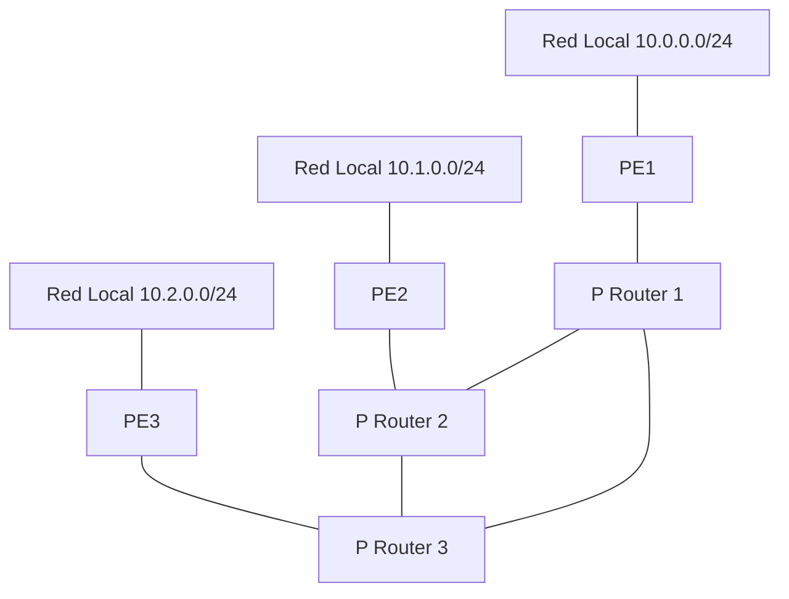

<p class="tema-num">LABORATORIO 10</p>

# Infraestructura WAN y Core

## Contexto empresarial

La empresa **Networking SecOps** ha implementado exitosamente su red con VPN y tunelización (Laboratorio 09). Ahora necesita expandir su infraestructura a nivel geográfico, conectando múltiples sucursales y centros de datos a través de una red WAN robusta y escalable.

## Objetivos del laboratorio

1.  Construir una **simulación de una topología WAN con roles PE/P**: **routers PE** (*Provider Edge*) y **routers P** (*Provider*) en malla parcial, con direccionamiento IP y rutas estáticas.
2.  Interconectar tres LAN remotas a través del núcleo con **rutas estáticas**.
3.  Comprobar la **redundancia** de la malla y el reparto de carga con **ECMP**.
4.  Comprender (a nivel conceptual) cómo MPLS reenvía por etiquetas, en qué se diferencia del enrutamiento IP convencional y en qué se diferencia de SD-WAN.

!!! warning "Qué es ejecutable y qué es conceptual"
    - **Ejecutable:** topología PE/P, rutas estáticas, failover por métricas y ECMP.
    - **Conceptual:** MPLS (*push/swap/pop*) y SD-WAN.
    - **No es** una implementación funcional de un *core* MPLS: la topología usa los **nombres** PE/P para el rol de cada equipo, pero lo que se ejecuta es **enrutamiento IP convencional** con rutas estáticas. Aquí **no** se configuran etiquetas reales (eso exigiría los módulos `mpls_router` y `mpls_iptunnel`) y no se usa OSPF ni BGP: con rutas estáticas el núcleo **no reconverge solo** ante fallos remotos. El enrutamiento dinámico se practica en el Laboratorio 15.

## Topología



**Direccionamiento:**

| Dispositivo | Interfaz | Dirección IP | Rol |
|-------------|----------|--------------|-----|
| PE1 | eth0 (LAN) | 10.0.0.1/24 | Provider Edge |
| host1 | - | 10.0.0.10/24 | Equipo de la LAN 1 |
| PE1 | eth1 (P1) | 192.168.1.1/30 | MPLS Core |
| PE2 | eth0 (LAN) | 10.1.0.1/24 | Provider Edge |
| host2 | - | 10.1.0.10/24 | Equipo de la LAN 2 |
| PE2 | eth1 (P2) | 192.168.1.5/30 | MPLS Core |
| PE3 | eth0 (LAN) | 10.2.0.1/24 | Provider Edge |
| host3 | - | 10.2.0.10/24 | Equipo de la LAN 3 |
| PE3 | eth1 (P3) | 192.168.1.9/30 | MPLS Core |
| P1 | eth0 (R1) | 192.168.1.2/30 | P Router |
| P1 | eth1 (P2) | 192.168.1.13/30 | P Router |
| P1 | eth2 (P3) | 192.168.1.17/30 | P Router |
| P2 | eth0 (R2) | 192.168.1.6/30 | P Router |
| P2 | eth1 (P1) | 192.168.1.14/30 | P Router |
| P2 | eth2 (P3) | 192.168.1.21/30 | P Router |
| P3 | eth0 (R3) | 192.168.1.10/30 | P Router |
| P3 | eth1 (P1) | 192.168.1.18/30 | P Router |
| P3 | eth2 (P2) | 192.168.1.22/30 | P Router |

## Construcción de la red

### Paso 0: Limpiar laboratorios anteriores (recomendado)

Este laboratorio usa una topología nueva e independiente (**un escenario distinto** de los anteriores: otros dispositivos, otro direccionamiento). Para no mezclar equipos, elimina **solo los namespaces creados en los laboratorios 01 a 09**, por nombre. No uses un bucle que borre todos los namespaces de `ip netns list`: eliminaría también los de otros entornos o servicios de tu equipo.

```bash
for ns in cliente1 cliente2 cliente3 cliente4 router switch \
          ventas1 ventas2 ventas3 it1 it2 it3 admin1 admin2 \
          R1 R2 R3 clienteSede clienteSucA clienteSucB \
          servidorDNS servidorDHCP clienteDHCP \
          firewall servidorWeb servidorDNS_PUB servidorInterno \
          VPN_GW clienteVPN; do
  sudo ip netns del $ns 2>/dev/null || true
done
sudo ip link del br-wan 2>/dev/null || true
sudo ip link del veth-host 2>/dev/null || true
```

Si ya habías limpiado parte de esos laboratorios, los errores se ignoran (`|| true`). Solo se tocan los nombres de la lista.

### Paso 1: Crear namespaces

```bash
sudo ip netns add PE1
sudo ip netns add PE2
sudo ip netns add PE3
sudo ip netns add P1
sudo ip netns add P2
sudo ip netns add P3
sudo ip netns add host1
sudo ip netns add host2
sudo ip netns add host3

# Un router solo reenvía si ip_forward vale 1 (en un namespace nuevo vale 0)
for r in PE1 PE2 PE3 P1 P2 P3; do
  sudo ip netns exec $r sysctl -w net.ipv4.ip_forward=1
done
```

### Paso 2: Conectar PE a P

```bash
sudo ip link add veth-pe1p1 type veth peer name veth-p1pe1
sudo ip link set veth-pe1p1 netns PE1
sudo ip link set veth-p1pe1 netns P1
sudo ip netns exec PE1 ip addr add 192.168.1.1/30 dev veth-pe1p1
sudo ip netns exec PE1 ip link set veth-pe1p1 up
sudo ip netns exec P1 ip addr add 192.168.1.2/30 dev veth-p1pe1
sudo ip netns exec P1 ip link set veth-p1pe1 up

sudo ip link add veth-pe2p2 type veth peer name veth-p2pe2
sudo ip link set veth-pe2p2 netns PE2
sudo ip link set veth-p2pe2 netns P2
sudo ip netns exec PE2 ip addr add 192.168.1.5/30 dev veth-pe2p2
sudo ip netns exec PE2 ip link set veth-pe2p2 up
sudo ip netns exec P2 ip addr add 192.168.1.6/30 dev veth-p2pe2
sudo ip netns exec P2 ip link set veth-p2pe2 up

sudo ip link add veth-pe3p3 type veth peer name veth-p3pe3
sudo ip link set veth-pe3p3 netns PE3
sudo ip link set veth-p3pe3 netns P3
sudo ip netns exec PE3 ip addr add 192.168.1.9/30 dev veth-pe3p3
sudo ip netns exec PE3 ip link set veth-pe3p3 up
sudo ip netns exec P3 ip addr add 192.168.1.10/30 dev veth-p3pe3
sudo ip netns exec P3 ip link set veth-p3pe3 up
```

### Paso 3: Conectar P routers

```bash
sudo ip link add veth-p1p2 type veth peer name veth-p2p1
sudo ip link set veth-p1p2 netns P1
sudo ip link set veth-p2p1 netns P2
sudo ip netns exec P1 ip addr add 192.168.1.13/30 dev veth-p1p2
sudo ip netns exec P1 ip link set veth-p1p2 up
sudo ip netns exec P2 ip addr add 192.168.1.14/30 dev veth-p2p1
sudo ip netns exec P2 ip link set veth-p2p1 up

sudo ip link add veth-p2p3 type veth peer name veth-p3p2
sudo ip link set veth-p2p3 netns P2
sudo ip link set veth-p3p2 netns P3
sudo ip netns exec P2 ip addr add 192.168.1.21/30 dev veth-p2p3
sudo ip netns exec P2 ip link set veth-p2p3 up
sudo ip netns exec P3 ip addr add 192.168.1.22/30 dev veth-p3p2
sudo ip netns exec P3 ip link set veth-p3p2 up

sudo ip link add veth-p1p3 type veth peer name veth-p3p1
sudo ip link set veth-p1p3 netns P1
sudo ip link set veth-p3p1 netns P3
sudo ip netns exec P1 ip addr add 192.168.1.17/30 dev veth-p1p3
sudo ip netns exec P1 ip link set veth-p1p3 up
sudo ip netns exec P3 ip addr add 192.168.1.18/30 dev veth-p3p1
sudo ip netns exec P3 ip link set veth-p3p1 up
```

### Paso 4: Configurar redes locales (un equipo en cada LAN)

```bash
for n in 1 2 3; do
  case $n in 1) NET=10.0.0.;; 2) NET=10.1.0.;; 3) NET=10.2.0.;; esac
  sudo ip link add veth-pe${n}lan type veth peer name veth-lanpe${n}
  sudo ip link set veth-pe${n}lan netns PE${n}
  sudo ip link set veth-lanpe${n} netns host${n}
  sudo ip netns exec PE${n} ip addr add ${NET}1/24 dev veth-pe${n}lan
  sudo ip netns exec PE${n} ip link set veth-pe${n}lan up
  sudo ip netns exec host${n} ip addr add ${NET}10/24 dev veth-lanpe${n}
  sudo ip netns exec host${n} ip link set veth-lanpe${n} up
  sudo ip netns exec host${n} ip link set lo up
  sudo ip netns exec host${n} ip route add default via ${NET}1
done
```

### Paso 5: Configurar enrutamiento estático

Cada PE envía al P al que está conectado todo lo que no conoce:

```bash
sudo ip netns exec PE1 ip route add default via 192.168.1.2
sudo ip netns exec PE2 ip route add default via 192.168.1.6
sudo ip netns exec PE3 ip route add default via 192.168.1.10
```

Los P conocen el núcleo. Entre P1 y P3 hay un enlace directo (camino preferido) y un camino de respaldo por P2 con `metric 100`:

```bash
# P1
sudo ip netns exec P1 ip route add 192.168.1.4/30 via 192.168.1.14
sudo ip netns exec P1 ip route add 192.168.1.8/30 via 192.168.1.18
sudo ip netns exec P1 ip route add 192.168.1.8/30 via 192.168.1.14 metric 100
sudo ip netns exec P1 ip route add 10.0.0.0/24 via 192.168.1.1
sudo ip netns exec P1 ip route add 10.1.0.0/24 via 192.168.1.14
sudo ip netns exec P1 ip route add 10.2.0.0/24 via 192.168.1.18
sudo ip netns exec P1 ip route add 10.2.0.0/24 via 192.168.1.14 metric 100

# P2
sudo ip netns exec P2 ip route add 192.168.1.0/30 via 192.168.1.13
sudo ip netns exec P2 ip route add 192.168.1.8/30 via 192.168.1.22
sudo ip netns exec P2 ip route add 10.0.0.0/24 via 192.168.1.13
sudo ip netns exec P2 ip route add 10.1.0.0/24 via 192.168.1.5
sudo ip netns exec P2 ip route add 10.2.0.0/24 via 192.168.1.22

# P3
sudo ip netns exec P3 ip route add 192.168.1.0/30 via 192.168.1.17
sudo ip netns exec P3 ip route add 192.168.1.0/30 via 192.168.1.21 metric 100
sudo ip netns exec P3 ip route add 192.168.1.4/30 via 192.168.1.21
sudo ip netns exec P3 ip route add 10.0.0.0/24 via 192.168.1.17
sudo ip netns exec P3 ip route add 10.0.0.0/24 via 192.168.1.21 metric 100
sudo ip netns exec P3 ip route add 10.1.0.0/24 via 192.168.1.21
sudo ip netns exec P3 ip route add 10.2.0.0/24 via 192.168.1.9
```

### Paso 6: Verificar conectividad

```bash
# Entre equipos de LAN distintas, a través del núcleo
sudo ip netns exec host1 ping -c 4 10.1.0.10
sudo ip netns exec host1 ping -c 4 10.2.0.10

# Camino que sigue el tráfico (host1 -> host3 pasa por PE1, P1, P3, PE3).
# Son saltos IP convencionales: en un core MPLS real los P no consultarían la tabla IP, sino etiquetas.
sudo ip netns exec host1 traceroute -n 10.2.0.10

# Entre routers PE
sudo ip netns exec PE1 ping -c 4 192.168.1.5
```

## Análisis MPLS (conceptual)

!!! warning "Lo que ejecutamos arriba no es MPLS"
    Las rutas estáticas del Paso 5 son **rutas IP convencionales**. **No crean una LFIB, no asignan etiquetas MPLS y no demuestran intercambio de etiquetas.** Cada router decide por la **dirección IP de destino** (*longest prefix match*). Lo que sigue explica qué haría MPLS en la misma topología, sin implementarlo.

**MPLS** (*Multiprotocol Label Switching*, RFC 3031) reenvía paquetes según una **etiqueta** de corta longitud, no según la dirección IP de destino. Los **PE** participan en la **entrada y salida** del dominio MPLS; los **P** realizan **conmutación de etiquetas** sin mirar el paquete IP. Las operaciones son:

1. **Push**: el PE de entrada añade una etiqueta al paquete.
2. **Swap**: cada P sustituye la etiqueta de entrada por la de salida, según su tabla.
3. **Pop**: se retira la etiqueta (en el último P, por *penultimate hop popping*, o en el PE de salida).

**Ejemplo de recorrido** (ilustrativo, los números de etiqueta son inventados) para el tráfico `host1 → host3`, que en MPLS seguiría el mismo camino PE1 → P1 → P3 → PE3:

| Salto | Equipo | Operación | Etiqueta en el paquete |
|-------|--------|-----------|------------------------|
| 1 | PE1 | **Push** (clasifica `10.2.0.0/24` en una FEC) | → 100 |
| 2 | P1 | **Swap** (consulta su LFIB) | 100 → 200 |
| 3 | P3 | **Pop** (*penultimate hop popping*, el PE final recibe el paquete sin etiqueta) | 200 → ninguna |
| 4 | PE3 | Reenvío IP normal hacia `host3` | — |

**Qué le falta a la simulación para ser una red MPLS real:**

-   **Distribución de etiquetas**: un protocolo como **LDP** (o RSVP-TE, o segment routing) reparte las etiquetas entre routers vecinos y las asocia a cada prefijo (FEC) que el IGP conoce. Sin él, no hay correspondencia etiqueta ↔ destino.
-   **Un IGP** (como OSPF o IS-IS) que dé a LDP la topología de transporte.
-   **Las tablas MPLS** (LFIB), que sustituyen en el núcleo a la consulta de la tabla de rutas IP, y el soporte de etiquetas en las interfaces (módulos `mpls_router` y `mpls_iptunnel` en Linux).

Entonces, ¿para qué sirve? Entre otras cosas, para **VPN de capa 3 (L3VPN)**, **ingeniería de tráfico** y **QoS** en redes de proveedor.

## Comparación MPLS vs SD-WAN

**SD-WAN no es sinónimo de MPLS.** MPLS es una **tecnología de reenvío** dentro de la red de un proveedor; SD-WAN es un **enfoque de gestión y control** de la conectividad WAN basado en **políticas y selección de caminos**, que puede utilizar **distintos transportes** (MPLS, Internet de banda ancha, 4G/5G…). De hecho, una SD-WAN puede usar un circuito MPLS como uno de sus transportes.

| Característica | MPLS | SD-WAN |
|----------------|------|--------|
| Naturaleza | Mecanismo de reenvío por etiquetas | Plano de control/gestión centralizado sobre varios transportes |
| Control | Distribuido (protocolos entre routers) | Centralizado (orquestador y políticas) |
| Transporte | Red del proveedor (con SLA) | Varios enlaces (MPLS, banda ancha, móvil) |
| QoS | Posible y con SLA según contrato | Depende del transporte elegido y de las políticas aplicadas |
| Costo | Suele ser mayor por Mbps | Suele ser menor, según el diseño |
| Agilidad | Menor (aprovisionamiento del proveedor) | Mayor |

Los valores de coste y agilidad son tendencias habituales, no reglas.

## Ejercicios

### Ejercicio 1: Simular un fallo en el núcleo

Tiramos el enlace directo P1-P3 (camino preferido) **por sus dos extremos**: así ambos routers retiran su ruta y activan la de respaldo por P2.

```bash
sudo ip netns exec P1 ip link set veth-p1p3 down
sudo ip netns exec P3 ip link set veth-p3p1 down
sudo ip netns exec host1 ping -c 4 10.2.0.10
sudo ip netns exec host1 traceroute -n 10.2.0.10
```

**Resultado esperado:** 0% de pérdida y un salto más (P2, `192.168.1.14`). Restablece después el enlace (`up` en ambos extremos) y vuelve a añadir las rutas de métrica 0 que se retiraron al bajar la interfaz.

!!! warning "Sin reconvergencia automática"
    Si en lugar del enlace P1-P3 cae el P2-P3, P1 **no se entera** y sigue usando una ruta estática que ya no sirve. Detectar fallos remotos es tarea de OSPF/BGP (Laboratorio 15).

### Ejercicio 2: Balanceo ECMP

**ECMP** (*Equal-Cost Multi-Path*) reparte el tráfico entre varios caminos de **igual coste**: es **balanceo de carga**, distinto del *failover*, que es la **selección de una ruta alternativa** cuando falla la principal (Ejercicio 1). ECMP **no equivale a alta disponibilidad completa**: si un camino cae, los flujos que lo usaban se interrumpen hasta que se detecta el fallo y se reasignan, y las aplicaciones pueden notarlo. Se define con **una sola ruta de varios saltos** (`nexthop`), no con dos `ip route add` (el segundo daría `File exists`). Por defecto el reparto se calcula solo con las IP de origen y destino; con la política 1 también se usan los puertos y se ven los dos caminos:

```bash
sudo ip netns exec P1 sysctl -w net.ipv4.fib_multipath_hash_policy=1
sudo ip netns exec P1 ip route replace 10.2.0.0/24 nexthop via 192.168.1.18 weight 1 nexthop via 192.168.1.14 weight 1
sudo ip netns exec P1 ip route show 10.2.0.0/24

# Varios flujos TCP distintos (puertos de origen distintos) pueden tomar caminos distintos
for sp in 40001 40002 40003 40004 40005 40006; do
  sudo ip netns exec P1 ip route get 10.2.0.10 from 10.0.0.10 iif veth-p1pe1 ipproto tcp sport $sp dport 80 | head -1
done
```

## Conceptos clave

| Concepto | Aplicación |
|----------|------------|
| MPLS | Explicado conceptualmente (push/swap/pop); **no** implementado |
| SD-WAN | Explicado conceptualmente: gestión por políticas sobre varios transportes |
| Topología PE/P | Roles de proveedor con enrutamiento IP y rutas estáticas con respaldo |
| ECMP | Reparto de carga entre caminos de igual coste (no es *failover* ni alta disponibilidad completa) |

## Conclusiones

Hemos construido una **simulación de una topología WAN con roles PE/P** y rutas IP estáticas, y hemos explicado MPLS de forma conceptual: para que fuese un core MPLS faltarían la distribución de etiquetas (LDP) y las tablas de etiquetas. MPLS permite ingeniería de tráfico y QoS mediante el reenvío por etiquetas (la calidad no es automática: depende de cómo el proveedor la configure). SD-WAN es un enfoque de gestión por políticas que puede apoyarse en MPLS, banda ancha u otros transportes, y suele ofrecer flexibilidad y reducción de costos. Las arquitecturas híbridas combinan ambos.

---

**¡Laboratorio 10 completado!** Continúa con el **Laboratorio 11**.
