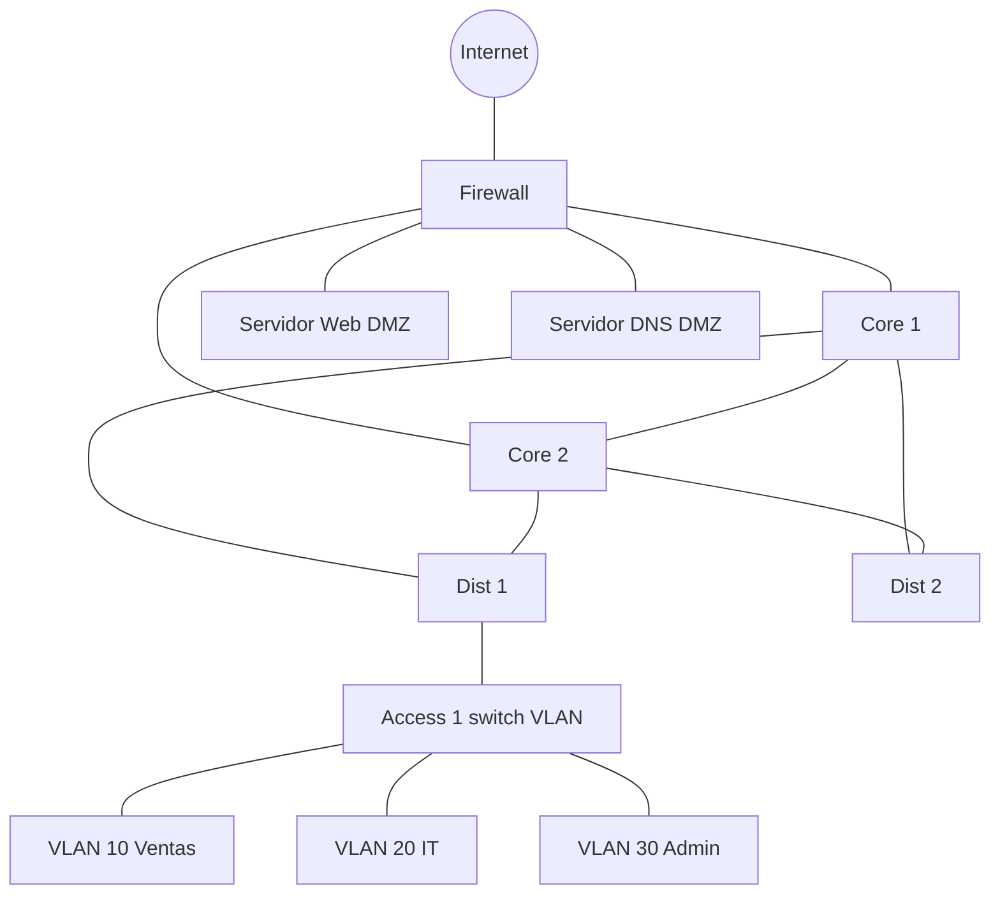

<p class="tema-num">LABORATORIO 11</p>

# Arquitectura de Red Empresarial

## Contexto empresarial

La empresa **Networking SecOps** ha implementado su infraestructura WAN (Laboratorio 10). Ahora necesita diseñar la arquitectura de red completa para su sede central, con el modelo jerárquico **Core - Distribución - Acceso**, redundancia en el núcleo y una DMZ.

!!! info "Alcance"
    Se construye **una** capa de acceso completa (`Access1`, con las tres VLAN) y la redundancia se logra con **rutas estáticas con métrica**. La alta disponibilidad de *gateway* con VRRP y la reconvergencia dinámica con OSPF se practican en el Laboratorio 15.

## Topología



**Direccionamiento.** Los enlaces punto a punto del núcleo usan subredes `/30` (una por enlace, sin repetir direcciones) dentro de `10.255.0.0/16`; las LAN, VLAN y DMZ usan `10.0.0.0/16`.

| Enlace | Subred | Extremo A | Extremo B |
|--------|--------|-----------|-----------|
| Core1 - Core2 | 10.255.0.0/30 | Core1 .1 | Core2 .2 |
| Core1 - Dist1 | 10.255.1.0/30 | Core1 .1 | Dist1 .2 |
| Core1 - Dist2 | 10.255.1.4/30 | Core1 .5 | Dist2 .6 |
| Core2 - Dist1 | 10.255.1.8/30 | Core2 .9 | Dist1 .10 |
| Core2 - Dist2 | 10.255.1.12/30 | Core2 .13 | Dist2 .14 |
| Core1 - Firewall | 10.255.2.0/30 | Core1 .1 | Firewall .2 |
| Core2 - Firewall | 10.255.2.4/30 | Core2 .5 | Firewall .6 |
| Firewall - Internet (host) | 192.168.100.0/24 | Firewall .1 | host .2 |

| Segmento | Subred | Gateway | Equipos |
|----------|--------|---------|---------|
| VLAN 10 Ventas | 10.0.10.0/24 | Dist1 10.0.10.1 | ventas 10.0.10.10 |
| VLAN 20 IT | 10.0.20.0/24 | Dist1 10.0.20.1 | it 10.0.20.10 |
| VLAN 30 Admin | 10.0.30.0/24 | Dist1 10.0.30.1 | admin 10.0.30.10 |
| DMZ | 10.0.99.0/24 | Firewall 10.0.99.1 | Web 10.0.99.10, DNS 10.0.99.5 |

## Construcción

### Paso 0: Limpiar laboratorios anteriores

```bash
for ns in $(ip netns list | awk '{print $1}'); do sudo ip netns del $ns; done
sudo ip link del br-wan 2>/dev/null || true
```

### Paso 1: Crear namespaces y una función auxiliar

```bash
for ns in Core1 Core2 Dist1 Dist2 Access1 Firewall ServidorWeb ServidorDNS ventas it admin; do
  sudo ip netns add $ns
done
for r in Core1 Core2 Dist1 Dist2 Firewall; do
  sudo ip netns exec $r sysctl -qw net.ipv4.ip_forward=1
done

# enlace NS_A IF_A IP_A NS_B IF_B IP_B : crea un par veth con una IP en cada extremo
enlace() {
  sudo ip link add $2 type veth peer name $5
  sudo ip link set $2 netns $1
  sudo ip link set $5 netns $4
  sudo ip netns exec $1 ip addr add $3 dev $2
  sudo ip netns exec $1 ip link set $2 up
  sudo ip netns exec $4 ip addr add $6 dev $5
  sudo ip netns exec $4 ip link set $5 up
}
```

### Paso 2: Enlaces del núcleo y de distribución (un /30 por enlace)

```bash
enlace Core1 veth-c1c2 10.255.0.1/30  Core2 veth-c2c1 10.255.0.2/30
enlace Core1 veth-c1d1 10.255.1.1/30  Dist1 veth-d1c1 10.255.1.2/30
enlace Core1 veth-c1d2 10.255.1.5/30  Dist2 veth-d2c1 10.255.1.6/30
enlace Core2 veth-c2d1 10.255.1.9/30  Dist1 veth-d1c2 10.255.1.10/30
enlace Core2 veth-c2d2 10.255.1.13/30 Dist2 veth-d2c2 10.255.1.14/30
```

### Paso 3: Firewall, Internet y DMZ

```bash
# Core <-> Firewall
enlace Core1 veth-c1fw 10.255.2.1/30 Firewall veth-fwc1 10.255.2.2/30
enlace Core2 veth-c2fw 10.255.2.5/30 Firewall veth-fwc2 10.255.2.6/30

# Firewall <-> Internet (el host, 192.168.100.2)
sudo ip link add veth-fw-wan type veth peer name veth-wan-fw
sudo ip link set veth-fw-wan netns Firewall
sudo ip netns exec Firewall ip addr add 192.168.100.1/24 dev veth-fw-wan
sudo ip netns exec Firewall ip link set veth-fw-wan up
sudo ip addr add 192.168.100.2/24 dev veth-wan-fw
sudo ip link set veth-wan-fw up
sudo ip netns exec Firewall ip route add default via 192.168.100.2

# El host reenvía y traduce hacia tu red real (cambia eth0 por tu interfaz de salida)
sudo sysctl -w net.ipv4.ip_forward=1
sudo iptables -t nat -C POSTROUTING -s 192.168.100.0/24 -o eth0 -j MASQUERADE 2>/dev/null || \
  sudo iptables -t nat -A POSTROUTING -s 192.168.100.0/24 -o eth0 -j MASQUERADE

# DMZ: un bridge en el firewall con los dos servidores públicos
sudo ip netns exec Firewall ip link add br-dmz type bridge
sudo ip netns exec Firewall ip addr add 10.0.99.1/24 dev br-dmz
sudo ip netns exec Firewall ip link set br-dmz up
for s in "ServidorWeb veth-web veth-fw-web 10.0.99.10/24" "ServidorDNS veth-dns veth-fw-dns 10.0.99.5/24"; do
  set -- $s
  sudo ip link add $2 type veth peer name $3
  sudo ip link set $2 netns $1
  sudo ip link set $3 netns Firewall
  sudo ip netns exec Firewall ip link set $3 master br-dmz
  sudo ip netns exec Firewall ip link set $3 up
  sudo ip netns exec $1 ip addr add $4 dev $2
  sudo ip netns exec $1 ip link set $2 up
  sudo ip netns exec $1 ip link set lo up
  sudo ip netns exec $1 ip route add default via 10.0.99.1
done
```

### Paso 4: Rutas estáticas con métrica (camino principal y de respaldo)

Cada router tiene un camino **principal** (métrica 10) y uno de **respaldo** (métrica 20). Dos rutas al mismo destino con la misma métrica no pueden coexistir.

```bash
# Distribución: salida por defecto hacia el core (principal Core1 en Dist1, Core2 en Dist2)
sudo ip netns exec Dist1 ip route add default via 10.255.1.1  metric 10
sudo ip netns exec Dist1 ip route add default via 10.255.1.9  metric 20
sudo ip netns exec Dist2 ip route add default via 10.255.1.13 metric 10
sudo ip netns exec Dist2 ip route add default via 10.255.1.5  metric 20

# Core: salida por el firewall (respaldo por el otro core) y rutas hacia las VLAN
sudo ip netns exec Core1 ip route add default via 10.255.2.2 metric 10
sudo ip netns exec Core1 ip route add default via 10.255.0.2 metric 20
sudo ip netns exec Core2 ip route add default via 10.255.2.6 metric 10
sudo ip netns exec Core2 ip route add default via 10.255.0.1 metric 20
for v in 10 20 30; do
  sudo ip netns exec Core1 ip route add 10.0.$v.0/24 via 10.255.1.2
  sudo ip netns exec Core2 ip route add 10.0.$v.0/24 via 10.255.1.10
  # Firewall: hacia las VLAN, principal por Core1 y respaldo por Core2
  sudo ip netns exec Firewall ip route add 10.0.$v.0/24 via 10.255.2.1 metric 10
  sudo ip netns exec Firewall ip route add 10.0.$v.0/24 via 10.255.2.5 metric 20
done
```

### Paso 5: Política del firewall y NAT

Las VLAN (`10.0.10-30.0/24`) están dentro de `10.0.0.0/18`; la DMZ (`10.0.99.0/24`) queda fuera.

```bash
sudo ip netns exec Firewall iptables -P FORWARD DROP
sudo ip netns exec Firewall iptables -A FORWARD -m state --state ESTABLISHED,RELATED -j ACCEPT
sudo ip netns exec Firewall iptables -A FORWARD -s 10.0.0.0/18 -o veth-fw-wan -j ACCEPT
sudo ip netns exec Firewall iptables -A FORWARD -s 10.0.0.0/18 -o br-dmz -p icmp --icmp-type echo-request -j ACCEPT
sudo ip netns exec Firewall iptables -A FORWARD -s 10.0.0.0/18 -o br-dmz -p tcp -m multiport --dports 22,80,443 -j ACCEPT
sudo ip netns exec Firewall iptables -t nat -A POSTROUTING -o veth-fw-wan -j MASQUERADE
```

### Paso 6: Capa de acceso con VLAN (Access1)

`Access1` es un switch (bridge con filtrado de VLAN) con un puerto de acceso por VLAN y un *trunk* 802.1Q hacia `Dist1`, que hace de *gateway* de cada VLAN con una subinterfaz (*router-on-a-stick*, como en el laboratorio 05). Requiere el módulo `8021q`.

```bash
sudo ip netns exec Access1 ip link add br0 type bridge
sudo ip netns exec Access1 ip link set br0 type bridge vlan_filtering 1 vlan_default_pvid 0
sudo ip netns exec Access1 ip link set br0 up

# Trunk Access1 <-> Dist1
sudo ip link add veth-a1d1 type veth peer name veth-d1a1
sudo ip link set veth-a1d1 netns Access1
sudo ip link set veth-d1a1 netns Dist1
sudo ip netns exec Access1 ip link set veth-a1d1 master br0
sudo ip netns exec Access1 ip link set veth-a1d1 up
for v in 10 20 30; do sudo ip netns exec Access1 bridge vlan add dev veth-a1d1 vid $v; done
sudo ip netns exec Dist1 ip link set veth-d1a1 up
for v in 10 20 30; do
  sudo ip netns exec Dist1 ip link add link veth-d1a1 name veth-d1a1.$v type vlan id $v
  sudo ip netns exec Dist1 ip addr add 10.0.$v.1/24 dev veth-d1a1.$v
  sudo ip netns exec Dist1 ip link set veth-d1a1.$v up
done

# Un equipo por VLAN (puerto de acceso sin etiqueta)
for h in "ventas 10 veth-ven veth-a1ven" "it 20 veth-it veth-a1it" "admin 30 veth-adm veth-a1adm"; do
  set -- $h
  sudo ip link add $3 type veth peer name $4
  sudo ip link set $3 netns $1
  sudo ip link set $4 netns Access1
  sudo ip netns exec Access1 ip link set $4 master br0
  sudo ip netns exec Access1 ip link set $4 up
  sudo ip netns exec Access1 bridge vlan add dev $4 vid $2 pvid untagged
  sudo ip netns exec $1 ip addr add 10.0.$2.10/24 dev $3
  sudo ip netns exec $1 ip link set $3 up
  sudo ip netns exec $1 ip link set lo up
  sudo ip netns exec $1 ip route add default via 10.0.$2.1
done
```

### Paso 7: Verificar

```bash
# Hacia Internet (el host) y hacia la DMZ, desde un equipo de la VLAN 10
sudo ip netns exec ventas ping -c 4 192.168.100.2
sudo ip netns exec ventas ping -c 4 10.0.99.10

# Entre VLAN (las enruta Dist1)
sudo ip netns exec ventas ping -c 4 10.0.20.10

# Camino seguido hacia la DMZ: Dist1 -> Core1 -> Firewall (-I usa ICMP, que el firewall permite; con UDP el trazado se cortaría en el firewall)
sudo ip netns exec ventas traceroute -n -I 10.0.99.10
```

## Alta disponibilidad

### Simular el fallo de Core1

Con rutas estáticas, un router solo retira un camino cuando **su propio** enlace cae. Para simular que Core1 deja de funcionar bajamos todos sus enlaces **por ambos extremos**:

```bash
for par in "Core1 veth-c1c2" "Core2 veth-c2c1" "Core1 veth-c1d1" "Dist1 veth-d1c1" \
           "Core1 veth-c1d2" "Dist2 veth-d2c1" "Core1 veth-c1fw" "Firewall veth-fwc1"; do
  set -- $par
  sudo ip netns exec $1 ip link set $2 down
done

# El tráfico sigue funcionando, ahora por Core2
sudo ip netns exec ventas ping -c 4 10.0.99.10
sudo ip netns exec ventas traceroute -n -I 10.0.99.10
```

**Salida esperada:** 0% de pérdida y un camino distinto (`10.255.1.9`, que es Core2).

Para recuperar Core1, sube de nuevo esas interfaces (`up`) y vuelve a añadir las rutas de métrica 10 que se retiraron al bajar los enlaces (Paso 4).

## Segmentación VLAN

| VLAN | ID | Subred | Propósito |
|------|----|--------|-----------|
| Ventas | 10 | 10.0.10.0/24 | Departamento Ventas |
| IT | 20 | 10.0.20.0/24 | Departamento IT |
| Admin | 30 | 10.0.30.0/24 | Administración |

La DMZ (`10.0.99.0/24`) **no** es una VLAN en este laboratorio: es un segmento propio del firewall.

## Ejercicios

### Ejercicio 1: Agregar redundancia de enlaces en el acceso

Conecta `Access1` también a `Dist2` con otro trunk. Piensa: ¿por qué aquí no se forma un bucle de capa 2? ¿Qué mecanismo haría falta para que los equipos cambiaran de *gateway* automáticamente si falla Dist1? (VRRP: Laboratorio 15.)

### Ejercicio 2: Investigar STP

Si conectaras dos switches por dos cables y los unieras en el mismo bridge, aparecería un bucle de capa 2. Crea esa topología con dos bridges y activa STP (`ip link set br0 type bridge stp_state 1`); observa qué puerto queda bloqueado con `bridge link show`.

### Ejercicio 3: Replicar el acceso

Crea `Access2` y `Access3` siguiendo el Paso 6 y comprueba que los equipos de la misma VLAN en distintos switches se alcanzan cuando todos los trunks transportan la VLAN.

## Conceptos clave

| Concepto | Aplicación |
|----------|------------|
| Modelo jerárquico | Core - Distribución - Acceso |
| Alta disponibilidad | Camino principal y de respaldo (métricas) en el núcleo |
| Redundancia | Doble enlace Dist-Core y Core-Firewall |
| Segmentación | VLAN 10, 20, 30 en el acceso |
| DMZ | Servidores aislados tras el firewall |

## Conclusiones

La arquitectura jerárquica proporciona escalabilidad, disponibilidad y facilidad de administración. La redundancia elimina puntos únicos de fallo en el núcleo; con rutas estáticas la conmutación es posible pero limitada a fallos de enlaces propios, y los protocolos dinámicos (OSPF) y de *gateway* (VRRP) completan la solución.

---

**¡Laboratorio 11 completado!** Continúa con el **Laboratorio 12**.
