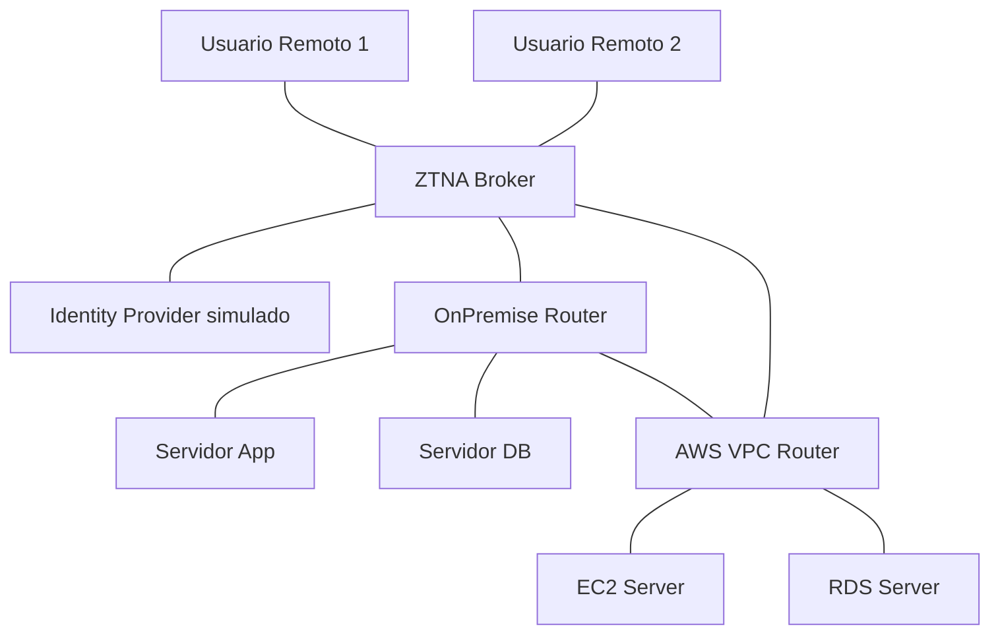

<p class="tema-num">LABORATORIO 12</p>

# Arquitecturas Modernas de Red

## Contexto empresarial

La empresa **Networking SecOps** ha implementado su arquitectura empresarial tradicional (Laboratorio 11). Ahora necesita modernizar su infraestructura para adaptarse a los nuevos modelos de trabajo híbrido.

!!! warning "Qué es real y qué es simulado"
    - **Real y ejecutable:** conectividad híbrida OnPremise ↔ VPC, acceso remoto con *política por aplicación* en un broker (modelo ZTNA simplificado con `iptables`) y **microsegmentación** entre servidores.
    - **Simulado / conceptual:** el *Identity Provider* (solo se representa como un nodo alcanzable, no autentica a nadie) y **SASE** (SWG, CASB, SD-WAN en un PoP): se explica en el análisis, pero no se construye. Un ZTNA real verifica identidad, dispositivo y contexto en cada conexión; aquí solo se emula la parte de *acceso mínimo por aplicación*.

!!! info "Nube: abstracción didáctica, no la arquitectura real de AWS"
    La VPC se representa como un router Linux y EC2/RDS como *namespaces*. Es una **abstracción válida para enseñar**, pero no reproduce AWS: una **VPC** es una **red virtual definida en la infraestructura del proveedor** (con tablas de rutas, gateways, grupos de seguridad y ACL propios); una **instancia EC2** es un **recurso de cómputo**; **RDS** es un **servicio administrado de bases de datos** (no un host al que se accede por SSH); y la conectividad y la seguridad de AWS usan componentes específicos. **No debe equipararse un *namespace* Linux con una instancia administrada en la nube.**

## Topología



**Direccionamiento:**

| Dispositivo | Interfaz | Dirección IP | Ubicación |
|-------------|----------|--------------|-----------|
| OnPremise (router) | br-lan | 10.0.0.1/24 | OnPremise |
| Servidor App | - | 10.0.0.10/24 | OnPremise |
| Servidor DB | - | 10.0.0.20/24 | OnPremise |
| OnPremise ↔ VPC | enlace híbrido (un `veth`) | 172.16.255.0/30 (OnPremise .1, VPC .2) | Conexión privada |
| VPC (router) | subred de aplicaciones | 10.100.1.1/24 | AWS (VPC 10.100.0.0/16) |
| EC2 Server | - | 10.100.1.10/24 | AWS |
| VPC (router) | subred de datos | 10.100.2.1/24 | AWS |
| RDS Server | - | 10.100.2.10/24 | AWS |
| ZTNA Broker ↔ OnPremise | conector | 172.16.254.0/30 (OnPremise .1, Broker .2) | Broker |
| ZTNA Broker ↔ VPC | conector | 172.16.253.0/30 (VPC .1, Broker .2) | Broker |
| ZTNA Broker ↔ IDP | - | 192.168.200.0/30 (Broker .1, IDP .2) | Broker |
| ZTNA Broker (usuarios) | br-users | 10.8.0.1/24 | Broker |
| Usuario 1 / Usuario 2 | - | 10.8.0.2/24 y 10.8.0.3/24 | Remoto |

La red `10.8.0.0/24` es una **red virtual de acceso de los usuarios del escenario**. Que exista no prueba que haya un sistema ZTNA real: el control lo ejerce la política del Paso 8.

## Construcción

### Paso 0: Limpiar laboratorios anteriores

Este laboratorio es un **escenario nuevo** (otros equipos y direccionamiento). Elimina **solo los namespaces de los laboratorios anteriores, por nombre**:

```bash
for ns in cliente1 cliente2 cliente3 cliente4 router switch \
          ventas1 ventas2 ventas3 it1 it2 it3 admin1 admin2 \
          R1 R2 R3 clienteSede clienteSucA clienteSucB \
          servidorDNS servidorDHCP clienteDHCP \
          firewall servidorWeb servidorDNS_PUB servidorInterno VPN_GW clienteVPN \
          PE1 PE2 PE3 P1 P2 P3 host1 host2 host3 \
          Core1 Core2 Dist1 Dist2 Access1 Firewall ServidorWeb ServidorDNS ventas it admin; do
  sudo ip netns del $ns 2>/dev/null || true
done
sudo ip link del br-wan 2>/dev/null || true
```

### Paso 1: Crear namespaces y la función auxiliar

```bash
for ns in OnPremise AppServer DBServer AWS_VPC EC2_Server RDS_Server ZTNA_Broker IDP User1 User2; do
  sudo ip netns add $ns
done
# Los routers deben reenviar paquetes
for r in OnPremise AWS_VPC ZTNA_Broker; do
  sudo ip netns exec $r sysctl -qw net.ipv4.ip_forward=1
done

# enlace NS_A IF_A IP_A NS_B IF_B IP_B
enlace() {
  sudo ip link add $2 type veth peer name $5
  sudo ip link set $2 netns $1
  sudo ip link set $5 netns $4
  sudo ip netns exec $1 ip addr add $3 dev $2
  sudo ip netns exec $1 ip link set $2 up
  sudo ip netns exec $4 ip addr add $6 dev $5
  sudo ip netns exec $4 ip link set $5 up
}
```

### Paso 2: Red OnPremise (un único segmento con App y DB)

La LAN `10.0.0.0/24` es **un solo segmento**: el router la presenta con un bridge y los servidores se conectan a él (no se reutiliza la subred en dos interfaces distintas).

```bash
sudo ip netns exec OnPremise ip link add br-lan type bridge
sudo ip netns exec OnPremise ip addr add 10.0.0.1/24 dev br-lan
sudo ip netns exec OnPremise ip link set br-lan up

for s in "AppServer veth-app veth-op-app 10.0.0.10/24" "DBServer veth-db veth-op-db 10.0.0.20/24"; do
  set -- $s
  sudo ip link add $2 type veth peer name $3
  sudo ip link set $2 netns $1
  sudo ip link set $3 netns OnPremise
  sudo ip netns exec OnPremise ip link set $3 master br-lan
  sudo ip netns exec OnPremise ip link set $3 up
  sudo ip netns exec $1 ip addr add $4 dev $2
  sudo ip netns exec $1 ip link set $2 up
  sudo ip netns exec $1 ip link set lo up
  sudo ip netns exec $1 ip route add default via 10.0.0.1
done
```

### Paso 3: Red en la nube (VPC con dos subredes)

Una VPC `10.100.0.0/16` se organiza en subredes. Cada servidor tiene un *gateway* que **está dentro de su propia subred**.

```bash
enlace AWS_VPC veth-vpc-ec2 10.100.1.1/24 EC2_Server veth-ec2 10.100.1.10/24
enlace AWS_VPC veth-vpc-rds 10.100.2.1/24 RDS_Server veth-rds 10.100.2.10/24
sudo ip netns exec EC2_Server ip route add default via 10.100.1.1
sudo ip netns exec RDS_Server ip route add default via 10.100.2.1
sudo ip netns exec EC2_Server ip link set lo up
sudo ip netns exec RDS_Server ip link set lo up
```

### Paso 4: Conectar OnPremise con la nube (conectividad híbrida)

Un `veth` representa una conexión virtual entre dos extremos, **pero no reproduce por sí mismo una VPN, AWS Direct Connect ni una interconexión privada empresarial**: no hay cifrado, negociación, ni medio contratado con el proveedor. Aquí solo sirve para ilustrar que ambos entornos están enlazados.

```bash
enlace OnPremise veth-op-vpc 172.16.255.1/30 AWS_VPC veth-vpc-op 172.16.255.2/30
sudo ip netns exec OnPremise ip route add 10.100.0.0/16 via 172.16.255.2
sudo ip netns exec AWS_VPC ip route add 10.0.0.0/24 via 172.16.255.1
```

### Paso 5: Broker de acceso (ZTNA) e identidad

El broker es el **único** punto de entrada de los usuarios remotos. Se conecta a OnPremise y a la nube mediante "conectores" y a un proveedor de identidad (simulado).

**IDP y broker no son el mismo componente.** El **proveedor de identidad (IDP)** participa en la **autenticación** y en la emisión o validación de la identidad (y, normalmente, de sus atributos). El **broker** (punto de aplicación de políticas) **aplica o coordina** las políticas de acceso según la arquitectura, consultando lo que el IDP afirma. En el laboratorio el IDP es solo un nodo alcanzable que **no autentica a nadie**.

```bash
enlace ZTNA_Broker veth-bk-op 172.16.254.2/30 OnPremise veth-op-bk 172.16.254.1/30
enlace ZTNA_Broker veth-bk-vpc 172.16.253.2/30 AWS_VPC veth-vpc-bk 172.16.253.1/30
enlace ZTNA_Broker veth-bk-idp 192.168.200.1/30 IDP veth-idp 192.168.200.2/30

# Rutas del broker hacia las aplicaciones y de ellas de vuelta hacia los usuarios
sudo ip netns exec ZTNA_Broker ip route add 10.0.0.0/24 via 172.16.254.1
sudo ip netns exec ZTNA_Broker ip route add 10.100.0.0/16 via 172.16.253.1
sudo ip netns exec OnPremise ip route add 10.8.0.0/24 via 172.16.254.2
sudo ip netns exec AWS_VPC ip route add 10.8.0.0/24 via 172.16.253.2
```

### Paso 6: Usuarios remotos

Los usuarios comparten un único segmento `10.8.0.0/24` mediante un bridge en el broker (una sola IP `10.8.0.1`, no repetida en dos interfaces).

```bash
sudo ip netns exec ZTNA_Broker ip link add br-users type bridge
sudo ip netns exec ZTNA_Broker ip addr add 10.8.0.1/24 dev br-users
sudo ip netns exec ZTNA_Broker ip link set br-users up

for u in "User1 veth-user1 veth-bk-u1 10.8.0.2/24" "User2 veth-user2 veth-bk-u2 10.8.0.3/24"; do
  set -- $u
  sudo ip link add $2 type veth peer name $3
  sudo ip link set $2 netns $1
  sudo ip link set $3 netns ZTNA_Broker
  sudo ip netns exec ZTNA_Broker ip link set $3 master br-users
  sudo ip netns exec ZTNA_Broker ip link set $3 up
  sudo ip netns exec $1 ip addr add $4 dev $2
  sudo ip netns exec $1 ip link set $2 up
  sudo ip netns exec $1 ip link set lo up
  sudo ip netns exec $1 ip route add default via 10.8.0.1
done
```

### Paso 7: Servicios de prueba

Cada aplicación se representa con un servicio TCP sencillo (`nc` en modo escucha):

```bash
sudo ip netns exec AppServer sh -c 'nc -lk -p 8080 >/dev/null 2>&1 </dev/null &'
sudo ip netns exec DBServer  sh -c 'nc -lk -p 3306 >/dev/null 2>&1 </dev/null &'
sudo ip netns exec EC2_Server sh -c 'nc -lk -p 8080 >/dev/null 2>&1 </dev/null &'
sudo ip netns exec RDS_Server sh -c 'nc -lk -p 5432 >/dev/null 2>&1 </dev/null &'
```

### Paso 8: Política Zero Trust en el broker (acceso mínimo por aplicación)

Por defecto **nada** pasa a través del broker. Se abre solo lo necesario para cada usuario: el Usuario 1 accede a la aplicación on-premise y el Usuario 2 a la aplicación en la nube.

!!! warning "Una IP de origen no es una identidad"
    Las reglas identifican al usuario por su dirección (`-s 10.8.0.2`), que es un **sustituto** de la identidad. En un ZTNA real la decisión se basa en la identidad verificada del usuario, el estado del dispositivo y el contexto, **no** en la dirección de red. Lo que sí ilustra bien este paso es el **acceso por recurso y puerto**: el usuario no recibe acceso a la red interna ni a la subred de datos, solo a **una aplicación concreta**.

```bash
sudo ip netns exec ZTNA_Broker iptables -P FORWARD DROP
sudo ip netns exec ZTNA_Broker iptables -A FORWARD -m state --state ESTABLISHED,RELATED -j ACCEPT
sudo ip netns exec ZTNA_Broker iptables -A FORWARD -s 10.8.0.2 -d 10.0.0.10 -p tcp --dport 8080 -j ACCEPT
sudo ip netns exec ZTNA_Broker iptables -A FORWARD -s 10.8.0.3 -d 10.100.1.10 -p tcp --dport 8080 -j ACCEPT
```

### Paso 9: Microsegmentación entre servidores

Cada servidor acepta **solo** lo que su función necesita, con política por defecto "denegar":

```bash
# DB (on-premise): solo el servidor App, y solo al puerto 3306
sudo ip netns exec DBServer iptables -P INPUT DROP
sudo ip netns exec DBServer iptables -A INPUT -i lo -j ACCEPT
sudo ip netns exec DBServer iptables -A INPUT -m state --state ESTABLISHED,RELATED -j ACCEPT
sudo ip netns exec DBServer iptables -A INPUT -s 10.0.0.10 -p tcp --dport 3306 -j ACCEPT

# RDS (nube): solo EC2, y solo al puerto 5432
sudo ip netns exec RDS_Server iptables -P INPUT DROP
sudo ip netns exec RDS_Server iptables -A INPUT -i lo -j ACCEPT
sudo ip netns exec RDS_Server iptables -A INPUT -m state --state ESTABLISHED,RELATED -j ACCEPT
sudo ip netns exec RDS_Server iptables -A INPUT -s 10.100.1.10 -p tcp --dport 5432 -j ACCEPT
```

### Paso 10: Verificar

```bash
# Usuario 1: SÍ a la app on-premise, NO a la de la nube
sudo ip netns exec User1 nc -zv -w 2 10.0.0.10 8080
sudo ip netns exec User1 nc -zv -w 2 10.100.1.10 8080

# Usuario 2: SÍ a la app en la nube, NO a la on-premise ni a las bases de datos
sudo ip netns exec User2 nc -zv -w 2 10.100.1.10 8080
sudo ip netns exec User2 nc -zv -w 2 10.0.0.10 8080
sudo ip netns exec User2 nc -zv -w 2 10.0.0.20 3306

# Microsegmentación: App -> DB (SÍ, 3306); App -> DB por otro puerto (NO); EC2 -> RDS (SÍ); on-premise -> RDS (NO)
sudo ip netns exec AppServer nc -zv -w 2 10.0.0.20 3306
sudo ip netns exec AppServer nc -zv -w 2 10.0.0.20 22
sudo ip netns exec EC2_Server nc -zv -w 2 10.100.2.10 5432
sudo ip netns exec AppServer nc -zv -w 2 10.100.2.10 5432
```

**Resultado esperado:** `succeeded` en las conexiones permitidas y expiración del tiempo de espera en las demás. Se verifica con conexiones TCP a puertos concretos (no con `ping`): las políticas son por aplicación y puerto.

## Análisis

**Cloud Networking:** VPC con subredes y conectividad híbrida (aquí, un enlace privado entre OnPremise y la VPC).

**Zero Trust** (NIST SP 800-207) es un **modelo**, no un producto: la presencia de un broker y de una red de usuarios **no constituye por sí misma Zero Trust**. Se define por principios:

-   **Verificación explícita** de la identidad (usuario y, cuando procede, dispositivo y servicio).
-   **Evaluación del contexto** (estado del dispositivo, ubicación, riesgo, hora).
-   **Autorización por recurso**, no por pertenencia a una red.
-   **Acceso de mínimo privilegio**.
-   **Reevaluación continua de la confianza**: el acceso no se concede de una vez para siempre.
-   **Protección de los recursos**, no solo del perímetro.

**En este laboratorio** solo se ilustran el acceso por recurso (Paso 8), el mínimo privilegio y la microsegmentación (Paso 9). **No** hay verificación de identidad, evaluación de contexto ni reevaluación.

**ZTNA:** acceso remoto por aplicación a través de un broker (en el laboratorio, con una política estática; en producción, decidida por el proveedor de identidad y el estado del dispositivo).

**SASE (conceptual):** SD-WAN + SWG + CASB + ZTNA como servicio en la nube. No se construye en este laboratorio.

**Microsegmentación:** políticas granulares App→DB y EC2→RDS.

## Ejercicios

### Ejercicio 1: Agregar usuario remoto

Configura un tercer usuario en el broker (`10.8.0.4`) con acceso solo a la base de datos de la nube por el puerto 5432 y comprueba que los demás usuarios no ganan ese acceso.

### Ejercicio 2: Definir políticas SASE

Redacta (sin implementarlas) las políticas que un SASE aplicaría al tráfico de los usuarios: categorías web permitidas (SWG), aplicaciones SaaS autorizadas (CASB) y condiciones de dispositivo.

## Conceptos clave

| Concepto | Aplicación |
|----------|------------|
| Cloud Networking | VPC con subredes, conectividad híbrida |
| Zero Trust | Denegar por defecto, acceso mínimo |
| ZTNA | Acceso remoto por aplicación (broker) |
| SASE | SD-WAN + SWG + CASB (conceptual) |
| Microsegmentación | Políticas granulares entre servidores |

## Conclusiones

Las arquitecturas modernas combinan Cloud Networking, Zero Trust, ZTNA, SASE y microsegmentación para adaptarse a entornos híbridos con agilidad y seguridad. En este laboratorio se ha **representado** la conectividad híbrida (con una abstracción de la nube), el acceso mínimo por aplicación y la microsegmentación; la verificación de identidad, la evaluación de contexto y SASE quedan como conceptos explicados, y el escenario **no equivale a una plataforma ZTNA ni a AWS reales**.

---

**¡Laboratorio 12 completado!**
