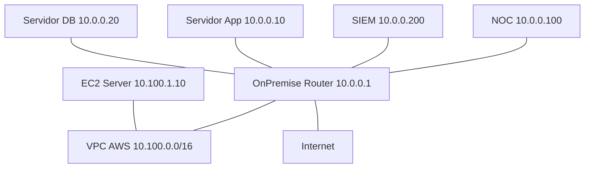
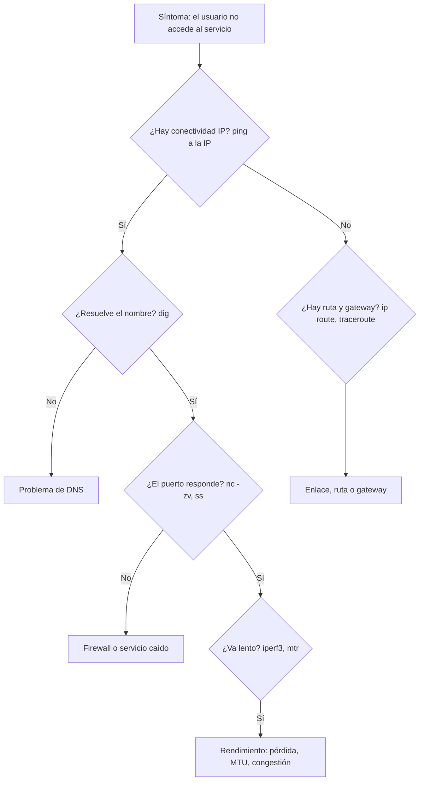

<p class="tema-eyebrow">LABORATORIO 13</p>

# MONITOREO Y DIAGNÓSTICO DE REDES

<p class="tema-meta"><span>9 secciones</span><span>2 diagramas</span><span>7 tablas</span></p>

## Contexto empresarial

La empresa **Networking SecOps** ha implementado su infraestructura de red completa con arquitectura moderna (Laboratorio 12). Ahora el equipo de operaciones necesita establecer un sistema de monitoreo y diagnóstico que permita supervisar el estado de la red, detectar anomalías y resolver incidentes de manera eficiente.

!!! info "Dos precisiones técnicas"
    - Los namespaces aíslan la **red**, no el sistema de archivos: un `tcpdump -w /tmp/captura.pcap` o un `rsyslog` dentro de un namespace escriben en el `/tmp` y el `/etc` **reales** del equipo. Por eso las capturas y el SIEM de este laboratorio usan rutas propias en `/tmp/lab13/` y los servicios se arrancan a mano (`systemctl` actuaría sobre el host).
    - El "SIEM" que se construye es un **colector central de logs** con `rsyslog`. Un SIEM real añade normalización, correlación de eventos, alertas y paneles. **No debe equipararse con un SIEM empresarial completo.**

!!! note "NOC y SIEM: dos funciones distintas"
    Un **NOC** (*Network Operations Center*) se ocupa de la **disponibilidad, el rendimiento y la operación** de la infraestructura (¿está caído el enlace? ¿qué latencia hay?). Un **SIEM** (*Security Information and Event Management*) se ocupa de **recolectar, correlacionar y analizar eventos relevantes para la seguridad** (¿hay un patrón de intentos de acceso anómalos?). En este laboratorio, el equipo `NOC` ejecuta herramientas de diagnóstico y el equipo `SIEM` hace de colector de registros; ambos comparten red, pero sirven a propósitos diferentes.

## Topología



**Direccionamiento:**

| Dispositivo | Interfaz | Dirección IP | Rol |
|-------------|----------|--------------|-----|
| OnPremise (router) | br-lan | 10.0.0.1/24 | Gateway |
| Servidor App | - | 10.0.0.10/24 | Aplicación |
| Servidor DB | - | 10.0.0.20/24 | Base de datos |
| NOC | - | 10.0.0.100/24 | Servidor de monitoreo |
| SIEM | - | 10.0.0.200/24 | Colector de logs |
| EC2 Server | - | 10.100.1.10/24 | Cloud |
| OnPremise (WAN, opcional) | veth-op-wan | 192.168.100.1/24 (host: .2) | Salida a Internet |

## Construcción de la red

### Paso 1: Verificar infraestructura existente

Este laboratorio continúa sobre la red del laboratorio 12 (namespaces `OnPremise`, `AppServer`, `DBServer`, `AWS_VPC`, `EC2_Server`...). Comprueba que sigue en pie:

```bash
sudo ip netns list
sudo ip netns exec OnPremise ping -c 2 10.100.1.10
sudo ip netns exec OnPremise ping -c 2 10.0.0.10
```

Si no existe, ejecuta antes el laboratorio 12. Instala las herramientas (en el host):

```bash
sudo apt-get install -y mtr-tiny traceroute tcpdump iperf3 rsyslog dnsutils netcat-openbsd
```

### Paso 2: Crear servidores de monitoreo

```bash
for ns in NOC SIEM; do
  if sudo ip netns list | awk '{print $1}' | grep -qx "$ns"; then
    echo "El namespace $ns ya existe: ejecuta la limpieza del laboratorio 13 antes de repetirlo"
    exit 1
  fi
done
VETH_WAN_OP=$(sudo ip -o link show veth-wan-op 2>/dev/null | head -1)
if [ -e /tmp/lab13 ] || [ -n "$VETH_WAN_OP" ] || [ -e /tmp/lab13-ip_forward.orig ] || [ -e /tmp/lab13-host-nat.added ]; then
  echo "Hay recursos de una ejecución anterior: ejecuta la limpieza del laboratorio 13 antes de repetirlo"
  exit 1
fi
sudo ip netns add NOC
sudo ip netns add SIEM
```

### Paso 3: Conectarlos a la LAN de OnPremise

Ambos se unen al bridge `br-lan` del router (la misma LAN que App y DB), no a interfaces sueltas del router:

```bash
for s in "NOC veth-noc veth-op-noc 10.0.0.100/24" "SIEM veth-siem veth-op-siem 10.0.0.200/24"; do
  set -- $s
  sudo ip link add $2 type veth peer name $3
  sudo ip link set $2 netns $1
  sudo ip link set $3 netns OnPremise
  sudo ip netns exec OnPremise ip link set $3 master br-lan
  sudo ip netns exec OnPremise ip link set $3 up
  sudo ip netns exec $1 ip addr add $4 dev $2
  sudo ip netns exec $1 ip link set $2 up
  sudo ip netns exec $1 ip link set lo up
  sudo ip netns exec $1 ip route add default via 10.0.0.1
done
```

### Paso 3b: Salida a Internet (opcional)

!!! danger "Cambio en el host (no en un namespace)"
    Este paso es opcional y modifica el equipo real (`veth-wan-op`, `ip_forward` y una regla `MASQUERADE`). Antes de ejecutar este paso anota el estado previo del equipo: `sysctl net.ipv4.ip_forward` y `iptables -t nat -S POSTROUTING`. La reversión está en la sección «Revertir los cambios del host» de este laboratorio.

Para las pruebas hacia Internet, OnPremise se conecta al host y traduce direcciones (NAT):

```bash
sudo ip link add veth-op-wan type veth peer name veth-wan-op
sudo ip link set veth-op-wan netns OnPremise
sudo ip netns exec OnPremise ip addr add 192.168.100.1/24 dev veth-op-wan
sudo ip netns exec OnPremise ip link set veth-op-wan up
sudo ip addr add 192.168.100.2/24 dev veth-wan-op
sudo ip link set veth-wan-op up
sudo ip netns exec OnPremise ip route add default via 192.168.100.2
sudo ip netns exec OnPremise iptables -t nat -A POSTROUTING -o veth-op-wan -j MASQUERADE

# El host reenvía y traduce hacia tu red real (cambia eth0 por tu interfaz de salida).
# El valor original de ip_forward y la creación de la regla NAT quedan registrados para revertirlos.
if [ ! -e /tmp/lab13-ip_forward.orig ]; then
  sudo sysctl -n net.ipv4.ip_forward | sudo tee /tmp/lab13-ip_forward.orig >/dev/null
fi
sudo sysctl -w net.ipv4.ip_forward=1
if ! sudo iptables -t nat -C POSTROUTING -s 192.168.100.0/24 -o eth0 -j MASQUERADE; then
  sudo iptables -t nat -A POSTROUTING -s 192.168.100.0/24 -o eth0 -j MASQUERADE && touch /tmp/lab13-host-nat.added
fi
```

### Paso 4: Herramientas básicas de diagnóstico

```bash
sudo ip netns exec NOC ping -c 4 10.0.0.10
sudo ip netns exec NOC ping -c 4 10.100.1.10
sudo ip netns exec NOC ping -c 4 192.168.100.2
sudo ip netns exec NOC traceroute -n 10.100.1.10
```

**Interpretación del `traceroute` hacia la nube:** primer salto el router (`10.0.0.1`), segundo el extremo VPC del enlace híbrido (`172.16.255.2`) y por último `10.100.1.10`.

Con Internet disponible en tu equipo:

```bash
sudo ip netns exec NOC ping -c 4 8.8.8.8
sudo ip netns exec NOC traceroute -n 8.8.8.8
sudo ip netns exec NOC nslookup google.com 8.8.8.8
```

### Paso 5: MTR

`mtr` combina `ping` y `traceroute`: muestra la pérdida y la latencia **por salto**, de forma continua.

```bash
sudo ip netns exec NOC mtr -n -r -c 10 10.100.1.10
```

### Paso 6: Captura de tráfico con tcpdump

**Qué se observa y qué no.** `tcpdump -i veth-noc` captura en la interfaz **del NOC**, dentro de su namespace: solo ve el tráfico que **entra o sale por esa interfaz** (el del propio NOC, más los *broadcast* y *multicast* de la LAN). En una LAN conmutada, el tráfico *unicast* entre otros equipos (por ejemplo App ↔ DB) **no pasa por el puerto del NOC**, así que **no se ve**. Una captura en la interfaz del NOC **no equivale a observar todo el tráfico de la infraestructura**; para ver más habría que capturar en el bridge `br-lan` de `OnPremise` o en el puerto del equipo que interesa. Dentro de un namespace tampoco se ven las interfaces del host ni las de otros namespaces.

Las capturas se guardan en `/tmp/lab13/` (el `/tmp` real: los namespaces no aíslan archivos).

```bash
mkdir -p /tmp/lab13

# Capturar 10 paquetes mientras haces algún ping desde otra terminal
sudo ip netns exec NOC tcpdump -i veth-noc -c 10 -n

# Filtrar por equipo y puerto (genera tráfico con: sudo ip netns exec NOC nc -zv 10.0.0.10 8080)
sudo ip netns exec NOC tcpdump -i veth-noc -n -c 5 'host 10.0.0.10 and port 8080'

# Guardar en un archivo .pcap y leerlo después
# -Z root: en Debian/Ubuntu tcpdump baja privilegios al usuario «tcpdump» y podría no poder escribir en /tmp/lab13
sudo ip netns exec NOC tcpdump -i veth-noc -n -c 20 -Z root -w /tmp/lab13/captura.pcap
sudo tcpdump -r /tmp/lab13/captura.pcap -n
```

### Paso 7: Análisis de rendimiento con iperf3

```bash
# Servidor en segundo plano en AppServer, guardando su PID para detenerlo con precisión
mkdir -p /tmp/lab13
sudo ip netns exec AppServer iperf3 -s -D -I /tmp/lab13/iperf3.pid

# TCP y UDP desde el NOC
sudo ip netns exec NOC iperf3 -c 10.0.0.10 -t 5
sudo ip netns exec NOC iperf3 -c 10.0.0.10 -u -b 100M -t 5

# Detener SOLO ese servidor: el PID guardado, no `pkill iperf3`
# (pkill actúa sobre todo el sistema: los namespaces aíslan la red, no los procesos)
sudo kill $(cat /tmp/lab13/iperf3.pid)
```

**Cómo interpretar los resultados.**

-   **TCP** mide el *throughput* que la conexión consigue sostener: TCP **se adapta** al camino (control de congestión), así que el resultado refleja la capacidad **efectiva** (y la CPU disponible, porque aquí el enlace es virtual).
-   **UDP** con `-b 100M` **ofrece** una tasa fija de 100 Mbps: es la tasa **ofrecida a la prueba**, **no demuestra que la red la soporte**. El informe debe leerse junto con la **pérdida de datagramas**, el **jitter**, la **capacidad real del enlace** y las **condiciones de ejecución** (carga de la máquina, otras pruebas simultáneas). Si la pérdida es 0 %, el camino aguantó esa tasa; si es alta, la tasa ofrecida superó lo que se pudo transportar.

**Ejemplo de interpretación** (salida representativa de la prueba TCP; tus cifras serán distintas):

```
[ ID] Interval        Transfer     Bitrate         Retr
[  5]   0.00-5.00 sec  9.80 GBytes  16.8 Gbits/sec    0   sender
[  5]   0.00-5.00 sec  9.80 GBytes  16.8 Gbits/sec        receiver
```

| Campo | Qué dice | Qué conclusión permite |
|-------|----------|-------------------------|
| `Bitrate` | Rendimiento TCP **sostenido** | La capacidad efectiva del camino virtual (aquí limitada por la CPU, no por un cable) |
| `Retr` | Retransmisiones TCP | **0** → sin pérdidas; valores altos sugieren pérdida o congestión |
| `sender` / `receiver` | Los dos extremos de la medición | Si difieren mucho, algo se perdió o se acumuló en el camino |

En la prueba **UDP**, mira además `Lost/Total` y `Jitter`: una pérdida de 0 % con 100 Mbps ofrecidos indica que el camino los soportó; una pérdida alta indica que la tasa ofrecida superó lo transportable. Un número aislado no prueba nada: se compara **antes y después** de un cambio (por ejemplo, de MTU) o frente a una línea base.

### Paso 8: Colector central de logs (SIEM básico) con rsyslog

Arrancamos una instancia de `rsyslog` **solo para el SIEM**, con su propia configuración (no se toca el `rsyslog` del equipo):

```bash
cat > /tmp/lab13/siem.conf << 'EOF'
module(load="imudp")
input(type="imudp" port="514")
module(load="imtcp")
input(type="imtcp" port="514")
template(name="RemoteLogs" type="string" string="%timegenerated% %HOSTNAME% %syslogtag% %msg%\n")
*.* /tmp/lab13/remote.log;RemoteLogs
EOF

sudo ip netns exec SIEM sh -c 'rsyslogd -n -f /tmp/lab13/siem.conf -i /tmp/lab13/siem.pid >/tmp/lab13/rsyslog.out 2>&1 </dev/null &'
```

Los equipos envían eventos al SIEM con `logger` (UDP al puerto 514):

```bash
sudo ip netns exec NOC logger -n 10.0.0.200 -P 514 -d -t noc "enlace hacia la nube con perdida"
sudo ip netns exec AppServer logger -n 10.0.0.200 -P 514 -d -t app "error de conexion a la base de datos"
sleep 1
cat /tmp/lab13/remote.log
```

Una "alerta" rudimentaria es buscar patrones en el colector:

```bash
grep -i "error" /tmp/lab13/remote.log
```

**Qué demuestra esto y qué no.** El envío de mensajes con `logger` demuestra el **transporte de eventos** hacia un punto central. Es un ejemplo básico de **centralización y consulta de registros**. **No** constituye correlación avanzada, detección automatizada ni respuesta ante incidentes: un SIEM real normaliza los eventos de muchas fuentes, los correlaciona (por ejemplo, «muchos fallos de acceso seguidos de un acceso correcto») y genera alertas.

**Monitoreo y seguridad.** Los datos de monitoreo y los registros permiten **detectar anomalías**, pero **no sustituyen** las medidas **preventivas** (firewall, segmentación, autenticación) ni los mecanismos de **respuesta** (procedimientos, aislamiento, recuperación).

### Del síntoma a la causa: método de diagnóstico

Los comandos de este laboratorio cobran sentido cuando se usan **en un orden**: de lo más simple a lo más específico, descartando capas.



| Síntoma | Capa o mecanismo | Herramientas | Causas posibles |
|---------|------------------|--------------|-----------------|
| No responde a `ping` a la IP | Conectividad / ruta | `ip route get`, `traceroute`, `mtr` | Falta ruta o *gateway*, enlace caído, ICMP filtrado |
| Responde a IP pero no a nombre | DNS | `dig`, `resolv.conf` del *namespace* | DNS caído, nombre inexistente, servidor mal anunciado |
| Resuelve pero el puerto no abre | Firewall o servicio | `nc -zv`, `ss -tlnp`, `tcpdump` | Regla `DROP`, servicio detenido, escucha en otra IP |
| Conecta pero va lento | Rendimiento | `iperf3`, `mtr`, `ping -s` | Pérdida de paquetes, MTU/fragmentación, enlace saturado |
| Funciona a veces | Intermitencia | `mtr`, capturas, logs | Rutas alternantes, pérdida en un salto, caídas breves |

### NOC, SIEM y observabilidad

| | NOC | SIEM | Observabilidad |
|--|-----|------|-----------------|
| Pregunta | ¿Está disponible y rinde? | ¿Hay eventos relevantes para la **seguridad**? | ¿Puedo entender **por qué** pasa algo a partir de lo que el sistema emite? |
| Datos | Estado, latencia, tráfico | Registros de muchas fuentes, correlacionados | Métricas, registros y trazas |
| En este laboratorio | `NOC` con `ping`, `mtr`, `iperf3` | `SIEM` como colector con `rsyslog` | Lo que se obtiene al combinar ambos |

### Métricas, umbrales y alertas

Un diagnóstico puntual responde a un problema que **ya ocurrió**; la supervisión continua intenta **verlo venir**:

| Elemento | Qué es | Ejemplo |
|----------|--------|---------|
| **Métrica** | Valor medido periódicamente | Latencia a `AppServer`, pérdida, uso del enlace |
| **Umbral** | Límite que define lo anómalo | Latencia > 50 ms o pérdida > 1 % |
| **Alerta** | Aviso al superarlo (durante un tiempo) | Notificar al NOC si ocurre 3 minutos seguidos |

Un umbral sin línea base genera ruido: primero se mide lo normal.

### Interpretar alertas y falsos positivos

No toda alerta indica un problema real, ni todo problema genera una alerta:

| Resultado | Significado | Ejemplo | Consecuencia |
|-----------|-------------|---------|--------------|
| **Verdadero positivo** | Alerta y problema real | Pérdida > 1 % sostenida por un enlace caído | Se actúa |
| **Falso positivo** | Alerta sin problema | Un pico de latencia durante un respaldo programado | Ruido; con el tiempo se ignoran las alertas |
| **Falso negativo** | Problema sin alerta | Fallo real en una métrica que nadie vigila | Se detecta tarde, o por quejas de usuarios |
| **Verdadero negativo** | Sin alerta y sin problema | Operación normal | Nada que hacer |

Antes de actuar sobre una alerta: (1) confirma con una segunda fuente (`mtr`, otro punto de medición, el registro del colector); (2) comprueba si coincide con un evento esperado (mantenimiento, copia de seguridad, despliegue); (3) valora si el umbral es adecuado con respecto a la línea base. Ajustar el umbral o exigir que se mantenga varios minutos reduce falsos positivos, pero un umbral demasiado holgado produce falsos negativos: hay que buscar equilibrio, no eliminar uno a costa del otro.

### Correlación de eventos: lo que un SIEM aporta más allá de guardar logs

Guardar registros no es correlacionarlos. Ejemplo conceptual: un solo intento de SSH fallido es normal; **veinte fallos desde una misma IP en un minuto, seguidos de un acceso correcto**, es un patrón. Un colector con `rsyslog` reúne los eventos; un SIEM los **normaliza, relaciona entre fuentes y alerta**. Aquí solo se construye la primera parte.

## Ejercicios

### Ejercicio 1: Analizar una captura

```bash
# timeout 5: la captura termina sola a los 5 s (con -c N esperaría N paquetes que quizá nunca lleguen)
sudo ip netns exec NOC timeout 5 tcpdump -i veth-noc -n -Z root -w /tmp/lab13/nc8080.pcap &
sleep 1
sudo ip netns exec NOC nc -zv 10.0.0.10 8080
wait
tcpdump -r /tmp/lab13/nc8080.pcap -n
```

Puedes abrir el `.pcap` con Wireshark o `tshark` para un análisis más detallado.

### Ejercicio 2: Monitoreo bidireccional

```bash
mkdir -p /tmp/lab13
sudo ip netns exec AppServer iperf3 -s -D -I /tmp/lab13/iperf3.pid
sudo ip netns exec NOC iperf3 -c 10.0.0.10 --bidir -t 5
sudo kill $(cat /tmp/lab13/iperf3.pid)
```

### Ejercicio 3: Simular un fallo de MTU

Bajamos la MTU **solo en el servidor App**. El NOC (que está en la misma LAN, sin pasar por el router) sigue enviando paquetes de hasta 1500 bytes y el servidor, con MTU 1400, normalmente descarta los que no caben sin avisar (no se genera el mensaje ICMP "fragmentation needed", porque en capa 2 no hay un router que lo emita): un "agujero negro" de MTU. El comportamiento exacto de recepción de tramas mayores que la MTU puede variar según el kernel.

```bash
sudo ip netns exec AppServer ip link set veth-app mtu 1400
sudo ip netns exec NOC ping -c 2 -M do -s 1200 10.0.0.10     # cabe: responde
sudo ip netns exec NOC ping -c 2 -W 1 -M do -s 1450 10.0.0.10  # no cabe: sin respuesta ni error
sudo ip netns exec AppServer ip link set veth-app mtu 1500     # restaurar
```

## Errores comunes

| Error | Solución |
|-------|----------|
| Ping falla | Verificar rutas y reglas de firewall/microsegmentación (laboratorio 12) |
| Captura vacía | Verificar la interfaz (`ip -br link` dentro del namespace) y que haya tráfico |
| `iperf3` no conecta | Ejecutar antes el servidor (`iperf3 -s`) en el namespace correcto |
| No llegan logs al SIEM | Comprobar que `rsyslogd` escucha (`ip netns exec SIEM ss -ulnp`) |

## Conceptos clave

| Concepto | Aplicación |
|----------|------------|
| Ping | Conectividad básica |
| Traceroute | Identificar saltos |
| MTR | Análisis continuo por salto |
| tcpdump | Captura de tráfico de **una interfaz** (no de toda la red) |
| iperf3 | Medición de rendimiento (TCP efectivo; UDP con tasa ofrecida, pérdida y jitter) |
| Colector de logs (SIEM básico) | Centralización de eventos con rsyslog; no es correlación ni respuesta |

## Revertir los cambios del host

Este laboratorio continúa el 12: **no elimines** `OnPremise`, `AppServer` ni el resto de la red de ese laboratorio si aún la necesitas. Solo deshaz lo añadido aquí:

```bash
# 1. Procesos del laboratorio, por PID
[ -f /tmp/lab13/iperf3.pid ] && sudo kill $(cat /tmp/lab13/iperf3.pid) 2>/dev/null || true
[ -f /tmp/lab13/siem.pid ]  && sudo kill $(cat /tmp/lab13/siem.pid)  2>/dev/null || true
sudo ip netns pids NOC  2>/dev/null | xargs -r sudo kill
sudo ip netns pids SIEM 2>/dev/null | xargs -r sudo kill

# 2. Salida opcional a Internet (solo si hiciste el Paso 3b; ajusta eth0)
sudo ip netns exec OnPremise iptables -t nat -D POSTROUTING -o veth-op-wan -j MASQUERADE 2>/dev/null || true
if [ -f /tmp/lab13-host-nat.added ]; then
  sudo iptables -t nat -D POSTROUTING -s 192.168.100.0/24 -o eth0 -j MASQUERADE 2>/dev/null || true
  rm -f /tmp/lab13-host-nat.added
fi
if [ -f /tmp/lab13-ip_forward.orig ]; then
  sudo sysctl -w net.ipv4.ip_forward="$(cat /tmp/lab13-ip_forward.orig)"
  sudo rm -f /tmp/lab13-ip_forward.orig
fi
sudo ip link del veth-wan-op 2>/dev/null || true

# 3. Namespaces de monitoreo y archivos temporales
for ns in NOC SIEM; do sudo ip netns del $ns 2>/dev/null || true; done
sudo rm -rf /tmp/lab13
```

Si quieres retirar también la red del laboratorio 12, elimina sus *namespaces* por nombre (`ip netns list` los muestra). Instalaste `mtr-tiny`, `iperf3`, `rsyslog`, etc.: quedan como paquetes, sin servicio activo propio.

## Preguntas de reflexión

1.  ¿Qué mecanismo permite al NOC decidir si un problema es de ruta, de DNS, de servicio o de rendimiento?
2.  ¿Qué sucedería si el NOC captura tráfico entre otros dos hosts de una LAN conmutada? ¿Qué vería realmente?
3.  ¿Qué diferencia hay entre el rendimiento TCP medido y la tasa UDP ofrecida?
4.  ¿Qué limitaciones tiene un colector `rsyslog` frente a un SIEM empresarial?
5.  ¿En qué escenario empresarial una alerta por umbral habría evitado una incidencia?
6.  ¿Qué otras herramientas aportarían métricas continuas? (SNMP, telemetría.)

## Conclusiones

Las herramientas de monitoreo y diagnóstico permiten detectar y resolver incidentes de red de manera rápida y estructurada. Un colector de logs es el primer paso hacia un SIEM; la correlación y las alertas avanzadas requieren herramientas específicas. El monitoreo detecta; la prevención y la respuesta son medidas aparte.

---

**¡Laboratorio 13 completado!** Continúa con el **Laboratorio 14**.
