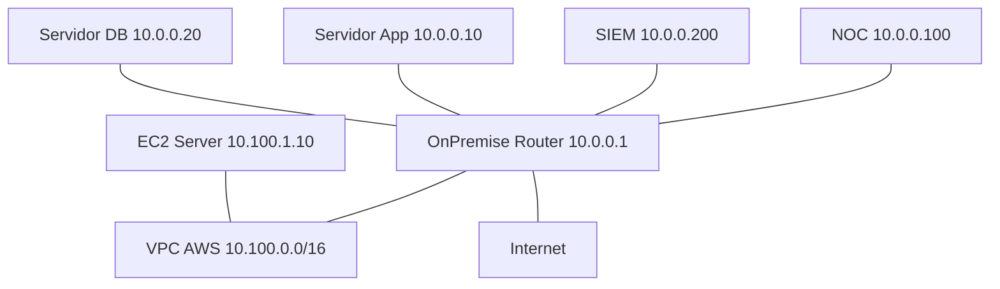

<p class="tema-num">LABORATORIO 13</p>

# Monitoreo y Diagnóstico de Redes

## Contexto empresarial

La empresa **Networking SecOps** ha implementado su infraestructura de red completa con arquitectura moderna (Laboratorio 12). Ahora el equipo de operaciones necesita establecer un sistema de monitoreo y diagnóstico que permita supervisar el estado de la red, detectar anomalías y resolver incidentes de manera eficiente.

!!! info "Dos precisiones técnicas"
    - Los namespaces aíslan la **red**, no el sistema de archivos: un `tcpdump -w /tmp/captura.pcap` o un `rsyslog` dentro de un namespace escriben en el `/tmp` y el `/etc` **reales** del equipo. Por eso las capturas y el SIEM de este laboratorio usan rutas propias en `/tmp/lab13/` y los servicios se arrancan a mano (`systemctl` actuaría sobre el host).
    - El "SIEM" que se construye es un **colector central de logs** con `rsyslog`. Un SIEM real añade normalización, correlación de eventos, alertas y paneles. **No debe equipararse con un SIEM empresarial completo.**

!!! note "NOC y SIEM: dos funciones distintas"
    Un **NOC** (*Network Operations Center*) se ocupa de la **disponibilidad, el rendimiento y la operación** de la infraestructura (¿está caído el enlace? ¿qué latencia hay?). Un **SIEM** (*Security Information and Event Management*) se ocupa de **recolectar, correlacionar y analizar eventos relevantes para la seguridad** (¿hay un patrón de intentos de acceso anómalos?). En este laboratorio, el equipo `NOC` ejecuta herramientas de diagnóstico y el equipo `SIEM` hace de colector de registros; ambos comparten red, pero sirven a propósitos diferentes.

## Topología



**Direccionamiento:**

| Dispositivo | Interfaz | Dirección IP | Rol |
|-------------|----------|--------------|-----|
| OnPremise (router) | br-lan | 10.0.0.1/24 | Gateway |
| Servidor App | - | 10.0.0.10/24 | Aplicación |
| Servidor DB | - | 10.0.0.20/24 | Base de datos |
| NOC | - | 10.0.0.100/24 | Servidor de monitoreo |
| SIEM | - | 10.0.0.200/24 | Colector de logs |
| EC2 Server | - | 10.100.1.10/24 | Cloud |
| OnPremise (WAN, opcional) | veth-op-wan | 192.168.100.1/24 (host: .2) | Salida a Internet |

## Construcción de la red

### Paso 1: Verificar infraestructura existente

Este laboratorio continúa sobre la red del laboratorio 12 (namespaces `OnPremise`, `AppServer`, `DBServer`, `AWS_VPC`, `EC2_Server`...). Comprueba que sigue en pie:

```bash
sudo ip netns list
sudo ip netns exec OnPremise ping -c 2 10.100.1.10
sudo ip netns exec OnPremise ping -c 2 10.0.0.10
```

Si no existe, ejecuta antes el laboratorio 12. Instala las herramientas (en el host):

```bash
sudo apt-get install -y mtr-tiny traceroute tcpdump iperf3 rsyslog dnsutils netcat-openbsd
```

### Paso 2: Crear servidores de monitoreo

```bash
sudo ip netns add NOC
sudo ip netns add SIEM
```

### Paso 3: Conectarlos a la LAN de OnPremise

Ambos se unen al bridge `br-lan` del router (la misma LAN que App y DB), no a interfaces sueltas del router:

```bash
for s in "NOC veth-noc veth-op-noc 10.0.0.100/24" "SIEM veth-siem veth-op-siem 10.0.0.200/24"; do
  set -- $s
  sudo ip link add $2 type veth peer name $3
  sudo ip link set $2 netns $1
  sudo ip link set $3 netns OnPremise
  sudo ip netns exec OnPremise ip link set $3 master br-lan
  sudo ip netns exec OnPremise ip link set $3 up
  sudo ip netns exec $1 ip addr add $4 dev $2
  sudo ip netns exec $1 ip link set $2 up
  sudo ip netns exec $1 ip link set lo up
  sudo ip netns exec $1 ip route add default via 10.0.0.1
done
```

### Paso 3b: Salida a Internet (opcional)

Para las pruebas hacia Internet, OnPremise se conecta al host y traduce direcciones (NAT):

```bash
sudo ip link add veth-op-wan type veth peer name veth-wan-op
sudo ip link set veth-op-wan netns OnPremise
sudo ip netns exec OnPremise ip addr add 192.168.100.1/24 dev veth-op-wan
sudo ip netns exec OnPremise ip link set veth-op-wan up
sudo ip addr add 192.168.100.2/24 dev veth-wan-op
sudo ip link set veth-wan-op up
sudo ip netns exec OnPremise ip route add default via 192.168.100.2
sudo ip netns exec OnPremise iptables -t nat -A POSTROUTING -o veth-op-wan -j MASQUERADE

# El host reenvía y traduce hacia tu red real (cambia eth0 por tu interfaz de salida)
sudo sysctl -w net.ipv4.ip_forward=1
sudo iptables -t nat -C POSTROUTING -s 192.168.100.0/24 -o eth0 -j MASQUERADE 2>/dev/null || \
  sudo iptables -t nat -A POSTROUTING -s 192.168.100.0/24 -o eth0 -j MASQUERADE
```

### Paso 4: Herramientas básicas de diagnóstico

```bash
sudo ip netns exec NOC ping -c 4 10.0.0.10
sudo ip netns exec NOC ping -c 4 10.100.1.10
sudo ip netns exec NOC ping -c 4 192.168.100.2
sudo ip netns exec NOC traceroute -n 10.100.1.10
```

**Interpretación del `traceroute` hacia la nube:** primer salto el router (`10.0.0.1`), segundo el extremo VPC del enlace híbrido (`172.16.255.2`) y por último `10.100.1.10`.

Con Internet disponible en tu equipo:

```bash
sudo ip netns exec NOC ping -c 4 8.8.8.8
sudo ip netns exec NOC traceroute -n 8.8.8.8
sudo ip netns exec NOC nslookup google.com 8.8.8.8
```

### Paso 5: MTR

`mtr` combina `ping` y `traceroute`: muestra la pérdida y la latencia **por salto**, de forma continua.

```bash
sudo ip netns exec NOC mtr -n -r -c 10 10.100.1.10
```

### Paso 6: Captura de tráfico con tcpdump

**Qué se observa y qué no.** `tcpdump -i veth-noc` captura en la interfaz **del NOC**, dentro de su namespace: solo ve el tráfico que **entra o sale por esa interfaz** (el del propio NOC, más los *broadcast* y *multicast* de la LAN). En una LAN conmutada, el tráfico *unicast* entre otros equipos (por ejemplo App ↔ DB) **no pasa por el puerto del NOC**, así que **no se ve**. Una captura en la interfaz del NOC **no equivale a observar todo el tráfico de la infraestructura**; para ver más habría que capturar en el bridge `br-lan` de `OnPremise` o en el puerto del equipo que interesa. Dentro de un namespace tampoco se ven las interfaces del host ni las de otros namespaces.

Las capturas se guardan en `/tmp/lab13/` (el `/tmp` real: los namespaces no aíslan archivos).

```bash
mkdir -p /tmp/lab13

# Capturar 10 paquetes mientras haces algún ping desde otra terminal
sudo ip netns exec NOC tcpdump -i veth-noc -c 10 -n

# Filtrar por equipo y puerto (genera tráfico con: sudo ip netns exec NOC nc -zv 10.0.0.10 8080)
sudo ip netns exec NOC tcpdump -i veth-noc -n -c 5 'host 10.0.0.10 and port 8080'

# Guardar en un archivo .pcap y leerlo después
sudo ip netns exec NOC tcpdump -i veth-noc -n -c 20 -w /tmp/lab13/captura.pcap
sudo tcpdump -r /tmp/lab13/captura.pcap -n
```

### Paso 7: Análisis de rendimiento con iperf3

```bash
# Servidor en segundo plano en AppServer
sudo ip netns exec AppServer iperf3 -s -D

# TCP y UDP desde el NOC
sudo ip netns exec NOC iperf3 -c 10.0.0.10 -t 5
sudo ip netns exec NOC iperf3 -c 10.0.0.10 -u -b 100M -t 5

# Detener el servidor al terminar
sudo ip netns exec AppServer pkill iperf3
```

**Cómo interpretar los resultados.**

-   **TCP** mide el *throughput* que la conexión consigue sostener: TCP **se adapta** al camino (control de congestión), así que el resultado refleja la capacidad **efectiva** (y la CPU disponible, porque aquí el enlace es virtual).
-   **UDP** con `-b 100M` **ofrece** una tasa fija de 100 Mbps: es la tasa **ofrecida a la prueba**, **no demuestra que la red la soporte**. El informe debe leerse junto con la **pérdida de datagramas**, el **jitter**, la **capacidad real del enlace** y las **condiciones de ejecución** (carga de la máquina, otras pruebas simultáneas). Si la pérdida es 0 %, el camino aguantó esa tasa; si es alta, la tasa ofrecida superó lo que se pudo transportar.

### Paso 8: Colector central de logs (SIEM básico) con rsyslog

Arrancamos una instancia de `rsyslog` **solo para el SIEM**, con su propia configuración (no se toca el `rsyslog` del equipo):

```bash
cat > /tmp/lab13/siem.conf << 'EOF'
module(load="imudp")
input(type="imudp" port="514")
module(load="imtcp")
input(type="imtcp" port="514")
template(name="RemoteLogs" type="string" string="%timegenerated% %HOSTNAME% %syslogtag% %msg%\n")
*.* /tmp/lab13/remote.log;RemoteLogs
EOF

sudo ip netns exec SIEM sh -c 'rsyslogd -n -f /tmp/lab13/siem.conf -i /tmp/lab13/siem.pid >/tmp/lab13/rsyslog.out 2>&1 </dev/null &'
```

Los equipos envían eventos al SIEM con `logger` (UDP al puerto 514):

```bash
sudo ip netns exec NOC logger -n 10.0.0.200 -P 514 -d -t noc "enlace hacia la nube con perdida"
sudo ip netns exec AppServer logger -n 10.0.0.200 -P 514 -d -t app "error de conexion a la base de datos"
sleep 1
cat /tmp/lab13/remote.log
```

Una "alerta" rudimentaria es buscar patrones en el colector:

```bash
grep -i "error" /tmp/lab13/remote.log
```

**Qué demuestra esto y qué no.** El envío de mensajes con `logger` demuestra el **transporte de eventos** hacia un punto central. Es un ejemplo básico de **centralización y consulta de registros**. **No** constituye correlación avanzada, detección automatizada ni respuesta ante incidentes: un SIEM real normaliza los eventos de muchas fuentes, los correlaciona (por ejemplo, «muchos fallos de acceso seguidos de un acceso correcto») y genera alertas.

**Monitoreo y seguridad.** Los datos de monitoreo y los registros permiten **detectar anomalías**, pero **no sustituyen** las medidas **preventivas** (firewall, segmentación, autenticación) ni los mecanismos de **respuesta** (procedimientos, aislamiento, recuperación).

## Ejercicios

### Ejercicio 1: Analizar una captura

```bash
sudo ip netns exec NOC tcpdump -i veth-noc -n -c 30 -w /tmp/lab13/http.pcap &
sleep 1
sudo ip netns exec NOC nc -zv 10.0.0.10 8080
wait
tcpdump -r /tmp/lab13/http.pcap -n
```

Puedes abrir el `.pcap` con Wireshark o `tshark` para un análisis más detallado.

### Ejercicio 2: Monitoreo bidireccional

```bash
sudo ip netns exec AppServer iperf3 -s -D
sudo ip netns exec NOC iperf3 -c 10.0.0.10 --bidir -t 5
sudo ip netns exec AppServer pkill iperf3
```

### Ejercicio 3: Simular un fallo de MTU

Bajamos la MTU **solo en el servidor App**. El NOC (que está en la misma LAN, sin pasar por el router) sigue enviando paquetes de hasta 1500 bytes y el servidor, con MTU 1400, normalmente descarta los que no caben sin avisar (no se genera el mensaje ICMP "fragmentation needed", porque en capa 2 no hay un router que lo emita): un "agujero negro" de MTU. El comportamiento exacto de recepción de tramas mayores que la MTU puede variar según el kernel.

```bash
sudo ip netns exec AppServer ip link set veth-app mtu 1400
sudo ip netns exec NOC ping -c 2 -M do -s 1200 10.0.0.10     # cabe: responde
sudo ip netns exec NOC ping -c 2 -W 1 -M do -s 1450 10.0.0.10  # no cabe: sin respuesta ni error
sudo ip netns exec AppServer ip link set veth-app mtu 1500     # restaurar
```

## Errores comunes

| Error | Solución |
|-------|----------|
| Ping falla | Verificar rutas y reglas de firewall/microsegmentación (laboratorio 12) |
| Captura vacía | Verificar la interfaz (`ip -br link` dentro del namespace) y que haya tráfico |
| `iperf3` no conecta | Ejecutar antes el servidor (`iperf3 -s`) en el namespace correcto |
| No llegan logs al SIEM | Comprobar que `rsyslogd` escucha (`ip netns exec SIEM ss -ulnp`) |

## Conceptos clave

| Concepto | Aplicación |
|----------|------------|
| Ping | Conectividad básica |
| Traceroute | Identificar saltos |
| MTR | Análisis continuo por salto |
| tcpdump | Captura de tráfico de **una interfaz** (no de toda la red) |
| iperf3 | Medición de rendimiento (TCP efectivo; UDP con tasa ofrecida, pérdida y jitter) |
| Colector de logs (SIEM básico) | Centralización de eventos con rsyslog; no es correlación ni respuesta |

## Conclusiones

Las herramientas de monitoreo y diagnóstico permiten detectar y resolver incidentes de red de manera rápida y estructurada. Un colector de logs es el primer paso hacia un SIEM; la correlación y las alertas avanzadas requieren herramientas específicas. El monitoreo detecta; la prevención y la respuesta son medidas aparte.

---

**¡Laboratorio 13 completado!** Continúa con el **Laboratorio 14**.
