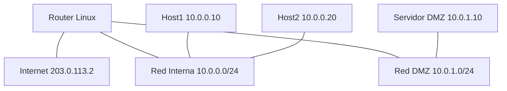

<p class="tema-num">LABORATORIO 14</p>

# Herramientas Linux Avanzadas

## Contexto empresarial

La empresa **Networking SecOps** ha implementado su infraestructura de red y sistemas de monitoreo (Laboratorio 13). Ahora el equipo de operaciones necesita dominar las herramientas avanzadas de Linux para administrar, diagnosticar y optimizar la red de manera eficiente.

!!! info "Laboratorio independiente"
    Este laboratorio monta su **propia** topología (un router Linux con LAN y DMZ) para practicar las herramientas con calma; no depende de los anteriores. Empieza limpiando el entorno.

## Topología



**Direccionamiento:**

| Dispositivo | Interfaz | Dirección IP |
|-------------|----------|--------------|
| Router Linux | veth-r-wan (WAN) | 203.0.113.1/30 (host: 203.0.113.2/30) |
| Router Linux | br-lan (LAN, bridge) | 10.0.0.1/24 |
| Router Linux | veth-r-lan2 (DMZ) | 10.0.1.1/24 |
| Host1 | veth-lan1-r | 10.0.0.10/24 |
| Host2 | veth-lan2h | 10.0.0.20/24 |
| Servidor DMZ | veth-lan2-r | 10.0.1.10/24 |

## Construcción

### Paso 0: Limpiar el entorno

```bash
for ns in $(ip netns list | awk '{print $1}'); do sudo ip netns del $ns; done
sudo ip link del br-wan 2>/dev/null || true
sudo apt-get install -y ethtool traceroute tcpdump netcat-openbsd nftables
```

### Paso 1: Crear namespaces

```bash
sudo ip netns add Router
sudo ip netns add Host1
sudo ip netns add Host2
sudo ip netns add ServidorDMZ
```

### Paso 2: Conectar interfaces

La LAN `10.0.0.0/24` es un único segmento con dos equipos, así que el router usa un bridge (`br-lan`):

```bash
# WAN: el router se conecta al host (que hace de "Internet")
sudo ip link add veth-r-wan type veth peer name veth-wan-r
sudo ip link set veth-r-wan netns Router
sudo ip netns exec Router ip addr add 203.0.113.1/30 dev veth-r-wan
sudo ip netns exec Router ip link set veth-r-wan up
sudo ip addr add 203.0.113.2/30 dev veth-wan-r
sudo ip link set veth-wan-r up

# LAN: bridge en el router con Host1 y Host2
sudo ip netns exec Router ip link add br-lan type bridge
sudo ip netns exec Router ip addr add 10.0.0.1/24 dev br-lan
sudo ip netns exec Router ip link set br-lan up

sudo ip link add veth-r-lan1 type veth peer name veth-lan1-r
sudo ip link set veth-r-lan1 netns Router
sudo ip link set veth-lan1-r netns Host1
sudo ip netns exec Router ip link set veth-r-lan1 master br-lan
sudo ip netns exec Router ip link set veth-r-lan1 up
sudo ip netns exec Host1 ip addr add 10.0.0.10/24 dev veth-lan1-r
sudo ip netns exec Host1 ip link set veth-lan1-r up
sudo ip netns exec Host1 ip link set lo up
sudo ip netns exec Host1 ip route add default via 10.0.0.1

sudo ip link add veth-r-lan2h type veth peer name veth-lan2h
sudo ip link set veth-r-lan2h netns Router
sudo ip link set veth-lan2h netns Host2
sudo ip netns exec Router ip link set veth-r-lan2h master br-lan
sudo ip netns exec Router ip link set veth-r-lan2h up
sudo ip netns exec Host2 ip addr add 10.0.0.20/24 dev veth-lan2h
sudo ip netns exec Host2 ip link set veth-lan2h up
sudo ip netns exec Host2 ip link set lo up
sudo ip netns exec Host2 ip route add default via 10.0.0.1

# DMZ: enlace punto a punto con el servidor
sudo ip link add veth-r-lan2 type veth peer name veth-lan2-r
sudo ip link set veth-r-lan2 netns Router
sudo ip link set veth-lan2-r netns ServidorDMZ
sudo ip netns exec Router ip addr add 10.0.1.1/24 dev veth-r-lan2
sudo ip netns exec Router ip link set veth-r-lan2 up
sudo ip netns exec ServidorDMZ ip addr add 10.0.1.10/24 dev veth-lan2-r
sudo ip netns exec ServidorDMZ ip link set veth-lan2-r up
sudo ip netns exec ServidorDMZ ip link set lo up
sudo ip netns exec ServidorDMZ ip route add default via 10.0.1.1
```

### Paso 3: Configurar enrutamiento y NAT

```bash
sudo ip netns exec Router sysctl -w net.ipv4.ip_forward=1
sudo ip netns exec Router ip route add default via 203.0.113.2
sudo ip netns exec Router ip route show

# NAT del router hacia la WAN
sudo ip netns exec Router iptables -t nat -A POSTROUTING -o veth-r-wan -j MASQUERADE

# (Opcional, para salir de verdad a Internet) El host reenvía y traduce.
# Cambia eth0 por tu interfaz de salida:
sudo sysctl -w net.ipv4.ip_forward=1
sudo iptables -t nat -C POSTROUTING -s 203.0.113.0/30 -o eth0 -j MASQUERADE 2>/dev/null || \
  sudo iptables -t nat -A POSTROUTING -s 203.0.113.0/30 -o eth0 -j MASQUERADE
```

Comprueba la conectividad básica:

```bash
sudo ip netns exec Host1 ping -c 2 10.0.0.20
sudo ip netns exec Host1 ping -c 2 10.0.1.10
sudo ip netns exec Host1 ping -c 2 203.0.113.2
```

### Paso 4: iproute2

```bash
sudo ip netns exec Router ip addr show
sudo ip -br addr                              # vista resumida (en el host)
sudo ip netns exec Router ip -s link show veth-r-lan2   # contadores de la interfaz
sudo ip netns exec Router ip neigh show       # tabla ARP
sudo ip netns exec Router ip rule show        # reglas de política de enrutamiento
sudo ip netns exec Router ip route get 10.0.1.10   # ¿qué ruta usaría el router para este destino?
```

**Cambiar la MTU.** Una MTU mayor solo sirve si **todos** los extremos del enlace la soportan. Cámbiala en **ambos** lados del enlace Router - DMZ y verifícalo:

```bash
sudo ip netns exec Router ip link set veth-r-lan2 mtu 9000
sudo ip netns exec ServidorDMZ ip link set veth-lan2-r mtu 9000
sudo ip netns exec Router ping -c 2 -M do -s 8972 10.0.1.10   # 8972 + 28 = 9000: pasa
```

(Si la cambiaras en un solo extremo, los paquetes grandes del lado de MTU mayor serían descartados por el otro.) Restablécela:

```bash
sudo ip netns exec Router ip link set veth-r-lan2 mtu 1500
sudo ip netns exec ServidorDMZ ip link set veth-lan2-r mtu 1500
```

**Agregar una ruta estática.** El siguiente salto debe ser **otro** equipo alcanzable directamente (no una dirección del propio router). Supongamos que existe una red `10.0.2.0/24` detrás de Host1:

```bash
sudo ip netns exec Router ip route add 10.0.2.0/24 via 10.0.0.10
sudo ip netns exec Router ip route get 10.0.2.55
sudo ip netns exec Router ip route del 10.0.2.0/24
```

### Paso 5: ss (sockets)

Arrancamos dos servicios de prueba en Host1 y establecemos una conexión desde Host2:

```bash
sudo ip netns exec Host1 sh -c 'nc -lk -p 9000 >/dev/null 2>&1 </dev/null &'
sudo ip netns exec Host1 sh -c 'nc -lk -p 8443 >/dev/null 2>&1 </dev/null &'
sudo ip netns exec Host2 sh -c 'sleep 30 | nc 10.0.0.10 9000 >/dev/null 2>&1 &'

sudo ip netns exec Host1 ss -tln                    # puertos TCP a la escucha
sudo ip netns exec Host1 ss -tlnp                   # ... con el proceso dueño
sudo ip netns exec Host1 ss -tn state established   # conexiones establecidas (verás la de Host2)
sudo ip netns exec Host1 ss -tn dport = :9000       # filtrar por puerto
```

`ss` muestra los sockets **del namespace en el que se ejecuta**: una conexión solo aparece en los equipos que son sus extremos, no en el router que la reenvía.

### Paso 6: nftables

Cuando una orden `nft` lleva llaves y puntos y coma, hay que **entrecomillarla**: sin comillas, el *shell* corta la orden en cada `;`.

```bash
sudo ip netns exec Router nft add table inet filter
sudo ip netns exec Router nft add chain inet filter input '{ type filter hook input priority 0 ; policy drop ; }'
sudo ip netns exec Router nft add rule inet filter input iif lo accept
sudo ip netns exec Router nft add rule inet filter input ct state established,related accept
sudo ip netns exec Router nft add rule inet filter input icmp type echo-request accept
sudo ip netns exec Router nft add rule inet filter input tcp dport 22 accept
sudo ip netns exec Router nft add rule inet filter input tcp dport '{ 80, 443 }' accept
sudo ip netns exec Router nft -a list ruleset
```

La opción `-a` muestra el *handle* de cada regla, que sirve para borrarla (`nft delete rule inet filter input handle N`).

### Paso 7: Diagnóstico

```bash
sudo ip netns exec Router ethtool veth-r-lan2          # velocidad, dúplex, estado del enlace
sudo ip netns exec Router ethtool -S veth-r-lan2       # estadísticas del controlador
sudo ip netns exec Router ping -c 4 10.0.0.10
sudo ip netns exec Router traceroute -n 203.0.113.2
sudo ip netns exec Router tcpdump -i br-lan -c 5 -n
```

Con Internet disponible en tu equipo: `sudo ip netns exec Router traceroute -n 8.8.8.8`.

## Ejercicios

### Ejercicio 1: Bloquear ICMP con nftables

Una regla añadida con `add` va **al final** de la cadena, después de la que acepta el ping. Insértala al principio:

```bash
sudo ip netns exec Router nft insert rule inet filter input ip protocol icmp drop
sudo ip netns exec Host1 ping -c 2 -W 1 10.0.0.1     # ahora no responde
sudo ip netns exec Router nft -a list chain inet filter input
```

Para quitar la regla usa `nft delete rule inet filter input handle N` con el *handle* que muestra el listado.

### Ejercicio 2: Verificar conexiones con ss

```bash
sudo ip netns exec Host1 ss -tn state established
sudo ip netns exec Host2 ss -tn state established
```

Comprueba que la conexión de Paso 5 aparece en **ambos** extremos (Host1 y Host2) pero no en el router.

## Conceptos clave

| Concepto | Aplicación |
|----------|------------|
| iproute2 | Administración moderna de red |
| ss | Análisis de sockets |
| nftables | Firewall moderno |
| ethtool | Diagnóstico físico |
| Netcat | Pruebas de conectividad |

## Conclusiones

Las herramientas avanzadas de Linux permiten administrar y diagnosticar redes de manera eficiente, reemplazando las herramientas tradicionales obsoletas.

---

**¡Laboratorio 14 completado!** Continúa con el **Laboratorio 15**.
