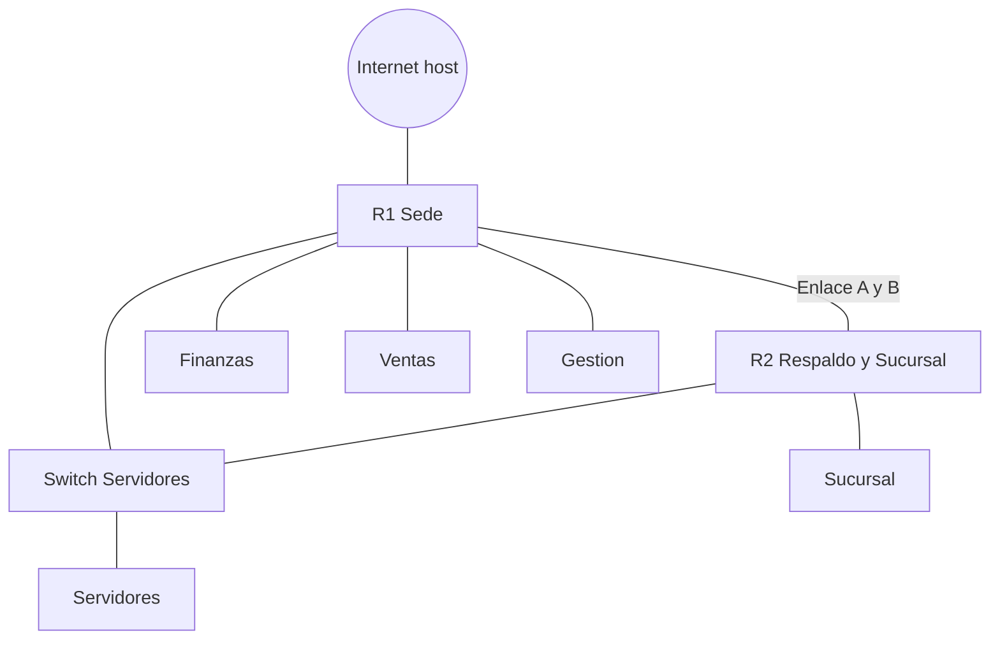

<p class="tema-num">LABORATORIO 15</p>

# Implementación Práctica Integral

## Contexto empresarial

La empresa **Networking SecOps** ha completado todos los laboratorios anteriores. Ahora debe **integrar todos los conceptos** en una implementación práctica completa: direccionamiento VLSM, enrutamiento dinámico con OSPF, firewall, DHCP y redundancia de *gateway* con VRRP.

!!! info "Mismo modelo que el resto de la serie"
    Todo se construye con **namespaces de red**, igual que en los laboratorios anteriores (no se usan interfaces `eth0`-`eth4` reales del equipo, así que no se toca tu red). Es un laboratorio de integración con una topología nueva, por lo que empieza limpiando el entorno. Requiere instalar `frr` (OSPF), `keepalived` (VRRP) y `dnsmasq-base` (DHCP).

## Topología



## Construcción

### Paso 0: Limpiar y preparar

```bash
for ns in $(ip netns list | awk '{print $1}'); do sudo ip netns del $ns; done
sudo ip link del br-wan 2>/dev/null || true
sudo apt-get install -y frr keepalived dnsmasq-base isc-dhcp-client nftables netcat-openbsd

for ns in R1 R2 SWsrv fin ven ges srv suc; do sudo ip netns add $ns; done
for r in R1 R2; do sudo ip netns exec $r sysctl -qw net.ipv4.ip_forward=1; done

# enlace NS_A IF_A IP_A NS_B IF_B IP_B
enlace() {
  sudo ip link add $2 type veth peer name $5
  sudo ip link set $2 netns $1
  sudo ip link set $5 netns $4
  sudo ip netns exec $1 ip addr add $3 dev $2
  sudo ip netns exec $1 ip link set $2 up
  sudo ip netns exec $4 ip addr add $6 dev $5
  sudo ip netns exec $4 ip link set $5 up
}
mkdir -p /tmp/lab15
```

## 15.1 Configuración de red básica

R1 es el router de la sede: una WAN hacia el host (que hace de "Internet"), NAT, y su primera LAN (Finanzas).

La WAN une R1 con el **host** (sin namespace), así que se configura a mano:

```bash
sudo ip link add veth-r1-wan type veth peer name veth-wan-r1
sudo ip link set veth-r1-wan netns R1
sudo ip netns exec R1 ip addr add 192.168.100.1/24 dev veth-r1-wan
sudo ip netns exec R1 ip link set veth-r1-wan up
sudo ip addr add 192.168.100.2/24 dev veth-wan-r1
sudo ip link set veth-wan-r1 up

# R1: ruta por defecto hacia el host y NAT hacia la WAN
sudo ip netns exec R1 ip route add default via 192.168.100.2
sudo ip netns exec R1 iptables -t nat -A POSTROUTING -o veth-r1-wan -j MASQUERADE

# El host reenvía y traduce hacia tu red real (cambia eth0 por tu interfaz de salida)
sudo sysctl -w net.ipv4.ip_forward=1
sudo iptables -t nat -C POSTROUTING -s 192.168.100.0/24 -o eth0 -j MASQUERADE 2>/dev/null || \
  sudo iptables -t nat -A POSTROUTING -s 192.168.100.0/24 -o eth0 -j MASQUERADE

# Primera LAN: Finanzas (10.0.1.0/25)
enlace R1 veth-r1fin 10.0.1.1/25 fin veth-fin 10.0.1.10/25
sudo ip netns exec fin ip route add default via 10.0.1.1
```

### Verificar

```bash
sudo ip netns exec fin ping -c 3 10.0.1.1
sudo ip netns exec fin ping -c 3 192.168.100.2
```

(Con Internet en tu equipo, `ping 8.8.8.8` y `nslookup google.com 8.8.8.8` desde `fin` también funcionan.)

## 15.2 Subnetting aplicado (VLSM)

**Bloque disponible:** `10.0.0.0/22` (de `10.0.0.0` a `10.0.3.255`).

| Departamento | Hosts | Subred | Máscara | Rango útil | Gateway |
|--------------|-------|--------|---------|------------|---------|
| Servidores | 200 | 10.0.0.0/24 | /24 | 10.0.0.1 - 10.0.0.254 | 10.0.0.1 |
| Finanzas | 100 | 10.0.1.0/25 | /25 | 10.0.1.1 - 10.0.1.126 | 10.0.1.1 |
| Ventas | 50 | 10.0.1.128/26 | /26 | 10.0.1.129 - 10.0.1.190 | 10.0.1.129 |
| Gestión | 10 | 10.0.1.192/28 | /28 | 10.0.1.193 - 10.0.1.206 | 10.0.1.193 |
| Enlace A R1-R2 | 2 | 10.0.1.208/30 | /30 | 10.0.1.209 - 10.0.1.210 | - |
| Enlace B R1-R2 | 2 | 10.0.1.212/30 | /30 | 10.0.1.213 - 10.0.1.214 | - |
| Sucursal (R2) | 200 | 10.0.2.0/24 | /24 | 10.0.2.1 - 10.0.2.254 | 10.0.2.1 |

Cada bloque se asigna de mayor a menor sin solaparse. Ahora creamos el resto de segmentos (Finanzas ya existe):

```bash
# Ventas y Gestión: una interfaz de R1 por segmento
enlace R1 veth-r1ven 10.0.1.129/26 ven veth-ven 10.0.1.130/26
sudo ip netns exec ven ip route add default via 10.0.1.129
enlace R1 veth-r1ges 10.0.1.193/28 ges veth-ges 10.0.1.194/28
sudo ip netns exec ges ip route add default via 10.0.1.193

# Servidores: un switch (bridge) que más adelante compartirán R1 y R2
sudo ip netns exec SWsrv ip link add br0 type bridge
sudo ip netns exec SWsrv ip link set br0 up
sudo ip link add veth-r1srv type veth peer name veth-sw-r1
sudo ip link set veth-r1srv netns R1
sudo ip link set veth-sw-r1 netns SWsrv
sudo ip netns exec SWsrv ip link set veth-sw-r1 master br0
sudo ip netns exec SWsrv ip link set veth-sw-r1 up
sudo ip netns exec R1 ip addr add 10.0.0.1/24 dev veth-r1srv
sudo ip netns exec R1 ip link set veth-r1srv up
sudo ip link add veth-srv type veth peer name veth-sw-srv
sudo ip link set veth-srv netns srv
sudo ip link set veth-sw-srv netns SWsrv
sudo ip netns exec SWsrv ip link set veth-sw-srv master br0
sudo ip netns exec SWsrv ip link set veth-sw-srv up
sudo ip netns exec srv ip addr add 10.0.0.10/24 dev veth-srv
sudo ip netns exec srv ip link set veth-srv up
sudo ip netns exec srv ip route add default via 10.0.0.1

# R2 y su sucursal; dos enlaces /30 entre R1 y R2 (A: principal, B: respaldo)
enlace R1 veth-r1r2a 10.0.1.209/30 R2 veth-r2r1a 10.0.1.210/30
enlace R1 veth-r1r2b 10.0.1.213/30 R2 veth-r2r1b 10.0.1.214/30
enlace R2 veth-r2suc 10.0.2.1/24 suc veth-suc 10.0.2.10/24
sudo ip netns exec suc ip route add default via 10.0.2.1
```

Comprueba que cada equipo alcanza a su *gateway* y entre sí a través de R1:

```bash
sudo ip netns exec fin ping -c 2 10.0.1.130     # Finanzas -> Ventas (R1 enruta)
sudo ip netns exec srv ping -c 2 10.0.1.194     # Servidores -> Gestión
sudo ip netns exec R1 ping -c 2 10.0.1.210      # R1 -> R2 por el enlace A
```

## 15.3 VLAN (variante)

En los pasos anteriores cada departamento tiene su propia interfaz. En una red real lo habitual es **un único enlace *trunk*** que transporta varias VLAN. La configuración con un bridge Linux con filtrado de VLAN y *router-on-a-stick* es la del laboratorio 05 (requiere el módulo `8021q`); con Open vSwitch el equivalente es:

```bash
sudo apt-get install -y openvswitch-switch
sudo ovs-vsctl add-br ovs-sw
sudo ovs-vsctl add-port ovs-sw puerto-fin tag=10      # puerto de acceso VLAN 10
sudo ovs-vsctl add-port ovs-sw puerto-ven tag=20      # puerto de acceso VLAN 20
sudo ovs-vsctl add-port ovs-sw puerto-ges tag=30      # puerto de acceso VLAN 30
sudo ovs-vsctl add-port ovs-sw trunk-r1 trunks=10,20,30   # trunk hacia el router
```

En el router, una subinterfaz por VLAN (`ip link add link <trunk> name <trunk>.10 type vlan id 10`) lleva la IP del *gateway* de cada subred (`10.0.1.1/25`, `10.0.1.129/26`, `10.0.1.193/28`), **en lugar de** las interfaces físicas del 15.2: no deben coexistir las dos formas con las mismas subredes. Este laboratorio sigue con segmentos separados para poder verificarlos en cualquier máquina.

## 15.4 Routing entre redes

### Rutas estáticas

```bash
sudo ip netns exec R2 ip route add default via 10.0.1.209
sudo ip netns exec R1 ip route add 10.0.2.0/24 via 10.0.1.210

sudo ip netns exec suc ping -c 2 10.0.1.10        # Sucursal -> Finanzas
sudo ip netns exec suc ping -c 2 192.168.100.2    # Sucursal -> "Internet" (vía R1 y su NAT)
sudo ip netns exec R1 ip route show
```

Funciona, pero las rutas estáticas no se adaptan solas a los cambios. Las eliminamos y usamos un protocolo dinámico.

### OSPF con FRRouting

Cada router ejecuta sus propios demonios `zebra` (conecta FRR con el kernel) y `ospfd`, dentro de su namespace y con archivos propios en `/tmp/lab15/<router>/`. Primero quitamos las rutas estáticas del tramo anterior:

```bash
sudo ip netns exec R2 ip route del default via 10.0.1.209
sudo ip netns exec R1 ip route del 10.0.2.0/24 via 10.0.1.210
```

Configuración de OSPF (los enlaces se declaran *punto a punto* para que la adyacencia llegue a `Full` enseguida, sin elección de DR; el enlace A, con coste 10, es el principal; el B, con coste 20, el respaldo; R1 anuncia además una ruta por defecto hacia Internet):

```bash
mkdir -p /tmp/lab15/r1 /tmp/lab15/r2

cat > /tmp/lab15/r1/zebra.conf << 'EOF'
hostname r1
EOF
cat > /tmp/lab15/r1/ospfd.conf << 'EOF'
hostname r1
interface veth-r1r2a
 ip ospf network point-to-point
 ip ospf cost 10
interface veth-r1r2b
 ip ospf network point-to-point
 ip ospf cost 20
router ospf
 ospf router-id 1.1.1.1
 passive-interface default
 no passive-interface veth-r1r2a
 no passive-interface veth-r1r2b
 network 10.0.0.0/24 area 0
 network 10.0.1.0/25 area 0
 network 10.0.1.128/26 area 0
 network 10.0.1.192/28 area 0
 network 10.0.1.208/30 area 0
 network 10.0.1.212/30 area 0
 default-information originate always
EOF

cat > /tmp/lab15/r2/zebra.conf << 'EOF'
hostname r2
EOF
cat > /tmp/lab15/r2/ospfd.conf << 'EOF'
hostname r2
interface veth-r2r1a
 ip ospf network point-to-point
 ip ospf cost 10
interface veth-r2r1b
 ip ospf network point-to-point
 ip ospf cost 20
router ospf
 ospf router-id 2.2.2.2
 passive-interface default
 no passive-interface veth-r2r1a
 no passive-interface veth-r2r1b
 network 10.0.2.0/24 area 0
 network 10.0.1.208/30 area 0
 network 10.0.1.212/30 area 0
EOF

# Los demonios se ejecutan como el usuario frr: necesita acceder a los archivos
sudo chown -R frr:frr /tmp/lab15
sudo chmod 755 /tmp /tmp/lab15

# Arrancar los demonios en cada namespace
for r in r1 r2; do
  R=$(echo $r | tr a-z A-Z)
  sudo ip netns exec $R /usr/lib/frr/zebra -d -u frr -g frr -f /tmp/lab15/$r/zebra.conf \
      -i /tmp/lab15/$r/zebra.pid -z /tmp/lab15/$r/zserv.api --vty_socket /tmp/lab15/$r
  sudo ip netns exec $R /usr/lib/frr/ospfd -d -u frr -g frr -f /tmp/lab15/$r/ospfd.conf \
      -i /tmp/lab15/$r/ospfd.pid -z /tmp/lab15/$r/zserv.api --vty_socket /tmp/lab15/$r
done
```

Los comandos `show ...` no son del *shell*: son del intérprete de FRR (`vtysh`). Desde el *shell* se ejecutan con `vtysh -c`, indicando el socket de cada router:

```bash
sleep 20
sudo vtysh --vty_socket /tmp/lab15/r1 -c "show ip ospf neighbor"
sudo vtysh --vty_socket /tmp/lab15/r1 -c "show ip route ospf"
sudo vtysh --vty_socket /tmp/lab15/r2 -c "show ip route ospf"

sudo ip netns exec suc ping -c 3 10.0.1.10
sudo ip netns exec suc ping -c 3 192.168.100.2
```

**Salida esperada:** R1 y R2 son vecinos en estado `Full`; R2 aprende las redes de R1 y una ruta por defecto (`O>* 0.0.0.0/0`), y R1 aprende `10.0.2.0/24`.

### Reconvergencia ante un fallo

Tiramos el enlace principal (A) por ambos extremos y observamos cómo OSPF mueve el tráfico al respaldo sin intervención:

```bash
sudo ip netns exec R1 ip link set veth-r1r2a down
sudo ip netns exec R2 ip link set veth-r2r1a down
sleep 5
sudo ip netns exec R1 ip route show 10.0.2.0/24        # ahora por el enlace B (10.0.1.214)
sudo ip netns exec suc ping -c 3 10.0.1.10
sudo ip netns exec R1 ip link set veth-r1r2a up
sudo ip netns exec R2 ip link set veth-r2r1a up
```

## 15.5 Firewall

Reglas en **nftables** para R1, guardadas en un archivo y cargadas dentro de su namespace. Las interfaces son las reales de R1: la WAN es `veth-r1-wan` y la zona de servidores `veth-r1srv`.

```bash
cat > /tmp/lab15/fw.nft << 'EOF'
table inet firewall {
    chain input {
        type filter hook input priority 0; policy drop;
        iif lo accept
        ct state established,related accept
        ip protocol icmp limit rate 10/second accept
        ip protocol ospf accept
        iifname { "veth-r1fin", "veth-r1ven" } udp dport 67 accept
        iifname { "veth-r1fin", "veth-r1ven", "veth-r1ges" } tcp dport 22 accept
    }
    chain forward {
        type filter hook forward priority 0; policy drop;
        ct state established,related accept
        iifname { "veth-r1fin", "veth-r1ven", "veth-r1ges", "veth-r1r2a", "veth-r1r2b" } oifname "veth-r1-wan" accept
        iifname { "veth-r1fin", "veth-r1ven", "veth-r1ges", "veth-r1r2a", "veth-r1r2b" } oifname "veth-r1srv" accept
        iifname "veth-r1-wan" oifname "veth-r1srv" tcp dport { 80, 443, 25 } accept
        iifname { "veth-r1fin", "veth-r1ven", "veth-r1ges" } oifname { "veth-r1fin", "veth-r1ven", "veth-r1ges" } accept
    }
}
EOF

sudo ip netns exec R1 nft -f /tmp/lab15/fw.nft
sudo ip netns exec R1 nft list ruleset
```

El protocolo OSPF (número 89) debe aceptarse en `input`, o R1 dejaría de ver a sus vecinos; y el puerto UDP 67 de las LAN de Finanzas y Ventas, o R1 no podría repartir direcciones DHCP (apartado 15.6). La política de `forward` es "denegar" y solo se abre lo necesario: las LAN salen a Internet y a los servidores; desde Internet solo entran HTTP, HTTPS y SMTP hacia la zona de servidores.

### Verificar

```bash
sudo ip netns exec fin ping -c 2 192.168.100.2     # salida a "Internet": permitida
sudo ip netns exec fin ping -c 2 10.0.1.130        # Finanzas -> Ventas: permitido (regla entre LAN)
sudo ip netns exec srv ping -c 2 -W 1 10.0.1.10    # Servidores -> Finanzas: bloqueado
sudo ip netns exec R1 nft list ruleset | grep -A1 counter
```

(La NAT hacia Internet sigue siendo la regla `iptables` de R1 del apartado 15.1.)

## 15.6 Servicios: DHCP con dnsmasq

R1 reparte direcciones en Finanzas y Ventas, con un rango por subred y su propio *gateway*:

```bash
cat > /tmp/lab15/dhcp.conf << 'EOF'
port=0
bind-interfaces
interface=veth-r1fin
interface=veth-r1ven
dhcp-range=set:fin,10.0.1.20,10.0.1.120,255.255.255.128,24h
dhcp-option=tag:fin,option:router,10.0.1.1
dhcp-range=set:ven,10.0.1.140,10.0.1.190,255.255.255.192,24h
dhcp-option=tag:ven,option:router,10.0.1.129
dhcp-option=option:dns-server,8.8.8.8
dhcp-leasefile=/tmp/lab15/dhcp.leases
EOF

sudo dnsmasq --test --conf-file=/tmp/lab15/dhcp.conf
sudo ip netns exec R1 dnsmasq --conf-file=/tmp/lab15/dhcp.conf --pid-file=/tmp/lab15/dhcp.pid
```

Los clientes piden dirección en lugar de tener una fija. Para que `dhclient` no toque el `resolv.conf` de tu equipo, damos a cada namespace el suyo:

```bash
for ns in fin ven; do
  sudo mkdir -p /etc/netns/$ns
  sudo touch /etc/netns/$ns/resolv.conf
done

# Finanzas: quitar la IP fija y pedirla por DHCP
sudo ip netns exec fin ip addr flush dev veth-fin
sudo ip netns exec fin dhclient -v veth-fin
sudo ip netns exec fin ip -4 addr show dev veth-fin
sudo ip netns exec fin ip route show

# Ventas
sudo ip netns exec ven ip addr flush dev veth-ven
sudo ip netns exec ven dhclient -v veth-ven
sudo ip netns exec ven ip -4 addr show dev veth-ven
```

### Validar

```bash
sudo ip netns exec fin ip route
sudo ip netns exec fin ping -c 2 10.0.1.1
sudo ip netns exec fin ping -c 2 192.168.100.2
sudo ip netns exec ven ping -c 2 192.168.100.2
```

## 15.7 Red empresarial completa: VRRP (redundancia de *gateway*)

Los servidores usan `10.0.0.1` como *gateway*. Si R1 falla, quedarían aislados. Con **VRRP** (aquí con `keepalived`) R1 y R2 comparten una **IP virtual** `10.0.0.1`: la tiene el router de mayor prioridad y, si cae, la toma el otro.

R2 se une al switch de servidores y R1 pasa a usar una IP propia distinta (`10.0.0.2`), dejando `10.0.0.1` para la IP virtual (no puede estar configurada a la vez como IP normal):

```bash
# R2 en el segmento de servidores
sudo ip link add veth-r2srv type veth peer name veth-sw-r2
sudo ip link set veth-r2srv netns R2
sudo ip link set veth-sw-r2 netns SWsrv
sudo ip netns exec SWsrv ip link set veth-sw-r2 master br0
sudo ip netns exec SWsrv ip link set veth-sw-r2 up
sudo ip netns exec R2 ip addr add 10.0.0.3/24 dev veth-r2srv
sudo ip netns exec R2 ip link set veth-r2srv up

# R1: su IP real pasa a 10.0.0.2 (10.0.0.1 será la IP virtual)
sudo ip netns exec R1 ip addr del 10.0.0.1/24 dev veth-r1srv
sudo ip netns exec R1 ip addr add 10.0.0.2/24 dev veth-r1srv
```

Configuración de VRRP en cada router (la contraseña de autenticación tiene como máximo 8 caracteres; la clave `PASS` de VRRP es débil y solo sirve para evitar errores de configuración, no como seguridad):

```bash
cat > /tmp/lab15/ka-r1.conf << 'EOF'
vrrp_instance SERVIDORES {
    state MASTER
    interface veth-r1srv
    virtual_router_id 10
    priority 100
    advert_int 1
    authentication {
        auth_type PASS
        auth_pass Secur24
    }
    virtual_ipaddress {
        10.0.0.1/24
    }
}
EOF
sed -e 's/MASTER/BACKUP/' -e 's/veth-r1srv/veth-r2srv/' -e 's/priority 100/priority 90/' /tmp/lab15/ka-r1.conf > /tmp/lab15/ka-r2.conf

sudo ip netns exec R1 keepalived -P -f /tmp/lab15/ka-r1.conf -p /tmp/lab15/ka-r1.pid -r /tmp/lab15/ka-r1.vrrp.pid
sudo ip netns exec R2 keepalived -P -f /tmp/lab15/ka-r2.conf -p /tmp/lab15/ka-r2.pid -r /tmp/lab15/ka-r2.vrrp.pid
```

### Verificar y probar el *failover*

```bash
sleep 5
sudo ip netns exec R1 ip -4 addr show dev veth-r1srv     # R1 tiene 10.0.0.1 como IP virtual
sudo ip netns exec srv ping -c 2 10.0.0.1

# Falla R1 (se detiene su VRRP): la IP virtual pasa a R2
sudo kill $(cat /tmp/lab15/ka-r1.vrrp.pid) $(cat /tmp/lab15/ka-r1.pid)
sleep 5
sudo ip netns exec R2 ip -4 addr show dev veth-r2srv     # ahora R2 tiene 10.0.0.1
sudo ip netns exec srv ping -c 3 10.0.0.1                # el gateway sigue respondiendo
```

## 15.8 Troubleshooting real

Casos de diagnóstico habituales. Los ejemplos de direcciones (`10.10.1.100`) son ilustrativos: no corresponden a un equipo de esta topología.

### Caso: degradación por MTU en un túnel (IPsec/GRE)

```bash
# Sondear la MTU efectiva con DF activado: el primer tamaño supera 1500 y debe fallar
ping -M do -s 1472 -c 2 10.10.1.100
ping -M do -s 1410 -c 2 10.10.1.100
sudo tcpdump -i eth0 host 10.10.1.100 and port 445 -w captura.pcap

# Limitar el MSS de las conexiones que atraviesan el router (se aplica habitualmente en la tabla mangle)
sudo iptables -t mangle -A FORWARD -p tcp --tcp-flags SYN,RST SYN -j TCPMSS --set-mss 1360
# (o, sin fijar el valor: -j TCPMSS --clamp-mss-to-pmtu)
```

### Caso: agotamiento de la tabla ARP

```bash
dmesg | grep -i neighbour
ip neigh show | wc -l
sysctl net.ipv4.neigh.default.gc_thresh3
sudo sysctl -w net.ipv4.neigh.default.gc_thresh3=8192
sudo sysctl -w net.ipv4.neigh.default.gc_thresh2=4096
# Para que persista tras reiniciar:
echo 'net.ipv4.neigh.default.gc_thresh3=8192' | sudo tee -a /etc/sysctl.d/99-arp.conf
echo 'net.ipv4.neigh.default.gc_thresh2=4096' | sudo tee -a /etc/sysctl.d/99-arp.conf
sudo sysctl --system
```

### Script de verificación ARP

```bash
sudo tee /usr/local/bin/check_arp.sh > /dev/null << 'EOF'
#!/bin/bash
THRESHOLD=7000
CURRENT=$(ip neigh show | wc -l)
if [ "$CURRENT" -gt "$THRESHOLD" ]; then
    echo "WARNING: ARP table usage high: $CURRENT entries"
fi
EOF
sudo chmod +x /usr/local/bin/check_arp.sh
```

## Conceptos clave

| Concepto | Aplicación |
|----------|------------|
| Configuración básica | Conectividad IP, NAT y ruta por defecto |
| Subnetting | VLSM para segmentación (`10.0.0.0/22`) |
| VLAN | Segmentación lógica (variante con trunk) |
| Routing | Rutas estáticas y OSPF con reconvergencia |
| Firewall | nftables con política "denegar" |
| DHCP | Un rango y un gateway por subred |
| VRRP | IP virtual de *gateway* con failover |
| Troubleshooting | MTU/MSS y tabla ARP |

## Conclusiones

Este laboratorio integra los conceptos de la serie: direccionamiento IP, enrutamiento dinámico, firewall, servicios y alta disponibilidad de *gateway*, y cierra con técnicas de diagnóstico. La implementación práctica de una red empresarial completa requiere planificación, documentación y verificación continua.

---

**¡Laboratorio 15 completado!** Has construido una red empresarial funcional.
