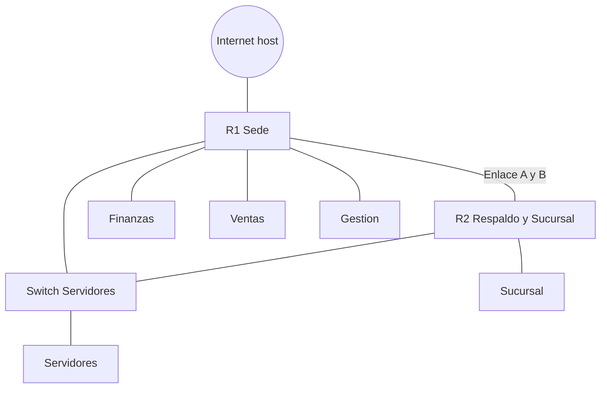
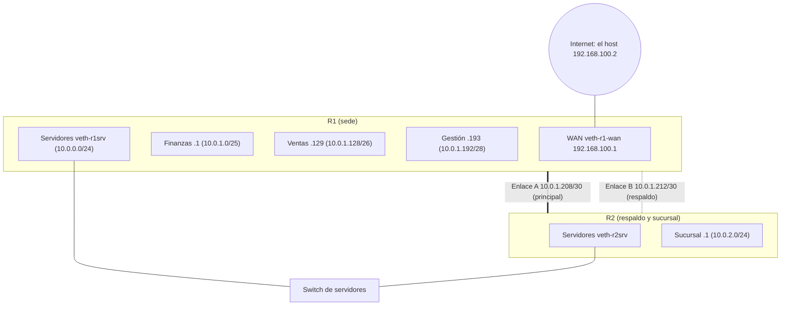
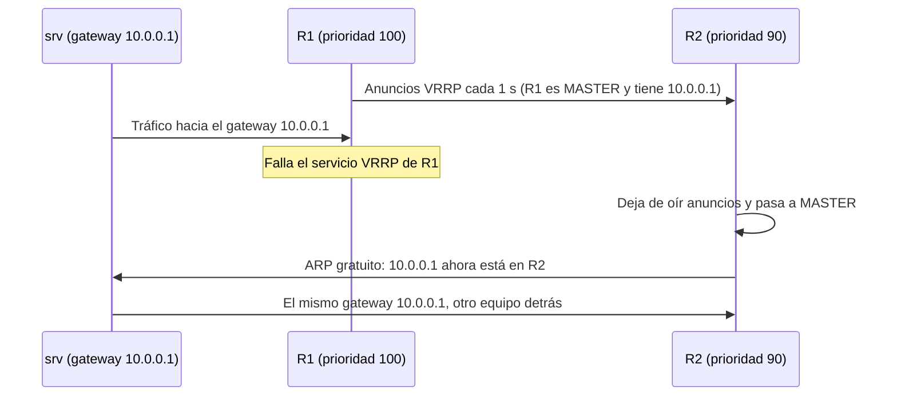

<p class="tema-eyebrow">LABORATORIO 15</p>

# IMPLEMENTACIÓN PRÁCTICA INTEGRAL

<p class="tema-meta"><span>17 secciones</span><span>3 diagramas</span><span>13 tablas</span></p>

## Contexto empresarial

La empresa **Networking SecOps** ha completado todos los laboratorios anteriores. Ahora debe integrar en una topología ejecutable los mecanismos centrales de este cierre: direccionamiento VLSM, enrutamiento dinámico con OSPF, firewall, DHCP/NAT y redundancia parcial de *gateway* con VRRP. **No es una única implementación de las quince tecnologías**: VLAN, DNS corporativo, VPN, MPLS, nube real, ZTNA y NOC/SIEM se estudian en escenarios previos, variantes o apartados conceptuales; el alcance se detalla en 15.10.

!!! info "Mismo modelo que el resto de la serie"
    Todo se construye con **namespaces de red**, igual que en los laboratorios anteriores (las interfaces de la práctica son virtuales). **Algunos pasos sí modifican el host**: el reenvío IPv4, una regla NAT y, en un caso de diagnóstico, un archivo persistente en `/etc/sysctl.d`. Están marcados como «Cambio en el host» y se revierten en la sección «Limpieza del laboratorio». Es un laboratorio de integración con una topología nueva, por lo que empieza limpiando el entorno. Requiere instalar `frr` (OSPF), `keepalived` (VRRP), `dnsmasq-base` (DHCP/DNS) y `dnsutils` para las pruebas con `dig`.

!!! note "Este es un escenario nuevo"
    Los laboratorios 01–14 usaron topologías diferentes. Aquí **se reutilizan los nombres `R1` y `R2` con otra función y otro direccionamiento** (sede y respaldo/sucursal), y el escenario se construye desde cero. Cada apartado funciona por sí mismo, pero la coherencia global se comprueba en el apartado «Revisión de coherencia» al final: que cada bloque funcione aisladamente no garantiza que el conjunto sea coherente.

## Topología



### Mapa del escenario: redes, *gateways* y caminos

El diagrama anterior muestra los equipos; este muestra **qué red cuelga de cada interfaz** y **por dónde puede viajar** el tráfico. Es la referencia visual para leer los apartados 15.1 a 15.8:



Tres ideas para leerlo: (1) la **única salida a Internet** es la WAN de R1 (R2 sale por R1); (2) hay **dos caminos** R1–R2 (A principal, B respaldo) y OSPF decide cuál usar; (3) el **segmento de servidores es compartido** por R1 y R2, y es ahí donde VRRP mueve la IP virtual del *gateway*.

## Construcción

### Paso 0: Limpiar y preparar

Elimina **solo los namespaces de los laboratorios anteriores, por nombre** (un bucle que borrara todos los de `ip netns list` afectaría también a otros entornos de tu equipo). Estos nombres (`R1`, `R2`, `host1`…) se reutilizan en toda la serie: si tu equipo tiene un entorno propio con alguno de ellos, **no continúes**; el bloque siguiente muestra cuáles existen y pide confirmación antes de borrar.

```bash
NS_SERIE="cliente1 cliente2 cliente3 cliente4 router switch ventas1 ventas2 ventas3 it1 it2 it3 admin1 admin2 R1 R2 R3 clienteSede clienteSucA clienteSucB servidorDNS servidorDHCP clienteDHCP firewall servidorWeb servidorDNS_PUB servidorInterno VPN_GW clienteVPN PE1 PE2 PE3 P1 P2 P3 host1 host2 host3 Core1 Core2 Dist1 Dist2 Access1 Firewall ServidorWeb ServidorDNS ventas it admin OnPremise AppServer DBServer AWS_VPC EC2_Server RDS_Server ZTNA_Broker IDP User1 User2 NOC SIEM Router Host1 Host2 ServidorDMZ SWsrv fin ven ges srv suc"

# Muestra cuáles de esos namespaces existen ahora mismo
EXISTENTES=$(ip netns list | awk '{print $1}' | grep -xF -f <(echo $NS_SERIE | tr ' ' '\n'))
VETH_WAN_FW=$(sudo ip -o link show veth-wan-fw 2>/dev/null | head -1)
echo "Se eliminarán: ${EXISTENTES:-(ninguno)}"
echo "Interfaz veth-wan-fw: ${VETH_WAN_FW:-(ausente)}"
read -r -p "¿Son todos recursos de laboratorios anteriores? (s/N) " R

if [ "$R" != s ]; then
  echo "Cancelado: renombra tus namespaces o usa una máquina virtual limpia"
elif pgrep -f '[/]tmp/lab15' >/dev/null; then
  echo "Hay procesos de una ejecución anterior de este laboratorio: aplica primero «Limpieza del laboratorio»"
else
  # Solo se llega aquí si todo lo anterior se ha confirmado
  for ns in $EXISTENTES; do
    sudo ip netns pids "$ns" 2>/dev/null | xargs -r sudo kill
    sudo ip netns del "$ns" 2>/dev/null || true
  done
  [ -n "$VETH_WAN_FW" ] && sudo ip link del veth-wan-fw 2>/dev/null || true
  [ "$(cat /sys/class/net/br-wan/ifalias 2>/dev/null)" = networking-lab ] && ip -4 -o addr show dev br-wan | grep -q '192\.168\.100\.2/24' && sudo ip link del br-wan   # solo el bridge de esta serie (marca + dirección)
  sudo apt-get install -y frr keepalived dnsmasq-base isc-dhcp-client dnsutils nftables netcat-openbsd

  for ns in R1 R2 SWsrv fin ven ges srv suc; do sudo ip netns add $ns; done
  for r in R1 R2; do sudo ip netns exec $r sysctl -qw net.ipv4.ip_forward=1; done
  mkdir -p /tmp/lab15

  # Registra ahora qué directorios DNS existían antes: la limpieza borra solo los que cree el laboratorio
  touch /tmp/lab15/netns.preexistente
  for ns in fin ven; do
    [ -e /etc/netns/$ns ] && echo "$ns" >> /tmp/lab15/netns.preexistente
  done

  # enlace NS_A IF_A IP_A NS_B IF_B IP_B
  enlace() {
    sudo ip link add $2 type veth peer name $5
    sudo ip link set $2 netns $1
    sudo ip link set $5 netns $4
    sudo ip netns exec $1 ip addr add $3 dev $2
    sudo ip netns exec $1 ip link set $2 up
    sudo ip netns exec $4 ip addr add $6 dev $5
    sudo ip netns exec $4 ip link set $5 up
  }
fi
```

Si aparece cualquiera de los mensajes de cancelación o aviso, **detente aquí**: no se ha creado nada y los apartados siguientes asumen el entorno preparado.

## 15.1 Configuración de red básica

R1 es el router de la sede: una WAN hacia el host (que hace de "Internet"), NAT, y su primera LAN (Finanzas).

La WAN une R1 con el **host** (sin namespace), así que se configura a mano:

```bash
sudo ip link add veth-r1-wan type veth peer name veth-wan-r1
sudo ip link set veth-r1-wan netns R1
sudo ip netns exec R1 ip addr add 192.168.100.1/24 dev veth-r1-wan
sudo ip netns exec R1 ip link set veth-r1-wan up
sudo ip addr add 192.168.100.2/24 dev veth-wan-r1
sudo ip link set veth-wan-r1 up

# R1: ruta por defecto hacia el host y NAT hacia la WAN
sudo ip netns exec R1 ip route add default via 192.168.100.2
sudo ip netns exec R1 iptables -t nat -A POSTROUTING -o veth-r1-wan -j MASQUERADE

# El host reenvía y traduce hacia tu red real (cambia eth0 por tu interfaz de salida)
# Guarda el valor original de ip_forward: la limpieza lo restaura
mkdir -p /tmp/lab15
sysctl -n net.ipv4.ip_forward > /tmp/lab15/ip_forward.orig
sudo sysctl -w net.ipv4.ip_forward=1
if ! sudo iptables -t nat -C POSTROUTING -s 192.168.100.0/24 -o eth0 -j MASQUERADE; then
  sudo iptables -t nat -A POSTROUTING -s 192.168.100.0/24 -o eth0 -j MASQUERADE && touch /tmp/lab15-host-nat.added
fi

# Primera LAN: Finanzas (10.0.1.0/25)
enlace R1 veth-r1fin 10.0.1.1/25 fin veth-fin 10.0.1.10/25
sudo ip netns exec fin ip route add default via 10.0.1.1
```

!!! danger "Cambio en el host en este apartado"
    Los comandos `sudo ip addr add … dev veth-wan-r1`, `sudo sysctl -w net.ipv4.ip_forward=1` e `iptables -t nat … -o eth0 -j MASQUERADE` **se ejecutan en el equipo real**, no dentro de un namespace (los de `ip netns exec R1 …` sí están aislados). El valor original de `ip_forward` y la creación de la regla NAT quedan registrados para revertirlos al terminar.

### Verificar conectividad WAN

```bash
sudo ip netns exec fin ping -c 3 10.0.1.1
sudo ip netns exec fin ping -c 3 192.168.100.2
```

(Con Internet en tu equipo, `ping 8.8.8.8` y `nslookup google.com 8.8.8.8` desde `fin` también funcionan.)

## 15.2 Subnetting aplicado (VLSM)

**Bloque disponible:** `10.0.0.0/22` (de `10.0.0.0` a `10.0.3.255`).

| Departamento | Hosts | Subred | Máscara | Rango útil | Gateway |
|--------------|-------|--------|---------|------------|---------|
| Servidores | 200 | 10.0.0.0/24 | /24 | 10.0.0.1 - 10.0.0.254 | 10.0.0.1 |
| Finanzas | 100 | 10.0.1.0/25 | /25 | 10.0.1.1 - 10.0.1.126 | 10.0.1.1 |
| Ventas | 50 | 10.0.1.128/26 | /26 | 10.0.1.129 - 10.0.1.190 | 10.0.1.129 |
| Gestión | 10 | 10.0.1.192/28 | /28 | 10.0.1.193 - 10.0.1.206 | 10.0.1.193 |
| Enlace A R1-R2 | 2 | 10.0.1.208/30 | /30 | 10.0.1.209 - 10.0.1.210 | - |
| Enlace B R1-R2 | 2 | 10.0.1.212/30 | /30 | 10.0.1.213 - 10.0.1.214 | - |
| Sucursal (R2) | 200 | 10.0.2.0/24 | /24 | 10.0.2.1 - 10.0.2.254 | 10.0.2.1 |

Cada bloque se asigna de mayor a menor sin solaparse (la sucursal, del mismo tamaño que Servidores, se reserva aparte en `10.0.2.0/24`).

**Correspondencia entre cada red y su interfaz.** Cada gateway pertenece a la interfaz que representa ese segmento y no a otra; las redes departamentales se distinguen de los enlaces punto a punto:

| Segmento | Red | Interfaz de R1 (o R2) | Dirección del router |
|----------|-----|-----------------------|----------------------|
| Servidores | 10.0.0.0/24 | `veth-r1srv` (R1), `veth-r2srv` (R2, apartado 15.7) | 10.0.0.1 (en 15.7 pasa a ser IP virtual; R1 = .2, R2 = .3) |
| Finanzas | 10.0.1.0/25 | `veth-r1fin` | 10.0.1.1 |
| Ventas | 10.0.1.128/26 | `veth-r1ven` | 10.0.1.129 |
| Gestión | 10.0.1.192/28 | `veth-r1ges` | 10.0.1.193 |
| Enlace A (principal) | 10.0.1.208/30 | `veth-r1r2a` (R1 .209) ↔ `veth-r2r1a` (R2 .210) | — (punto a punto) |
| Enlace B (respaldo) | 10.0.1.212/30 | `veth-r1r2b` (R1 .213) ↔ `veth-r2r1b` (R2 .214) | — (punto a punto) |
| Sucursal | 10.0.2.0/24 | `veth-r2suc` (R2) | 10.0.2.1 |

Ahora creamos el resto de segmentos (Finanzas ya existe):

```bash
# Ventas y Gestión: una interfaz de R1 por segmento
enlace R1 veth-r1ven 10.0.1.129/26 ven veth-ven 10.0.1.130/26
sudo ip netns exec ven ip route add default via 10.0.1.129
enlace R1 veth-r1ges 10.0.1.193/28 ges veth-ges 10.0.1.194/28
sudo ip netns exec ges ip route add default via 10.0.1.193

# Servidores: un switch (bridge) que más adelante compartirán R1 y R2
sudo ip netns exec SWsrv ip link add br0 type bridge
sudo ip netns exec SWsrv ip link set br0 up
sudo ip link add veth-r1srv type veth peer name veth-sw-r1
sudo ip link set veth-r1srv netns R1
sudo ip link set veth-sw-r1 netns SWsrv
sudo ip netns exec SWsrv ip link set veth-sw-r1 master br0
sudo ip netns exec SWsrv ip link set veth-sw-r1 up
sudo ip netns exec R1 ip addr add 10.0.0.1/24 dev veth-r1srv
sudo ip netns exec R1 ip link set veth-r1srv up
sudo ip link add veth-srv type veth peer name veth-sw-srv
sudo ip link set veth-srv netns srv
sudo ip link set veth-sw-srv netns SWsrv
sudo ip netns exec SWsrv ip link set veth-sw-srv master br0
sudo ip netns exec SWsrv ip link set veth-sw-srv up
sudo ip netns exec srv ip addr add 10.0.0.10/24 dev veth-srv
sudo ip netns exec srv ip link set veth-srv up
sudo ip netns exec srv ip route add default via 10.0.0.1

# R2 y su sucursal; dos enlaces /30 entre R1 y R2 (A: principal, B: respaldo)
enlace R1 veth-r1r2a 10.0.1.209/30 R2 veth-r2r1a 10.0.1.210/30
enlace R1 veth-r1r2b 10.0.1.213/30 R2 veth-r2r1b 10.0.1.214/30
enlace R2 veth-r2suc 10.0.2.1/24 suc veth-suc 10.0.2.10/24
sudo ip netns exec suc ip route add default via 10.0.2.1
```

Comprueba que cada equipo alcanza a su *gateway* y entre sí a través de R1:

```bash
sudo ip netns exec fin ping -c 2 10.0.1.130     # Finanzas -> Ventas (R1 enruta)
sudo ip netns exec srv ping -c 2 10.0.1.194     # Servidores -> Gestión
sudo ip netns exec R1 ping -c 2 10.0.1.210      # R1 -> R2 por el enlace A
```

## 15.3 VLAN (variante conceptual)

!!! warning "Ejemplo conceptual, no integrable directamente"
    En 15.2 cada departamento usa **una interfaz independiente** de R1. En una red real lo habitual es **un único enlace *trunk*** que transporta varias VLAN. Esta variante se presenta como **ejemplo conceptual**: **no es una configuración integral que pueda incorporarse directamente a la topología anterior** (no coexisten con las mismas subredes), y no se ha encadenado con el resto del laboratorio. Este laboratorio sigue con segmentos separados para poder verificarlos en cualquier máquina.

La configuración con un bridge Linux con filtrado de VLAN y *router-on-a-stick* es la del laboratorio 05 (requiere el módulo `8021q`). Con Open vSwitch, los elementos que hay que definir son estos:

| Elemento | Qué es | Dónde |
|----------|--------|-------|
| `ovs-sw` | El switch (bridge OVS) | host |
| `puerto-fin`, `puerto-ven`, `puerto-ges` | Puertos **access** de las VLAN 10, 20, 30; cada uno es un extremo de un `veth` cuyo otro extremo va al equipo final (`fin`, `ven`, `ges`) | host (extremo del switch) |
| `trunk-r1` ↔ `trunk` | Enlace **trunk**: `trunk-r1` es el puerto del switch y **recibe/envía las etiquetas 802.1Q**; su otro extremo `trunk` va a R1 | host / R1 |
| `trunk.10`, `trunk.20`, `trunk.30` | **Subinterfaces** de R1 sobre `trunk`, una por VLAN, con la IP del *gateway* de cada VLAN | R1 |

```bash
sudo apt-get install -y openvswitch-switch
mkdir -p /tmp/lab15
if sudo ovs-vsctl br-exists ovs-sw; then
  echo "Ya existe ovs-sw: no se reutiliza ni se elimina un bridge preexistente."
  exit 1
fi
sudo ovs-vsctl add-br ovs-sw && touch /tmp/lab15/ovs-sw.created

# Equipos finales: veth cuyo extremo "puerto-*" queda en el switch y el otro va a cada equipo
for h in "fin 10" "ven 20" "ges 30"; do
  set -- $h
  sudo ip link add puerto-$1 type veth peer name veth-eq-$1
  sudo ip link set veth-eq-$1 netns $1
  sudo ip link set puerto-$1 up
  sudo ovs-vsctl add-port ovs-sw puerto-$1 tag=$2      # puerto de acceso (sin etiqueta hacia el equipo)
done

# Trunk hacia R1: el switch etiqueta 10, 20 y 30
sudo ip link add trunk-r1 type veth peer name trunk
sudo ip link set trunk netns R1
sudo ip link set trunk-r1 up
sudo ovs-vsctl add-port ovs-sw trunk-r1 trunks=10,20,30

# En R1, una subinterfaz por VLAN con el gateway de cada subred
sudo ip netns exec R1 ip link set trunk up
for v in "10 10.0.1.1/25" "20 10.0.1.129/26" "30 10.0.1.193/28"; do
  set -- $v
  sudo ip netns exec R1 ip link add link trunk name trunk.$1 type vlan id $1
  sudo ip netns exec R1 ip addr add $2 dev trunk.$1
  sudo ip netns exec R1 ip link set trunk.$1 up
done

# Limpieza (el bridge OVS persiste incluso tras reiniciar):
# sudo ovs-vsctl --if-exists del-br ovs-sw
```

Los equipos finales (`fin`, `ven`, `ges`) tendrían su IP y su *gateway* como en 15.2, pero conectados al puerto de acceso de su VLAN. Estas subinterfaces llevan las IP de *gateway* **en lugar de** las interfaces `veth-r1fin`, `veth-r1ven` y `veth-r1ges` del 15.2: **no deben coexistir las dos formas** con las mismas subredes. Verifica en tu propio entorno antes de adoptarlo: este bloque ilustra el modelo trunk/access, no se encadena con el firewall, el DHCP ni el OSPF de los apartados siguientes (que usan los nombres de interfaz del 15.2).

## 15.4 Routing entre redes

### Rutas estáticas

```bash
sudo ip netns exec R2 ip route add default via 10.0.1.209
sudo ip netns exec R1 ip route add 10.0.2.0/24 via 10.0.1.210

sudo ip netns exec suc ping -c 2 10.0.1.10        # Sucursal -> Finanzas
sudo ip netns exec suc ping -c 2 192.168.100.2    # Sucursal -> "Internet" (vía R1 y su NAT)
sudo ip netns exec R1 ip route show
```

Funciona, pero las rutas estáticas no se adaptan solas a los cambios. Las eliminamos y usamos un protocolo dinámico.

### OSPF con FRRouting

Cada router ejecuta sus propios demonios `zebra` (conecta FRR con el kernel) y `ospfd`, dentro de su namespace y con archivos propios en `/tmp/lab15/<router>/`. Primero quitamos las rutas estáticas del tramo anterior:

```bash
sudo ip netns exec R2 ip route del default via 10.0.1.209
sudo ip netns exec R1 ip route del 10.0.2.0/24 via 10.0.1.210
```

Configuración de OSPF (los enlaces se declaran *punto a punto* para que la adyacencia llegue a `Full` enseguida, sin elección de DR; el enlace A, con coste 10, es el principal; el B, con coste 20, el respaldo; R1 anuncia además una ruta por defecto hacia Internet):

```bash
mkdir -p /tmp/lab15/r1 /tmp/lab15/r2

cat > /tmp/lab15/r1/zebra.conf << 'EOF'
hostname r1
EOF
cat > /tmp/lab15/r1/ospfd.conf << 'EOF'
hostname r1
interface veth-r1r2a
 ip ospf network point-to-point
 ip ospf cost 10
interface veth-r1r2b
 ip ospf network point-to-point
 ip ospf cost 20
router ospf
 ospf router-id 1.1.1.1
 passive-interface default
 no passive-interface veth-r1r2a
 no passive-interface veth-r1r2b
 network 10.0.0.0/24 area 0
 network 10.0.1.0/25 area 0
 network 10.0.1.128/26 area 0
 network 10.0.1.192/28 area 0
 network 10.0.1.208/30 area 0
 network 10.0.1.212/30 area 0
 default-information originate always
EOF

cat > /tmp/lab15/r2/zebra.conf << 'EOF'
hostname r2
EOF
cat > /tmp/lab15/r2/ospfd.conf << 'EOF'
hostname r2
interface veth-r2r1a
 ip ospf network point-to-point
 ip ospf cost 10
interface veth-r2r1b
 ip ospf network point-to-point
 ip ospf cost 20
router ospf
 ospf router-id 2.2.2.2
 passive-interface default
 no passive-interface veth-r2r1a
 no passive-interface veth-r2r1b
 network 10.0.2.0/24 area 0
 network 10.0.1.208/30 area 0
 network 10.0.1.212/30 area 0
EOF

# Los demonios se ejecutan como el usuario frr: necesita acceder a los archivos
sudo chown -R frr:frr /tmp/lab15/r1 /tmp/lab15/r2   # solo los directorios de los demonios
sudo chmod 755 /tmp/lab15                            # ¡no cambies los permisos de /tmp!

# Arrancar los demonios en cada namespace
for r in r1 r2; do
  R=$(echo $r | tr a-z A-Z)
  sudo ip netns exec $R /usr/lib/frr/zebra -d -u frr -g frr -f /tmp/lab15/$r/zebra.conf \
      -i /tmp/lab15/$r/zebra.pid -z /tmp/lab15/$r/zserv.api --vty_socket /tmp/lab15/$r
  sudo ip netns exec $R /usr/lib/frr/ospfd -d -u frr -g frr -f /tmp/lab15/$r/ospfd.conf \
      -i /tmp/lab15/$r/ospfd.pid -z /tmp/lab15/$r/zserv.api --vty_socket /tmp/lab15/$r
done
```

Los comandos `show ...` no son del *shell*: son del intérprete de FRR (`vtysh`). Desde el *shell* se ejecutan con `vtysh -c`, indicando el socket de cada router:

```bash
sleep 20
sudo vtysh --vty_socket /tmp/lab15/r1 -c "show ip ospf neighbor"
sudo vtysh --vty_socket /tmp/lab15/r1 -c "show ip route ospf"
sudo vtysh --vty_socket /tmp/lab15/r2 -c "show ip route ospf"

sudo ip netns exec suc ping -c 3 10.0.1.10
sudo ip netns exec suc ping -c 3 192.168.100.2
```

**Resultado esperado:** R1 y R2 son vecinos en estado `Full`; R2 aprende las redes de R1 y una ruta por defecto (`O>* 0.0.0.0/0`), y R1 aprende `10.0.2.0/24`.

**Qué hace OSPF (y qué no es).** OSPF no es «un mecanismo que cambia de interfaz cuando se cae un enlace». El resultado que observas es la consecuencia de un proceso en varias etapas:

1.  **Adyacencia:** R1 y R2 se descubren con paquetes *Hello* por cada enlace y establecen una relación de vecindad (`Full`). Hay una adyacencia **por enlace** (A y B).
2.  **Intercambio de estado de enlace:** cada router describe en **LSA** sus interfaces, sus redes y su **coste**, y se los envía al vecino.
3.  **Base de datos de estado de enlace (LSDB):** cada router acumula los LSA y construye una **vista idéntica de la topología**.
4.  **Cálculo SPF:** cada router ejecuta el algoritmo de Dijkstra sobre esa base de datos y obtiene el **camino de menor coste acumulado** hacia cada red. El coste de un camino es la **suma** de los costes de los enlaces que atraviesa.
5.  **Selección de ruta:** de entre los caminos calculados (aquí, por el enlace A con coste 10 o por el B con coste 20), se instala en la tabla de rutas el de menor coste. El B queda **preparado** en la base de datos pero no se usa mientras A sea mejor. Si dos caminos tuvieran el mismo coste, se instalarían los dos (ECMP).
6.  **Reconvergencia:** cuando un enlace cae, el router lo **detecta** (por pérdida de la interfaz o por vencer el tiempo de *dead*), **genera un LSA nuevo**, lo propaga, los routers **actualizan su LSDB y recalculan SPF** y se instalan las nuevas rutas.

Por eso la reconvergencia del apartado siguiente es rápida **aquí**: la interfaz cae y se detecta al instante; si el fallo fuera más allá de la interfaz (un fallo remoto), el vecino se declararía caído al vencer el *dead interval* (40 s por defecto), y la reconvergencia sería más lenta salvo con temporizadores ajustados o BFD.

**La ruta por defecto: `default-information originate always`.** Con esta orden R1 **anuncia a los demás routers una ruta por defecto**. La palabra `always` hace que la anuncie **incluso si R1 no dispone de una ruta por defecto válida** en su tabla. En este escenario R1 sí tiene una salida configurada hacia el host (`default via 192.168.100.2`), pero conviene saber qué significa: sin `always`, R1 solo anunciaría la ruta mientras tuviera una propia. **Que se anuncie una ruta no garantiza que el acceso exterior funcione**: si la WAN de R1 cayera, R2 seguiría recibiendo la ruta por defecto (con `always`) y enviando allí el tráfico. Quitar `always` hace que el anuncio dependa de la ruta real de R1.

### Reconvergencia ante un fallo

Tiramos el enlace principal (A) por ambos extremos y observamos cómo OSPF mueve el tráfico al respaldo sin intervención:

```bash
sudo ip netns exec R1 ip link set veth-r1r2a down
sudo ip netns exec R2 ip link set veth-r2r1a down
sleep 5
sudo ip netns exec R1 ip route show 10.0.2.0/24        # ahora por el enlace B (10.0.1.214)
sudo ip netns exec suc ping -c 3 10.0.1.10
sudo ip netns exec R1 ip link set veth-r1r2a up
sudo ip netns exec R2 ip link set veth-r2r1a up
```

**Las rutas antes y después de la caída del enlace A** (R1 hacia la sucursal `10.0.2.0/24`):

| Momento | `ip route show 10.0.2.0/24` en R1 | Quién lo decide |
|---------|-----------------------------------|-----------------|
| Enlace A activo | `via 10.0.1.210 dev veth-r1r2a proto ospf` | OSPF elige el camino de menor coste |
| Enlace A caído (tras ~5 s) | `via 10.0.1.214 dev veth-r1r2b proto ospf` | OSPF detecta la pérdida de la adyacencia y **recalcula** (SPF) |
| Enlace A restablecido | Vuelve `via 10.0.1.210` | Se restablece la adyacencia y el camino de menor coste |

Compárese con el laboratorio 06: allí el respaldo era una **segunda ruta estática** y solo valía para fallos locales; aquí el protocolo **descubre** el cambio por sí mismo, incluso si el fallo no fuera de la interfaz propia.

## 15.5 Firewall

Reglas en **nftables** para R1, guardadas en un archivo y cargadas dentro de su namespace. Las interfaces son las reales de R1: la WAN es `veth-r1-wan` y la zona de servidores `veth-r1srv`.

```bash
cat > /tmp/lab15/fw.nft << 'EOF'
table inet firewall {
    chain input {
        type filter hook input priority 0; policy drop;
        iif lo accept
        ct state established,related accept
        ip protocol icmp limit rate 10/second accept
        ip protocol ospf accept
        ip protocol vrrp accept
        iifname { "veth-r1fin", "veth-r1ven" } udp dport 67 accept
        iifname { "veth-r1fin", "veth-r1ven" } udp dport 53 accept
        iifname { "veth-r1fin", "veth-r1ven" } tcp dport 53 accept
        iifname { "veth-r1fin", "veth-r1ven", "veth-r1ges" } tcp dport 22 accept
    }
    chain forward {
        type filter hook forward priority 0; policy drop;
        ct state established,related accept
        iifname { "veth-r1fin", "veth-r1ven", "veth-r1ges", "veth-r1r2a", "veth-r1r2b" } oifname "veth-r1-wan" accept
        iifname { "veth-r1fin", "veth-r1ven", "veth-r1ges", "veth-r1r2a", "veth-r1r2b" } oifname "veth-r1srv" accept
        iifname "veth-r1-wan" oifname "veth-r1srv" tcp dport { 80, 443, 25 } accept
        # Entre LAN departamentales: por defecto NADA; solo Gestión puede administrar Finanzas y Ventas
        iifname "veth-r1ges" oifname { "veth-r1fin", "veth-r1ven" } icmp type echo-request accept
        iifname "veth-r1ges" oifname { "veth-r1fin", "veth-r1ven" } tcp dport 22 accept
        counter    # cuenta lo que llega al final de la cadena: lo que descartará la política
    }
}
EOF

sudo ip netns exec R1 nft -f /tmp/lab15/fw.nft
sudo ip netns exec R1 nft list ruleset
```

El protocolo OSPF (número 89) debe aceptarse en `input`, o R1 dejaría de ver a sus vecinos; igual que VRRP (número 112, apartado 15.7); y el puerto UDP 67 de las LAN de Finanzas y Ventas, o R1 no podría repartir direcciones DHCP (apartado 15.6). La política de `forward` es "denegar" y solo se abre lo necesario.

**Política de comunicación que implementan estas reglas** (segmentación no equivale a aislamiento absoluto: las reglas deben responder a una política definida):

| Origen → Destino | Política |
|------------------|----------|
| LAN (Finanzas, Ventas, Gestión) y enlaces a R2 → Internet | Permitido |
| LAN y sucursal → Servidores | Permitido |
| Finanzas ↔ Ventas, y Servidores → LAN | **Denegado** |
| Gestión → Finanzas / Ventas | Solo ICMP y SSH (administración) |
| Internet → Servidores | Solo TCP 80, 443 y 25 (si el servicio se publica; véase abajo) |

!!! note "Permitir el reenvío no equivale a publicar el servicio"
    La regla «Internet → Servidores en 80, 443 y 25» **solo permite el reenvío** si el paquete llega con un destino interno por la interfaz WAN. **No crea por sí sola la traducción de destino ni la accesibilidad exterior.** Para publicar un servicio privado hace falta normalmente **DNAT** (o direccionamiento público, o una arquitectura equivalente), además de rutas y políticas de seguridad. Ejemplo para publicar el puerto 80 del servidor `10.0.0.10` en la dirección WAN de R1:

    ```bash
    sudo ip netns exec R1 iptables -t nat -A PREROUTING -i veth-r1-wan -p tcp --dport 80 -j DNAT --to-destination 10.0.0.10:80
    sudo ip netns exec srv sh -c 'nc -l -p 80 >/dev/null 2>&1 </dev/null &'
    nc -zv -w 2 192.168.100.1 80        # desde el host («Internet»)
    ```

    Sin la regla de `PREROUTING`, el host no alcanzaría el servidor aunque la política de `forward` lo permitiera.

### Verificar segmentación y políticas

```bash
sudo ip netns exec fin ping -c 2 192.168.100.2     # salida a "Internet": permitida
sudo ip netns exec fin ping -c 2 -W 1 10.0.1.130   # Finanzas -> Ventas: BLOQUEADO (sin regla entre LAN)
sudo ip netns exec ges ping -c 2 10.0.1.10         # Gestión -> Finanzas: permitido (administración)
sudo ip netns exec srv ping -c 2 -W 1 10.0.1.10    # Servidores -> Finanzas: bloqueado
sudo ip netns exec R1 nft list chain inet firewall forward | grep counter   # paquetes descartados por la política
```

(La NAT hacia Internet sigue siendo la regla `iptables` de R1 del apartado 15.1.)

## 15.6 Servicios: DHCP con dnsmasq

R1 reparte direcciones en Finanzas y Ventas, con un rango por subred y su propio *gateway*. Antes de leer la configuración, fija la correspondencia:

| Interfaz de R1 | Segmento | Rango DHCP | Máscara | Gateway entregado | Etiqueta de dnsmasq |
|----------------|----------|------------|---------|-------------------|---------------------|
| `veth-r1fin` | Finanzas (10.0.1.0/25) | 10.0.1.20 – 10.0.1.120 | 255.255.255.128 | 10.0.1.1 | `fin` |
| `veth-r1ven` | Ventas (10.0.1.128/26) | 10.0.1.140 – 10.0.1.190 | 255.255.255.192 | 10.0.1.129 | `ven` |

**Cómo se asocian las etiquetas con los rangos.** `dhcp-range=set:fin,…` **crea la etiqueta `fin` para los clientes que reciban una dirección de ese rango**; `dhcp-option=tag:fin,option:router,…` aplica la opción de *gateway* **solo** a los clientes con esa etiqueta. Así, cada cliente recibe el *gateway* de su subred. Dnsmasq decide el rango por la interfaz por la que llega la petición.

**Qué parámetros recibe cada cliente:** dirección IP, máscara, puerta de enlace (`router`), servidor DNS y duración de la concesión (24 h). La configuración siguiente anuncia un **DNS interno opcional** ejecutado en R1: Finanzas consulta `10.0.1.1` y Ventas `10.0.1.129`, ambas direcciones del mismo router en sus respectivas redes. El servicio mantiene una zona de demostración `secops.local` y reenvía otros nombres a `8.8.8.8` si el host dispone de salida. DHCP y DNS siguen siendo servicios independientes: recibir una IP no garantiza que la resolución funcione.

```bash
cat > /tmp/lab15/dhcp.conf << 'EOF'
port=0
bind-interfaces
interface=veth-r1fin
interface=veth-r1ven
dhcp-range=set:fin,10.0.1.20,10.0.1.120,255.255.255.128,24h
dhcp-option=tag:fin,option:router,10.0.1.1
dhcp-range=set:ven,10.0.1.140,10.0.1.190,255.255.255.192,24h
dhcp-option=tag:ven,option:router,10.0.1.129
dhcp-option=tag:fin,option:dns-server,10.0.1.1
dhcp-option=tag:ven,option:dns-server,10.0.1.129
dhcp-leasefile=/tmp/lab15/dhcp.leases
EOF

sudo dnsmasq --test --conf-file=/tmp/lab15/dhcp.conf
sudo ip netns exec R1 dnsmasq --conf-file=/tmp/lab15/dhcp.conf --pid-file=/tmp/lab15/dhcp.pid
```

### DNS interno opcional: completar el ciclo DHCP → DNS → aplicación

El servidor DHCP anterior usa `port=0`, por lo que no presta DNS. Para recuperar la práctica del laboratorio 07, se levanta una segunda instancia de dnsmasq, dedicada a DNS, en las dos interfaces departamentales. No se presenta como DNS autoritativo empresarial completo: es una zona local pequeña y un reenviador para el resto.

```bash
cat > /tmp/lab15/dns.conf << 'EOF'
port=53
bind-interfaces
interface=veth-r1fin
interface=veth-r1ven
listen-address=10.0.1.1,10.0.1.129
no-resolv
server=8.8.8.8
domain-needed
bogus-priv
domain=secops.local
local=/secops.local/
host-record=app.secops.local,10.0.0.10
host-record=db.secops.local,10.0.0.20
cache-size=1000
EOF

sudo dnsmasq --test --conf-file=/tmp/lab15/dns.conf
sudo ip netns exec R1 dnsmasq --conf-file=/tmp/lab15/dns.conf --pid-file=/tmp/lab15/dns.pid
```

Tras obtener las concesiones DHCP, comprueba que cada segmento recibió su DNS y que la zona local resuelve:

```bash
sudo ip netns exec fin cat /etc/resolv.conf
sudo ip netns exec fin dig @10.0.1.1 app.secops.local A +noall +answer
sudo ip netns exec ven dig @10.0.1.129 db.secops.local A +noall +answer
sudo ip netns exec fin dig @10.0.1.1 app.secops.local A +tcp +noall +answer
sudo ip netns exec fin dig @10.0.1.1 inexistente.secops.local A
```

Resultados esperados: `app.secops.local` devuelve `10.0.0.10`, `db.secops.local` devuelve `10.0.0.20` y el nombre inexistente devuelve `NXDOMAIN`. Si la consulta externa falla pero la zona interna responde, revisa salida WAN/forwarding antes de atribuir el fallo al DNS interno.

Los clientes piden dirección en lugar de tener una fija. Para que `dhclient` no toque el `resolv.conf` de tu equipo, damos a cada namespace el suyo:

```bash
for ns in fin ven; do
  sudo mkdir -p /etc/netns/$ns
  sudo touch /etc/netns/$ns/resolv.conf
done

# Finanzas: quitar la IP fija y pedirla por DHCP
sudo ip netns exec fin ip addr flush dev veth-fin
sudo ip netns exec fin dhclient -v -pf /tmp/lab15/dhclient-fin.pid -lf /tmp/lab15/dhclient-fin.leases veth-fin
sudo ip netns exec fin ip -4 addr show dev veth-fin
sudo ip netns exec fin ip route show

# Ventas
sudo ip netns exec ven ip addr flush dev veth-ven
sudo ip netns exec ven dhclient -v -pf /tmp/lab15/dhclient-ven.pid -lf /tmp/lab15/dhclient-ven.leases veth-ven
sudo ip netns exec ven ip -4 addr show dev veth-ven
```

### Validar

```bash
sudo ip netns exec fin ip route
sudo ip netns exec fin ping -c 2 10.0.1.1
sudo ip netns exec fin ping -c 2 192.168.100.2
sudo ip netns exec ven ping -c 2 192.168.100.2
```

## 15.7 Red empresarial completa: VRRP (redundancia de *gateway*)

Los servidores usan `10.0.0.1` como *gateway*. Si R1 falla, quedarían aislados. Con **VRRP** (aquí con `keepalived`) R1 y R2 comparten una **IP virtual** `10.0.0.1`: la tiene el router de mayor prioridad y, si cae, la toma el otro.

**Los elementos de VRRP:**

| Elemento | En este laboratorio |
|----------|---------------------|
| Dirección física de R1 | `10.0.0.2` (en `veth-r1srv`) |
| Dirección física de R2 | `10.0.0.3` (en `veth-r2srv`) |
| Dirección virtual compartida | `10.0.0.1` (el *gateway* de los servidores) |
| Router activo (*master*) | R1, prioridad 100 |
| Router de respaldo (*backup*) | R2, prioridad 90 |
| Anuncios VRRP | El *master* envía un anuncio cada segundo (`advert_int 1`) por multicast (224.0.0.18, protocolo IP 112) |
| Cambio de estado | Si el respaldo deja de recibir anuncios durante unos tres intervalos, **se declara *master*** y **adquiere la dirección virtual** (y avisa con ARP gratuito) |

R2 se une al switch de servidores y R1 pasa a usar una IP propia distinta (`10.0.0.2`), dejando `10.0.0.1` para la IP virtual (no puede estar configurada a la vez como IP normal):

```bash
# R2 en el segmento de servidores
sudo ip link add veth-r2srv type veth peer name veth-sw-r2
sudo ip link set veth-r2srv netns R2
sudo ip link set veth-sw-r2 netns SWsrv
sudo ip netns exec SWsrv ip link set veth-sw-r2 master br0
sudo ip netns exec SWsrv ip link set veth-sw-r2 up
sudo ip netns exec R2 ip addr add 10.0.0.3/24 dev veth-r2srv
sudo ip netns exec R2 ip link set veth-r2srv up

# R1: su IP real pasa a 10.0.0.2 (10.0.0.1 será la IP virtual)
sudo ip netns exec R1 ip addr del 10.0.0.1/24 dev veth-r1srv
sudo ip netns exec R1 ip addr add 10.0.0.2/24 dev veth-r1srv
```

Configuración de VRRP en cada router (la contraseña de autenticación tiene como máximo 8 caracteres; la clave `PASS` de VRRP es débil y solo sirve para evitar errores de configuración, no como seguridad):

```bash
cat > /tmp/lab15/ka-r1.conf << 'EOF'
vrrp_instance SERVIDORES {
    state MASTER
    interface veth-r1srv
    virtual_router_id 10
    priority 100
    advert_int 1
    authentication {
        auth_type PASS
        auth_pass Secur24
    }
    virtual_ipaddress {
        10.0.0.1/24
    }
}
EOF
sed -e 's/MASTER/BACKUP/' -e 's/veth-r1srv/veth-r2srv/' -e 's/priority 100/priority 90/' /tmp/lab15/ka-r1.conf > /tmp/lab15/ka-r2.conf

sudo ip netns exec R1 keepalived -P -f /tmp/lab15/ka-r1.conf -p /tmp/lab15/ka-r1.pid -r /tmp/lab15/ka-r1.vrrp.pid
sudo ip netns exec R2 keepalived -P -f /tmp/lab15/ka-r2.conf -p /tmp/lab15/ka-r2.pid -r /tmp/lab15/ka-r2.vrrp.pid
```

### Verificar y probar el *failover*

```bash
sleep 5
sudo ip netns exec R1 ip -4 addr show dev veth-r1srv     # R1 tiene 10.0.0.1 como IP virtual
sudo ip netns exec srv ping -c 2 10.0.0.1

# Falla R1 (se detiene su VRRP): la IP virtual pasa a R2
sudo kill $(cat /tmp/lab15/ka-r1.vrrp.pid) $(cat /tmp/lab15/ka-r1.pid)
sleep 5
sudo ip netns exec R2 ip -4 addr show dev veth-r2srv     # ahora R2 tiene 10.0.0.1
sudo ip netns exec srv ping -c 3 10.0.0.1                # el gateway sigue respondiendo
```

**Alcance de VRRP.** VRRP proporciona **redundancia del *gateway***, **no redundancia integral de toda la infraestructura**. Si R1 pierde **solo su conectividad WAN** pero **su interfaz LAN sigue funcionando**, R1 sigue enviando anuncios y conservando la IP virtual: **la configuración mostrada no provoca una transferencia automática**, y los servidores seguirían enviando su tráfico a un *gateway* sin salida. Para cubrir esa condición hace falta **seguimiento del estado de interfaces o rutas** y una **política de prioridad** que lo acompañe. Con `keepalived`:

```
vrrp_instance SERVIDORES {
    ...
    track_interface {
        veth-r1-wan weight -20     # si la WAN cae, la prioridad de R1 baja de 100 a 80 (< 90 de R2)
    }
}
```

(Ilustrativo: en **esta** topología R2 sale a Internet a través de R1, así que transferir el *gateway* a R2 no restablecería la salida; el seguimiento solo sirve cuando el respaldo tiene un camino alternativo.) La clave `PASS` no es una protección criptográfica: ya se advirtió arriba que es débil, y esa advertencia se mantiene.

### Cambio de *master* y *backup*



### Dos casos que no deben confundirse

**Caso A: falla el *servicio de gateway* de R1.** Es el que demuestra el apartado anterior: R2 asume la IP virtual y los servidores conservan su *gateway*. Lo que se demuestra es **disponibilidad del *gateway***.

**Caso B: falla la conectividad **WAN** de R1, pero R1 sigue vivo.** Obsérvalo con VRRP funcionando y R1 como *master* (hazlo **antes** del *failover* anterior o reinicia primero el `keepalived` de R1):

```bash
sudo ip netns exec R1 ip link set veth-r1-wan down
sudo ip netns exec srv ping -c 2 -W 1 10.0.0.1          # el gateway sigue respondiendo
sudo ip netns exec srv ping -c 2 -W 1 192.168.100.2     # pero ya no hay salida a «Internet»

# Restablecer: al bajar la interfaz el kernel retiró la ruta por defecto
sudo ip netns exec R1 ip link set veth-r1-wan up
sudo ip netns exec R1 ip route replace default via 192.168.100.2
```

La IP virtual **no se movió** porque R1 sigue enviando anuncios por su LAN. Para que el caso B se resuelva hace falta, además, que **R2 tenga una salida WAN propia**:

| Requisito | Por qué |
|-----------|---------|
| Una salida WAN independiente en R2 (otro enlace al exterior) | Si R2 sale por R1, transferir el *gateway* no restablece nada |
| Ruta por defecto y NAT en R2 | Para que, al ser *master*, pueda sacar el tráfico |
| Seguimiento de la WAN en `keepalived` (`track_interface` o `track_script`) | Para que R1 **baje su prioridad** al perder la WAN y R2 pase a ser *master* |
| Reglas de firewall equivalentes en R2 | Para que la política no cambie al cambiar de *master* |

Es la diferencia entre **disponibilidad del *gateway*** (caso A) y **continuidad integral del servicio** (caso B).

## 15.8 Troubleshooting real

Casos de diagnóstico habituales. Los ejemplos de direcciones (`10.10.1.100`) son **ilustrativos**: no corresponden a un equipo de esta topología. Los comandos siguientes sirven para **representar un diagnóstico de paquetes que atraviesan un túnel**; **no** verifican el túnel construido en apartados anteriores (en este laboratorio no hay ningún túnel GRE ni IPsec).

### Caso: degradación por MTU en un túnel (IPsec/GRE)

**No uses MTU y MSS indistintamente:**

| Concepto | Qué es | Ejemplo |
|----------|--------|---------|
| **MTU del enlace** | Tamaño máximo del paquete IP en ese enlace | 1500 |
| **MTU efectiva del túnel** | La MTU del enlace **menos el *overhead* de la encapsulación** | p. ej. ~1400 con IPsec |
| **MSS anunciado por TCP** | Máximo de **datos TCP** por segmento que un extremo anuncia (MTU − 20 IP − 20 TCP) | 1460 con MTU 1500; 1360 con MTU 1400 |
| **Ajuste de MSS** (*MSS clamping*) | El router reescribe el MSS de los SYN para que los segmentos quepan en el túnel | `TCPMSS --set-mss 1360` |
| **Fragmentación y PMTUD** | Si un paquete excede la MTU: se fragmenta (si no tiene DF) o se descarta y se avisa por ICMP «fragmentation needed» (PMTUD); si ese ICMP se filtra, la conexión **se bloquea** |  |

```bash
# Sondear la MTU efectiva con DF activado.
# -s es el tamaño de los DATOS ICMP: 1472 + 28 = 1500, el tamaño máximo con MTU 1500.
# Si falla, la MTU del camino es menor que 1500 (por ejemplo, por la encapsulación de un túnel).
ping -M do -s 1472 -c 2 10.10.1.100
ping -M do -s 1410 -c 2 10.10.1.100
sudo tcpdump -i eth0 host 10.10.1.100 and port 445 -w captura.pcap

# Limitar el MSS de las conexiones que atraviesan el router (se aplica habitualmente en la tabla mangle).
# 1360 = 1400 (MTU efectiva del túnel) - 20 (IP) - 20 (TCP).
# Aplicar dentro del router del laboratorio y limitarlo al flujo ilustrativo.
# No modifica el firewall global del host. El destino es de ejemplo, no parte de la topología base.
if ! sudo ip netns exec R1 iptables -t mangle -C FORWARD -s 10.0.0.0/22 -d 10.10.1.100/32 -o veth-r1-wan -p tcp --tcp-flags SYN,RST SYN -j TCPMSS --set-mss 1360; then
  sudo ip netns exec R1 iptables -t mangle -A FORWARD -s 10.0.0.0/22 -d 10.10.1.100/32 -o veth-r1-wan -p tcp --tcp-flags SYN,RST SYN -j TCPMSS --set-mss 1360
  touch /tmp/lab15/tcpmss.added
fi
# Alternativa dinámica (elige clamp-mss-to-pmtu en lugar de set-mss, no ambas).
```

### Caso: agotamiento de la tabla ARP

A diferencia del resto del libro, estas órdenes actúan sobre el **host** (`sysctl` y `/etc/sysctl.d`), no sobre un namespace: es un caso de ejemplo para entender el diagnóstico, no una receta para ejecutar tal cual en un equipo de producción.

```bash
dmesg | grep -i neighbour
ip neigh show | wc -l
sysctl net.ipv4.neigh.default.gc_thresh3
# Guarda los valores originales: la limpieza los restaura
sysctl -n net.ipv4.neigh.default.gc_thresh2 > /tmp/lab15/gc_thresh2.orig
sysctl -n net.ipv4.neigh.default.gc_thresh3 > /tmp/lab15/gc_thresh3.orig
sudo sysctl -w net.ipv4.neigh.default.gc_thresh3=8192
sudo sysctl -w net.ipv4.neigh.default.gc_thresh2=4096
# ⚠ CAMBIO PERSISTENTE EN EL HOST: sobrevive a reinicios (reversión en «Limpieza del laboratorio»)
# Si 99-arp.conf ya existe es tuyo: no lo toques; elige otro nombre o cancela
[ -e /etc/sysctl.d/99-arp.conf ] && echo "99-arp.conf ya existe: no continúes" || {
  echo 'net.ipv4.neigh.default.gc_thresh3=8192' | sudo tee /etc/sysctl.d/99-arp.conf
  echo 'net.ipv4.neigh.default.gc_thresh2=4096' | sudo tee -a /etc/sysctl.d/99-arp.conf
  touch /tmp/lab15/creado-99-arp
}
sudo sysctl --system
```

### Script de verificación ARP

```bash
[ -e /usr/local/bin/check_arp.sh ] && echo "check_arp.sh ya existe: no se sobrescribe" || {
sudo tee /usr/local/bin/check_arp.sh > /dev/null << 'EOF'
#!/bin/bash
THRESHOLD=7000
CURRENT=$(ip neigh show | wc -l)
if [ "$CURRENT" -gt "$THRESHOLD" ]; then
    echo "WARNING: ARP table usage high: $CURRENT entries"
fi
EOF
sudo chmod +x /usr/local/bin/check_arp.sh
touch /tmp/lab15/creado-check_arp
}
```

## 15.9 Dependencias, fallos e incidencias

### Matriz de dependencias

Los servicios de red no son independientes: unos **necesitan** que otros funcionen y la política de seguridad **los condiciona a todos**.

| Servicio | Depende de | Qué permite el firewall (`input`) | Si falta algo |
|----------|------------|-------------------------------------|----------------|
| **Routing (OSPF)** | Enlaces A/B activos | Protocolo 89 | No hay adyacencia: R1 y R2 no intercambian rutas |
| **DHCP (dnsmasq)** | Interfaz de la LAN y rango definido | UDP 67 desde Finanzas y Ventas | Los clientes no reciben IP |
| **VRRP** | Misma LAN de servidores en R1 y R2 | Protocolo 112 | Ambos routers se creen *master* |
| **Salida a Internet** | WAN de R1, NAT y ruta por defecto | `forward` LAN → WAN | Hay *gateway*, pero no hay salida |
| **Administración (SSH)** | Alcance a R1 desde Gestión | TCP 22 desde Gestión | No se puede gestionar el router |

### Escenarios de fallo y comportamiento esperado

| Fallo | Qué ocurre | Quién lo resuelve | ¿Se recupera solo? |
|-------|------------|-------------------|--------------------|
| Cae el enlace A (R1–R2) | El tráfico pasa al enlace B | OSPF | Sí, en segundos |
| Cae el servicio VRRP de R1 | R2 asume la IP virtual `10.0.0.1` | VRRP | Sí, en segundos |
| Cae la WAN de R1 (R1 sigue vivo) | Los servidores conservan el *gateway* pero pierden la salida | **Nadie** (falta seguimiento y WAN en R2) | **No** (caso B) |
| Se omite `ip protocol ospf accept` | Se pierde la adyacencia; el enlace «funciona» pero no hay rutas dinámicas | El administrador | No |
| Se omite DHCP (UDP 67) en `input` | Los clientes no obtienen IP | El administrador | No |
| Falta la regla DNAT | El servicio publicado no es alcanzable desde fuera aunque `forward` lo permita | El administrador | No |
| MTU menor en un túnel | Las conexiones pequeñas funcionan y las transferencias grandes se cuelgan | Ajuste de MTU/MSS | No |

### Caso final: una incidencia combinada

> **Aviso del equipo:** tras publicar una nueva versión del archivo `fw.nft` en R1, **los equipos que piden dirección ya no reciben IP** y, además, la **sucursal perdió las rutas dinámicas**. Los enlaces A y B están arriba y R1 responde a `ping`.

Dos síntomas distintos, ¿una causa o dos? Antes de abrir la solución, razona **qué comprobarías y en qué orden**. Dispones de `ping`, `tcpdump`, `nft -a list chain inet firewall input` y `vtysh -c "show ip ospf neighbor"`.

??? note "Solución razonada"
    1.  **Conectividad básica.** `ping` a R1 funciona: `input` acepta ICMP. Así que no es un problema de enlace ni de capa 2.
    2.  **Síntoma de rutas.** `show ip ospf neighbor` en R1 no muestra a R2 en estado *Full*. Con `tcpdump -i veth-r1r2a proto ospf` se ven los *Hello* de R2 **llegar** a R1, pero R1 no los procesa y nunca declara al vecino: los descarta el firewall.
    3.  **Síntoma de DHCP.** `tcpdump -i veth-r1fin port 67 or port 68` muestra los `DISCOVER` entrando y ningún `OFFER` saliendo: `dnsmasq` no llega a recibirlos.
    4.  **Un punto en común.** OSPF y DHCP son tráfico **destinado a R1** (cadena `input`), no tráfico que lo atraviesa. Con `policy drop`, solo pasa lo que `input` acepta de forma explícita. `nft -a list chain inet firewall input` muestra que en la nueva versión **faltan** las reglas de protocolo 89 y de UDP 67.
    5.  **Corrección y verificación.** Se restituyen las reglas, se comprueba que la adyacencia vuelve a *Full* y que un cliente obtiene IP. **Una sola causa** (la política de `input`) explicaba dos síntomas aparentemente independientes.

    Lección: ante varios síntomas, busca primero lo que tienen en común (aquí, que el destino era el propio router), y no trates cada servicio por separado.

Para **reproducirlo** (opcional), elimina esas reglas por su *handle* y restitúyelas después:

```bash
sudo ip netns exec R1 nft -a list chain inet firewall input        # anota los handle de «ospf» y «udp dport 67»
sudo ip netns exec R1 nft delete rule inet firewall input handle N   # repite con cada handle

# Restituir
sudo ip netns exec R1 nft insert rule inet firewall input ip protocol ospf accept
sudo ip netns exec R1 nft insert rule inet firewall input iifname '{ "veth-r1fin", "veth-r1ven" }' udp dport 67 accept
```

## Limpieza del laboratorio

Al terminar, detén los demonios y elimina solo lo creado aquí. Un namespace **no desaparece del todo mientras tenga procesos dentro**, así que primero se detienen los procesos (todos usan archivos de `/tmp/lab15`):

```bash
# Retirar TCPMSS dentro de R1 antes de eliminar el namespace, solo si esta práctica añadió la regla.
if [ -f /tmp/lab15/tcpmss.added ]; then
  sudo ip netns exec R1 iptables -t mangle -D FORWARD -s 10.0.0.0/22 -d 10.10.1.100/32 -o veth-r1-wan -p tcp --tcp-flags SYN,RST SYN -j TCPMSS --set-mss 1360 2>/dev/null || true
fi

# Detener únicamente procesos con PID files de esta ejecución.
for pf in /tmp/lab15/r1/zebra.pid /tmp/lab15/r1/ospfd.pid /tmp/lab15/r2/zebra.pid /tmp/lab15/r2/ospfd.pid /tmp/lab15/dhcp.pid /tmp/lab15/dns.pid /tmp/lab15/ka-r1.pid /tmp/lab15/ka-r2.pid /tmp/lab15/ka-r1.vrrp.pid /tmp/lab15/ka-r2.vrrp.pid /tmp/lab15/dhclient-fin.pid /tmp/lab15/dhclient-ven.pid; do
  if [ -s "$pf" ]; then
    pid=$(cat "$pf")
    if [[ "$pid" =~ ^[0-9]+$ ]] && kill -0 "$pid" 2>/dev/null; then
      sudo kill -TERM "$pid" 2>/dev/null || true
    fi
  fi
done
# Respaldo acotado: procesos que aún pertenezcan a los namespaces exclusivos del laboratorio.
for ns in R1 R2 SWsrv fin ven ges srv suc; do
  sudo ip netns pids "$ns" 2>/dev/null | xargs -r sudo kill
  sudo ip netns del "$ns" 2>/dev/null || true
done
sudo ip link del veth-wan-r1 2>/dev/null || true
# /etc/netns/fin y /etc/netns/ven: se borran solo si NO existían antes del laboratorio
# (si no existe el registro del Paso 0, no se borra nada)
if [ -f /tmp/lab15/netns.preexistente ]; then
  for ns in fin ven; do
    grep -qx "$ns" /tmp/lab15/netns.preexistente || sudo rm -rf /etc/netns/$ns
  done
fi
# Restaura ip_forward al valor original (no se asume 0)
[ -f /tmp/lab15/ip_forward.orig ] && sudo sysctl -w net.ipv4.ip_forward="$(cat /tmp/lab15/ip_forward.orig)"
# Archivos persistentes del caso ARP: solo si los creó este laboratorio
[ -f /tmp/lab15/creado-99-arp ] && sudo rm -f /etc/sysctl.d/99-arp.conf && sudo sysctl --system
[ -f /tmp/lab15/creado-check_arp ] && sudo rm -f /usr/local/bin/check_arp.sh
# Restaura los umbrales ARP originales
for n in 2 3; do
  [ -f /tmp/lab15/gc_thresh$n.orig ] && sudo sysctl -w net.ipv4.neigh.default.gc_thresh$n="$(cat /tmp/lab15/gc_thresh$n.orig)"
done
if [ -f /tmp/lab15-host-nat.added ]; then
  sudo iptables -t nat -D POSTROUTING -s 192.168.100.0/24 -o eth0 -j MASQUERADE 2>/dev/null || true
  rm -f /tmp/lab15-host-nat.added
fi
# Solo eliminar el bridge OVS si el marcador demuestra que lo creó esta práctica.
if [ -f /tmp/lab15/ovs-sw.created ]; then
  sudo ovs-vsctl --if-exists del-br ovs-sw
fi
sudo rm -rf /tmp/lab15
```

### Revertir lo que se hizo en el host

| Cambio | Reversión |
|--------|-----------|
| `net.ipv4.ip_forward=1` | Lo restaura el bloque de limpieza con el valor guardado en `/tmp/lab15/ip_forward.orig`; sin ese archivo, usa el valor que anotaste |
| Regla `MASQUERADE` del host | La línea `iptables -t nat -D …` de arriba |
| Interfaz `veth-wan-r1` | La línea `ip link del veth-wan-r1` de arriba |
| **Persistente:** `/etc/sysctl.d/99-arp.conf` (caso de agotamiento ARP) | Lo elimina el bloque de limpieza, solo si lo creó el laboratorio (si ya existía, no se toca) |
| `gc_thresh2` y `gc_thresh3` cambiados con `sysctl -w` | Los restaura el bloque de limpieza con los valores guardados en `/tmp/lab15/gc_thresh2.orig` y `gc_thresh3.orig` |
| `/usr/local/bin/check_arp.sh` (si lo creó el laboratorio) | Lo elimina el bloque de limpieza, solo si lo creó el laboratorio |

Comprueba al final: `sysctl net.ipv4.ip_forward`, `iptables -t nat -S POSTROUTING` y `ls /etc/sysctl.d/`.

## Conceptos clave

| Concepto | Aplicación |
|----------|------------|
| Configuración básica | Conectividad IP, NAT y ruta por defecto |
| Subnetting | VLSM para segmentación (`10.0.0.0/22`) |
| VLAN | Segmentación lógica (variante **conceptual** con trunk) |
| Routing | Rutas estáticas y OSPF (adyacencia, LSDB, SPF, reconvergencia) |
| Firewall | nftables con política "denegar" y una política de comunicación explícita (el reenvío no publica servicios sin DNAT) |
| DHCP/DNS | Un rango, gateway y resolver DNS interno por subred; zona `secops.local` simplificada opcional |
| VRRP | IP virtual de *gateway* con failover; no redunda toda la infraestructura |
| Troubleshooting | MTU frente a MSS, y tabla ARP |

## Revisión de coherencia del escenario global

Cada apartado funciona por sí mismo, pero conviene comprobar que **el conjunto es coherente**:

-   **Direccionamiento:** el mapa red ↔ interfaz del apartado 15.2 es la referencia única; no hay dos interfaces con la misma dirección. En 15.7 la IP de R1 en servidores cambia de `10.0.0.1` a `10.0.0.2` (y la `10.0.0.1` pasa a ser virtual); OSPF sigue anunciando `10.0.0.0/24`.
-   **Firewall frente a protocolos de control:** `input` acepta OSPF, VRRP y DHCP; si falta alguno, ese servicio se rompe de forma silenciosa.
-   **NAT y firewall:** la NAT de salida sigue siendo `iptables` y la política de reenvío es de `nftables`; conviven en el mismo namespace.
-   **VLAN:** el apartado 15.3 es una variante; no se mezcla con los demás.
-   **Alcance de las pruebas:** las comprobaciones de cada apartado demuestran lo que se afirma en él; no demuestran, por ejemplo, que una caída de la WAN se gestione sola (véase VRRP).

## 15.10. Cierre de competencias y límites de la integración

La topología principal integra VLSM, routing estático/OSPF, firewall, DHCP, NAT y VRRP en los segmentos indicados. No integra en ejecución VLAN completa, DNS corporativo empresarial (incluye solo una zona interna simplificada opcional), VPN/IPsec/WireGuard, MPLS, ZTNA, nube real ni NOC/SIEM. Esas tecnologías se estudian en escenarios previos o variantes; no afirmes que la topología final las implementa todas.

### RIB, LSDB, SPF y FIB en OSPF

La LSDB describe la topología mediante LSAs; no contiene una ruta de respaldo ya instalada. SPF calcula los caminos a partir de la LSDB; el proceso de routing instala las rutas seleccionadas en la RIB; el kernel mantiene la información de forwarding que usa el plano de datos (FIB). Un cambio en la topología puede provocar nueva ejecución de SPF y actualización de rutas, pero los tiempos dependen de detección, temporizadores, procesamiento y convergencia.

### DHCP y DNS: cerrar el ciclo de servicio

La asignación DHCP debe verificarse junto con máscara, gateway, DNS y lease. La extensión opcional anuncia el DNS interno de R1 y sirve una zona local simplificada; no es un DNS corporativo autoritativo completo. Comprueba respuestas positivas, TTL, NXDOMAIN y consultas TCP; el reenvío externo depende de la salida WAN. No confundas una concesión DHCP válida con resolución DNS funcional.

### Matriz de disponibilidad por segmento

VRRP se ejecuta solo en la red de servidores en el escenario descrito. Finanzas, Ventas y Gestión mantienen gateways asociados a R1; la sucursal depende de R2; Internet y DHCP también tienen dependencias propias. Completa esta matriz y no generalices el failover del gateway de servidores a toda la empresa:

| Segmento/servicio | Gateway redundante | Dependencia residual | Resultado ante caída de R1 |
|---|---|---|---|
| Servidores | Sí, VIP VRRP | Servicios y rutas de R2 | Solo continuidad si R2 tiene camino y servicios necesarios |
| Finanzas | No en topología base | Gateway R1 | Pierde gateway |
| Ventas | No en topología base | Gateway R1 | Pierde gateway |
| Gestión | No en topología base | Gateway R1 | Pierde gateway |
| Sucursal | No equivalente a VRRP | R2 y su WAN | Depende del enlace y rutas de R2 |
| Internet | No hay WAN independiente en R2 | R1/host | No hay continuidad automática |
| DHCP | Servicio central en R1 | Proceso y conectividad a R1 | Los clientes existentes pueden conservar lease; nuevas concesiones/renovaciones pueden fallar |

### Correcciones operativas obligatorias

**Open vSwitch:** no elimines `ovs-sw` solo por su nombre. Antes de crearlo, comprueba que no exista; registra un marcador de propiedad únicamente cuando esta práctica lo crea. En limpieza, ejecuta `ovs-vsctl --if-exists del-br ovs-sw` solo si existe el marcador y elimina el marcador después. Si el bridge ya existía, detén el ejercicio y no lo reutilices ni lo borres.

**TCPMSS:** el ejemplo original ejecutado sin `ip netns exec` modifica el firewall del host y puede afectar tráfico ajeno. La opción preferida es aplicar la regla dentro del router del laboratorio y limitarla a las interfaces/redes de la práctica. Si por un motivo didáctico se conserva en el host, debe restringirse a interfaces y prefijos propios, registrarse con un marcador y eliminarse con la regla exacta en la limpieza. Nunca dejes una regla global sin reversión.

**Procesos:** evita `pkill -f` como mecanismo general de limpieza. Guarda PID de `zebra`, `ospfd`, `dnsmasq`, `keepalived` y `dhclient` al iniciarlos; valida que el proceso pertenece a `/tmp/lab15` o a la configuración del laboratorio antes de enviar TERM. Espera su salida y usa KILL solo como último recurso sobre esos PID validados.

**ARP:** el ajuste de `gc_thresh2/3` modifica umbrales del host; no demuestra por sí mismo agotamiento de la tabla. Describe el ejercicio como inspección/ajuste de umbrales, mide entradas IPv4 de vecinos y su evolución temporal, y no lo denomines “simulación de agotamiento” si no se genera una carga controlada y segura que lo reproduzca.

### Proyecto final evaluable

El recorrido de 15 laboratorios necesita una evidencia de competencia que no dependa de ejecutar todo en una única topología. El proyecto final debe entregar: diagrama lógico; plan VLSM; matriz VLAN/zonas; plan de routing; matriz DHCP/DNS/NAT; política de seguridad; matriz de disponibilidad; plan de monitoreo; informe de pruebas y fallos; memoria técnica con decisiones, limitaciones y reversión. Rúbrica recomendada: diseño 15%, routing 15%, servicios 10%, seguridad 15%, disponibilidad 10%, monitoreo/diagnóstico 15%, pruebas/reversión 10%, documentación/justificación 10%.


## Preguntas de reflexión

1.  ¿Qué mecanismo hace que R2 asuma el *gateway*, y por qué eso no restablece la salida a Internet?
2.  ¿Qué sucedería si se elimina `ip protocol vrrp accept` del firewall de R1 y R2?
3.  ¿Qué diferencia hay entre el comportamiento esperado de OSPF ante la caída del enlace A y el que observaste con rutas estáticas en el laboratorio 06?
4.  ¿Qué limitaciones tiene esta implementación frente a una red empresarial real? (Un solo *gateway* WAN, claves débiles, sin monitoreo.)
5.  ¿En qué escenario empresarial priorizarías la redundancia de la salida WAN antes que la del *gateway* LAN?
6.  ¿Qué otros mecanismos podrían resolver el caso B? (Segundo ISP con BGP, SD-WAN.)

## Conclusiones

Este laboratorio integra los conceptos de la serie: direccionamiento IP, enrutamiento dinámico, firewall, servicios y alta disponibilidad de *gateway*, y cierra con técnicas de diagnóstico. La implementación práctica de una red empresarial completa requiere planificación, documentación y verificación continua.

---

**¡Laboratorio 15 completado!** Has construido una red empresarial funcional.
