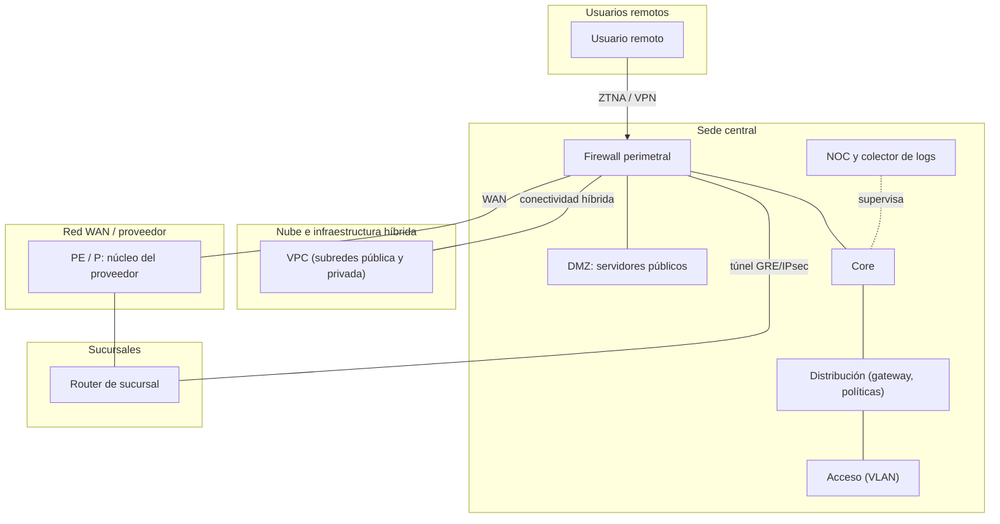
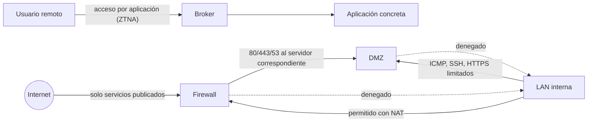

REFERENCIA

# ARQUITECTURA INTEGRAL Y MAPAS DE SÍNTESIS

Los laboratorios usan topologías distintas a propósito: cada uno aísla un mecanismo. Estos mapas **reúnen las piezas** para ver la infraestructura como un **sistema** y no como una colección de dispositivos. No sustituyen las topologías particulares ni son una configuración ejecutable: son un **esquema conceptual**.

## Mapa integral de una infraestructura empresarial

| Zona | Función | Laboratorios |
|------|---------|--------------|
| Acceso, Distribución, Core | Conectar equipos, segmentar y transportar | 03, 05, 11 |
| Firewall y DMZ | Controlar el tráfico entre zonas | 08, 11 |
| Sucursales y túneles | Extender la red a otras sedes | 06, 09 |
| WAN / proveedor | Transporte entre sedes | 10 |
| Nube y acceso remoto | Entornos modernos y Zero Trust | 12 |
| NOC y colector | Observar y diagnosticar | 13, 14 |

## Comparación de tecnologías de conectividad

| Tecnología | Qué resuelve | Cifra | Complejidad | Dónde se practica |
|------------|--------------|-------|-------------|-------------------|
| **Rutas estáticas** | Conectar redes con caminos fijos | No | Baja; no escala | 06, 10 |
| **GRE** | Enlace virtual entre redes no contiguas | No | Baja | 06, 09 |
| **IPsec** | Proteger tráfico entre sedes | Sí | Alta (claves, políticas, NAT-T) | 09 |
| **OpenVPN** | VPN de acceso remoto o sitio a sitio | Sí | Media (PKI en producción) | 09 |
| **WireGuard** | VPN ligera basada en pares de claves | Sí | Baja | 09 |
| **MPLS** | Transporte del proveedor con servicios (L3VPN, QoS) | No por defecto | Alta; lo opera el proveedor | 10 (conceptual) |
| **SD-WAN** | Gestión por políticas sobre varios transportes | Según diseño | Media; control centralizado | 10 (conceptual) |

## Mapa de seguridad y flujo del tráfico

Qué zonas se comunican, quién controla y dónde se aplica la política:

Principios que se repiten: **denegar por defecto**, permitir solo el flujo necesario (**mínimo privilegio**), **no confiar** en la ubicación del origen y **dejar rastro** de lo denegado.

## Matriz de disponibilidad

| Componente | Fallo posible | Mecanismo relacionado | Se practica en |
|------------|---------------|------------------------|----------------|
| Enlace | Pérdida de conectividad | Ruta alternativa (métrica) | 06, 10, 11 |
| Router | Pérdida de *gateway* | VRRP | 15 |
| Ruta | Pérdida de camino | OSPF (reconvergencia) | 15 |
| Servicio | Aplicación inaccesible | Monitoreo y diagnóstico | 13, 14 |
| Segmento | Acceso no autorizado | Firewall y microsegmentación | 08, 12 |
| Salida WAN | Pérdida de Internet con el *gateway* vivo | WAN independiente y seguimiento (`track`) | 15 (caso B) |

!!! warning "Disponibilidad no es presencia de equipos duplicados"
    Un equipo de respaldo solo aporta disponibilidad si hay un mecanismo que **detecte el fallo** y **mueva el tráfico**, y si el respaldo **no comparte** el mismo punto único de fallo (la misma WAN, el mismo *switch*).

Véase también: [Comparaciones conceptuales](comparaciones.md) · [Método de diagnóstico](diagnostico.md).
