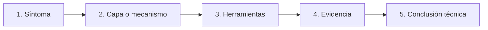
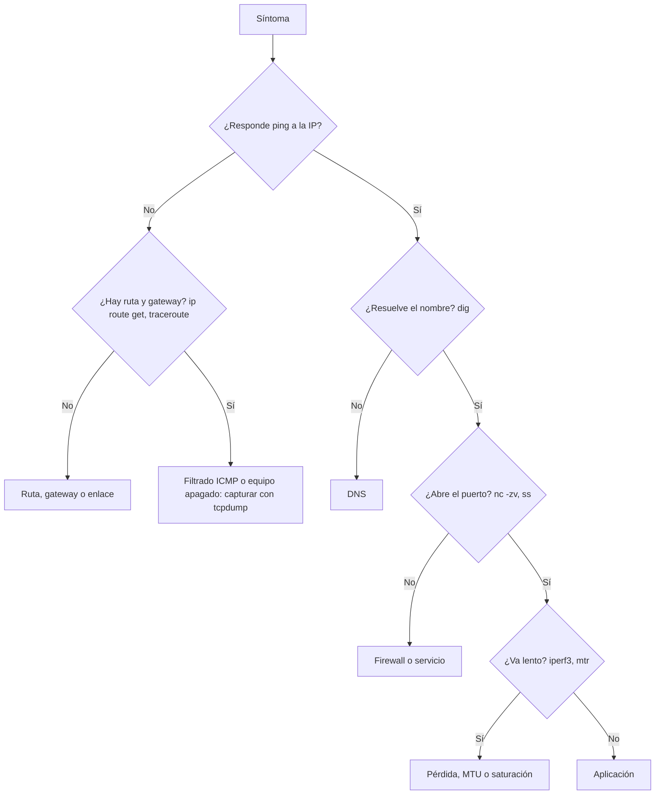

REFERENCIA

# MÉTODO DE DIAGNÓSTICO

Los laboratorios enseñan a configurar y a observar. Esta página propone **cómo razonar** cuando algo no funciona, con el mismo esquema en los 15 laboratorios.

## El esquema en cinco pasos

| Paso | Pregunta | Ejemplo: «el usuario no puede acceder a un servicio» |
|------|----------|--------------------------------------------------------|
| **1. Síntoma** | ¿Qué falla exactamente, para quién y desde cuándo? | Solo Finanzas, desde que cambió el firewall |
| **2. Capa o mecanismo** | ¿Conectividad, ruta, nombre, firewall o aplicación? | Probablemente firewall (afecta a un solo origen) |
| **3. Herramientas** | ¿Qué comando separa las hipótesis? | `ping`, `ip route get`, `nft list`, `ss`, `tcpdump` |
| **4. Evidencia** | ¿Qué funciona y dónde aparece el problema? | Hay ruta y respuesta ARP; los paquetes llegan y no salen |
| **5. Conclusión** | ¿Cuál es la causa probable y la solución? | Falta una regla en `forward` para ese origen |

## De lo simple a lo específico

## Síntomas, herramientas y causas

| Síntoma | Herramientas | Causas posibles |
|---------|--------------|-----------------|
| No llega a la IP | `ip route get`, `traceroute`, `mtr` | Falta ruta o *gateway*, enlace caído, ICMP filtrado |
| Llega a la IP pero no al nombre | `dig`, `resolv.conf` | DNS caído, nombre inexistente, DNS mal anunciado por DHCP |
| Resuelve pero el puerto no abre | `nc -zv`, `ss -tlnp`, `tcpdump` | Regla `DROP`, servicio detenido, escucha en otra IP |
| Conecta pero va lento | `iperf3`, `mtr`, `ping -s` | Pérdida, fragmentación por MTU, saturación |
| Funciona a veces | Capturas, registros, `mtr` | Rutas que alternan, pérdida intermitente |
| Los clientes no obtienen IP | `tcpdump port 67 or port 68`, `nft list` | DHCP no recibe (firewall en `input`), rango agotado |
| Se pierde la adyacencia OSPF | `vtysh -c "show ip ospf neighbor"`, `tcpdump proto ospf` | Protocolo 89 bloqueado, MTU distinta, enlace caído |

## Cinco situaciones para practicar

Cada una se resuelve **razonando** con las herramientas ya vistas; no hace falta construir una topología nueva.

1.  **Un usuario alcanza el *gateway* pero no una aplicación.** Pistas: `ip route get`, `ss` en el servidor, regla en el firewall. ¿Es de ruta, de servicio o de política?
2.  **OSPF pierde una adyacencia.** Pistas: estado de los vecinos, captura del protocolo 89, regla `input`. ¿El problema es del enlace o del filtrado?
3. **El firewall permite el tráfico pero el servicio no es accesible desde fuera.** Pista: ¿existe la traducción de destino (DNAT)? Permitir el reenvío no publica un servicio.
4.  **El *gateway* responde pero no hay salida a Internet.** Pista: ¿el *gateway* tiene una WAN operativa y NAT? (Caso B del laboratorio 15.)
5.  **Una aplicación funciona pero con degradación.** Pistas: `iperf3` (pérdida y *jitter*), `ping -M do -s` (MTU), `mtr` (en qué salto empieza).

!!! info "Qué se espera del razonamiento"
    No hay una única respuesta correcta: lo importante es **descartar capas con evidencia**, no probar comandos al azar. Anota en cada caso qué descartaste y con qué comando.

Véase también: [Comparaciones conceptuales](comparaciones.md) · [Servicios, protocolos y puertos](servicios-puertos.md).
